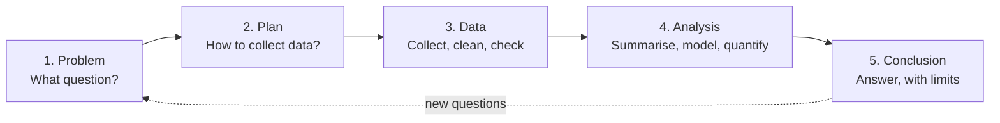
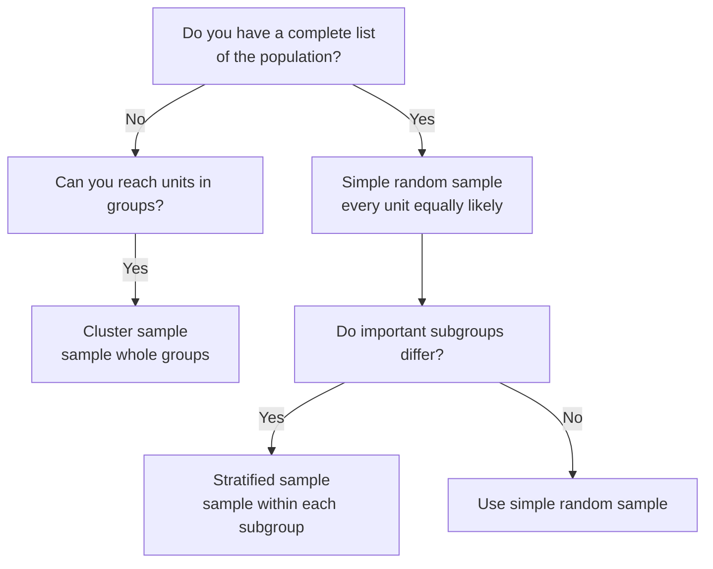
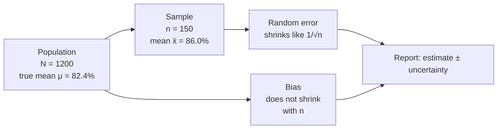

# M01 · Introduction to Probability and Statistics

<div class="psds-meta" markdown>
<span class="psds-chip psds-chip--beginner">Chapter</span>
<span class="psds-chip">6 study hours</span>
<span class="psds-chip">Module overview: [M01](../01-introduction-to-statistics.md)</span>
</div>

## 1. The idea, before any symbols

You already do statistics. When you check how many marks you need in the final exam
to reach a B grade, you are estimating. When a cricket captain decides a player is
"in form" after three good innings, they are generalising from a sample. When a
shopkeeper looks at last week's sales to decide how much stock to order, they are
forecasting from data.

What separates that from *statistics* is discipline. Statistics is the set of
methods for making a statement about something you have **not** seen, using
something you **have** seen — and for saying how wrong the statement might be.

That is the whole subject in one sentence. Everything else in this course is
machinery for doing it carefully:

- what "something you have seen" means, and how to collect it (this chapter),
- how to describe it compactly (M03, M04),
- how to model the randomness behind it (M05–M11),
- how to go from data to claims with quantified uncertainty (M12–M18).

Here is the smallest possible example. A university has 1,200 students in a
programme. You want the average attendance. You could read every register, but that
takes a week. Instead you sample 150 students and find their average attendance is
86.0%. The true average, from the registrar's records, turns out to be 82.4%.

Two numbers, and the interesting part is the gap between them. Statistics is the
study of that gap: how big it is likely to be, why it exists, and how to choose a
sample so that it is small.

## 2. Why this matters

### 2.1 Decisions are made from incomplete information

No hospital knows the true rate of a rare complication; it sees the cases that
arrived. No company knows the true effect of a new app design; it sees the users
who were in the test. No government knows the true unemployment rate; it surveys a
fraction of households. Statistical reasoning is how those gaps get bridged, and
how the bridged claim gets its error bar.

### 2.2 Bad sampling produces confident nonsense

The failure mode is not "a number that is a bit off". It is a **systematic** error
that no amount of extra work removes. In 1936, a magazine surveyed 2.4 million
people and predicted a presidential landslide for the wrong candidate; a rival
pollster asked 50,000 people and got it right. The large sample was recruited from
telephone lists and car registrations — in 1936, a group that was richer than the
population, and therefore unrepresentative. Size was never the problem; selection
was.

The lesson is the single most important one in this chapter: *a bigger biased
sample is still biased*. A million self-selected responses tell you about the
people who answer surveys, not about the population.

### 2.3 Numbers carry authority they have not earned

A percentage with a decimal place looks precise. "73.2% of students prefer…" sounds
like a measurement. Whether it means anything depends on who was asked, how they
were chosen, and what question they were answering. Learning to ask those three
questions is what this chapter is for, and it is the skill that keeps you from
being fooled — as a student, and later as the person producing the number.

## 3. Terminology and notation

Statistics has a small vocabulary that is used with great precision. Learn these
eight words properly and the rest of the course becomes easier to read.

| Term | Meaning | Example |
|---|---|---|
| **Population** | The complete set of units you want to know about | All 1,200 students in the programme |
| **Sample** | The subset you actually observe | The 150 students you surveyed |
| **Unit** (or case, observation) | One member of the population | One student |
| **Variable** | A property measured on each unit | Attendance percentage |
| **Parameter** | A numerical summary of the **population** | Population mean attendance \(\mu\) |
| **Statistic** | A numerical summary of the **sample** | Sample mean attendance \(\bar{x}\) |
| **Census** | A study of the whole population | The registrar reading every register |
| **Sampling frame** | The list you actually sample from | The enrolment database |

### 3.1 Notation you will see from here on

| Symbol | Read as | Meaning |
|---|---|---|
| \(N\) | big N | number of units in the **population** |
| \(n\) | little n | number of units in the **sample** |
| \(\mu\) | mu | population mean (a parameter) |
| \(\bar{x}\) | x-bar | sample mean (a statistic) |
| \(\sigma\) | sigma | population standard deviation |
| \(s\) | s | sample standard deviation |
| \(p\) | p | population proportion |
| \(\hat{p}\) | p-hat | sample proportion |
| \(\theta\) | theta | a generic unknown parameter |
| \(\hat{\theta}\) | theta-hat | an estimate of it |

The hat is a general convention: **a hat means "estimated from data"**. So
\(\hat{p}\) is what you computed, and \(p\) is what you want to know. Keeping those
two apart is the difference between a correct sentence and a wrong one.

!!! note "Population or sample? A habit worth building"

    Greek letters (\(\mu, \sigma, p, \theta\)) are almost always parameters.
    Latin letters and hats (\(\bar{x}, s, \hat{p}\)) are almost always statistics.
    This convention is not universal in every field, but it is used consistently in
    this course, and it is the fastest way to check whether a formula describes what
    you have or what you want.

### 3.2 Variables and scales

Not every variable supports every calculation. Knowing the scale tells you which
summaries are legal.

| Scale | What it allows | Examples | Legal summaries |
|---|---|---|---|
| **Nominal** | Labels only, no order | Gender, city, blood group | Counts, mode, proportions |
| **Ordinal** | Ordered labels, unequal gaps | Grade (A/B/C), Likert rating, pain score | Median, percentiles, counts |
| **Interval** | Equal gaps, arbitrary zero | Temperature in °C, IQ score | Mean, SD (differences only) |
| **Ratio** | Equal gaps, true zero | Height, income, attendance % | Mean, SD, ratios, CV |

Two rules follow immediately, and both are broken constantly:

1. **Averaging labels is meaningless.** "Average blood group" is not a quantity.
   Coding groups as 1, 2, 3 lets software compute a mean, but the number has no
   meaning.
2. **An ordinal average is at best a rough summary.** A mean of a 1–5 satisfaction
   scale is common practice and defensible for comparing groups, but it silently
   assumes the gap between 1 and 2 equals the gap between 4 and 5.

Variables are also **discrete** (countable values: number of siblings) or
**continuous** (any value in a range: height), which matters later when you choose
a distribution in M09 and M10.

## 4. The statistical problem-solving cycle

Every well-run study, from a class project to a national survey, moves through the
same five stages. Professionals name them PPDAC.



**Stage 1 — Problem.** State the question so that data could answer it. "Are
students happy?" is not answerable. "What proportion of second-year students rate
the timetable as adequate or better?" is.

**Stage 2 — Plan.** Decide the population, the sample size, the sampling method,
the variables and their measurement. This is where most studies are won or lost,
because no analysis can repair a badly collected sample.

**Stage 3 — Data.** Collect, then clean. Check ranges, missing values, duplicates
and impossible entries. Record every exclusion and why it was made.

**Stage 4 — Analysis.** Summarise, plot, model. Report uncertainty, not just point
estimates.

**Stage 5 — Conclusion.** Answer the original question in its own terms, and state
what the data do **not** support.

Skipping stage 2 is the most common mistake, and it is invisible in the final
report: a beautifully analysed biased sample still gives a wrong answer.

## 5. How data are collected

### 5.1 Observational studies and experiments

| | Observational study | Experiment |
|---|---|---|
| Researcher assigns treatment? | No | Yes |
| Can establish causation? | Generally no | Yes, if randomised and controlled |
| Example | Survey of smokers and non-smokers | Randomised trial of a teaching method |
| Main threat | Confounding | Ethical and practical limits |

In an **observational** study you watch. In an **experiment** you intervene. Only
intervention with random assignment licenses causal language, which is why M18
returns to experiment design and why the phrase "correlation is not causation" (M16)
is not a slogan but a statement about study design.

### 5.2 Sampling methods

The point of a probability sample is that every unit has a known chance of
selection. That is what allows the mathematics of M12 to say how far a sample
statistic is likely to be from the parameter.



| Method | How it works | Strength | Weakness |
|---|---|---|---|
| **Simple random** | Draw \(n\) units so every subset is equally likely | Unbiased, simple theory | Needs a frame; may miss small groups |
| **Stratified** | Split into strata, sample within each | Guarantees subgroup coverage, lower variance | Needs stratum information |
| **Cluster** | Sample whole groups (schools, villages) | Cheap when travel is expensive | Units in a cluster are similar, so less information per unit |
| **Systematic** | Take every \(k\)-th unit from a list | Easy in the field | Hidden periodicity can bias it |
| **Convenience** | Take whoever is available | Cheap, fast | **No valid inference** — this is not a probability sample |
| **Voluntary response** | People choose to answer | Large numbers | Strongly biased towards strong opinions |

**Worked example 5.1 — Which method?** A study wants 400 households from a
district of 40,000 to estimate internet access.

- A list of households exists → **simple random sample** of 400 from 40,000.
- The district has 8 union councils of unequal size, and access differs sharply
  between urban and rural councils → **stratified** sampling: sample 200 urban and
  200 rural households, then weight back to the district's urban/rural split.
- No list exists and travel is costly → **cluster**: choose 20 villages at random,
  then 20 households in each.

Each is defensible; the choice depends on the frame and the cost, not on taste.

### 5.3 What makes a sample biased

Bias is a systematic departure from the truth that does not shrink with sample
size. The four common sources:

1. **Selection bias** — the frame excludes part of the population. An online survey
   about internet quality excludes people with no internet.
2. **Non-response bias** — the people who do not answer differ from those who do.
   A course feedback form returned by 12% of students is a sample of the 12%.
3. **Measurement bias** — the instrument is wrong. A scale that reads 2 kg heavy
   makes every weight wrong by 2 kg, however many you weigh.
4. **Survivorship bias** — you only see the units that made it. Studying successful
   companies to learn what makes companies successful ignores the failures.

## 6. Mathematical principles: how a statistic differs from a parameter

Here is the idea the rest of the course formalises. Suppose the population mean is
\(\mu\) and you take a sample of size \(n\), computing \(\bar{x}\).

**Fact 1 — a statistic is a random variable.** Before you draw the sample,
\(\bar{x}\) could turn out to be many things. It has a distribution. That
distribution is the subject of M12.

**Fact 2 — sampling error is unavoidable but predictable.** Define the error of
estimation as

\[ e=\bar{x}-\mu. \]

For a probability sample, \(e\) is not systematically positive or negative (it has
mean zero, shown in M12), and its typical size shrinks as \(n\) grows. The precise
statement, derived in M12, is that the standard deviation of \(\bar{x}\) is

\[ \se(\bar{x})=\frac{\sigma}{\sqrt{n}}. \]

**Fact 3 — the square root is the expensive part.** To halve the typical error you
need four times the sample:

\[ \frac{\sigma}{\sqrt{4n}}=\frac{1}{2}\cdot\frac{\sigma}{\sqrt{n}}. \]

That one line explains most sample-size decisions you will ever see, and it is why
surveys stop at a few thousand respondents.

**Fact 4 — bias does not shrink.** If a sample over-represents wealthy households,
the error \(e\) has a component that stays roughly constant as \(n\to\infty\).
Precision (small spread) and accuracy (small bias) are different properties, and
only precision is bought with sample size.

**Distinguishing the two formulas.** In M03 you will meet two standard deviations:

\[ \sigma=\sqrt{\frac{\sum_{i=1}^{N}(x_i-\mu)^{2}}{N}}
   \qquad\text{and}\qquad
   s=\sqrt{\frac{\sum_{i=1}^{n}(x_i-\bar{x})^{2}}{n-1}}. \]

The first describes the **population** (divide by \(N\), use \(\mu\)). The second
estimates it from a **sample** (divide by \(n-1\), use \(\bar{x}\)). They are not
interchangeable: one is a description, the other an estimate. Whenever you meet a
formula in this course, first ask which of the two it is.

## 7. Worked examples

### Example 7.1 — Population, sample, parameter, statistic

A programme has \(N=1{,}200\) students. A sample of \(n=150\) is drawn, and their
mean attendance is \(86.0\%\). The registrar's records show the true mean is
\(82.4\%\).

| Item | Value | Kind |
|---|---|---|
| Students in the programme | 1,200 | \(N\), population size |
| Students surveyed | 150 | \(n\), sample size |
| True mean attendance | 82.4% | \(\mu\), parameter |
| Sample mean attendance | 86.0% | \(\bar{x}\), statistic |
| Error of estimation | \(86.0-82.4 = 3.6\) percentage points | \(e=\bar{x}-\mu\) |

**Reading it.** The sample over-stated attendance by 3.6 points. Is that alarming?
Not by itself — sample means vary. What matters is how large such gaps usually are,
which needs \(\sigma\) and \(n\) (M12). What would be alarming is a *known reason*
the sample should be high: if the survey was conducted in lecture halls, it excluded
students who do not attend, and the error would not be random at all.

### Example 7.2 — Classify the variables

For each variable, give the scale and say whether it is discrete or continuous.

| Variable | Scale | Type | Why |
|---|---|---|---|
| Blood group (A, B, AB, O) | Nominal | Discrete | Labels, no order |
| Grade (A, B, C, D, F) | Ordinal | Discrete | Ordered, gaps not equal |
| Daily temperature (°C) | Interval | Continuous | Equal gaps, 0 °C is not "no heat" |
| Family income (PKR) | Ratio | Continuous | True zero, ratios meaningful |
| Number of siblings | Ratio | Discrete | Counts, true zero |
| Satisfaction (1–5) | Ordinal | Discrete | Ordered categories |
| Waiting time (minutes) | Ratio | Continuous | True zero, ratios meaningful |

**The trap.** Because the software accepts a column of 1s and 2s, students compute
the mean of a nominal variable. The mean of "1 = male, 2 = female" is 1.47, and it
means nothing. Always identify the scale before summarising.

### Example 7.3 — Two samples, one population: which is more informative?

A university wants the average monthly mobile-data usage of its 8,000 students.

- **Sample A:** 500 students chosen at random from the enrolment list.
- **Sample B:** 3,000 students who responded to an Instagram poll.

Sample B is six times larger. Which estimate should you trust, and why?

**Answer.** Sample A. The enrolment list covers the population and every student has
a known chance of selection, so sampling error is quantifiable and shrinks with
\(n\). Sample B is a voluntary-response sample: it over-represents students who
follow the account and care enough to answer, and that group is plausibly different
in data usage. Its larger size reduces random error while leaving the systematic
error untouched, and no formula can correct it.

This is the answer to "but the sample was huge" in every argument about online
polls.

### Example 7.4 — A screening test, and what a positive result means

A district of 10,000 people is screened for a disease with prevalence 2%. The test
has **sensitivity** 90% (it detects 90% of true cases) and **specificity** 95% (it
correctly clears 95% of healthy people). A person tests positive. What is the
probability they actually have the disease?

This is a preview of Bayes' theorem (M07), included here because it shows why
intuition about data is unreliable.

**Step 1 — how many have the disease?** \(2\%\) of 10,000 \(=200\) people.
**Step 2 — how many test positive among them?** \(90\%\) of 200 \(=180\) (true
positives); 20 are missed.
**Step 3 — how many are healthy?** \(10{,}000-200=9{,}800\).
**Step 4 — how many test positive among the healthy?** \(5\%\) of 9,800 \(=490\)
(false positives).
**Step 5 — total positives.** \(180+490=670\).
**Step 6 — the answer.**

\[ \Pr(\text{disease}\mid +)=\frac{180}{670}\approx 0.269\approx 26.9\%. \]

| | Test positive | Test negative | Total |
|---|---|---|---|
| **Disease** | 180 | 20 | 200 |
| **Healthy** | 490 | 9,310 | 9,800 |
| **Total** | 670 | 9,330 | 10,000 |

**Reading it.** A "90% accurate" test gives a positive result that is wrong about
73% of the time, because healthy people vastly outnumber sick ones. The test is not
bad; the base rate is low. Any statement of the form "the test was positive,
therefore…" requires the prevalence. This table is the fastest correct way to do the
calculation, and M07 derives it formally.

### Example 7.5 — Simpson's paradox: when the obvious summary misleads

Two treatments for a condition are compared. Patients arrive either **mild** or
**severe**, and severity is recorded.

| | Mild: recovered | Severe: recovered | All: recovered |
|---|---|---|---|
| **Treatment A** | 60 of 100 (60%) | 60 of 300 (20%) | 120 of 400 (**30%**) |
| **Treatment B** | 150 of 300 (50%) | 10 of 100 (10%) | 160 of 400 (**40%**) |

**Overall**, B looks better: 40% versus 30%. **Within each severity group**, A looks
better: 60% versus 50% for mild, 20% versus 10% for severe.

Both statements are arithmetically correct. They disagree because the groups are
mixed differently: A was given mostly to severe patients (300 of 400), B mostly to
mild ones (300 of 400). In this (constructed) example, severity is a **confounder**
— it affects both which treatment you get and whether you recover.

**Correct conclusion.** A is the better treatment for each type of patient; B's
higher overall rate comes entirely from being given to easier cases. And the deeper
lesson: an aggregated table can reverse the comparison that matters. Whenever a
summary surprises you, split it by the variable that determined who got what.

### Example 7.6 — From question to study design (the full cycle)

**Question.** Do students who attend more lectures get better grades?

1. **Problem.** Refine to: "Among second-year BS Data Science students, is there an
   association between attendance percentage and final marks, and how strong is it?"
2. **Plan.** Population: the 1,200 second-years. Sample: 200 randomly chosen.
   Variables: attendance (ratio, from the register), final marks (ratio). Design:
   observational — we cannot randomise attendance.
3. **Data.** Pull registers and results; drop students who withdrew (and record
   why); check for impossible values (attendance above 100%).
4. **Analysis.** Scatterplot, correlation, regression (M16), with the caveat that
   attendance may be a proxy for motivation.
5. **Conclusion.** "Students with higher attendance tended to score higher
   (r = 0.42, n = 196). This is an association; attending more may help, or
   motivated students may both attend and study."

Note how stage 5 refuses the causal sentence. That refusal is not modesty; it is the
honest limit of the design.

## 8. Common mistakes and misconceptions

| # | Mistake | Why it is wrong | Correct habit |
|---|---|---|---|
| 1 | "A bigger sample is always better." | Size does not fix selection bias. | Ask *how* the sample was drawn before asking how big it is. |
| 2 | "The sample mean is the population mean." | It is an estimate with sampling error. | Attach an uncertainty, or say "about". |
| 3 | "\(\bar{x}\) and \(\mu\) are the same thing with different notation." | One is data, one is the unknown truth. | Greek = parameter, hat/bar = statistic. |
| 4 | "Averaging ordinal labels is fine." | It assumes equal gaps that do not exist. | Use median or proportions for ordinal data. |
| 5 | "Correlation shows that X causes Y." | Association can arise from confounding or reverse causation. | Only randomisation supports causal claims. |
| 6 | "If the test is 99% accurate, a positive means 99% likely." | Base rates dominate (Example 7.4). | Build the 2×2 table first. |
| 7 | "Outliers should always be deleted." | Some outliers are the finding; some are errors. | Investigate, then decide and record the decision. |
| 8 | "The sample was random because we asked randomly chosen people who replied." | Non-response is its own selection. | Report the response rate alongside the result. |
| 9 | "More decimal places means more precision." | Digits describe the report, not the data. | Round to the precision the data support. |
| 10 | "Statistics proves things." | It quantifies evidence; it rarely proves. | Say "consistent with" and give the error rate. |

## 9. How this connects to Data Science

| Data-science activity | What M01 supplies |
|---|---|
| Reading a model's accuracy on a test set | The test set is a sample; its score is a statistic with sampling error |
| A/B testing a feature | Random assignment is the experiment design in §5.1 |
| Survey or feedback analysis | Bias sources (§5.3) determine whether the numbers mean anything |
| Dashboard metrics | Aggregation can hide confounding (Example 7.5) |
| Data collection pipelines | Variable scales decide which transformations and summaries are legal |
| "The model works in production" | Distribution shift is a sampling problem: your training sample no longer matches the population |

The most valuable habit from this chapter is the first question you should ask of
any number: **"who was measured, and who was not?"**

## 10. Real-world scenarios

**A polio vaccination campaign in Punjab.** Coverage is estimated from a household
survey, not from clinic records — clinic records only contain families who come to
clinics. The survey uses cluster sampling by union council, because no household
list exists. The reported coverage is a *statistic*; the campaign's decision depends
on how far it might be from the true coverage, which is why the survey also reports
a confidence interval (M14).

**Sugar prices and the cost of living.** A news report says the average retail price
of sugar rose 12% over a year. Which average — of which cities, weighted how? A
simple mean across 20 cities treats a small town and Karachi equally. A
population-weighted mean tells a different story. The formula is arithmetic; the
judgement is about the population you claim to describe.

**Cricket selection and small samples.** A batter scores 40, 12 and 90 in three
innings and is called "consistent". Three observations cannot distinguish a good
player from a lucky one. Selectors who over-read small samples make predictable
errors — the same error as a company that changes its pricing after one week of
data.

**Netflix-style recommendation experiments.** A streaming service tests a new
artwork on 2% of users at random, because a self-selected group ("users who clicked
the survey banner") would not represent the audience. The random 2% costs almost
nothing and is the only reason the resulting lift estimate can be trusted.

**A university admission model.** If a model is trained on students who enrolled, it
never sees applicants who were rejected. Any claim about "who would succeed" is a
claim about a population the data do not contain — survivorship bias in machine
learning form.

## 11. Visual explanations

### 11.1 Population, sample and the two kinds of error



*What to look at:* the two arrows leaving the population. Random error is the price
of not measuring everything; bias is a defect in how you sampled. Only the first
responds to more data.

### 11.2 The four scales, as a ladder of permitted arithmetic

| Level | Operation allowed | Example |
|---|---|---|
| Nominal | = , ≠ | Blood group |
| Ordinal | = , ≠ , < , > | Grade |
| Interval | + , − (differences) | Temperature °C |
| Ratio | + , − , × , ÷ (ratios) | Income |

*What to look at:* each step down adds one operation. If you use an operation that
is not in the row, the result is not meaningful — whatever the software prints.

### 11.3 Sensitivity, specificity and base rate

```
10,000 people tested, prevalence 2%
┌───────────────────────────────┬──────────┬─────────┐
│                               │   Test + │  Test − │
├───────────────────────────────┼──────────┼─────────┤
│ Have disease        (200)     │     180  │    20   │
│ Healthy           (9,800)     │     490  │ 9,310   │
└───────────────────────────────┴──────────┴─────────┘
                    positives: 670  →  PPV = 180/670 = 26.9%
```

*What to look at:* the lower-left cell. It is larger than the upper-left cell, and
it is the entire explanation for why an accurate test can give a misleading positive.

## 12. Practice exercises

★ = guided, ★★ = application, ★★★ = challenge. Solutions follow.

**Exercise 1 (★).** For each, state whether the quantity is a parameter or a
statistic: (a) the mean mark of all 300 students in a course, computed from the
marks file; (b) the mean mark of 40 students you asked; (c) the proportion of
Pakistani adults who own a smartphone, as reported by a survey of 2,000 adults;
(d) the proportion in (c) as it truly is.

**Exercise 2 (★).** Classify each variable by scale and type: (a) number of emails
received per day; (b) city of residence; (c) rating of a food delivery app from 1 to
5; (d) time to complete a 5 km run; (e) month of birth.

**Exercise 3 (★).** A population has \(N=5{,}000\) units. You draw \(n=250\).
Compute the sampling fraction \(n/N\) and explain in one sentence why it matters
that it is small.

**Exercise 4 (★★).** A university wants to estimate the proportion of students who
use the library at least once a week. It emails a survey to all 12,000 students and
receives 900 replies. Identify two distinct sources of bias and state the direction
each would push the estimate.

**Exercise 5 (★★).** A test has sensitivity 95% and specificity 90%. Prevalence in
the tested population is 10%. Using a hypothetical population of 1,000 people, build
the 2×2 table and compute the probability that a person who tests positive has the
disease.

**Exercise 6 (★★).** In a study of 200 employees, average monthly salary is
PKR 85,000 with standard deviation PKR 20,000. A second study samples 800 employees
from the same population. Using \(\se(\bar{x})=\sigma/\sqrt{n}\), compute the
standard error in each study and state how many times more precise the second is.

**Exercise 7 (★★★).** A company reports that "87% of users love the new design",
based on 4,300 responses to a banner shown to 60,000 users. Explain, in at most six
sentences, why this cannot support the claim, and describe the design you would run
instead. Include what you would report that the original report omits.

**Exercise 8 (★★★).** Reconstruct a Simpson's paradox. Using only the numbers
given in Example 7.5, show the arithmetic that produces the overall rates 30% and
40%, then state one sentence a journalist might write that would be misleading and
one that would be accurate.

**Exercise 9 (★★★).** Explain why increasing the sample size from 500 to 5,000
reduces the typical error by a factor of about 3.16, not 10. Derive the factor from
\(\sigma/\sqrt{n}\).

## 13. Solutions

**Solution 1.** (a) Parameter — it summarises all 300 students, the whole
population of interest. (b) Statistic — computed from a sample of 40.
(c) Statistic — a survey of 2,000 is a sample of the adult population.
(d) Parameter — the unknown truth the survey is trying to estimate.

**Solution 2.** (a) Ratio, discrete (a count with a true zero). (b) Nominal,
discrete. (c) Ordinal, discrete (ordered categories; gaps not guaranteed equal).
(d) Ratio, continuous (true zero at 0 minutes). (e) Nominal (cyclical labels; not
ordinal, despite the numbering of months).

**Solution 3.** \(n/N=250/5{,}000=0.05\), i.e. 5%. Because the sample is a small
fraction of the population, sampling is effectively with replacement for the
purposes of the standard error; the finite-population correction \((N-n)/(N-1)\)
would change \(\se(\bar{x})\) by only about 2.5% (M12).

**Solution 4.** Two distinct sources:

1. **Non-response bias.** Students who use the library may be more likely to read
   email or to answer a library survey, pushing the estimate **up**.
2. **Frame/selection bias.** Students who rarely check university email are less
   likely to see the survey at all, again pushing the estimate **up** (since
   non-users are under-represented).

A third, also acceptable: **measurement ambiguity** — "use the library" is undefined
(entering the building? borrowing? studying?), which could push the estimate either
way depending on interpretation.

**Solution 5.** Population 1,000, prevalence 10% → 100 diseased, 900 healthy.

- True positives: \(0.95\times 100=95\). Missed: 5.
- False positives: \(10\%\) of 900 \(=90\) (since specificity 90% means 10% of
  healthy test positive). Correct negatives: 810.
- Total positives: \(95+90=185\).

\[ \Pr(\text{disease}\mid +)=\frac{95}{185}\approx 0.514\approx 51.4\%. \]

| | Test + | Test − | Total |
|---|---|---|---|
| Disease | 95 | 5 | 100 |
| Healthy | 90 | 810 | 900 |
| Total | 185 | 815 | 1,000 |

So even with a good test, a positive result is only slightly more likely than not
to be a true positive at 10% prevalence.

**Solution 6.** First study: \(\se=\dfrac{20{,}000}{\sqrt{200}}\). Since
\(\sqrt{200}\approx 14.14\),

\[ \se_1\approx\frac{20{,}000}{14.14}\approx \text{PKR }1{,}414. \]

Second study: \(\sqrt{800}\approx 28.28\),

\[ \se_2\approx\frac{20{,}000}{28.28}\approx \text{PKR }707. \]

The ratio is \(\se_1/\se_2=\sqrt{800/200}=\sqrt{4}=2\). The second study is
**twice** as precise, from four times the data — the square-root law at work.

**Solution 7.** Model answer (six sentences): The 4,300 responses are 7.2% of the
60,000 users shown the banner and are a voluntary-response sample, not a random one.
Users who dislike the design are less likely to answer a banner asking whether they
like it, so the direction of the bias is strongly upward. Nothing in the report says
how many were shown the banner, how many responded, or whether the banner was shown
to all users equally. "Love" is also undefined: there is no stated question or scale,
so the 87% could measure almost anything. Finally, a single percentage with no
uncertainty and no comparison group cannot show that the design is an improvement.
Instead: randomly assign 50% of users to the new design and 50% to the current one,
define a behavioural metric (for example, task completion or 7-day retention), and
report both groups' values with a confidence interval and the sample size. Report
what the original omits: response rate, the exact question, the metric definition,
randomisation, and uncertainty.

**Solution 8.** Overall rates:
\(\;120/400=0.30\;\) and \(\;160/400=0.40.\) Stratum rates:
\(60/100=0.60\), \(60/300=0.20\); \(150/300=0.50\), \(10/100=0.10\). The overall
figure is a weighted average of the stratum rates, with weights given by the mix of
patients: A's overall \(=0.25(0.60)+0.75(0.20)=0.15+0.15=0.30\); B's overall
\(=0.75(0.50)+0.25(0.10)=0.375+0.025=0.40\).

*Misleading:* "Treatment B is more effective, with a 40% recovery rate against 30%
for Treatment A." *Accurate:* "Treatment A had higher recovery rates in both mild and
severe cases, but was given mostly to severe cases, so its overall rate is lower."

**Solution 9.** The standard error is \(\sigma/\sqrt{n}\), so the ratio of errors is

\[ \frac{\se_{500}}{\se_{5000}}
   =\frac{\sigma/\sqrt{500}}{\sigma/\sqrt{5000}}
   =\sqrt{\frac{5000}{500}}=\sqrt{10}\approx 3.16. \]

Reducing error by a factor of 10 would require \(n\) to grow by \(10^{2}=100\), that
is from 500 to 50,000. Precision scales with the square root of effort, which is why
the last decimal place is so expensive.

## 14. Knowledge check

Answer without looking back. Answers follow.

1. A sample of 300 students is used to estimate the mean height of 12,000 students.
   Which symbol denotes the quantity you are estimating?
2. True or false: doubling the sample size halves the standard error. Explain.
3. A variable records educational level as Primary / Secondary / Tertiary. Which
   measure of centre is appropriate, and why not the mean?
4. Name the four sources of bias in §5.3.
5. A test with 99% specificity and 99% sensitivity is applied where prevalence is
   0.1%. Is a positive result more likely to be true or false? (No computation
   required — reason from the base rate.)
6. In an observational study, attendance correlates with grades at \(r=0.42\).
   Write one sentence that is supported and one that is not.
7. What does a large \(n\) with a convenience sample guarantee? 
8. A report says "average household income rose 8%". Name two questions you must ask
   before believing the comparison.
9. In the 1936 poll example, why did the larger sample give the worse answer?
10. Which stage of the PPDAC cycle can no later analysis repair, and why?

### Answers

1. \(\mu\) (the population mean); the sample mean is \(\bar{x}\).
2. **False.** The standard error is \(\sigma/\sqrt{n}\), so doubling \(n\) divides
   it by \(\sqrt{2}\approx1.41\). Halving it needs four times the sample.
3. The **median** (or the mode, or proportions). The categories are ordered but the
   gaps between Primary, Secondary and Tertiary are not equal, so an average treats
   them as equally spaced numbers.
4. Selection bias, non-response bias, measurement bias, survivorship bias.
5. **False.** At 0.1% prevalence, healthy people outnumber cases roughly 999 to 1, so
   the 1% of healthy people who test positive vastly outnumber the true positives. A
   positive is more likely false.
6. Supported: "Students who attended more lectures tended to score higher."
   Not supported: "Attending lectures raises marks."
7. Nothing about representativeness. It reduces random error only; a convenience
   sample remains biased however large it is.
8. (i) Which population and which average — mean or median, which cities, weighted
   how? (ii) Is it a nominal or real change, and is the comparison like-for-like over
   the same period and the same basket?
9. Because the sample was drawn from telephone and car-registration lists, which in
   1936 covered a richer-than-average part of the population. The bias was
   systematic, and size does not reduce systematic error.
10. **Stage 2, Plan.** If the sample is selected or measured badly, the defect is
    built into the data; analysis can only describe the flawed sample precisely.

## 15. Revision summary

**The one-sentence version.** Statistics turns data into claims about a population,
and attaches a quantified uncertainty to those claims.

**Vocabulary to own.** Population / sample; parameter / statistic; census; sampling
frame; unit; variable; observational study / experiment; the four scales (nominal,
ordinal, interval, ratio); discrete / continuous.

**Notation.** \(N, n\) for sizes; \(\mu,\sigma,p\) for parameters; \(\bar{x},s,\hat{p}\)
for statistics; a hat means "estimated from data".

**Key relationships.**

\[ e=\bar{x}-\mu, \qquad \se(\bar{x})=\frac{\sigma}{\sqrt{n}}, \qquad
   \se(4n)=\tfrac{1}{2}\se(n). \]

**Sampling methods.** Simple random, stratified, cluster, systematic — all
probability samples. Convenience and voluntary response are not, and no sample size
repairs them.

**Four biases.** Selection, non-response, measurement, survivorship.

**Two formulas, never interchangeable.** Population SD divides by \(N\) and uses
\(\mu\); sample SD divides by \(n-1\) and uses \(\bar{x}\).

**Three habits.**

1. Ask who was measured and who was not, before reading the number.
2. Split an aggregate before trusting a surprising comparison (Simpson's paradox).
3. Refuse causal language unless the design earned it.

**Next.** M02 builds the mathematical language — sets, summation, functions, limits,
derivatives and integrals — that every later formula is written in.

**Run it.** [Practical 01 — Descriptive statistics from examination data](../../practicals/notebooks/01-descriptive-statistics.ipynb) · [all practicals](../../practicals/index.md)

---

**Previous:** [Module overview](../01-introduction-to-statistics.md) ·
**Next:** [M02 · Mathematical Foundations for Statistics](../02-mathematical-foundations.md)
