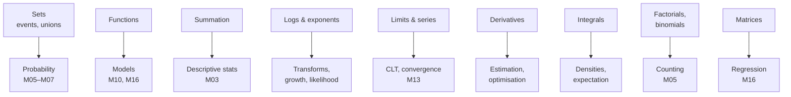

# M02 · Mathematical Foundations for Statistics

<div class="psds-meta" markdown>
<span class="psds-chip psds-chip--beginner">Chapter</span>
<span class="psds-chip">12 study hours</span>
<span class="psds-chip">Module overview: [M02](../02-mathematical-foundations.md)</span>
</div>

## 1. The idea, before any symbols

Every formula in this course is a sentence in a compact language. "The mean is the
sum of the observations divided by how many there are" becomes

\[ \bar{x}=\frac{1}{n}\sum_{i=1}^{n}x_i. \]

That is not a different claim — it is the same claim, written so that it can be
manipulated. The purpose of this chapter is to teach you to read and write that
language fluently enough that a derivation becomes a sequence of obvious steps rather
than a magic trick.

You need seven pieces of it:

1. **Sets** — to talk about events and outcomes (M05–M07).
2. **Functions** — to describe relationships between variables (M03, M16).
3. **Summation notation** — to write sums without writing them out.
4. **Exponents and logarithms** — for growth, ratios and skewed data.
5. **Limits and series** — for convergence, the CLT and \(e\) (M13).
6. **Derivatives and integrals** — for maxima, densities and expectations (M08–M10).
7. **Factorials, binomial coefficients and matrices** — for counting and regression
   (M05, M16).

Nothing here is abstract for its own sake. Each item appears later in a specific
place, and this chapter says where.

## 2. Why this matters

Three practical reasons.

**Formulas you can manipulate are formulas you can trust.** If you know that
\(\sum (x_i-\bar{x})=0\), you can explain why the sample variance divides by
\(n-1\) instead of \(n\). If you only know the formula, you cannot.

**Data science is written in this notation.** A log transform, a gradient, a
probability density, a matrix of predictors — each assumes the tools below. Reading
documentation for `scikit-learn` or a paper about A/B testing requires them.

**Most errors are not statistical, they are algebraic.** Confusing
\(\sum x_i^2\) with \((\sum x_i)^2\) is the single most common arithmetic error in
statistics, and it is an error about notation.

## 3. Sets and set notation

A **set** is a collection of distinct objects. In probability, the objects are
outcomes.

| Notation | Meaning | Example |
|---|---|---|
| \(S\) or \(\Omega\) | the sample space: all possible outcomes | Rolling a die: \(\{1,2,3,4,5,6\}\) |
| \(A\subseteq S\) | \(A\) is a subset of \(S\) (an **event**) | \(A=\{2,4,6\}\) = "even" |
| \(x\in A\) | \(x\) belongs to \(A\) | \(4\in A\) |
| \(A^{c}\) | complement: everything not in \(A\) | \(A^{c}=\{1,3,5\}\) |
| \(A\cup B\) | union: in \(A\) **or** \(B\) or both | \(\{2,4\}\cup\{4,5\}=\{2,4,5\}\) |
| \(A\cap B\) | intersection: in both | \(\{2,4\}\cap\{4,5\}=\{4\}\) |
| \(\varnothing\) | empty set | "odd and even" |
| \(\lvert A\rvert\) | number of elements in \(A\) | \(\lvert\{2,4,6\}\rvert=3\) |
| \(A\setminus B\) | set difference | \(\{2,4,6\}\setminus\{4\}=\{2,6\}\) |

Two identities do most of the work later:

\[ (A\cup B)^{c}=A^{c}\cap B^{c}, \qquad (A\cap B)^{c}=A^{c}\cup B^{c}, \]

and the **counting rule** for a union, which appears again as the addition rule in
M06:

\[ \lvert A\cup B\rvert=\lvert A\rvert+\lvert B\rvert-\lvert A\cap B\rvert. \]

*Why the subtraction?* Because elements in both sets are counted twice. The formula
adds them twice, so it removes one copy.

## 4. Functions

A **function** \(f\) takes an input and returns exactly one output: \(y=f(x)\). The
set of allowed inputs is the **domain**; the set of outputs is the **range**.

| Function | Form | Where it appears |
|---|---|---|
| Linear | \(f(x)=a+bx\) | Regression (M16) |
| Quadratic | \(f(x)=ax^{2}+bx+c\) | Least squares, variance |
| Exponential | \(f(x)=ae^{bx}\) | Growth, decay, Poisson pmf (M09) |
| Logarithmic | \(f(x)=a+b\ln x\) | Skewed data, log-scale plots |
| Logistic | \(f(x)=\dfrac{1}{1+e^{-x}}\) | Probability models, ML classifiers |
| Power | \(f(x)=ax^{b}\) | Heavy-tailed data, allometry |

### 4.1 The logistic function, briefly

\[ \sigma(x)=\frac{1}{1+e^{-x}} \]

It maps any real number into \((0,1)\), so it can turn a score into a probability.
At \(x=0\), \(\sigma(0)=0.5\); as \(x\to\infty\), \(\sigma(x)\to1\); as
\(x\to-\infty\), \(\sigma(x)\to0\). You will meet it as the inverse of the log-odds
in logistic regression, which is the standard model for binary outcomes.

## 5. Summation and product notation

### 5.1 Summation

\[ \sum_{i=1}^{n}x_i=x_1+x_2+\cdots+x_n \]

The letter \(i\) is the **index**; it takes each integer value from the lower limit
to the upper limit, and the terms are added. The index is a dummy: \(\sum_{i=1}^{n}
x_i\) and \(\sum_{j=1}^{n}x_j\) are the same number.

**Three rules you will use constantly.**

1. **Constant multiple:** \(\displaystyle\sum_{i=1}^{n}c\,x_i=c\sum_{i=1}^{n}x_i\).
2. **Sum:** \(\displaystyle\sum_{i=1}^{n}(x_i+y_i)=\sum_{i=1}^{n}x_i+\sum_{i=1}^{n}y_i\).
3. **Constant term:** \(\displaystyle\sum_{i=1}^{n}c=nc\) — you add \(c\) to itself
   \(n\) times.

**Two formulas worth memorising.**

\[ \sum_{i=1}^{n}i=\frac{n(n+1)}{2}, \qquad
   \sum_{i=1}^{n}i^{2}=\frac{n(n+1)(2n+1)}{6}. \]

*Derivation of the first.* Write the sum forwards and backwards and add column by
column:

\[
\begin{aligned}
S &= 1+2+\cdots+n,\\
S &= n+(n-1)+\cdots+1.
\end{aligned}
\]

Each column sums to \(n+1\), and there are \(n\) columns, so \(2S=n(n+1)\) and
\(S=n(n+1)/2\). This is the pairing argument, and it works for \(n=100\) in one line.

**Product notation.** \(\displaystyle\prod_{i=1}^{n}x_i=x_1x_2\cdots x_n\). It
appears in likelihoods (M14), where a product of \(n\) probabilities becomes a sum
after taking logs — which is why logarithms matter next.

### 5.2 A warning that prevents a whole class of errors

\[ \sum_{i=1}^{n}x_i^{2}\ \neq\ \left(\sum_{i=1}^{n}x_i\right)^{2}. \]

With the numbers \(1,2,3\): the left side is \(1+4+9=14\); the right side is
\(6^{2}=36\). The first is the sum of squares; the second is the square of the sum.
Variance uses the first; a squared total uses the second.

## 6. Exponents, logarithms and growth

### 6.1 Exponent rules

\[ a^{m}a^{n}=a^{m+n},\qquad \frac{a^{m}}{a^{n}}=a^{m-n},\qquad
   (a^{m})^{n}=a^{mn},\qquad a^{0}=1,\qquad a^{-n}=\frac{1}{a^{n}}. \]

### 6.2 Logarithms

The logarithm answers "to what power must the base be raised?":

\[ \log_{b}(x)=y \iff b^{y}=x. \]

So \(\log_{10}(1000)=3\) because \(10^{3}=1000\), and \(\ln(e^{2})=2\).

\[ \log(xy)=\log x+\log y,\qquad \log\!\left(\frac{x}{y}\right)=\log x-\log y,
   \qquad \log(x^{k})=k\log x. \]

**The three identities that matter in practice.**

- **Products become sums.** Likelihoods (M14) and independence (M07) both exploit
  this.
- **Ratios become differences.** A log difference is approximately a percentage
  change: \(\ln(1+r)\approx r\) for small \(r\). Check: \(\ln(1.12)=0.1133\), and
  12% is 0.12.
- **Skew becomes symmetry.** Income, city populations and website traffic are
  right-skewed; their logs are often nearly symmetric, which is why log transforms
  are standard before plotting or modelling.

**Change of base.** \(\log_{b}x=\dfrac{\ln x}{\ln b}\). Only two bases matter: base
\(e\) (natural log, \(\ln\)) in mathematics, and base 2 for doubling times and
information.

### 6.3 Growth and doubling time

If a quantity grows by a fixed proportion \(r\) each period, after \(t\) periods it
is \(A(1+r)^{t}\). To find when it doubles, solve

\[ (1+r)^{t}=2 \;\Longrightarrow\; t=\frac{\ln 2}{\ln(1+r)}. \]

At \(r=8\%\), \(t=0.6931/0.07696\approx 9.0\) years — the familiar "rule of 72"
(\(72/8=9\)) is a mental approximation to this calculation.

### 6.4 Compounding continuously

If interest is compounded \(n\) times a year at nominal rate \(r\), the balance
after one year is \(A(1+r/n)^{n}\). As \(n\to\infty\) this tends to \(Ae^{r}\). That
limit is the definition of \(e\):

\[ e=\lim_{n\to\infty}\left(1+\frac{1}{n}\right)^{n}\approx 2.71828. \]

## 7. Limits and series

### 7.1 Limits

\(\displaystyle\lim_{x\to a}f(x)=L\) means \(f(x)\) gets arbitrarily close to \(L\)
as \(x\) approaches \(a\). Two limits used later:

\[ \lim_{x\to1}\frac{x^{2}-1}{x-1}=\lim_{x\to1}(x+1)=2,
   \qquad \lim_{n\to\infty}\left(1+\frac{1}{n}\right)^{n}=e. \]

The first is computed by factoring before substituting, because direct substitution
gives \(0/0\) — an **indeterminate form**, not an answer.

Limits are how "approximately normal for large \(n\)" (M13) is made precise: the
distribution of a standardised mean converges to the standard normal as
\(n\to\infty\).

### 7.2 Series

A **series** is a sum of many terms. The geometric series is the one you must know:

\[ \sum_{k=0}^{n-1}ar^{k}=a\,\frac{1-r^{n}}{1-r}\quad (r\neq1),
   \qquad \sum_{k=0}^{\infty}ar^{k}=\frac{a}{1-r}\quad (\lvert r\rvert<1). \]

*Derivation (finite case).* Let \(S=\sum_{k=0}^{n-1}ar^{k}\). Then
\(rS=\sum_{k=1}^{n}ar^{k}\). Subtracting,

\[ S-rS=S(1-r)=a-ar^{n}=a(1-r^{n}), \]

so \(S=a(1-r^{n})/(1-r)\). Taking \(n\to\infty\) with \(\lvert r\rvert<1\) sends
\(r^{n}\to0\), giving \(a/(1-r)\). This telescoping trick is the standard tool for
summing probabilities of a geometric distribution (M09).

## 8. Derivatives

The derivative is the instantaneous rate of change:

\[ f'(x)=\lim_{h\to0}\frac{f(x+h)-f(x)}{h}. \]

In statistics it does three jobs: finding maxima of likelihoods (M14), finding
least-squares estimates (M16), and describing densities (M10).

### 8.1 Rules

| Rule | Statement |
|---|---|
| Constant | \(\dfrac{d}{dx}c=0\) |
| Power | \(\dfrac{d}{dx}x^{n}=nx^{n-1}\) |
| Constant multiple | \(\dfrac{d}{dx}\big(cf\big)=cf'\) |
| Sum | \((f+g)'=f'+g'\) |
| Product | \((fg)'=f'g+fg'\) |
| Quotient | \(\left(\dfrac{f}{g}\right)'=\dfrac{f'g-fg'}{g^{2}}\) |
| Chain | \(\dfrac{d}{dx}f(g(x))=f'(g(x))\,g'(x)\) |
| Exponential | \(\dfrac{d}{dx}e^{x}=e^{x}\), \(\dfrac{d}{dx}e^{kx}=ke^{kx}\) |
| Logarithm | \(\dfrac{d}{dx}\ln x=\dfrac{1}{x}\) |

*Derivation of the power rule for \(n=2\), from the definition:*

\[
\frac{(x+h)^{2}-x^{2}}{h}=\frac{x^{2}+2xh+h^{2}-x^{2}}{h}=2x+h
\;\xrightarrow[h\to0]{}\;2x.
\]

The same expansion gives \(3x^{2}\) for \(n=3\), and the pattern generalises.

*Derivation of \(\frac{d}{dx}\ln x=\frac{1}{x}\):* differentiate both sides of
\(e^{\ln x}=x\) with the chain rule: \(e^{\ln x}\cdot\frac{d}{dx}\ln x=1\), so
\(x\cdot\frac{d}{dx}\ln x=1\) and the result follows.

### 8.2 Optimisation

A maximum or minimum of a differentiable function occurs where \(f'(x)=0\)
(**stationary point**). To classify it, use the second derivative: \(f''<0\) means
concave (maximum), \(f''>0\) means convex (minimum).

**Worked example 8.1 — maximising revenue.** A shop can sell \(q=1000-20p\) units
at price \(p\) rupees. Revenue is

\[ R(p)=p(1000-20p)=1000p-20p^{2}. \]

Differentiate: \(R'(p)=1000-40p\). Setting \(R'=0\) gives \(p=25\).
Since \(R''(p)=-40<0\), it is a maximum. The quantity is
\(q=1000-20(25)=500\) and the revenue is \(R=25\times500=\text{PKR }12{,}500\).

Check at a nearby price: \(p=24\) gives \(q=520\) and \(R=12{,}480\); \(p=26\) gives
\(q=480\) and \(R=12{,}480\). Both are lower, as expected.

## 9. Integration

Integration accumulates. The definite integral \(\int_{a}^{b}f(x)\,dx\) is the
signed area under \(f\) from \(a\) to \(b\). In probability it computes probability
from a density (M10):

\[ \Pr(a\le X\le b)=\int_{a}^{b}f(x)\,dx. \]

### 9.1 The fundamental theorem

If \(F'(x)=f(x)\), then

\[ \int_{a}^{b}f(x)\,dx=F(b)-F(a). \]

Integration and differentiation are inverse operations, which is why every
differentiation rule above has an integration counterpart.

### 9.2 Standard integrals

| Function | Integral |
|---|---|
| \(x^{n}\) (\(n\neq-1\)) | \(\dfrac{x^{n+1}}{n+1}+C\) |
| \(\dfrac{1}{x}\) | \(\ln\lvert x\rvert+C\) |
| \(e^{kx}\) | \(\dfrac{1}{k}e^{kx}+C\) |
| \(c\) (constant) | \(cx+C\) |

*Derivation of \(\int_{0}^{1}x^{2}dx=\frac13\) from first principles.* Split
\([0,1]\) into \(n\) strips of width \(1/n\) and use right endpoints:

\[ \sum_{k=1}^{n}\left(\frac{k}{n}\right)^{2}\frac{1}{n}
   =\frac{1}{n^{3}}\sum_{k=1}^{n}k^{2}
   =\frac{1}{n^{3}}\cdot\frac{n(n+1)(2n+1)}{6}
   =\frac{(n+1)(2n+1)}{6n^{2}}. \]

As \(n\to\infty\) this tends to \(2/6=1/3\), matching
\(\left[x^{3}/3\right]_{0}^{1}\).

### 9.3 Improper integrals

A density such as \(f(x)=\lambda e^{-\lambda x}\) for \(x\ge0\) has an infinite
range. Its total area must be 1:

\[ \int_{0}^{\infty}\lambda e^{-\lambda x}dx
   =\Big[-e^{-\lambda x}\Big]_{0}^{\infty}=0-(-1)=1. \]

That single calculation is why the exponential density is normalised, and it is the
first thing to check whenever you meet a new density function.

## 10. Factorials, binomial coefficients and matrices

### 10.1 Factorials

\(n!=n(n-1)(n-2)\cdots1\), with \(0!=1\) by convention. So \(4!=24\) and
\(5!=120\). Factorials count **arrangements** (M05).

### 10.2 Binomial coefficients

\[ \binom{n}{k}=\frac{n!}{k!\,(n-k)!} \]

counts the ways to choose \(k\) items from \(n\) without regard to order. For
example, \(\binom{10}{3}=120\), and the symmetry \(\binom{n}{k}=\binom{n}{n-k}\)
holds because choosing what to include is the same as choosing what to exclude.

The binomial theorem follows from these coefficients:

\[ (a+b)^{n}=\sum_{k=0}^{n}\binom{n}{k}a^{n-k}b^{k}. \]

Check with \(n=3\): the coefficients are \(1,3,3,1\), and
\((a+b)^{3}=a^{3}+3a^{2}b+3ab^{2}+b^{3}\).

### 10.3 Matrices, only as far as M16 needs

A **matrix** is a rectangular array of numbers; \(X^{\top}\) is its transpose
(rows and columns swapped). Multiplying a \(3\times2\) matrix by its transpose gives
a \(2\times2\) matrix:

\[
X=\begin{pmatrix}1&2\\1&4\\1&6\end{pmatrix},
\qquad
X^{\top}X=\begin{pmatrix}3&12\\12&56\end{pmatrix}.
\]

Check the entries: the top-left is \(1\cdot1+1\cdot1+1\cdot1=3\) (the column of ones
summed); the top-right is \(1\cdot2+1\cdot4+1\cdot6=12\); the bottom-right is
\(2^{2}+4^{2}+6^{2}=56\). Regression (M16) inverts a matrix of exactly this form,
which is why collinearity (near-singularity) ruins standard errors.

## 11. Worked examples

### Example 11.1 — Sets with real survey data

In a survey of 500 students, 280 use Facebook, 190 use Instagram and 90 use both.
How many use at least one, and how many use neither?

\[ \lvert F\cup I\rvert=280+190-90=380, \qquad 500-380=120. \]

So 380 use at least one platform and 120 use neither. In probability notation, if a
student is chosen at random, \(\Pr(F\cup I)=380/500=0.76\). Without the subtraction
you would report 470 users, which is more than the number who use either.

### Example 11.2 — Summation in practice

Compute \(\sum_{i=1}^{50}(3i-2)\).

Split it into familiar pieces:

\[ \sum_{i=1}^{50}(3i-2)=3\sum_{i=1}^{50}i-\sum_{i=1}^{50}2
   =3\cdot\frac{50\cdot51}{2}-2\cdot50=3(1275)-100=3725. \]

(The second term is a constant repeated 50 times, hence \(2\times50\).)

### Example 11.3 — Logs, decibels and earthquake magnitude

Sound intensity in decibels is \(10\log_{10}(I/I_0)\). A sound 1,000 times more
intense than the reference is \(10\log_{10}(1000)=10\times3=30\) dB. Earthquake
magnitude is logarithmic too: an increase of 1.0 in magnitude is a tenfold increase
in amplitude. **Reading it:** a "small" change on a log scale is a large change in
the underlying quantity, which is why log scales are used for quantities that span
orders of magnitude.

### Example 11.4 — A limit and a series together

A savings account pays 8% per year. Starting with PKR 50,000, what is the balance
after 5 years, and how long does it take to double?

\[ 50{,}000(1.08)^{5}=50{,}000\times1.4693\approx \text{PKR }73{,}466. \]

Doubling time: \(t=\ln 2/\ln 1.08=0.6931/0.0770\approx9.0\) years. Compounded
continuously at the same nominal rate, the balance after 5 years is
\(50{,}000e^{0.4}=50{,}000\times1.4918\approx\text{PKR }74{,}591\) — slightly more,
because continuous compounding compounds infinitely often.

### Example 11.5 — An integral as a probability

The time to the next customer at a counter is exponential with rate \(\lambda=0.5\)
per minute, so \(f(t)=0.5e^{-0.5t}\) for \(t\ge0\). What is the probability of
waiting more than 2 minutes?

\[ \Pr(T>2)=\int_{2}^{\infty}0.5e^{-0.5t}dt
   =\Big[-e^{-0.5t}\Big]_{2}^{\infty}=0+ e^{-1}\approx0.368. \]

About 36.8% of waits exceed 2 minutes. Note the shape of the answer: probabilities
from exponential models are always \(e^{-\lambda t}\), a fact used repeatedly in
M10.

### Example 11.6 — Binomial coefficients in a real count

A committee of 3 is chosen from 10 students. How many committees are possible?

\[ \binom{10}{3}=\frac{10!}{3!\,7!}=\frac{10\cdot9\cdot8}{3\cdot2\cdot1}=120. \]

If instead the three roles (chair, secretary, treasurer) matter, order counts and the
answer is \(10\cdot9\cdot8=720\) — six times larger, because each committee can be
arranged in \(3!=6\) ways. That factor of \(3!\) is exactly the relationship between
permutations and combinations derived in M05.

### Example 11.7 — A derivative that answers a business question

A delivery service's cost per parcel is modelled as
\(C(q)=0.02q^{2}+3q+500\) rupees for \(q\) parcels. Marginal cost is
\(C'(q)=0.04q+3\). At \(q=100\), \(C'(100)=7\) rupees: the 101st parcel costs about
7 rupees more. At \(q=1{,}000\), \(C'(1000)=43\) rupees. Marginal cost — the
derivative — is the number a pricing decision needs.

## 12. Common mistakes and misconceptions

| # | Mistake | Why it is wrong | Correct |
|---|---|---|---|
| 1 | \(\sum x_i^2=(\sum x_i)^2\) | Sum of squares ≠ square of sum | \(14\) vs \(36\) for \(1,2,3\) |
| 2 | \(\log(a+b)=\log a+\log b\) | The rule is for **products** | \(\log(ab)=\log a+\log b\) |
| 3 | \(\sqrt{a+b}=\sqrt a+\sqrt b\) | Same error, different function | Test with \(a=b=4\): \(\sqrt8\neq4\) |
| 4 | \((a+b)^2=a^2+b^2\) | Missing the cross term | \((a+b)^2=a^2+2ab+b^2\) |
| 5 | \(d/dx\,(fg)=f'g'\) | Product rule is not multiplicative | \((fg)'=f'g+fg'\) |
| 6 | \(\int \frac1x dx=\ln x\) always | Undefined for \(x<0\) | \(\ln\lvert x\rvert+C\) |
| 7 | "Dividing by zero is fine if \(n\) is large" | Undefined is undefined | Check denominators; a zero variance breaks \(t\)-statistics |
| 8 | \(0/0=0\) or \(1\) | It is indeterminate | Factor and take a limit |
| 9 | "\(=\)" used for approximations | Turns a bound into a claim | Write \(\approx\) and state the error |
| 10 | Cancelling inside sums | Sums do not cancel term by term | Write the terms out when unsure |

## 13. How this connects to Data Science

| Technique | Mathematics from this chapter |
|---|---|
| Log-transforming a skewed metric | §6.2 — logs turn ratios into differences and compress tails |
| Gradient descent | §8 — the gradient is a vector of partial derivatives |
| Maximum-likelihood fitting | §8.2 — set the derivative of the log-likelihood to zero |
| Probability from a density | §9 — integrate the density over a range |
| Counting outcomes in a simulation | §10.1–10.2 — factorials and binomial coefficients |
| Regression in matrix form | §10.3 — \(X^{\top}X\) and its inverse |
| Reading a model's "log loss" | §6.2 — a log of a probability is a negative penalty |
| Interpreting an elasticity | §8 — percentage change per percentage change is a derivative on a log scale |

## 14. Real-world scenarios

**Inflation in Pakistan.** If prices rise 12% a year, they double in
\(\ln 2/\ln 1.12=6.1\) years. A student planning a four-year degree should expect
prices roughly \(1.12^{4}=1.57\) times higher at graduation — which is why
"the fee is fixed" and "the fee rises with inflation" are very different
commitments.

**Mobile data plans.** A plan offering "up to 20 Mbps" and one offering "up to
100 Mbps" differ by a factor of 5, but users perceive the difference
logarithmically: what feels like "twice as fast" is often a fivefold increase.

**Earthquake reporting.** The 2005 Kashmir earthquake was magnitude 7.6; a magnitude
6.6 event releases about 32 times less energy (each whole number is ~31.6×). Reading
magnitudes as ordinary numbers leads to badly wrong intuitions about danger.

**Medical test thresholds.** A screening rule of the form "flag if the score exceeds
\(c\)" is a step function, and choosing \(c\) is a trade-off between two integrals
(the tails of the healthy and diseased distributions). That is §9 applied to a
decision.

## 15. Visual explanations

### 15.1 The map of this chapter



*What to look at:* every box is a later module. This chapter is a toolkit, and each
tool has a named job.

### 15.2 Linear versus log scale

| Value | Linear axis position | Log₁₀ axis position |
|---|---|---|
| 1 | 1 | 0 |
| 10 | 10 | 1 |
| 100 | 100 | 2 |
| 1,000 | 1,000 | 3 |
| 10,000 | 10,000 | 4 |

*What to look at:* on a log axis, each row is one equal step. Equal *ratios* become
equal *distances*, which is why a log axis makes a heavy-tailed distribution legible.

### 15.3 The derivative as a slope, the integral as an area

```
f(x)            slope of the tangent  →  f'(x)
f(x)            area under the curve  →  ∫ f(x) dx

  f(x)=x²                     f(x)=x (uniform density on [0,1])
   │      ·                    │──────────
   │    ·                      │          │
   │  ·                        │          │
   └──────── x                 └────────── x
   slope at x is 2x            area = 1
```

*What to look at:* both panels describe the same function \(x^{2}\) if you integrate
it, or \(x\) if you differentiate it — which is the point of the fundamental theorem.

## 16. Practice exercises

**Exercise 1 (★).** Evaluate (a) \(\sum_{i=1}^{10}i\), (b) \(\sum_{i=1}^{10}i^{2}\),
(c) \(\sum_{i=1}^{4}(2i+1)\).

**Exercise 2 (★).** Simplify: (a) \(\log_{2}32\), (b) \(\ln(e^{3})\),
(c) \(\log_{10}(0.001)\), (d) \(e^{0}\).

**Exercise 3 (★).** Compute \(\binom{6}{2}\), \(\binom{6}{4}\) and \(5!\). Explain
why the first two are equal.

**Exercise 4 (★★).** In a class of 60, 35 study Python, 28 study R and 15 study
both. How many study at least one language, and how many study neither? Express the
first answer as a probability for a randomly chosen student.

**Exercise 5 (★★).** Differentiate: (a) \(f(x)=3x^{4}-2x+7\);
(b) \(g(x)=x\ln x\); (c) \(h(x)=e^{-2x}\). Then find the maximum of
\(f(x)=12x-x^{2}\).

**Exercise 6 (★★).** Evaluate \(\int_{0}^{2}3x^{2}dx\) and
\(\int_{1}^{e}\frac{1}{x}dx\). Interpret each as an area.

**Exercise 7 (★★).** A quantity grows 5% per year. Find the doubling time exactly
and compare it with the rule of 72. Then find the growth factor over 10 years.

**Exercise 8 (★★★).** Show that \(\sum_{i=1}^{n}(x_i-\bar{x})=0\) using the
summation rules, where \(\bar{x}=\frac1n\sum x_i\). Explain in one sentence why this
forces the sample variance to divide by \(n-1\).

**Exercise 9 (★★★).** Using the geometric series, show that if
\(\Pr(X=k)=(1-p)^{k-1}p\) for \(k=1,2,\dots\), then the probabilities sum to 1.

## 17. Solutions

**Solution 1.** (a) \(10\cdot11/2=55\). (b) \(10\cdot11\cdot21/6=385\).
(c) \(3+5+7+9=24\) (or \(2(1+2+3+4)+4=20+4\)).

**Solution 2.** (a) \(5\), since \(2^{5}=32\). (b) \(3\). (c) \(-3\), since
\(10^{-3}=0.001\). (d) \(1\).

**Solution 3.** \(\binom62=\frac{6!}{2!4!}=15\); \(\binom64=\frac{6!}{4!2!}=15\);
\(5!=120\). They are equal by the symmetry \(\binom nk=\binom n{n-k}\): choosing 2
to include is the same as choosing 4 to exclude.

**Solution 4.** \(\lvert P\cup R\rvert=35+28-15=48\). Neither: \(60-48=12\).
Probability for a random student: \(48/60=0.80\).

**Solution 5.**

(a) \(f'(x)=12x^{3}-2\).
(b) product rule: \(g'(x)=1\cdot\ln x+x\cdot\frac1x=\ln x+1\).
(c) chain rule: \(h'(x)=-2e^{-2x}\).

For \(f(x)=12x-x^{2}\): \(f'(x)=12-2x=0\Rightarrow x=6\); \(f''=-2<0\), so a
maximum, with \(f(6)=72-36=36\).

**Solution 6.** \(\int_{0}^{2}3x^{2}dx=\left[x^{3}\right]_{0}^{2}=8-0=8\).
\(\int_{1}^{e}\frac1x dx=\left[\ln x\right]_{1}^{e}=1-0=1\).
The first is the area under \(3x^{2}\) between 0 and 2; the second is the area under
\(1/x\) between 1 and \(e\).

**Solution 7.** \(t=\ln2/\ln1.05=0.6931/0.04879=14.2\) years; the rule of 72 gives
\(72/5=14.4\) years, close. Growth factor over 10 years:
\(1.05^{10}=1.6289\), about a 63% increase.

**Solution 8.**

\[ \sum_{i=1}^{n}(x_i-\bar{x})=\sum x_i-\sum\bar{x}
   =\sum x_i-n\bar{x}=\sum x_i-\sum x_i=0, \]

using \(n\bar{x}=\sum x_i\). Because the \(n\) deviations always sum to zero, only
\(n-1\) of them are free to vary — the last is determined by the others. Dividing by
\(n-1\) corrects for that lost degree of freedom, which is why \(s^2\) is unbiased
and the \(n\)-divisor version is not (M12, M14).

**Solution 9.** Sum over all \(k\):

\[ \sum_{k=1}^{\infty}(1-p)^{k-1}p=p\sum_{j=0}^{\infty}(1-p)^{j}
   =p\cdot\frac{1}{1-(1-p)}=\frac{p}{p}=1, \]

using the geometric series with ratio \(r=(1-p)\) and first term \(a=1\). The
substitution \(j=k-1\) is what turns the sum into the standard form.

## 18. Knowledge check

1. Write \(\sum_{i=1}^{4}x_i^{2}\) and \((\sum_{i=1}^{4}x_i)^{2}\) for
   \(x=(2,3,5,6)\). Are they equal?
2. State the three logarithm rules that turn a product into a sum, a ratio into a
   difference, and a power into a multiple.
3. What is \(\lim_{x\to1}\frac{x^{2}-1}{x-1}\), and why can you not simply
   substitute \(x=1\)?
4. A function has \(f'(3)=0\) and \(f''(3)=4\). Is \(x=3\) a maximum or a minimum?
5. What does \(\int_{0}^{\infty}f(x)dx=1\) certify about \(f\)?
6. Give the value of \(\binom{8}{3}\) and say what it counts.
7. Why does the geometric series converge only when \(\lvert r\rvert<1\)?
8. If a metric grows 7% per year, roughly how long until it doubles?
9. In \(X^{\top}X\), what does the top-left entry equal when the first column of
   \(X\) is all ones?
10. Rewrite \(\ln(a^{2}b/c)\) as a sum and difference of logs.

### Answers

1. Sum of squares: \(4+9+25+36=74\). Square of sum: \(16^{2}=256\). Not equal.
2. \(\log(xy)=\log x+\log y\); \(\log(x/y)=\log x-\log y\); \(\log(x^{k})=k\log x\).
3. \(2\), after factoring \((x-1)(x+1)\). Direct substitution gives \(0/0\), which is
   indeterminate, not a value.
4. A minimum, because \(f''>0\) (convex).
5. That \(f\) is a valid probability density: non-negative and integrating to 1, so
   total probability is 1.
6. \(56\) — the number of ways to choose 3 items from 8 without regard to order.
7. Because \(r^{n}\to0\) is required for the remainder \(ar^{n}/(1-r)\) to vanish; for
   \(\lvert r\rvert\ge1\) the terms do not shrink and the sum diverges.
8. \(\ln2/\ln1.07=0.6931/0.0677\approx10.2\) years (rule of 72 gives 10.3).
9. The number of rows of \(X\), i.e. \(n\), the sample size.
10. \(2\ln a+\ln b-\ln c\).

## 19. Revision summary

**Sets.** \(A\cup B\), \(A\cap B\), \(A^{c}\); \(\lvert A\cup B\rvert=\lvert A\rvert+\lvert B\rvert-\lvert A\cap B\rvert\).

**Summation.** Rules for constants and sums; \(\sum i=n(n+1)/2\);
\(\sum i^{2}=n(n+1)(2n+1)/6\). Never confuse \(\sum x_i^{2}\) with
\((\sum x_i)^{2}\).

**Logs.** \(\log(xy)=\log x+\log y\); log differences are percentage changes;
\(\log_{b}x=\ln x/\ln b\).

**Limits and series.** \(0/0\) is indeterminate — factor. Geometric sum
\(a(1-r^{n})/(1-r)\); infinite sum \(a/(1-r)\) for \(\lvert r\rvert<1\);
\(e=\lim(1+1/n)^{n}\).

**Derivatives.** Power, product, quotient, chain; \(e^{kx}\), \(\ln x\). Set \(f'=0\)
and use \(f''\) to classify. This is how every maximum-likelihood estimate is found.

**Integrals.** \(\int x^{n}dx=x^{n+1}/(n+1)\); \(\int \frac1x dx=\ln\lvert x\rvert\);
\(\int e^{kx}dx=e^{kx}/k\). Probability is area under a density.

**Counting.** \(n!\), \(\binom nk=n!/(k!(n-k)!)\), symmetry, binomial theorem.

**Matrices.** \(X^{\top}X\) appears in regression; near-singularity is collinearity.

**Three habits.** Write the terms out when a rule is unclear; check a formula on two
numbers before trusting it; ask which symbols are parameters and which are data.

**Next.** M03 uses summation, quantiles and the two standard-deviation formulas on
real datasets.

**Run it.** [Practical 02 — Mathematical foundations](../../practicals/notebooks/02-mathematical-foundations.ipynb) · [all practicals](../../practicals/index.md)

---

**Previous:** [M01 chapter](../01-introduction-to-statistics/chapter.md) ·
**Next:** [M03 · Data and Descriptive Statistics](../03-data-and-descriptive-statistics.md)
