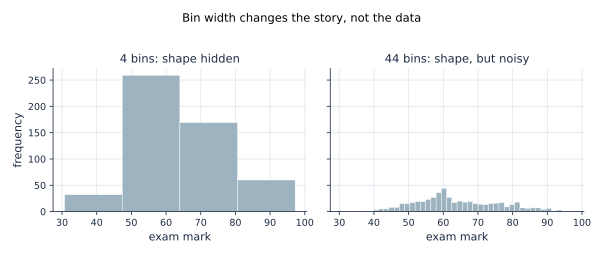
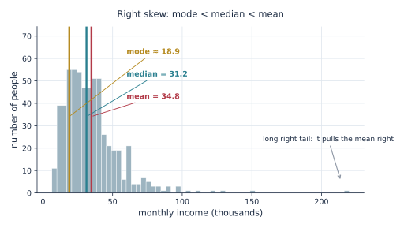
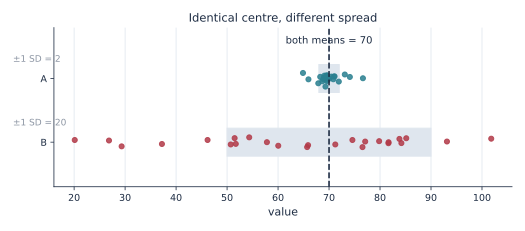
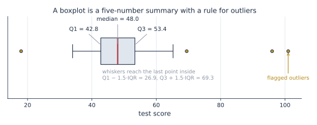
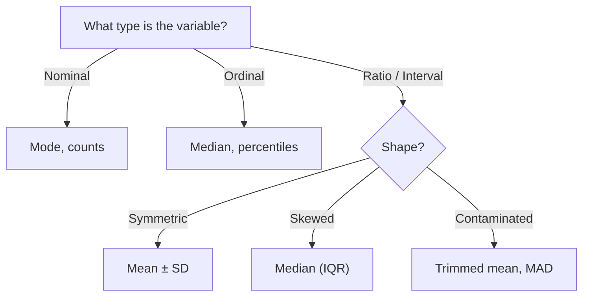

# M03 · Data and Descriptive Statistics

<div class="psds-meta" markdown>
<span class="psds-chip psds-chip--beginner">Chapter</span>
<span class="psds-chip">14 study hours</span>
<span class="psds-chip">Module overview: [M03](../03-data-and-descriptive-statistics.md)</span>
</div>

## 1. The idea, before any symbols

A dataset is a crowd of numbers. Nobody can read a crowd, so we replace it with two
or three numbers: a **typical value** and a **typical distance from that value**.

That is all descriptive statistics is. Everything else in this chapter is about
choosing those two numbers honestly, because the choice is not neutral:

- The mean of the marks below is 68.3; the median is 64. They describe the same ten
  students and give different pictures, and which one is "right" depends on what you
  are trying to say.
- The spread matters as much as the centre. A hospital with an average waiting time
  of 30 minutes is very different if every patient waits 30 minutes than if half wait
  5 and half wait 55.
- A single summary can be arithmetically correct and substantively misleading. Half
  of this chapter is about that.

## 2. Why this matters

**You cannot model what you cannot describe.** Every later method — regression,
hypothesis tests, machine learning — assumes you know the distribution of your
variables. Looking at them first is not a preliminary; it is the analysis.

**Most data problems are found here, not later.** Missing values coded as `-999`,
duplicated rows, a height of 1,700 cm, a date in 2099: these are visible in a
five-number summary and invisible in a model until they have distorted it.

**Summaries are where data gets misused.** "Average salary" can mean the mean
(pulled up by three executives) or the median (what a typical employee earns). Two
honest people can report different numbers from the same file. This chapter teaches
you to say which you mean, and to spot when someone else has not.

## 3. From units to variables: the data rectangle

Data is usually organised as a rectangle:

| student_id | programme | year | attendance_% | marks | Fee paid (PKR) |
|---|---|---|---|---|---|
| S001 | BSDS | 2 | 92 | 88 | 145,000 |
| S002 | BSDS | 2 | 78 | 71 | 145,000 |
| S003 | BSDS | 3 | 64 | 55 | 138,000 |

- A **row** is a unit (a case, an observation).
- A **column** is a **variable**.
- A **cell** is a value.

Three questions to ask of any such table before computing anything:

1. What is one row? (A student? A student-term? A course registration?)
2. What are the units of each column? (Percent, rupees, count, code?)
3. What does a missing cell mean? (Not measured? Not applicable? Refused?)

Getting the row definition wrong is the most damaging error in practice: if rows are
course registrations, a student taking five courses is counted five times, and every
summary describes registrations rather than students.

### 3.1 Scales, restated for practice

| Scale | Arithmetic allowed | Typical summaries |
|---|---|---|
| Nominal | counts only | mode, proportions, bar chart |
| Ordinal | order only | median, percentiles, stacked bar |
| Interval | differences | mean, SD, histogram |
| Ratio | all operations | mean, SD, CV, ratios, log-ratio |

Two consequences used repeatedly below:

- For **ordinal** data, report the median and the distribution, not the mean.
- For **ratio** data, a coefficient of variation is meaningful; for interval data
  (temperature in °C) it is not, because the zero is arbitrary.

## 4. Data quality: what goes wrong before analysis

### 4.1 Missing data

| Mechanism | Meaning | Effect on the mean |
|---|---|---|
| **MCAR** (missing completely at random) | Missingness unrelated to anything | Unbiased, just less precise |
| **MAR** (missing at random) | Missingness depends on observed variables | Biased if ignored; correctable with modelling |
| **MNAR** (missing not at random) | Missingness depends on the missing value itself | Biased and not correctable without assumptions |

Example: 8% of students do not report family income. If those students are simply
richer or poorer than average, the complete-case mean is biased (MNAR-like). If they
are missing for an unrelated administrative reason, it is not (MCAR).

**Practical rule:** report the number missing and the reason, per variable. A model
that silently drops 300 rows is a model of the remaining rows.

### 4.2 The other five defects

| Defect | Example | Check |
|---|---|---|
| Out-of-range values | Height 1,700 cm | Min/max against plausible bounds |
| Impossible combinations | Age 14 with a PhD | Cross-field rules |
| Duplicates | Same student twice | Count distinct IDs vs rows |
| Inconsistent coding | "Male", "M", "male" | Frequency table of each category |
| Sentinel codes | `-999` for missing | Frequency table; suspicious round numbers |

A frequency table of every categorical variable and a five-number summary of every
numeric variable will catch all six defects in most real datasets. That is a
ten-minute check that saves days.

## 5. Frequency distributions

Before summarising, count.

| Marks band | Midpoint \(m_i\) | Frequency \(f_i\) | Cumulative \(F_i\) | Relative \(f_i/n\) |
|---|---|---|---|---|
| 40–50 | 45 | 3 | 3 | 0.075 |
| 50–60 | 55 | 5 | 8 | 0.125 |
| 60–70 | 65 | 8 | 16 | 0.200 |
| 70–80 | 75 | 12 | 28 | 0.300 |
| 80–90 | 85 | 9 | 37 | 0.225 |
| 90–100 | 95 | 3 | 40 | 0.075 |
| **Total** | | **40** | | **1.000** |

Two things this table gives you that a mean does not: **where the mass is** (the
70–80 band, 30%) and **how the values accumulate** (16 of 40 students, 40%, score
below 70).

Band boundaries matter. Using 40–49, 50–59, … with integer marks produces a visual
gap that does not exist. Convention: make bands **mutually exclusive and exhaustive**;
for continuous data the boundary belongs to the upper band by convention.


[](../../assets/images/figures/fig-03-03-histogram-bins.svg)

*Figure 5.1 — one dataset, two bin widths*

**What it shows.** Bin width is a choice, not a property of the data. Four bins hide the second group completely; forty-four bins show it but add noise. Always state the binning, and try at least two widths before describing a shape. The underlying counts are identical in both panels.

## 6. Measures of centre

### 6.1 The arithmetic mean

\[ \bar{x}=\frac{1}{n}\sum_{i=1}^{n}x_i \]

*Derivation of the definition:* "add up all values and divide by how many there
are" — that is exactly the formula. Its two algebraic properties do the real work.

**Property 1 — deviations sum to zero.**

\[ \sum_{i=1}^{n}(x_i-\bar{x})=\sum x_i-n\bar{x}=\sum x_i-\sum x_i=0. \]

**Property 2 — the mean minimises squared error.** For any constant \(c\),

\[ \sum (x_i-c)^{2}=\sum (x_i-\bar{x})^{2}+n(\bar{x}-c)^{2}, \]

which is smallest at \(c=\bar{x}\). So the mean is the "least-squares" centre — the
reason regression and ANOVA are built on it.

**When to use it:** ratio or interval data, roughly symmetric, no extreme outliers.
**When not to:** skewed incomes, house prices, waiting times with a long tail.

### 6.2 The median

Order the values; the median splits them in half. For \(n\) observations,

\[ \text{median}=
\begin{cases}
x_{(n+1)/2}, & n \text{ odd},\\
\tfrac12\left(x_{n/2}+x_{n/2+1}\right), & n \text{ even},
\end{cases}
\]

where \(x_{(k)}\) is the \(k\)-th value in sorted order.

The median is **robust**: it ignores how far the extreme values are, only where they
fall. That is why income and house-price reports use it.

### 6.3 The mode

The most frequent value. The only sensible centre for nominal data ("most common
city"). A dataset can be bimodal, and then no single centre is honest — report both
modes.

### 6.4 Weighted mean

When observations represent different numbers of units,

\[ \bar{x}_w=\frac{\sum w_i x_i}{\sum w_i}. \]

Course grades are the standard example: coursework 20%, midterm 30%, final 50%.

### 6.5 Geometric mean

For growth factors or ratios, average by multiplication:

\[ \bar{x}_g=\left(\prod_{i=1}^{n}x_i\right)^{1/n}. \]

It is always \(\le\) the arithmetic mean for positive values, and equal only when
all values are equal.

### 6.6 Trimmed mean

Delete the smallest \(k\) and largest \(k\) values, average the rest. A 10% trimmed
mean with \(n=10\) drops one from each end. It keeps more information than the
median while resisting outliers.

### 6.7 Choosing a centre

| Data | Centre | Why |
|---|---|---|
| Symmetric, ratio | Mean | Uses all information; minimal squared error |
| Skewed (income, prices) | Median | Not dragged by the tail |
| Ordinal | Median | Means assume equal gaps |
| Nominal | Mode | Only order-free summary |
| Growth rates, ratios | Geometric mean | Compounds correctly |
| Contaminated data | Trimmed mean | Robust, still uses most values |


[](../../assets/images/figures/fig-03-01-centre.svg)

*Figure 6.1 — mode, median and mean on the same right-skewed data*

**What it shows.** The three averages answer different questions. The mode sits at the tallest bar, the median splits the count in half, and the mean is dragged right by the long tail. When the mean exceeds the median the distribution is right-skewed; reversing the inequality means left skew. On income data the median is the honest 'typical' value, and the gap between the two is itself the simplest skew diagnostic you can compute.

## 7. Measures of spread

Centre alone is not a description. These two datasets have the same mean and nothing
else in common:

\[ A=(68,69,70,71,72), \qquad B=(10,40,70,100,130). \]

Both have mean 70. \(A\)'s values are within 2 of each other; \(B\)'s span 120.

### 7.1 Range and interquartile range

\[ \text{range}=\max-\min, \qquad \text{IQR}=Q_3-Q_1. \]

The range uses two values and is fragile. The IQR uses the middle 50% and is robust
— which is why boxplots are drawn from it.

**Quartile conventions.** Different software computes quartiles slightly differently
(including or excluding the median). With \(n=10\), the lower half is the first five
values, so \(Q_1\) is their median. The difference between conventions is small and
matters mainly for small samples; state the convention if you report quartiles to
one decimal place.

### 7.2 Variance and standard deviation

**Population variance** (a description, when you have every unit):

\[ \sigma^{2}=\frac{1}{N}\sum_{i=1}^{N}(x_i-\mu)^{2}. \]

**Sample variance** (an estimate, when you have \(n\) of \(N\)):

\[ s^{2}=\frac{1}{n-1}\sum_{i=1}^{n}(x_i-\bar{x})^{2}. \]

**Why \(n-1\)?** The \(n\) deviations sum to zero, so once \(n-1\) of them are known
the last is determined: only \(n-1\) pieces of information about spread remain. The
divisor is the **degrees of freedom**. Dividing by \(n-1\) makes \(s^{2}\) unbiased,
in the sense that \(\E[s^{2}]=\sigma^{2}\) (proved in M12). Dividing by \(n\)
produces a value that is systematically a little too small.

**Standard deviation** is the square root, so it is in the data's own units:

\[ \sigma=\sqrt{\sigma^{2}}, \qquad s=\sqrt{s^{2}}. \]


[](../../assets/images/figures/fig-03-02-spread.svg)

*Figure 7.1 — identical centres, different spreads*

**What it shows.** Both rows average 70, so a report that quotes only the mean describes them as the same. The shaded band is one standard deviation either side of the mean: in A it covers almost every observation, in B only a third of them. Spread is not a detail of the summary — it is half the summary.

### 7.3 Coefficient of variation

\[ \text{CV}=\frac{s}{\bar{x}}, \]

usually as a percentage. It compares variability across variables with different
units or very different means. It requires a **ratio** scale with a meaningful zero:
CV of temperature in °C is meaningless.

### 7.4 Mean absolute deviation

\[ \text{MAD}=\frac{1}{n}\sum_{i=1}^{n}\lvert x_i-\bar{x}\rvert. \]

Less common than the SD but easier to explain ("average distance from the mean") and
less sensitive to squaring large deviations.

### 7.5 Which spread?

| Situation | Use | Note |
|---|---|---|
| Symmetric data, SD meaningful | SD | Same units as data |
| Skewed or ordinal | IQR | Report with median |
| Comparing across units | CV | Needs a true zero |
| Explaining to non-specialists | MAD or IQR | "Typical distance" |
| Reporting an estimate's precision | Standard error | Different quantity — see M12; \(\se=s/\sqrt{n}\) |

**The SD is not the standard error.** The SD describes how spread out the data are.
The standard error describes how uncertain a *statistic* is. Confusing them
overstates precision by a factor of \(\sqrt{n}\).

## 8. Shape, z-scores and outliers

### 8.1 Skewness

A distribution is **right-skewed** (positively skewed) when the tail is long on the
right; then mean > median. **Left-skewed** gives mean < median. Compare:

\[ \text{mean}=68.3, \quad \text{median}=64 \;\Longrightarrow\; \text{right-skewed.} \]

A sample skewness coefficient is
\(g_1=\frac{1}{n}\sum\left(\frac{x_i-\bar{x}}{s}\right)^{3}\); its sign tells you the
direction, and its size is hard to interpret, so look at a histogram first.

### 8.2 z-scores

\[ z_i=\frac{x_i-\bar{x}}{s}. \]

A z-score says how many standard deviations a value sits from the mean. It is
unit-free, which is why it is used to compare across variables (a student's mark and
attendance can both be expressed as z-scores).

### 8.3 The empirical rule

For roughly symmetric, bell-shaped data:

- about **68%** of values lie within \(\bar{x}\pm s\),
- about **95%** within \(\bar{x}\pm 2s\),
- about **99.7%** within \(\bar{x}\pm 3s\).

This is a heuristic, not a theorem. The theorem is Chebyshev's inequality
(M08): at least \(1-1/k^{2}\) of values lie within \(k\) SDs of the mean for **any**
distribution — so at least 75% within \(2s\), whatever the shape.

### 8.4 Outliers

A common rule: a value is a **potential outlier** if it lies below \(Q_1-1.5\,\text{IQR}\)
or above \(Q_3+1.5\,\text{IQR}\).

An outlier is a **flag, not an error**. It may be:

- a data-entry error (1,700 cm height) → correct or remove, and record it;
- a genuine extreme value (a billionaire in an income survey) → keep, and use robust
  summaries;
- the most interesting observation in the dataset (a fraudulent transaction) → keep
  and investigate.

The one indefensible action is deleting it silently.


[](../../assets/images/figures/fig-03-04-boxplot.svg)

*Figure 8.1 — reading a boxplot, including the 1.5 × IQR rule*

**What it shows.** The box is the middle half of the data and the line inside is the median; the whiskers stop at the most extreme point still inside Q1 − 1.5·IQR and Q3 + 1.5·IQR. Points beyond those fences are drawn individually: they are flagged for investigation, not proven errors.

## 9. Worked examples

### 9.1 Example 1 — Ten students' marks, summarised completely

Marks (out of 100): 45, 52, 58, 61, 67, 70, 74, 79, 85, 92.

**Step 1 — order and count.** Already ordered; \(n=10\).

**Step 2 — sum.**

\[ \sum x_i = 45+52+58+61+67+70+74+79+85+92 = 683. \]

**Step 3 — mean.**

\[ \bar{x}=\frac{683}{10}=68.3. \]

**Step 4 — median.** \(n\) is even, so average the 5th and 6th values:
\((67+70)/2=68.5\).

**Step 5 — deviations and squared deviations.**

| \(x_i\) | \(x_i-\bar{x}\) | \((x_i-\bar{x})^{2}\) |
|---|---|---|
| 45 | −23.3 | 542.89 |
| 52 | −16.3 | 265.69 |
| 58 | −10.3 | 106.09 |
| 61 | −7.3 | 53.29 |
| 67 | −1.3 | 1.69 |
| 70 | +1.7 | 2.89 |
| 74 | +5.7 | 32.49 |
| 79 | +10.7 | 114.49 |
| 85 | +16.7 | 278.89 |
| 92 | +23.7 | 561.69 |
| **Sum** | **0.0** | **1960.10** |

The deviations sum to zero, which is the check from §6.1 — if they do not, you made
an arithmetic error.

**Step 6 — variance and SD (sample).**

\[ s^{2}=\frac{1960.10}{9}=217.79, \qquad s=\sqrt{217.79}=14.76. \]

**Step 7 — population versions, for contrast.** If these ten students were the entire
population of interest,

\[ \sigma^{2}=\frac{1960.10}{10}=196.01, \qquad \sigma=14.00. \]

Both are legitimate; they answer different questions. The sample SD (14.76) is the
estimate of a wider population's SD; the population SD (14.00) describes exactly
these ten students.

**Step 8 — five-number summary and fences.**

- Minimum 45, \(Q_1=58\) (median of the lower five), median 68.5,
  \(Q_3=79\) (median of the upper five), maximum 92.
- IQR \(=79-58=21\).
- Fences: \(58-1.5(21)=26.5\) and \(79+1.5(21)=110.5\). No value is outside, so
  there are **no** outliers by this rule.

**Step 9 — coefficient of variation.** \(\text{CV}=14.76/68.3=0.216=21.6\%\).

**Step 10 — a z-score.** The top student:

\[ z=\frac{92-68.3}{14.76}=1.61. \]

So 92 is 1.6 standard deviations above the mean — high, but not extreme (under the
empirical rule, about 5% of a normal sample exceeds 1.6 SD).

**Step 11 — trimmed mean.** Remove 45 and 92; the remaining eight sum to
\(683-45-92=546\), so the 10% trimmed mean is \(546/8=68.25\) — almost identical to
the mean, which tells you the two extreme values were not distorting it much.

### 9.2 Example 2 — One value changes everything, and nothing

Same data, but the last mark is misread: 92 is actually **992** (a typo that added a
digit).

- New sum: \(683-92+992=1583\), so \(\bar{x}=158.3\) — the mean **more than doubles**.
- The median is still 68.5, because the 5th and 6th values did not move.
- The SD becomes enormous: the deviation of the new value is \(992-158.3=833.7\),
  whose square is about 695,000, so \(s^{2}\approx85{,}958\) and \(s\approx293\).

**Reading it.** One bad cell destroyed the mean and SD and left the median untouched.
This is exactly why you check ranges before summarising, and why skewed data calls
for median and IQR.

### 9.3 Example 3 — Weighted mean for a course grade

A course is graded: assignments 20%, midterm 30%, final 50%. A student scores 78,
65 and 84.

\[ \bar{x}_w = 0.20(78)+0.30(65)+0.50(84)=15.6+19.5+42.0=77.1. \]

The unweighted mean would be \((78+65+84)/3=75.67\) — different, and wrong for this
question, because the components do not carry equal importance.

### 9.4 Example 4 — Geometric mean for growth

A startup's user base grows by 10%, then 5%, then 20%. The correct average growth
factor:

\[ \bar{x}_g=(1.10\times1.05\times1.20)^{1/3}=(1.386)^{1/3}=1.115. \]

So the average annual growth is **11.5%**, not the arithmetic average of
\((10+5+20)/3=11.67\%\). The geometric mean is lower because compounding is
multiplicative: two years of +10% and one of −10% do not return you to where you
started.

### 9.5 Example 5 — Grouped data: the mean from a frequency table

Using the table in §5 (\(n=40\)):

\[ \bar{x}\approx\frac{1}{n}\sum f_i m_i
   =\frac{3(45)+5(55)+8(65)+12(75)+9(85)+3(95)}{40}
   =\frac{2880}{40}=72.0. \]

The grouped mean uses midpoints, so it is an approximation: it assumes every value in
a band sits at the midpoint. With narrow bands the error is small; with wide bands it
can be substantial.

### 9.6 Example 6 — Aggregation trap: average of ratios

Two shops report defect rates. Shop A: 5 defects in 100 items (5%). Shop B: 2 defects
in 20 items (10%).

\[ \text{Average of the two rates} = \frac{5\%+10\%}{2}=7.5\%. \]

But the overall defect rate across all items is

\[ \frac{5+2}{100+20}=\frac{7}{120}=5.83\%. \]

The correct pooled figure is much closer to A's, because A produced five times as
many items. **Never average percentages without checking the denominators**; weight
by the group sizes.

### 9.7 Example 7 — Comparing variability across units

Marks: mean 68.3, \(s=14.76\) → CV \(=21.6\%\).
Weights of the same students: mean 60 kg, \(s=6\) kg → CV \(=10.0\%\).

Weights vary less, relative to their own mean, than marks do. The raw SDs (14.76
marks vs 6 kg) cannot be compared, because the units differ; the CVs can, because
both are ratio-scale variables.

## 10. Common mistakes and misconceptions

| # | Mistake | Why it is wrong | Correct |
|---|---|---|---|
| 1 | "The average is the typical value." | For skewed data the mean is not typical of anyone. | Report median with IQR for skewed data. |
| 2 | "\(s\) is biased so use \(\sigma\)." | They answer different questions. | Use \(s\) to estimate, \(\sigma\) to describe a complete population. |
| 3 | "Divide by \(n\) and you are fine." | For a sample, that understates the variance. | Divide by \(n-1\) when estimating. |
| 4 | "The SD and the standard error are the same." | One describes data, the other an estimate. | \(\se=s/\sqrt{n}\). |
| 5 | "An outlier must be an error." | It may be the finding. | Investigate; record the decision. |
| 6 | "The mean of ordinal data is fine." | Equal gaps are assumed, not true. | Use the median. |
| 7 | "Averaging percentages is fine." | Denominators usually differ. | Weight by group sizes. |
| 8 | "A high CV means bad data." | It means high relative variability. | Interpret against the context. |
| 9 | "The empirical rule always applies." | It assumes a bell shape. | Use Chebyshev for a guaranteed bound. |
| 10 | "Removing outliers improves the analysis." | It can manufacture the result you wanted. | Report both with and without, and justify. |

## 11. How this connects to Data Science

- **Feature scaling.** z-scores standardise variables before distance-based methods;
  the formula in §8.2 is exactly what `StandardScaler` computes.
- **Skew detection.** A mean much larger than the median is the first signal to
  consider a log transform (§6 vs §8.1).
- **Robust metrics.** Dashboards for revenue should show median and IQR, because a
  single large order distorts the mean.
- **Missing-data decisions.** The MCAR/MAR/MNAR distinction decides whether dropping
  rows is defensible.
- **Aggregation in BI tools.** "Average of averages" is the same trap as Example 9.6
  and appears in every dashboard tool that lets you average a pre-aggregated column.
- **Outlier policy in ML.** Whatever you do to outliers must be repeated identically
  on training and production data, or the model sees a different distribution.

## 12. Real-world scenarios

**Sugar prices across Punjab.** Weekly retail prices are collected in 20 cities. A
simple mean across cities makes a small town equal in weight to Lahore. A
population-weighted mean (§6.4) is the honest district-level figure. The two can
differ by several rupees per kilogram, which is enough to change a news headline.

**Waiting times at a clinic.** Mean waiting time 34 minutes, median 22, IQR 18–41.
The mean is dragged up by a few very long waits. A manager who targets the mean will
focus on the tail; a manager who targets the median will focus on the typical patient.
Both are legitimate — but only if you know which you are reporting.

**Rainfall in Lahore.** Monthly rainfall is right-skewed: many dry months, a few
monsoon deluges. The median month is nearly dry, the mean is much wetter. Water
planning needs the distribution (a histogram), not a single number.

**Mobile-data usage.** A telecom's customers use a mean of 6.2 GB, median 3.8 GB.
Product design for the median user and capacity planning for the mean user are
different problems, and confusing them leads either to over-built networks or
under-served customers.

**Exam results and grade boundaries.** If a class's mean is 68.3 and the pass mark is
40, most students pass; if the SD is 14.76, roughly 3% fall below
\(40\) — a z-score of \((40-68.3)/14.76=-1.92\) — assuming approximate normality.
That assumption is doing real work, and M10 makes it explicit.

## 13. Visual explanations

### 13.1 The same mean, different spread

```
A:  ·  ·  ·  ·  ·                 mean 70, range 4
       68 69 70 71 72

B:  ·        ·        ·           mean 70, range 120
   10      70      130
```

*What to look at:* the centre is identical; the description is not. Any summary that
reports only a mean has discarded the information that distinguishes A from B.

### 13.2 Mean versus median under skew

```
right-skewed marks
│
│▄▄▄▄▄▄▄▄▄
│███████████▄▄
│████████████████▄▄▄
└──┬──────┬──────────────
  median  mean
  64      68.3        → tail pulls the mean right
```

*What to look at:* the mean sits to the right of the median whenever the tail is on
the right. That inequality is a quick diagnostic you can compute in one line.

### 13.3 Reading a boxplot

```
        │
   ┌────┼────┐
───┤    │    ├───
   └────┼────┘
        │
   Q1  median  Q3
   min         max
   (whiskers to 1.5×IQR; points beyond are flagged)
```

*What to look at:* the box is the middle 50% (the IQR); the line inside is the
median. A long whisker on one side is skew; a point beyond the whisker is a flagged
outlier, not a proven error.

### 13.4 Choosing a summary



*What to look at:* the first branch is about the variable's scale; the second is
about its shape. Both must be answered before you report a number.

## 14. Practice exercises

**Exercise 1 (★).** For the values 12, 15, 15, 18, 21, 24, 30, compute the mean,
median, mode, range and IQR (use the "median of halves" convention).

**Exercise 2 (★).** A dataset has mean 50 and SD 8. Compute the z-scores of 42, 50
and 66, and state which is furthest from the mean.

**Exercise 3 (★).** Explain in one sentence each why: (a) the sample variance
divides by \(n-1\); (b) a CV cannot be computed for temperature in °C.

**Exercise 4 (★★).** A company's monthly sales (thousand PKR) for six months are
120, 135, 128, 400, 142, 138. Compute the mean and median. Which better describes a
typical month, and what should you do about the 400 before reporting?

**Exercise 5 (★★).** A student's course grade uses assignments 25%, quiz 15%, midterm
25% and final 35%. Scores: 82, 74, 68, 79. Compute the weighted mean and compare it
with the unweighted mean.

**Exercise 6 (★★).** A courier's parcel volumes grow 8%, then fall 4%, then grow 15%.
Compute the geometric mean growth factor and the implied total growth over the three
periods. Why is the arithmetic mean wrong here?

**Exercise 7 (★★).** Using the grouped table in §5, compute the cumulative percentage
below 80 and interpret it in one sentence.

**Exercise 8 (★★★).** A class of 30 has mean 62 and SD 10; another class of 20 has
mean 74 and SD 12. Compute the combined mean. Then explain why the combined SD
cannot be obtained by averaging 10 and 12, and state what extra information you would
need.

**Exercise 9 (★★★).** A hospital reports "average waiting time 34 minutes". A critic
says the true typical wait is 22 minutes. Both are correct. Explain how, name the
measures each is using, and say what a patient planning a visit should be told.

## 15. Solutions

**Solution 1.** Ordered: 12, 15, 15, 18, 21, 24, 30. Sum \(=135\), \(n=7\), mean
\(=19.29\). Median = 4th value = 18. Mode = 15. Range \(=30-12=18\). Lower half
(12, 15, 15) has median 15; upper half (21, 24, 30) has median 24; IQR \(=24-15=9\).

**Solution 2.** \(z=(42-50)/8=-1.0\); \(z=(50-50)/8=0\); \(z=(66-50)/8=2.0\). The
value 66 is furthest, at 2 SD above the mean.

**Solution 3.** (a) The \(n\) deviations from the mean sum to zero, so only \(n-1\) are
free; dividing by \(n-1\) corrects for that and makes the estimator unbiased.
(b) A CV is a ratio \(s/\bar{x}\), which requires a true zero; 0 °C is arbitrary, so
the ratio changes if you switch to Fahrenheit.

**Solution 4.** Sum \(=120+135+128+400+142+138=1063\), mean \(=1063/6=177.2\).
Ordered: 120, 128, 135, 138, 142, 400 → median \(=(135+138)/2=136.5\). The median
(136.5) describes a typical month; the mean is inflated by the 400. Before reporting,
check whether 400 is a genuine month (a bulk order) or an error (a misplaced digit);
report both statistics and say which you used and why.

**Solution 5.**

\[ \bar{x}_w=0.25(82)+0.15(74)+0.25(68)+0.35(79)
   =20.5+11.1+17.0+27.65=76.25. \]

Unweighted: \((82+74+68+79)/4=303/4=75.75\). The weighted mean is higher because the
student's best performance (82) carries the largest weight.

**Solution 6.** Factors: 1.08, 0.96, 1.15. Product
\(=1.08\times0.96\times1.15=1.19232\). Geometric mean
\(=(1.19232)^{1/3}=1.0604\), so about **6.0% per period**. Total growth is 19.2% over
three periods. The arithmetic mean of the factors, \((1.08+0.96+1.15)/3=1.0633\),
overstates growth because it ignores compounding: a 4% fall and an 8% rise do not
cancel.

**Solution 7.** Cumulative frequencies below 80: \(3+5+8+12=28\) of 40, i.e.
\(28/40=0.70\), **70%**. Three in ten students scored 80 or above.

**Solution 8.** Combined mean:

\[ \bar{x}=\frac{30(62)+20(74)}{50}=\frac{1860+1480}{50}=\frac{3340}{50}=66.8. \]

The combined SD depends on the **within-group** spread *and* the gap between the
group means (66.8 sits between 62 and 74), so it cannot be an average of 10 and 12.
You need each group's sum of squared deviations, or equivalently its variance, plus
the group means and sizes; the pooled variance formula is

\[ s_p^{2}=\frac{(n_1-1)s_1^{2}+(n_2-1)s_2^{2}}{n_1+n_2-2} \]
for the pooled within-group estimate, and the total variance adds the between-group
term (the law of total variance, M11).

**Solution 9.** The hospital reports the **mean** (34), which includes a few very long
waits; the critic reports the **median** (22), the typical patient's experience. A
patient should be told both, plus the spread: "half of patients are seen within
22 minutes; the average is 34 because some waits are much longer." A single number,
whichever it is, hides the shape.

## 16. Knowledge check

1. State the formula for the sample variance and say why the divisor is \(n-1\).
2. A dataset has mean 100, median 80. What does that tell you about its shape?
3. Give the five numbers in a five-number summary.
4. Which measure of spread would you report for a strongly skewed income variable,
   and why?
5. What is the difference between \(s\) and \(\se(\bar{x})\)?
6. Why is the geometric mean appropriate for growth rates?
7. Compute the z-score of a value 3 units above the mean when \(s=1.5\).
8. An outlier lies beyond which two fences (give the formula)?
9. Why can averaging two percentages give the wrong overall percentage?
10. A hidden typo turns 92 into 992. Which summary statistics change, and which do
    not?

### Answers

1. \(s^{2}=\frac{1}{n-1}\sum(x_i-\bar{x})^{2}\); the deviations sum to zero, so only
   \(n-1\) are free, and dividing by \(n-1\) makes the estimator unbiased.
2. Right-skewed: the mean is pulled above the median by a long right tail.
3. Minimum, \(Q_1\), median, \(Q_3\), maximum.
4. The IQR, paired with the median; both resist the influence of the extreme tail.
5. \(s\) is the standard deviation of the data; \(\se(\bar{x})=s/\sqrt{n}\) is the
   standard deviation of the sample mean as an estimate.
6. Growth compounds multiplicatively, so the correct average is the \(n\)-th root of
   the product of the growth factors.
7. \(z=3/1.5=2\).
8. Below \(Q_1-1.5\,\text{IQR}\) or above \(Q_3+1.5\,\text{IQR}\).
9. Because the groups have different sizes; the correct overall rate is the total
   count over the total denominator.
10. The mean and SD change drastically; the median and quartiles are essentially
    unchanged (only slightly, if the value crosses the median's position).

## 17. Revision summary

**Data rectangle.** Rows are units, columns are variables. Establish what a row is
before computing anything.

**Quality first.** Check missingness (MCAR/MAR/MNAR), ranges, duplicates, coding and
sentinel values. Ten minutes of checks prevents days of wrong analysis.

**Centre.** Mean (symmetric, least squares), median (skewed, ordinal), mode
(nominal), weighted mean (unequal importance), geometric mean (growth), trimmed mean
(contamination). Mean > median implies right skew.

**Spread.** Range, IQR (robust), variance and SD, CV (needs a true zero), MAD.

**Two formulas, never interchangeable.**

\[ \sigma^{2}=\frac{\sum(x_i-\mu)^{2}}{N} \qquad\text{versus}\qquad
   s^{2}=\frac{\sum(x_i-\bar{x})^{2}}{n-1}. \]

**Position and shape.** z-scores standardise; the empirical rule needs a bell shape;
Chebyshev always gives at least \(1-1/k^{2}\) within \(k\) SDs.

**Outliers.** Flag with \(1.5\times\)IQR, investigate, decide, record. Never delete
silently.

**Aggregation.** Weight by group size; never average percentages; check whether a
surprising aggregate reverses when split.

**Three habits.**

1. Compute the five-number summary before the mean.
2. Report a measure of centre *and* a measure of spread, always.
3. Say which formula you used — population or sample — because the number differs.

**Next.** M04 turns these summaries into pictures, and shows what a summary hides.

**Run it.** [Practical 03 — Working with a student dataset](../../practicals/notebooks/03-data-and-descriptive-statistics.ipynb) · [all practicals](../../practicals/index.md)

---

**Previous:** [M02 chapter](../02-mathematical-foundations/chapter.md) ·
**Next:** [M04 · Data Visualization and Exploratory Analysis](../04-data-visualization.md)
