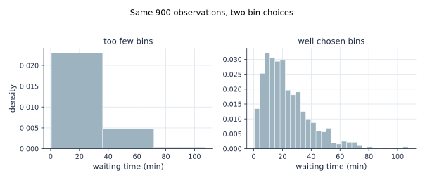
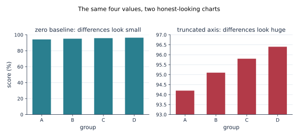
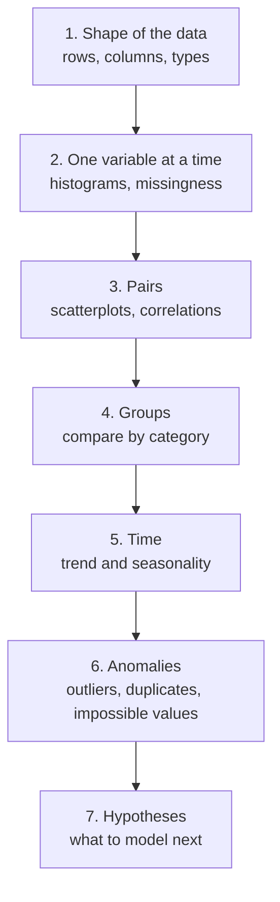
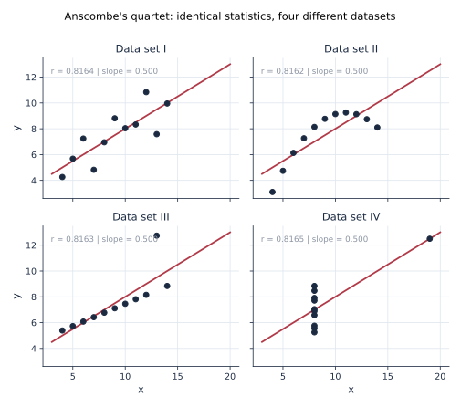
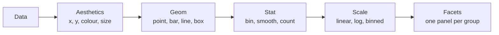

# M04 · Data Visualization and Exploratory Statistical Analysis

<div class="psds-meta" markdown>
<span class="psds-chip psds-chip--beginner">Chapter</span>
<span class="psds-chip">12 study hours</span>
<span class="psds-chip">Module overview: [M04](../04-data-visualization.md)</span>
</div>

## 1. The idea, before any symbols

A number summarises one property of a dataset. A chart shows the **whole shape** at
once, and shape is where surprises live.

M03 gave the ten marks 45, 52, 58, 61, 67, 70, 74, 79, 85, 92 a mean of 68.3 and a
standard deviation of 14.76. Both are correct and both hide the interesting fact —
that the values are almost evenly spaced, with no cluster, no gap and no outlier.
Nothing in "68.3 ± 14.76" tells you that. A dot plot does, instantly.

This chapter is therefore not decoration. Visualisation is an instrument for
**finding things out**: gaps, clusters, curvature, changing spread, groups that
behave differently. Its second job is communication, and that job has rules, because
a chart can mislead without containing a single false number.

## 2. Why this matters

**Many patterns are invisible in summaries.** Four datasets can share a mean,
variance and correlation of 0.816 and look completely different (§9.2). Summary
statistics are not sufficient statistics for shape.

**Exploration decides the model.** Curvature suggests a transformation; a funnel
shape suggests heteroscedasticity; two clusters suggest a missing grouping variable.
Each of those changes the analysis, and each is found by plotting.

**Charts persuade, so they can mislead.** A truncated y-axis, a dual axis, or a 3-D
pie chart can make a 5% difference look like a crisis. Learning to read charts
critically is as important as learning to draw them.

**Data-science work is visual before it is statistical.** Every modelling project
begins with plotting to check joins, distributions, missingness patterns and
relationships. Skipping that step is how a model ends up fitting 3,000 rows of
duplicated data.

## 3. Terminology and notation

| Term | Meaning |
|---|---|
| **Aesthetic** (aes) | A visual property mapped to a variable: x, y, colour, size, shape, alpha |
| **Geom** | The geometric object: point, line, bar, box, area |
| **Stat** | A transformation of the data before drawing: binning, binning + counting, smoothing |
| **Scale** | The mapping from data values to visual values (linear, log, reversed, binned) |
| **Facet** | A small multiple: one panel per subgroup |
| **Coordinate system** | Cartesian, polar (pie, radar), geographic |
| **Lie factor** | (size of effect shown) ÷ (size of effect in the data) |
| **Data-ink ratio** | Proportion of ink that encodes data rather than decoration |

The organising idea is the **grammar of graphics**: a chart is a mapping from
variables to aesthetics, drawn with a geom, optionally split into facets. Once you
have that vocabulary you can describe any chart, and construct the one you need.

## 4. Principles: which chart for which question

### 4.1 Four questions, four chart families

| Question | Chart | Notes |
|---|---|---|
| How is one variable distributed? | Histogram, density, dot plot, ECDF, boxplot | Histograms depend on bin width; ECDFs do not |
| How do two variables relate? | Scatterplot, line (over time), hexbin | Add a smoother only if the shape is unclear |
| How do groups compare? | Bar (means), box/violin (distributions), dot plot | Show the distribution, not just the mean |
| How is a whole composed? | Stacked bar, treemap | Avoid pie charts beyond 2–3 slices |

Two rules follow from this table and are broken constantly:

1. **A bar chart of a mean hides the distribution.** Three groups with means 70, 70,
   70 can look identical while one is tightly clustered and another is bimodal. Use a
   boxplot or dot plot when group variability is part of the question.
2. **A line chart implies order.** Lines connect points in sequence, so they are for
   time or another ordered variable. Joining categorical groups with a line invents a
   trajectory that does not exist.

### 4.2 Perceptual accuracy

Not all encodings are equally readable. Experiments on graphical perception rank
them roughly as follows, from most to least accurate:

1. Position along a common scale (scatterplot, dot plot)
2. Position along non-aligned scales (multiple panels)
3. Length (bar chart)
4. Angle and slope (pie, line slope)
5. Area (bubble chart)
6. Volume, colour saturation, shading

**Practical consequence:** to compare magnitudes, use position and length; reserve
area and colour for secondary information. A pie chart asks readers to compare
angles, and it is why readers cannot tell whether the 23% slice is bigger than the
25% one.

### 4.3 Axes and scales

- **Bar charts must start at zero.** The bar's length is the encoding, so cutting the
  axis truncates the encoding itself.
- **Line charts may use a non-zero baseline** when the question is about change, but
  the axis must be labelled and the choice should not exaggerate.
- **Log scales** turn equal ratios into equal distances. Use them when values span
  orders of magnitude (city populations, incomes, viral case counts) and say so in
  the axis label.

### 4.4 Histogram binning

Two bin-width rules, both defensible:

\[ k_{\text{Sturges}}=1+\log_{2}n, \qquad
   h_{\text{FD}}=2\,\frac{\text{IQR}}{n^{1/3}}. \]

For \(n=40\): \(k=1+\log_{2}40=1+5.32=6.3\), so about 6 bins. Always try two or
three widths before believing a shape: a bimodal distribution can look unimodal at
the wrong width, and vice versa.


[](../../assets/images/figures/fig-04-01-bins.svg)

*Figure 4.1 — the same 900 observations with too few and with well-chosen bins*

**What it shows.** With three bins the right-skewed shape is invisible; with thirty the shape and the tail are both readable. A useful default is to try the square-root rule and Sturges' rule together, then choose the width that answers your question — and to say which you used.

### 4.5 Colour

| Purpose | Palette | Never |
|---|---|---|
| Ordered magnitude | Sequential (light → dark, one hue) | Rainbow |
| Deviation from a midpoint | Diverging (two hues, light centre) | Two unrelated hues |
| Categories | Qualitative, ≤ 7 hues, colour-blind safe | More than 8 colours |

Roughly 8% of men have red–green colour-vision deficiency, so a red/green contrast
alone fails for a large minority. Encode important distinctions with position,
shape or direct labels as well as colour.

### 4.6 Small multiples

When a third variable is categorical, split into panels rather than drawing one busy
chart with twelve colours. Each panel keeps a common scale, so comparison stays
honest, and the eye does the work of comparison better than a legend.

## 5. Chart integrity: how honest charts go wrong

| Defect | What it does | Fix |
|---|---|---|
| Truncated y-axis on a bar chart | Multiplies apparent differences | Start at zero |
| Inconsistent bins | Changes the apparent shape | Same width everywhere; state it |
| 3-D effects | Distorts area and position | Use 2-D |
| Dual axes | Invents a correlation by scaling | Two panels, or index both to 100 |
| Area scaled by radius | Squares the apparent effect | Scale area, not radius |
| Cherry-picked range | Hides the trend | Show the full period |
| Aggregation that hides confounding | Reverses the comparison (Simpson) | Show strata |
| Missing data dropped silently | Changes the population described | Show counts, state exclusions |

**The lie factor.** Tufte's diagnostic:

\[ \text{lie factor}=\frac{\text{size of effect shown in the graphic}}
   {\text{size of effect in the data}}. \]

A lie factor near 1 is honest; above about 1.05 or below 0.95, the graphic is
distorting. Example: a 20% increase shown as a bar 3 times taller has a lie factor of
\(3/1.2=2.5\).


[](../../assets/images/figures/fig-04-03-truncated-axis.svg)

*Figure 5.1 — the same four values drawn honestly and dishonestly*

**What it shows.** On the left the bars start at zero and the groups look nearly equal, which is true. On the right the axis starts at 93, so a 2.2-point range fills the panel and the difference looks roughly ten times larger than it is. Bars must start at zero because their length encodes the value; line and dot plots, where position encodes it, may legitimately start elsewhere.

## 6. The exploratory workflow

A repeatable sequence that finds most data problems in under an hour:



At each step, write one sentence of what you see. That sentence is the finding; the
chart is the evidence.

## 7. Worked examples

### Example 7.1 — The same 40 marks, two bin widths

The marks from the M03 frequency table, binned at width 10:

| Band | Count |
|---|---|
| 40–50 | 3 |
| 50–60 | 5 |
| 60–70 | 8 |
| 70–80 | 12 |
| 80–90 | 9 |
| 90–100 | 3 |

Now bin the same data at width 20: 40–60 has \(3+5=8\), 60–80 has \(8+12=20\),
80–100 has \(9+3=12\).

| Band | Count |
|---|---|
| 40–60 | 8 |
| 60–80 | 20 |
| 80–100 | 12 |

**Reading it.** The narrow bins show a peak at 70–80 and a slight left skew; the wide
bins show a single hump centred at 60–80. Neither is wrong — but a reader shown only
the second would not know that 12 of 40 students sit in one ten-mark band. Report the
bin width whenever you show a histogram.

### Example 7.2 — Anscombe's quartet: identical summaries, different data

Four datasets, each with eleven points:

| \(x\) | \(y_1\) | \(y_2\) | \(y_3\) | \(y_4\) |
|---|---|---|---|---|
| 10 | 8.04 | 9.14 | 7.46 | 6.58 |
| 8 | 6.95 | 8.14 | 6.77 | 5.76 |
| 13 | 7.58 | 8.74 | 12.74 | 7.71 |
| 9 | 8.81 | 8.77 | 7.11 | 8.84 |
| 11 | 8.33 | 9.26 | 7.81 | 8.47 |
| 14 | 9.96 | 8.10 | 8.84 | 7.04 |
| 6 | 7.24 | 6.13 | 6.08 | 5.25 |
| 4 | 4.26 | 3.10 | 5.39 | 12.50 |
| 12 | 10.84 | 9.13 | 8.15 | 5.56 |
| 7 | 4.82 | 7.26 | 6.42 | 7.91 |
| 5 | 5.68 | 4.74 | 5.73 | 6.89 |

*One detail before reading the summaries:* \(y_4\) uses its **own** \(x\) values —
\(8,8,8,8,8,8,8,19,8,8,8\) — not the column above. With them, all four datasets share
the same five numbers:

\[ \bar{x}=9.0,\quad \bar{y}=7.5,\quad s_x^{2}=11.0,\quad s_y^{2}=4.125,
   \quad r=0.816. \]

Yet:

- \(y_1\) is linear with noise — a regression is appropriate.
- \(y_2\) is a smooth curve — linear regression is wrong; the relationship is
  quadratic.
- \(y_3\) is perfectly linear except for **one outlier**, which drags the slope down.
- \(y_4\) has ten points stacked at \(x=8\) and a single point at \(x=19\), so that
  one point single-handedly determines the slope.

**Reading it.** Five summary numbers cannot distinguish four completely different
stories. This is the strongest available argument for plotting every pair of
variables before modelling, and it is why "the correlation is 0.82" is never a
complete analysis.


[](../../assets/images/figures/fig-04-02-anscombe.svg)

*Figure 7.1 — Anscombe's quartet: identical statistics, four different datasets*

**What it shows.** All four datasets give the same correlation to four decimal places and the same fitted line to three. Only the plots reveal that one is linear, one is curved, one has an outlier driving the fit, and one has a single high-leverage point setting the slope. Summary statistics cannot substitute for looking at the data.

### Example 7.3 — A truncated axis, quantified

Three products have satisfaction scores 4.1, 4.4 and 4.9 out of 5.

- **Honest chart:** y-axis 0–5. Bar heights are proportional: ratios 1 : 1.07 : 1.20.
- **Truncated chart:** y-axis 4.0–5.0. The visible heights are 0.1, 0.4, 0.9 —
  ratios 1 : 4 : 9.

\[ \text{lie factor}=\frac{9/1}{1.20/1.00}=\frac{9}{1.2}=7.5. \]

The graphic exaggerates the real difference by a factor of 7.5. Nothing false was
printed; the axis did the work.

### Example 7.4 — Log scale, and when it is the honest choice

Values: 1, 10, 100, 1,000. On a linear axis, the last value is 1,000 times further
from zero than the first, so the first three collapse into a single pixel. On a
\(\log_{10}\) axis, the positions are 0, 1, 2, 3 — equally spaced.

\[ \log_{10}(1)=0,\quad \log_{10}(10)=1,\quad \log_{10}(100)=2,\quad
   \log_{10}(1000)=3. \]

**When to use it:** the data span more than about two orders of magnitude, or the
question is about *ratios* ("twice as many") rather than differences. **When not to:**
values near or including zero, and any audience that will read distances as
differences.

### Example 7.5 — Choosing a chart for a real question

A university wants to compare marks across four programmes.

| Chart | What it shows | Verdict |
|---|---|---|
| Bar chart of programme means | Four numbers | Misleading if spreads differ; hides bimodality |
| Boxplot by programme | Median, IQR, outliers | Good default |
| Violin plot | Full distribution shape | Good, but harder to read |
| Dot plot with jitter | Every student | Best for small \(n\) (< ~200) |
| Stacked bar of grade bands | Composition per programme | Good for pass/fail proportions |

**Recommendation:** dot plot with jitter for 40 students per programme; boxplots if
the groups are large. Add the group sizes to the labels — a boxplot of \(n=4\) is not
a distribution.

### Example 7.6 — Reading a funnel shape

A scatterplot of monthly spend against income shows points tightly clustered at low
income and increasingly spread out at high income.

**Diagnosis:** heteroscedasticity — the variance of spend grows with income. This
matters for M16 (regression standard errors assume constant variance) and suggests
either a log transform of spend or a model that allows the variance to change.

**How to confirm:** plot residuals against fitted values after fitting; the funnel
should persist. Then compare the log-transformed version, which usually flattens it.

## 8. Python: the four plots you will use most

```python
import numpy as np
import pandas as pd
import matplotlib.pyplot as plt
import seaborn as sns

marks = np.array([45, 52, 58, 61, 67, 70, 74, 79, 85, 92])

# 1. Distribution: histogram with an explicit bin width
fig, ax = plt.subplots(figsize=(6, 3.5))
ax.hist(marks, bins=np.arange(40, 101, 10), edgecolor="white")
ax.set(xlabel="Marks", ylabel="Students", title="Marks, bin width 10")
plt.show()

# 2. Distribution without binning artefacts: ECDF
xs = np.sort(marks)
ys = np.arange(1, len(xs) + 1) / len(xs)
ax.step(xs, ys, where="post")
ax.set(xlabel="Marks", ylabel="Proportion ≤ x")

# 3. Relationship
rng = np.random.default_rng(42)
study = rng.normal(12, 3, 60)
score = 40 + 2.5 * study + rng.normal(0, 6, 60)
sns.regplot(x=study, y=score, ci=95)

# 4. Group comparison
df = pd.DataFrame({"programme": ["BSDS", "BSDS", "BSIT", "BSIT"],
                   "marks": [72, 65, 68, 74]})
sns.boxplot(data=df, x="programme", y="marks")
```

Three habits in that code worth copying: set the figure size, **label both axes**, and
give every figure a title that states the finding rather than the variable names.

## 9. Common mistakes and misconceptions

| # | Mistake | Why it is wrong | Correct |
|---|---|---|---|
| 1 | "A chart is just the numbers drawn." | A chart encodes relationships; the encoding can distort. | Check the axis, bins and area scaling. |
| 2 | "Pie charts are good for comparison." | Angles are hard to compare beyond 2–3 slices. | Use a bar chart. |
| 3 | "Truncating the axis is fine if it is labelled." | On a bar chart, length *is* the encoding. | Start bars at zero. |
| 4 | "The histogram shape is the truth." | Shape depends on bin width and origin. | Try several bins; prefer ECDF for exactness. |
| 5 | "Rainbow colours are clear." | They are not ordered perceptually and fail for colour-blind readers. | Sequential or diverging palettes. |
| 6 | "More colours make groups clearer." | Beyond ~7, colours stop being distinguishable. | Facet or use shape + position. |
| 7 | "A line through categories shows a trend." | Lines imply an ordered continuum. | Bars or dots for unordered groups. |
| 8 | "Dual axes show correlation." | Two independently scaled axes can make anything look related. | Index both series or use two panels. |
| 9 | "3-D makes it look professional." | Perspective distorts lengths and areas. | 2-D. |
| 10 | "The mean bar tells the group story." | It hides spread and bimodality. | Show the distribution. |

## 10. How this connects to Data Science

| Task | Visual technique |
|---|---|
| Checking a join or merge | Row counts before/after, and a quick scatter of a shared key |
| Finding missingness | Missingness matrix or a bar chart of null rates by column |
| Detecting skew before modelling | Histogram plus a log-scale version side by side |
| Diagnosing a regression | Residual-vs-fitted plot, Q–Q plot (M16) |
| Comparing model errors | Distribution of residuals by segment, not a single RMSE |
| Explaining a model to stakeholders | Partial dependence plots, coefficient dot plots with intervals |
| Monitoring drift in production | Overlaid distributions of a feature, last month vs this month |

## 11. Real-world scenarios

**A university's pass-rate dashboard.** A bar chart of pass rates by programme shows
one programme at 62% against 88% elsewhere. Splitting by admission year reveals that
the low programme has a large cohort of repeat students — the aggregate hid the
composition. Small multiples by year tell the real story.

**Cricket run rates.** A line chart of runs per over for two teams, plotted with a
shared y-axis starting at zero, is honest. Plotted with a truncated axis starting at
a team's average, the same data makes a one-run difference look decisive.

**COVID-19 case reporting.** Early charts used log scales because cases grew
exponentially: on a linear axis, the first month is invisible. The log axis makes the
*rate* comparable across countries — and is also where charts are most often
misread, which is why the axis label and a companion linear panel matter.

**Flood data in Punjab.** River discharge spans 100 to 100,000 cubic metres per
second. Plotted linearly, everything below 10,000 is a flat line along the bottom;
on a log axis, the seasonal pattern and the extreme years are both visible.

**E-commerce conversion by city.** Conversion rates near 1% with small city samples
produce a chart that is pure noise: the top city is whichever had two sales instead
of one. Plotting the sample size alongside the rate — or a funnel plot with
confidence bands — is the difference between a finding and an artefact.

## 12. Visual explanations

Every figure in this course is an original plot generated by `tools/make_figures.py`, so the
repository contains no third-party images and every picture can be regenerated from its
source. Nothing here is decorative: each figure carries an argument that the caption and the
surrounding text complete.

### 12.1 Grammar of graphics, in one diagram



*What to look at:* every chart is a path through these five boxes. If you cannot say
which geom and which aesthetics you are using, you do not yet know what the chart
claims.

### 12.2 The perceptual ranking, as a ladder

| Rank | Encoding | Example | Precision |
|---|---|---|---|
| 1 | Position, common scale | Dot plot | Highest |
| 2 | Position, non-aligned | Small multiples | High |
| 3 | Length | Bar chart | High |
| 4 | Angle / slope | Pie, line slope | Moderate |
| 5 | Area | Bubble | Low |
| 6 | Colour / shading | Heatmap | Lowest |

*What to look at:* the further down the ladder, the more the reader has to work and
the easier it is to mislead — often unintentionally.

### 12.3 Four datasets, one summary

```
y1: straight line + noise      y2: smooth curve
    ·  ·  ·  ·  ·                  ·      ·
  ·                    ·        ·            ·
                                ·            ·
       (regression ok)            (wrong model)

y3: line + one outlier         y4: vertical points + one lever
        ·                          ·
   ·                               ·
 ·    ·  ← outlier            ·  ·  ·  ·
                                  (one point sets the slope)
```

*What to look at:* in \(y_3\) the outlier pulls the slope down; in \(y_4\) a single
high-leverage point determines it. Both have \(r=0.816\) — the same number as the
honest linear case. The plot is what distinguishes them.

### 12.4 Lie factor worked

```
data:      1.00   1.20          (20% increase)
graphic:   █      ███           (3× height)
lie factor = 3 / 1.2 = 2.5
```

*What to look at:* compare the ratio of the drawn heights with the ratio of the
numbers. That single division is the fastest integrity check available.

## 13. Practice exercises

**Exercise 1 (★).** Name the chart you would use for each question: (a) the
distribution of waiting times; (b) the relationship between study hours and marks;
(c) the median mark by programme; (d) monthly sales over three years.

**Exercise 2 (★).** Using Sturges' rule, how many bins for \(n=100\)? For \(n=1{,}000\)?

**Exercise 3 (★).** A bar chart's y-axis runs from 90 to 100. Bars of heights 92 and
97 are drawn. Compute the ratio of drawn bar lengths and compare it with the ratio of
the underlying values.

**Exercise 4 (★★).** The marks 45, 52, 58, 61, 67, 70, 74, 79, 85, 92 are binned at
width 15 starting at 40. Give the bins and their counts. Does this binning hide
anything the width-10 version showed?

**Exercise 5 (★★).** Explain why a pie chart with eight slices is a poor choice for
comparing category sizes, using the perceptual ranking.

**Exercise 6 (★★).** A scatterplot of ad spend against revenue shows a strong curve
that flattens at high spend. Name the transformation you would try, sketch (in words)
what the plot should look like afterwards, and say what statistical problem the curve
would otherwise cause in M16.

**Exercise 7 (★★).** A chart shows two time series on dual axes, and the lines cross
at the point the article calls "the turning point". Explain why the crossing is
meaningless and describe an honest alternative.

**Exercise 8 (★★★).** You are given Anscombe's \(y_3\) column. Identify which point is
the outlier, explain its effect on the slope, and describe the two charts you would
show to make the effect visible.

**Exercise 9 (★★★).** Design a single figure that answers: "Did the new study
programme improve marks, and for whom?" State the geom, the facets, the summary you
would overlay, and the one thing you would refuse to do.

## 14. Solutions

**Solution 1.** (a) Histogram or ECDF (dot plot if \(n\) is small). (b) Scatterplot
with a smoother. (c) Boxplot or dot plot by programme — not a bar chart of means.
(d) Line chart with time on the x-axis.

**Solution 2.** \(k=1+\log_{2}100=1+6.64\approx7.6\), so about 8 bins.
\(k=1+\log_{2}1000=1+9.97\approx11\), so about 11 bins. Note that the count grows
very slowly: ten times the data adds only about three bins.

**Solution 3.** Drawn lengths: \(92-90=2\) and \(97-90=7\), a ratio of \(7/2=3.5\).
Underlying ratio: \(97/92=1.054\). The axis inflates the difference by
\(3.5/1.054\approx3.3\) times. This is why bars must start at zero.

**Solution 4.** Bins: 40–55 contains 45, 52 → 2; 55–70 contains 58, 61, 67 → 3;
70–85 contains 70, 74, 79 → 3; 85–100 contains 85, 92 → 2. Counts 2, 3, 3, 2.

The width-15 version suggests a symmetric mound with a flat top; the width-10 version
showed the peak at 70–80 (12 of 40). The coarser bins merge the peak with its
neighbours and make the distribution look more uniform than it is.

**Solution 5.** A pie encodes magnitude as angle, which ranks fourth in perceptual
accuracy, and eight slices force the reader to compare small angles that differ by a
degree or two. Labels do not fix this, because the reader still cannot verify the
order without reading every number — at which point a bar chart would have been
faster and more accurate.

**Solution 6.** A log transform of spend (and possibly of revenue): spending often
has diminishing returns, so the relationship is multiplicative. After transforming,
the curve should straighten into a line. Untransformed, the curvature violates the
linearity assumption of M16, so the fitted slope is an average of slopes that differ
across the range, and residuals show a systematic pattern.

**Solution 7.** Two independently scaled axes have no common unit, so where the lines
cross depends entirely on the two scale choices; changing either axis moves the
"turning point". Honest alternative: index both series to 100 at the start and plot
on one axis, or use two stacked panels sharing the x-axis only.

**Solution 8.** The point \((13, 12.74)\) is the outlier: at \(x=13\) the other
datasets give about 7.5–8.7, so it sits far above the line through the other ten points
and pulls the least-squares slope upward (and the intercept down). Charts: (i) the
scatterplot with the fitted line and the point highlighted; (ii) the same plot with
the point removed, showing the line that describes the other ten points. The pair
makes the influence visible without deleting the observation from the record.

**Solution 9.** Geom: points (jittered) or boxplots of marks, with each student
coloured by programme group. Facets: one panel per prior-attainment band (or per
programme), sharing a common y-axis. Overlay: the median and IQR, or a fitted line if
the x-axis is pre-test score. Refuse: plotting only group means as bars — with
40–100 students per group, the distribution is the answer, and a mean bar would hide
both the spread and the possibility that the programme helped one band and not
another.

## 15. Knowledge check

1. Why must a bar chart start at zero but a line chart need not?
2. What does the lie factor measure, and what value indicates an honest graphic?
3. Give the ordering of encodings by perceptual accuracy, from best to worst (four
   items suffice).
4. Why can two histograms of the same data look different?
5. What is the difference between a sequential and a diverging palette, and when is
   each used?
6. State Sturges' rule and give \(k\) for \(n=40\).
7. What does Anscombe's quartet demonstrate?
8. Name three defects that make a chart misleading without any false number.
9. When is a log scale the honest choice?
10. Why is a boxplot of \(n=4\) not a distribution?

### Answers

1. A bar's length encodes the value, so a non-zero baseline truncates the encoding;
   a line's position encodes the value, and the question is usually about change.
2. The ratio of the effect shown graphically to the effect in the data; about 1
   (within roughly ±5%).
3. Position on a common scale → position on non-aligned scales → length →
   angle/slope (then area, then colour).
4. Because bin width and bin origin change what falls into each bar; the underlying
   data are unchanged.
5. Sequential encodes ordered magnitude with one hue (light to dark); diverging
   encodes deviation from a meaningful midpoint with two hues. Use diverging only
   when a midpoint (zero, parity, target) exists.
6. \(k=1+\log_{2}n\); for \(n=40\), \(k=1+5.32\approx6.3\), about 6 bins.
7. That identical summary statistics (means, variances, correlation) can correspond to
   completely different datasets, so plots are required.
8. Any three of: truncated axis, inconsistent bins, dual axes, 3-D distortion,
   area-by-radius scaling, cherry-picked range, hidden confounding.
9. When values span several orders of magnitude or the question is about ratios, and
   the axis is labelled as logarithmic.
10. With four values the "box" is barely defined (quartiles are interpolations of
    four points), and the shape cannot be seen. Show all four points instead.

## 16. Revision summary

**Purpose.** Visualisation finds patterns that summaries hide and communicates them
without distortion. Plot before modelling, always.

**Grammar.** Data → aesthetics → geom → stat → scale → facets. Be able to name the
geom and aesthetics of any chart you make.

**Chart choice.** Distribution → histogram/ECDF/dot; relationship → scatter;
comparison → box/dot (not mean bars); composition → stacked bar; time → line; groups
→ facets.

**Perception.** Position > length > angle > area > colour. Encode the important
comparison in position.

**Integrity.** Bars from zero; consistent bins; one y-axis per panel; no 3-D; area
scales with area. Compute the lie factor when a chart looks dramatic.

**Histograms.** Shape depends on bin width; Sturges \(k=1+\log_2 n\); try two widths.

**Colour.** Sequential for magnitude, diverging for deviation, qualitative for
categories, colour-blind safe, at most about seven hues.

**Workflow.** Shape → one variable → pairs → groups → time → anomalies → hypotheses.

**Habits.**

1. Label both axes and title the finding.
2. Show the distribution whenever you compare groups.
3. Plot the data before you trust any summary — including your own.

**Next.** M05 begins probability with counting, where "how many ways" becomes
"what is the chance".

**Run it.** [Practical 04 — Data visualization](../../practicals/notebooks/04-data-visualization.ipynb) · [all practicals](../../practicals/index.md)

---

**Previous:** [M03 chapter](../03-data-and-descriptive-statistics/chapter.md) ·
**Next:** [M05 · Counting and Combinatorics](../05-counting-and-combinatorics.md)
