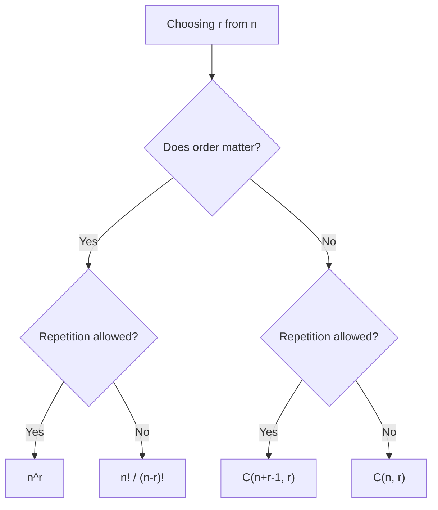
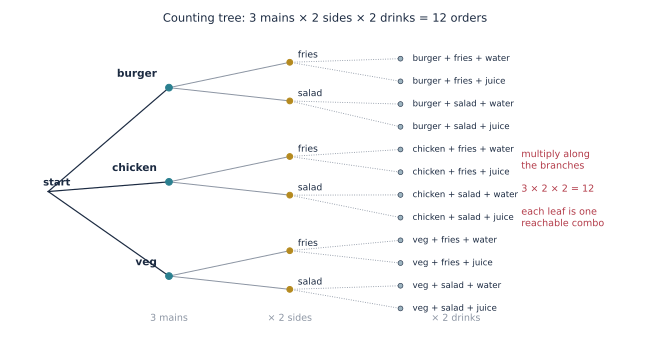

# M05 · Counting and Combinatorics

<div class="psds-meta" markdown>
<span class="psds-chip psds-chip--beginner">Chapter</span>
<span class="psds-chip">10 study hours</span>
<span class="psds-chip">Module overview: [M05](../05-counting-and-combinatorics.md)</span>
</div>

## 1. The idea, before any symbols

When outcomes are equally likely, probability is just counting:

\[ \Pr(A)=\frac{\text{number of outcomes in }A}{\text{number of outcomes in }S}. \]

So "what is the chance?" becomes "how many ways?" — and that is a different skill.
Counting is not hard because the ideas are deep; it is hard because each problem
requires you to see its structure before you can count it.

Three questions decide almost every counting problem:

1. **Does order matter?** A committee {Ali, Sara, Bilal} is the same committee however
   you list it; a gold–silver–bronze podium is not.
2. **Is repetition allowed?** A password can repeat a letter; a team cannot repeat a
   player.
3. **Is everything distinguishable?** Two identical mangoes cannot be swapped to make
   a new arrangement; two students can.

Answer those three and the formula follows from a table (§5.1).

## 2. Why this matters

**Probability needs denominators.** To say a lottery ticket has a 1-in-13,983,816
chance you must count the tickets. To say a test can detect a disease in a family of
five you must count the possible family compositions.

**Counting finds rare-event risk.** The chance of at least one collision, one
duplicate ID, one hash clash — all of these are counting problems over large spaces,
and they are the basis of the birthday problem (§8.5).

**Counting is the foundation of distributions.** The binomial coefficient
\(\binom{n}{k}\) appears in the binomial distribution (M09), in the hypergeometric,
and in every likelihood that involves "k successes out of n".

**Counting errors are large errors.** Being off by a factor of 6 or 720 is normal when
you confuse permutations with combinations, and it changes a probability by orders of
magnitude.

## 3. Terminology and notation

| Symbol | Read as | Meaning |
|---|---|---|
| \(n!\) | n factorial | \(n(n-1)\cdots1\), with \(0!=1\) |
| \(P(n,r)\) or \({}^{n}P_r\) | n permute r | ordered selections of \(r\) from \(n\) |
| \(C(n,r)\) or \(\binom{n}{r}\) | n choose r | unordered selections of \(r\) from \(n\) |
| \(\binom{n}{r_1,\dots,r_k}\) | multinomial | ways to split \(n\) into labelled groups |
| \(\lvert S\rvert\) | size of S | number of outcomes in the sample space |

Two conventions worth stating: \(0!=1\) (one way to arrange nothing), and
\(\binom{n}{0}=\binom{n}{n}=1\).

## 4. The multiplication principle

**Statement.** If a task consists of \(k\) stages, and stage \(i\) can be done in
\(m_i\) ways regardless of the earlier choices, then the whole task can be done in

\[ m_1\times m_2\times\cdots\times m_k \]

ways.

**Why it is true.** Each complete outcome is a sequence of choices, one per stage. Two
different sequences give different outcomes (because some stage differs), so the
outcomes are in one-to-one correspondence with the sequences. Counting sequences of
independent choices is multiplication, by the same logic as counting the cells of a
grid: 3 rows × 4 columns = 12 cells.

**Example 4.1.** A menu offers 3 starters, 4 mains and 2 desserts. A three-course meal
can be chosen in \(3\times4\times2=24\) ways.

**Example 4.2.** A Pakistani mobile number has the form 03XX-XXXXXXX: the operator
code has 4 fixed digits after 03, then 7 free digits. Numbers available:
\(10^{7}=10{,}000{,}000\) per operator code.

**The condition that is easy to miss.** The principle requires the number of choices
at each stage to be the **same regardless of earlier choices**. If you are choosing
two students from a group and the second choice depends on the first (the first person
cannot be chosen twice), you must account for that — which is exactly what
permutations do.

## 5. Permutations and combinations

### 5.1 The four cases

| | Order matters | Order does not matter |
|---|---|---|
| **With replacement** | \(n^{r}\) | \(\binom{n+r-1}{r}\) |
| **Without replacement** | \(\dfrac{n!}{(n-r)!}\) | \(\binom{n}{r}\) |

This table is the most useful thing in the chapter. Before computing anything, locate
your problem in one of the four cells.

### 5.2 Permutations without replacement

**Derivation.** Choose \(r\) items from \(n\), order matters, no repetition. Stage 1
has \(n\) choices; stage 2 has \(n-1\) (one is used); …; stage \(r\) has \(n-r+1\). By
the multiplication principle,

\[ P(n,r)=n(n-1)(n-2)\cdots(n-r+1). \]

Multiply and divide by \((n-r)!\):

\[ P(n,r)=\frac{n(n-1)\cdots(n-r+1)\,(n-r)!}{(n-r)!}
   =\frac{n!}{(n-r)!}. \]

**Example 5.1.** How many ways can 3 of 10 students fill chair, secretary and
treasurer?

\[ P(10,3)=\frac{10!}{7!}=10\times9\times8=720. \]

**Special case \(r=n\):** \(P(n,n)=n!\) — the number of orderings of \(n\) distinct
objects.

### 5.3 Combinations without replacement

**Derivation.** Every unordered selection of \(r\) items can be arranged in \(r!\)
orders. So the ordered count over-counts each selection exactly \(r!\) times:

\[ \binom{n}{r}=\frac{P(n,r)}{r!}=\frac{n!}{r!\,(n-r)!}. \]

**Example 5.2.** How many ways can 3 of 10 students form a committee (no roles)?

\[ \binom{10}{3}=\frac{10!}{3!\,7!}=\frac{720}{6}=120. \]

The ratio \(720/120=6=3!\) is exactly the over-count: each committee appears six times
in the list of ordered selections.

### 5.4 Three properties, and why they hold

\[ \binom{n}{r}=\binom{n}{n-r}, \qquad
   \binom{n}{r}=\binom{n-1}{r-1}+\binom{n-1}{r}, \qquad
   \sum_{r=0}^{n}\binom{n}{r}=2^{n}. \]

- **Symmetry:** choosing \(r\) to include is the same act as choosing \(n-r\) to
  exclude.
- **Pascal's identity:** fix one item. Selections either include it (choose \(r-1\)
  more from \(n-1\)) or exclude it (choose \(r\) from \(n-1\)). The two cases are
  exhaustive and disjoint, so their counts add.
- **The sum:** each of the \(n\) items is in or out, so there are \(2^{n}\) subsets in
  total, grouped by size.

### 5.5 Circular arrangements

\(n\) people around a round table: fix one person to remove the rotation, then arrange
the rest, giving \((n-1)!\). For 5 people, \(4!=24\).

If reflections also count as the same (a necklace, a bracelet), divide by 2:
\(\frac{(n-1)!}{2}\).

## 6. Multinomial counts

Splitting \(n\) distinct objects into \(k\) labelled groups of sizes
\(r_1,\dots,r_k\) with \(\sum r_i=n\):

\[ \binom{n}{r_1,\dots,r_k}=\frac{n!}{r_1!\,r_2!\cdots r_k!}. \]

**Derivation.** Choose the first group: \(\binom{n}{r_1}\). From the remaining
\(n-r_1\), choose the second: \(\binom{n-r_1}{r_2}\). Continue, and the product
telescopes:

\[ \frac{n!}{r_1!(n-r_1)!}\cdot\frac{(n-r_1)!}{r_2!(n-r_1-r_2)!}\cdots
   =\frac{n!}{r_1!\,r_2!\cdots r_k!}. \]

**Example 6.1.** Ten students are assigned to three project teams of sizes 3, 3 and 4:

\[ \frac{10!}{3!\,3!\,4!}=\frac{3{,}628{,}800}{6\times6\times24}=4200. \]

## 7. Inclusion–exclusion and stars and bars

### 7.1 Inclusion–exclusion

For two sets, \(n(A\cup B)=n(A)+n(B)-n(A\cap B)\). For three,

\[ n(A\cup B\cup C)=n(A)+n(B)+n(C)-n(A\cap B)-n(A\cap C)-n(B\cap C)+n(A\cap B\cap C). \]

The pattern is alternating: add singles, subtract pairs, add triples. Each element is
counted once on the left and exactly once in total on the right.

**Example 7.1.** How many integers from 1 to 100 are divisible by 3 or 5?

Multiples of 3: \(\lfloor100/3\rfloor=33\). Of 5: \(\lfloor100/5\rfloor=20\). Of both
(that is, of 15): \(\lfloor100/15\rfloor=6\). So

\[ 33+20-6=47. \]

### 7.2 Stars and bars

The number of ways to put \(n\) **identical** items into \(k\) **distinct** boxes is

\[ \binom{n+k-1}{k-1}. \]

**Why.** A distribution is a row of \(n\) stars and \(k-1\) bars separating the boxes.
For example, with 3 items in 2 boxes, "★★|★" means two in the first box, one in the
second. Every arrangement of 4 symbols, of which 3 are stars, is a distribution:
\(\binom{4}{1}=4\).

**Example 7.2.** Distribute 10 identical laptops to 3 departments:
\(\binom{10+3-1}{3-1}=\binom{12}{2}=66\) ways.

**The trap:** this counts **identical** items. Ten distinct laptops give \(3^{10}\)
distributions instead, because each laptop independently chooses a department.

## 8. Applications

### 8.1 Passwords and PINs

A 4-letter (lowercase) + 2-digit password: \(26^{4}\times10^{2}=456{,}976\times100
=45{,}697{,}600\) possibilities. Add uppercase and symbols and the space grows fast —
which is exactly why length beats complexity in password policy.

### 8.2 Lotteries

Choosing 6 numbers from 49:

\[ \binom{49}{6}=\frac{49\cdot48\cdot47\cdot46\cdot45\cdot44}{720}=13{,}983{,}816. \]

A single ticket's chance is 1 in about 14 million. Buying ten tickets changes it to
10 in 14 million — still about one in 1.4 million.

### 8.3 Teams with constraints

**Example 8.1.** From 6 men and 4 women, form a committee of 3 including at least one
woman.

Total committees: \(\binom{10}{3}=120\). All-men committees: \(\binom63=20\). So
\(120-20=100\). The complement is almost always easier than counting directly.

**Example 8.2.** Choose 11 players from a squad of 15: \(\binom{15}{11}=1365\). If one
player must be captain and is always selected, choose the other 10 from the remaining
14: \(\binom{14}{10}=1001\).

### 8.4 Seating

Five students in a row: \(5!=120\). Around a round table: \(4!=24\). If two particular
students must sit together, treat them as one block: \(3!\times2=12\) arrangements
around a table of 5 (block + 3 others = 4 units, times 2 internal orders).

### 8.5 The birthday problem, as counting

With \(n\) people, the number of ordered birthday assignments (365 days, ignoring leap
years) is \(365^{n}\). The number with **all distinct** birthdays is
\(365\times364\times\cdots\times(365-n+1)\). So

\[ \Pr(\text{at least one shared birthday})
   =1-\frac{365\cdot364\cdots(365-n+1)}{365^{n}}. \]

At \(n=23\) this is about 0.507 — just over half. At \(n=41\), about 0.90. The
counter-intuitive part is not the arithmetic but the question: it counts **pairs of
people**, and 23 people make \(\binom{23}{2}=253\) pairs, any of which could match.

### 8.6 Pigeonhole principle

If \(n\) items are placed in \(m<n\) boxes, some box contains at least two items. So in
a group of 13 people, at least two share a birth month; with 367 people, two share a
birthday. The principle proves existence without constructing the example, and appears
in hashing (collisions are certain once you exceed the number of buckets).

## 9. Worked examples

### Example 9.1 — A four-digit PIN with a constraint

How many 4-digit PINs have **no repeated digit**?

First digit cannot be 0, so 9 choices; then choose the remaining 3 from the 9 remaining
digits, ordered: \(9\times9\times8\times7=4536\). (Direct count: total with no repeats
is \(10\times9\times8\times7=5040\); subtract those starting with 0, which are
\(9\times8\times7=504\); \(5040-504=4536\). Both routes agree.)

### Example 9.2 — Committee with a named member

From 12 students, form a committee of 4.

- Total: \(\binom{12}{4}=495\).
- Including a particular student: choose 3 from the other 11: \(\binom{11}{3}=165\).
- Excluding her: \(\binom{11}{4}=330\). Check: \(165+330=495\).

### Example 9.3 — Arrangements of a word

How many distinct arrangements of the letters of **BANANA**?

Six letters with repetitions: B once, A three times, N twice.

\[ \frac{6!}{3!\,2!\,1!}=\frac{720}{6\times2\times1}=60. \]

If all six letters were distinct there would be 720; dividing by the internal orders of
the identical letters removes the over-count.

### Example 9.4 — Sampling with and without replacement

A box has 5 red and 3 blue balls. Draw 2.

- **With replacement, ordered:** \(8^{2}=64\) outcomes; both red: \(5^{2}=25\), so
  \(\Pr=25/64=0.391\).
- **Without replacement, ordered:** \(8\times7=56\) outcomes; both red:
  \(5\times4=20\), so \(\Pr=20/56=0.357\).
- **Without replacement, unordered:** \(\binom82=28\) pairs; both red
  \(\binom52=10\), so \(\Pr=10/28=0.357\). Same answer — as it must be, because the
  unordered count divides both numerator and denominator by \(2!\).

### Example 9.5 — A grid path

A delivery rider moves from \((0,0)\) to \((4,3)\) using only right and up steps. How
many shortest paths? Each path is a sequence of 4 R's and 3 U's:

\[ \binom{7}{4}=\binom{7}{3}=35. \]

### Example 9.6 — Inclusion–exclusion with three sets

In a class of 40, 20 take Python, 18 take R, 12 take SQL; 8 take Python and R, 5 take
Python and SQL, 4 take R and SQL, and 2 take all three. How many take at least one?

\[ 20+18+12-8-5-4+2=35. \]

So 5 take none. Notice the order of signs: add singles, subtract pairs, add the
triple.

## 10. Common mistakes and misconceptions

| # | Mistake | Why it is wrong | Correct |
|---|---|---|---|
| 1 | Using \(n^{r}\) when items cannot repeat | Replacement is an assumption, not a default | Check: can the same item be chosen twice? |
| 2 | Using permutations for a committee | Committee order is not meaningful | \(\binom{n}{r}\) |
| 3 | Forgetting to divide by \(r!\) | Ordered count over-counts unordered selections | \(P(n,r)/r!\) |
| 4 | "At least one" counted directly | Overlapping cases are hard to enumerate | Use \(1-\) (none) |
| 5 | Adding counts of overlapping events | Double-counts the intersection | Inclusion–exclusion |
| 6 | Stars and bars for distinct items | It counts identical items only | \(k^{n}\) for distinct |
| 7 | Treating a rotated table as a new arrangement | Rotations are the same seating | \((n-1)!\) |
| 8 | Forgetting identical letters in a word | Over-counts arrangements | Divide by repeated factorials |
| 9 | "\(0!=0\)" | Then every formula with factorials collapses | \(0!=1\) |
| 10 | Reporting an exact count without checking plausibility | A count in the billions may signal a slip | Sanity-check with a small case |

## 11. How this connects to Data Science

- **Binomial and multinomial models** (M09) are built on the coefficients derived in
  §5.3 and §6.
- **Hypergeometric sampling** — "how many defects in this batch?" — is a combinations
  count.
- **Hash collisions and UUIDs.** A 128-bit ID space has \(2^{128}\) values; the birthday
  bound says collisions become likely near \(2^{64}\) items. Counting, not luck.
- **Cross-validation splits.** The number of distinct \(k\)-folds from \(n\) items is a
  multinomial coefficient, which is why every split is nearly unique.
- **Feature interaction counts.** The number of pairs of \(p\) features is
  \(\binom{p}{2}\), which grows quadratically — the reason pairwise interaction models
  become infeasible quickly.
- **Sampling audits.** "How many ways could this randomisation have gone?" is a
  combinations count, and it is the basis of the permutation test in M17.

## 12. Real-world scenarios

**CNIC and phone-number allocation.** Pakistan's 13-digit CNIC space is
\(10^{13}\) — far larger than the population, so collisions in a well-run system are
avoidable by design rather than by chance.

**Prize draws in a shop.** A shop puts 200 entries in a drum and draws 3 prizes.
Ordered draws: \(P(200,3)=7{,}880{,}400\); unordered winners:
\(\binom{200}{3}=1{,}313{,}400\). The probability any specific person wins a prize is
\(3/200=0.015\), which follows from either count.

**Cricket squad selection.** A squad of 15 with 2 wicket-keepers: the number of
11-player teams containing exactly one keeper is
\(\binom{2}{1}\binom{13}{10}=2\times286=572\). Selection debates are counting
problems, and this is why "he picked the wrong team" is usually about constraints, not
arithmetic.

**Password policy.** A 6-character lowercase password has \(26^{6}=308{,}915{,}776\)
possibilities; 10 characters have \(26^{10}\approx1.4\times10^{14}\). Length multiplies
the space exponentially; complexity rules multiply it by a small constant.

**Duplicate detection in a dataset.** With 10,000 records and a 1,000-bucket hash,
pigeonhole guarantees at least 10 records per bucket on average, and the birthday
bound says duplicate-looking keys appear far sooner than intuition suggests.

## 13. Visual explanations

### 13.1 The decision tree for counting



*What to look at:* two questions, four answers. Almost every counting mistake is a
wrong turn at one of them.

[](../../assets/images/figures/fig-05-01-counting-tree.svg)

*Figure 13.1 — a counting tree for a three-part order: 3 mains × 2 sides × 2 drinks*

**What it shows.** Each path from *start* to a leaf is one complete order, and the
leaves are written out so they can be counted directly: there are twelve of them.
Nothing is counted twice, because any two paths differ at some stage, and nothing is
missed, because every option at every stage has its own branch. The arithmetic
shortcut — multiply the branch counts, \(3\times 2\times 2 = 12\) — gives exactly the
number of leaves.

**The mathematics.** Write an outcome as a tuple \((m, s, d)\) with \(m \in M\),
\(s \in S\), \(d \in D\). The tree is a picture of the cartesian product
\(M \times S \times D\), and the multiplication principle says

\[
|M \times S \times D| = |M| \cdot |S| \cdot |D| = 3 \cdot 2 \cdot 2 = 12 .
\]

The proof is a bijection: every tuple is a path and every path is a tuple. Two
consequences are worth carrying away. First, the principle extends to any number of
stages, which is why a four-digit PIN has \(10^4 = 10{,}000\) paths and a four-card
deal has \(52 \cdot 51 \cdot 50 \cdot 49\) ordered paths. Second, a tree whose later
stages offer fewer branches — a hand of cards, a committee of people, a seating plan —
is *unbalanced*, and then the product must be corrected for the paths that differ only
in order: dividing by \(4!\) collapses those five-card paths into one combination. When
the branch count depends on the route already taken, the tree, not the formula, is the
honest picture.

**Try it.** [Practical 05 — Counting and combinatorics](../../practicals/notebooks/05-counting-and-combinatorics.ipynb)
builds trees like this one in code and checks the multiplication principle against
brute-force enumeration.


### 13.2 Why \(\binom{n}{r}\) divides by \(r!\)

```
Choose 2 of {A, B, C} without order:

ordered pairs:  AB  AC  BA  BC  CA  CB   (6 = P(3,2))
grouped by set: {A,B}: AB, BA          (2 = 2!)
                {A,C}: AC, CA
                {B,C}: BC, CB
distinct sets:  3  = 6 / 2  = C(3,2)
```

*What to look at:* the over-count factor is the number of orderings of the chosen
items, which is \(r!\) — not \(n!\) and not \(r\).

### 13.3 Pascal's triangle

```
n=0            1
n=1          1   1
n=2        1   2   1
n=3      1   3   3   1
n=4    1   4   6   4   1
n=5  1   5  10  10   5   1
```

*What to look at:* each entry is the sum of the two above it (Pascal's identity), and
the row sums are \(1,2,4,8,16,32=2^{n}\).

### 13.4 "At least one" is usually a complement

```
P(at least one) = 1 − P(none)

die rolls:  1 − (5/6)^4  = 0.518
lottery:    1 − C(48,6)/C(49,6) = 6/49 = 0.122  (one ticket, one draw's numbers)
birthdays:  1 − 365·364···343 / 365^23 = 0.507
```

*What to look at:* three very different problems, one structure. Whenever you see "at
least one", write the complement first.

## 14. Practice exercises

**Exercise 1 (★).** Evaluate: (a) \(5!\), (b) \(P(7,2)\), (c) \(\binom{7}{2}\),
(d) \(\binom{10}{0}\).

**Exercise 2 (★).** A cafe offers 5 teas and 4 cakes. How many tea-and-cake orders
are possible? Does order matter?

**Exercise 3 (★).** How many distinct arrangements of the letters of **STATISTICS**?

**Exercise 4 (★★).** From 8 men and 6 women, how many committees of 5 contain
exactly 2 women?

**Exercise 5 (★★).** How many 5-card hands from a standard 52-card deck contain at
least one ace?

**Exercise 6 (★★).** In how many ways can 4 distinct prizes be distributed to 10
students if (a) a student may win more than one prize, (b) no student may win more
than one?

**Exercise 7 (★★).** How many integers from 1 to 200 are divisible by 4 or by 6?

**Exercise 8 (★★★).** Ten identical books are placed on 4 shelves. How many
arrangements are possible if shelves may be empty? Which formula would you use if the
books were distinct?

**Exercise 9 (★★★).** Prove Pascal's identity algebraically from
\(\binom{n}{r}=\frac{n!}{r!(n-r)!}\), and explain in one sentence why the combinatorial
argument in §5.4 is shorter.

## 15. Solutions

**Solution 1.** (a) \(120\). (b) \(P(7,2)=7\times6=42\). (c) \(\binom72=21\).
(d) \(1\).

**Solution 2.** \(5\times4=20\). Order does not matter within an order (a tea and a cake
is one order), but the two stages are distinct, so the multiplication principle
applies directly.

**Solution 3.** STATISTICS has 10 letters: S×3, T×3, A×1, I×2, C×1.

\[ \frac{10!}{3!\,3!\,2!}=\frac{3{,}628{,}800}{6\times6\times2}=50{,}400. \]

**Solution 4.** Choose 2 women from 6 and 3 men from 8:

\[ \binom62\binom83=15\times56=840. \]

**Solution 5.** Total hands \(\binom{52}{5}=2{,}598{,}960\). Hands with no ace:
\(\binom{48}{5}=1{,}712{,}304\). So

\[ 2{,}598{,}960-1{,}712{,}304=886{,}656. \]

As a probability: \(886{,}656/2{,}598{,}960\approx0.341\).

**Solution 6.** (a) Each prize independently goes to one of 10 students:
\(10^{4}=10{,}000\). (b) Ordered assignment without repetition:
\(P(10,4)=10\times9\times8\times7=5040\).

**Solution 7.** Multiples of 4: \(\lfloor200/4\rfloor=50\). Of 6:
\(\lfloor200/6\rfloor=33\). Of both (LCM 12): \(\lfloor200/12\rfloor=16\). So
\(50+33-16=67\).

**Solution 8.** Identical books: stars and bars with \(n=10\), \(k=4\):
\(\binom{10+3}{3}=\binom{13}{3}=286\). If the books were distinct, each book
independently chooses a shelf: \(4^{10}=1{,}048{,}576\).

**Solution 9.** Algebraically,

\[ \binom{n-1}{r-1}+\binom{n-1}{r}
   =\frac{(n-1)!}{(r-1)!(n-r)!}+\frac{(n-1)!}{r!(n-r-1)!}. \]

Put both over \(r!(n-r)!\). The first term is multiplied by \(r\), the second by
\(n-r\):

\[ \frac{(n-1)!\,\big[r+(n-r)\big]}{r!(n-r)!}
   =\frac{n\,(n-1)!}{r!(n-r)!}=\binom{n}{r}. \]

The combinatorial argument is shorter because it avoids the algebra entirely: split
all selections by whether they contain one fixed item, and the two cases are exactly
the two terms.

## 16. Knowledge check

1. State the difference between \(P(n,r)\) and \(\binom{n}{r}\) in one sentence.
2. Why is \(0!=1\)?
3. How many ways can 4 people sit around a round table?
4. What does \(\binom{n+r-1}{r}\) count, and what assumption does it make?
5. Write the inclusion–exclusion formula for three sets.
6. In 6 rolls of a fair die, what is the probability of at least one six (give the
   expression)?
7. A committee is chosen from 10 people; how many committees of size 3 include a
   specific person?
8. Why does the birthday problem surprise people?
9. What does the pigeonhole principle guarantee for 13 people and 12 months?
10. \(P(n,r)/r!\) equals what?

### Answers

1. \(P(n,r)\) counts ordered selections; \(\binom{n}{r}\) counts unordered ones, and
   \(\binom{n}{r}=P(n,r)/r!\).
2. There is exactly one way to arrange nothing, and the recursion
   \(n!=n\cdot(n-1)!\) requires it at \(n=1\).
3. \((4-1)!=6\).
4. Ways to distribute \(n\) identical items into \(r\) distinct boxes, allowing empty
   boxes.
5. \(n(A)+n(B)+n(C)-n(A\cap B)-n(A\cap C)-n(B\cap C)+n(A\cap B\cap C)\).
6. \(1-(5/6)^{6}\approx0.665\).
7. \(\binom{9}{2}=36\).
8. Because people compare \(n\) with 365 and not the \(\binom{n}{2}\) pairs; at
   \(n=23\) there are 253 pairs.
9. At least two people share a birth month.
10. \(\binom{n}{r}\).

## 17. Revision summary

**The three questions.** Order? Repetition? Distinguishable?

**Formulas.**

\[ n!,\qquad P(n,r)=\frac{n!}{(n-r)!},\qquad \binom{n}{r}=\frac{n!}{r!(n-r)!},
   \qquad \binom{n+r-1}{r}. \]

**Special counts.** Circular arrangements \((n-1)!\); arrangements with repeated items
\(n!/(r_1!\cdots r_k!)\); multinomial splits; grid paths \(\binom{m+n}{m}\).

**Inclusion–exclusion.** Add singles, subtract pairs, add triples.

**"At least one".** Compute the complement: \(1-\Pr(\text{none})\).

**Pigeonhole.** More items than boxes forces a collision — the reason hash tables and
birthday coincidences behave as they do.

**Habits.**

1. Write the sample space size and the event size separately; only then divide.
2. Check a small case by hand (3 items, 2 boxes) before trusting a formula.
3. Sanity-check magnitudes: a count that seems impossible usually is.

**Next.** M06 turns counts into probabilities by adding the axioms and the rules that
follow from them.

**Run it.** [Practical 05 — Counting and combinatorics](../../practicals/notebooks/05-counting-and-combinatorics.ipynb) · [all practicals](../../practicals/index.md)

---

**Previous:** [M04 chapter](../04-data-visualization/chapter.md) ·
**Next:** [M06 · Probability Fundamentals](../06-probability-fundamentals.md)
