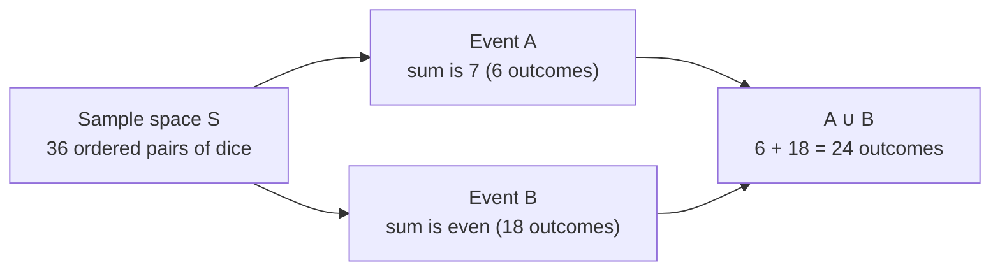

# M06 · Probability Fundamentals

<div class="psds-meta" markdown>
<span class="psds-chip psds-chip--core">Chapter</span>
<span class="psds-chip">14 study hours</span>
<span class="psds-chip">Module overview: [M06](../06-probability-fundamentals.md)</span>
</div>

!!! abstract "Interactive laboratory"
    [Lab L-01 — Random events and long-run frequency](../../labs/probability.md) — run an experiment with n trials and k outcomes, and watch the observed frequencies settle onto the model probabilities.

## 1. The idea, before any symbols

Probability is a number between 0 and 1 assigned to an event, measuring how likely it
is. That sentence is almost the whole definition — and it is deliberately thin.

The thinness is the point. Mathematics does not tell you that a coin is fair; it tells
you what follows **if** it is. A probability model is a set of assumptions, and the
subject begins by making those assumptions explicit and then deriving everything else
from three of them.

Here is the structure in one picture:

- A **sample space** \(S\) lists every possible outcome.
- An **event** is a subset of \(S\).
- A **probability measure** assigns each event a number in \([0,1]\), with
  \(\Pr(S)=1\), and adds up over disjoint events.

From those three lines, every rule you have ever used — complements, unions,
inclusion–exclusion, "the probabilities must sum to 1" — follows by proof. This
chapter derives them rather than asserting them, because a rule you can derive is a
rule you can adapt when a problem does not match the textbook case.

## 2. Why this matters

**It is the model everything else uses.** Distributions (M09, M10), expectation
(M08), sampling (M12) and inference (M14) are all built on this foundation. A gap
here becomes mysterious later.

**It makes "impossible" and "certain" precise.** \(\Pr=0\) and \(\Pr=1\) are
mathematical statements, not feelings, and they can behave surprisingly: an event of
probability zero is not necessarily impossible in the logical sense.

**It exposes bad reasoning.** "It hasn't happened in ten draws, so it's due" is a
claim about a model, and the model refutes it (§9.4). "The probability of at least one
is small, so it won't happen among 10,000 people" is the same error at scale.

**Data science is probabilistic all the way down.** A classifier outputs a
probability; a p-value is a probability computed under a model (M15); a confidence
interval's coverage is a probability over repeated samples (M14).

## 3. Terminology and notation

| Term | Meaning | Example |
|---|---|---|
| **Sample space** \(S\) (or \(\Omega\)) | Set of all possible outcomes | Two coin tosses: \(\{HH,HT,TH,TT\}\) |
| **Outcome** \(\omega\) | One element of \(S\) | \(HT\) |
| **Event** \(A\) | A subset of \(S\) | "exactly one head" \(=\{HT,TH\}\) |
| **Simple event** | A single outcome | \(\{HT\}\) |
| **Complement** \(A^{c}\) | Outcomes not in \(A\) | \(\{HH,TT\}\) |
| **Union** \(A\cup B\) | \(A\) or \(B\) or both | "at least one head" |
| **Intersection** \(A\cap B\) | Both occur | "first toss head and second head" |
| **Disjoint** (mutually exclusive) | \(A\cap B=\varnothing\) | "one head" and "two heads" |
| **Exhaustive** | Together they cover \(S\) | \(A\) and \(A^{c}\) |
| \(\Pr(A)\) | Probability of \(A\) | \(\Pr(\{HT,TH\})=1/2\) |
| \(n(A)\) or \(\lvert A\rvert\) | Number of outcomes in \(A\) | \(n(\{HT,TH\})=2\) |

### 3.1 The three axioms

For a sample space \(S\) and events \(A,B\):

1. **Non-negativity:** \(\Pr(A)\ge0\).
2. **Normalisation:** \(\Pr(S)=1\).
3. **Countable additivity:** if \(A_1,A_2,\dots\) are pairwise disjoint, then
   \(\Pr\left(\bigcup_i A_i\right)=\sum_i \Pr(A_i)\).

Everything in §4 is a theorem, not an assumption.

## 4. Rules derived from the axioms

### 4.1 The probability of the empty set is zero

\(S\) and \(\varnothing\) are disjoint and \(S\cup\varnothing=S\), so by axiom 3,

\[ \Pr(S)=\Pr(S)+\Pr(\varnothing)\;\Longrightarrow\;\Pr(\varnothing)=0. \]

### 4.2 Complement rule

\(A\) and \(A^{c}\) are disjoint and together make \(S\), so

\[ \Pr(A)+\Pr(A^{c})=\Pr(S)=1\;\Longrightarrow\;\Pr(A^{c})=1-\Pr(A). \]

This is the most useful identity in the chapter, because "at least one" problems are
almost always easier through the complement.

### 4.3 Bounds

Since \(\Pr(A^{c})\ge0\), we get \(\Pr(A)\le1\). Combined with axiom 1:

\[ 0\le\Pr(A)\le1. \]

### 4.4 Addition rule (two events)

Write \(A\cup B\) as three disjoint pieces: \(A\cap B^{c}\), \(A\cap B\), and
\(A^{c}\cap B\). Then

\[ \Pr(A\cup B)=\Pr(A\cap B^{c})+\Pr(A\cap B)+\Pr(A^{c}\cap B). \]

Using \(\Pr(A)=\Pr(A\cap B^{c})+\Pr(A\cap B)\) and the same for \(B\),

\[ \Pr(A\cup B)=\Pr(A)+\Pr(B)-\Pr(A\cap B). \]

*Check the logic:* if the events are disjoint, \(\Pr(A\cap B)=0\) and the rule
reduces to addition. The subtraction exists precisely to remove the double count.

### 4.5 Monotonicity and differences

If \(A\subseteq B\) then \(\Pr(A)\le\Pr(B)\), because \(B=A\cup(A^{c}\cap B)\) is a
disjoint union and the second piece has non-negative probability. Also

\[ \Pr(A\cap B^{c})=\Pr(A)-\Pr(A\cap B). \]

### 4.6 Three events

\[
\begin{aligned}
\Pr(A\cup B\cup C)={}&\Pr(A)+\Pr(B)+\Pr(C)\\
&-\Pr(A\cap B)-\Pr(A\cap C)-\Pr(B\cap C)\\
&+\Pr(A\cap B\cap C).
\end{aligned}
\]

*Why the last term is added:* the triple intersection was counted three times by the
singles and subtracted three times by the pairs, so it must be restored once.

### 4.7 De Morgan

\[ (A\cup B)^{c}=A^{c}\cap B^{c}, \qquad (A\cap B)^{c}=A^{c}\cup B^{c}. \]

These turn "neither" into "not either", which is often the easier computation:
\(\Pr(\text{neither }A\text{ nor }B)=\Pr(A^{c}\cap B^{c})\).

## 5. Equally likely outcomes

If \(S\) is finite and all outcomes are equally likely, then for any event \(A\),

\[ \Pr(A)=\frac{n(A)}{n(S)}=\frac{\lvert A\rvert}{\lvert S\rvert}. \]

This is the classical definition, and it is a **modelling assumption** — not a fact
about the world. A fair coin is an assumption; a real coin is a physical object with
a slight bias that you would need data to estimate.

**When it applies:** symmetric mechanisms (fair dice, well-shuffled cards, random
number generators, random assignment in an experiment).
**When it does not:** anything selected by humans, anything with unequal base rates,
anything where "equally likely" is asserted without justification.

## 6. Probability by counting

Combining §5 with M05 gives the workhorse method: count the sample space, count the
event.

\[ \Pr(A)=\frac{\text{ways for }A}{\text{ways total}}. \]

The counting must use the **same convention** in numerator and denominator — both
ordered, or both unordered. Mixing them is the most common error in this chapter.

| Draw | Space size | Both red from 5 red, 3 blue |
|---|---|---|
| 2 with replacement, ordered | \(8^{2}=64\) | \(5^{2}=25\) → 0.391 |
| 2 without replacement, ordered | \(8\cdot7=56\) | \(5\cdot4=20\) → 0.357 |
| 2 without replacement, unordered | \(\binom82=28\) | \(\binom52=10\) → 0.357 |

The last two agree, as they must: the unordered count divides numerator and
denominator by the same \(2!\).

## 7. Interpretations of probability

| View | What probability is | Where it is natural |
|---|---|---|
| **Classical** | Ratio of favourable to equally likely outcomes | Dice, cards, randomised algorithms |
| **Frequentist** | Long-run relative frequency, \(\lim_{n\to\infty}n(A)/n\) | Repeatable experiments, simulations |
| **Subjective (Bayesian)** | Degree of belief, updated by evidence | One-off events, prior knowledge (M18) |

The axioms are the same in all three; the interpretations differ in what the number
is *about*. They also differ in what they let you say: a frequentist cannot assign a
probability to "this candidate wins the election" (one event, no repeat), while a
Bayesian can. M18 develops this properly.

## 8. Worked examples

### Example 8.1 — Two dice: the full sample space

Roll two fair dice. \(n(S)=36\).

| Sum | Ways | Probability |
|---|---|---|
| 2 | 1 | 1/36 |
| 3 | 2 | 2/36 |
| 4 | 3 | 3/36 |
| 5 | 4 | 4/36 |
| 6 | 5 | 5/36 |
| 7 | 6 | 6/36 |
| 8 | 5 | 5/36 |
| 9 | 4 | 4/36 |
| 10 | 3 | 3/36 |
| 11 | 2 | 2/36 |
| 12 | 1 | 1/36 |

Check: the ways sum to \(1+2+\cdots+6+5+\cdots+1=36\). ✓

- \(\Pr(\text{sum}=7)=6/36=1/6\).
- \(\Pr(\text{sum}\ge10)=(3+2+1)/36=6/36=1/6\).
- \(\Pr(\text{sum is even})=(1+3+5+5+3+1)/36=18/36=1/2\).

**Why 7 is most likely:** it has the most decompositions, not because it is "lucky".
Counting explains the shape of the distribution that M09 will name.

### Example 8.2 — At least one head in three tosses

\(S=\{HHH,HHT,HTH,HTT,THH,THT,TTH,TTT\}\), \(n(S)=8\).

- Direct: 7 outcomes contain at least one H → \(7/8\).
- Complement: only \(TTT\) has none, so \(1-1/8=7/8\). ✓

The complement method is shorter and scales: for ten tosses it is
\(1-(1/2)^{10}=1023/1024\), which you could not enumerate.

### Example 8.3 — Cards: at least one ace in a five-card hand

Total hands: \(\binom{52}{5}=2{,}598{,}960\).
Hands with no ace: \(\binom{48}{5}=1{,}712{,}304\).

\[ \Pr(\text{at least one ace})=1-\frac{1{,}712{,}304}{2{,}598{,}960}
   =\frac{886{,}656}{2{,}598{,}960}\approx0.341. \]

Note the pattern: as soon as a problem says "at least one", the complement is the
first thing to try.

### Example 8.4 — Two cards, both aces

Draw 2 cards without replacement. Unordered:

\[ \Pr(\text{both aces})=\frac{\binom42}{\binom{52}2}=\frac{6}{1326}
   =\frac{1}{221}\approx0.00452. \]

Ordered check: \(\frac{4}{52}\cdot\frac{3}{51}=\frac{12}{2652}=\frac{1}{221}\). ✓
The two routes agree because the second card's probability is computed **given** the
first — the seed of conditional probability (M07).

### Example 8.5 — Inclusion–exclusion with real numbers

In a class, \(\Pr(\text{uses Python})=0.50\), \(\Pr(\text{uses R})=0.40\), and
\(\Pr(\text{uses both})=0.20\).

\[ \Pr(\text{uses at least one})=0.50+0.40-0.20=0.70. \]

Then \(\Pr(\text{uses neither})=1-0.70=0.30\). A student chosen at random is more
likely to use one of the two than neither, but three in ten use none — a fact invisible
if you only look at the two marginal probabilities.

### Example 8.6 — Sampling without replacement, all three cases

A box has 5 red and 3 blue balls; draw 2 without replacement. Ordered space: 56.

- Both red: \(\frac{5}{8}\cdot\frac47=\frac{20}{56}=\frac{5}{14}\approx0.357\).
- Both blue: \(\frac38\cdot\frac27=\frac{6}{56}=\frac{3}{28}\approx0.107\).
- Exactly one red: \(1-\frac{20}{56}-\frac{6}{56}=\frac{30}{56}=\frac{15}{28}\approx0.536\).

The three probabilities sum to 1, which is the check that the events are exhaustive and
disjoint.

### Example 8.7 — Geometric probability

A bus arrives uniformly at random within any 15-minute window. You arrive at a random
time. What is the probability you wait at most 5 minutes?

The sample space is the interval \([0,15]\), uniformly weighted, so probability is
length:

\[ \Pr(\text{wait}\le5)=\frac{5}{15}=\frac13. \]

**Why length and not counting:** the outcomes are uncountable. For continuous sample
spaces, probability is **area**, not a count — which is exactly why M10 replaces sums
with integrals.

### Example 8.8 — Validating a proposed model

Is \(p(x)=x/6\) for \(x\in\{1,2,3\}\) a valid probability mass function?

\[ \sum_x p(x)=\frac16+\frac26+\frac36=\frac{6}{6}=1, \qquad p(x)\ge0\ \forall x. \]

Yes. Now check \(q(x)=x/5\) on the same set: the sum is \(6/5>1\), so no. The first
check on any proposed distribution is that it sums (or integrates) to 1.

## 9. Common mistakes and misconceptions

| # | Mistake | Why it is wrong | Correct |
|---|---|---|---|
| 1 | Adding probabilities of overlapping events | Double-counts the intersection | Use the addition rule |
| 2 | "\(\Pr(A\text{ or }B)=\Pr(A)+\Pr(B)\)" always | Only for disjoint events | Subtract \(\Pr(A\cap B)\) |
| 3 | "\(\Pr(A)=0\) means impossible" | Zero-probability events can be possible in continuous models | Zero probability ≠ logical impossibility |
| 4 | "It hasn't happened, so it's due" | Independent trials do not remember (M07) | The probability is unchanged |
| 5 | Counting ordered outcomes over unordered ones | Numerator and denominator use different conventions | Be consistent |
| 6 | Assuming equally likely without justification | Fairness is an assumption, not a fact | State the model, or estimate it |
| 7 | Adding probabilities of outcomes that are not disjoint | The sum can exceed 1 | Check disjointness first |
| 8 | "\(\Pr(\text{at least one})=n\times\Pr(\text{one})\)" | Overlapping events; the formula double-counts | \(1-\Pr(\text{none})\) |
| 9 | Treating \(\Pr(A\cap B)=\Pr(A)\Pr(B)\) as always true | That is the definition of independence, not a rule | Check independence (M07) |
| 10 | Using counting when outcomes are not equally likely | The ratio \(\lvert A\rvert/\lvert S\rvert\) requires equal likelihood | Use a weighted model or a density |

**On #4 specifically.** A fair coin has landed heads ten times. The next toss is still
\(1/2\) if the tosses are independent. What is genuinely unlikely is the *sequence* of
eleven heads — but that sequence was already unlikely before the tenth toss happened.
The past cannot make the coin "owe" you a tail.

## 10. How this connects to Data Science

- **Randomised experiments.** A/B assignment is a probability model over users;
  "random" means every user has a known chance of each variant.
- **Sampling.** Survey weights are inverse selection probabilities; the whole of M12
  is this chapter applied to samples.
- **Classifiers.** A model's output is \(\Pr(y=1\mid x)\) — a conditional probability,
  the subject of M07.
- **Monte Carlo.** Simulating an event and counting occurrences estimates its
  probability; the error shrinks like \(1/\sqrt{B}\) (M13, M18).
- **Hash collisions and duplicates.** Birthday-problem counting (§M05) tells you when
  collisions are expected, which is why UUIDs are long.
- **Rare-event risk.** Insurance and fraud detection work at probabilities of
  \(10^{-4}\) and below, where intuition fails and axioms do not.

## 11. Real-world scenarios

**Load-shedding schedules.** If each of 5 feeders fails independently with probability
0.02 on a given day, the chance that at least one fails is
\(1-0.98^{5}\approx0.096\) — about one day in ten, not one in fifty. "At least one"
multiplies risk across units, which is why redundancy is designed, not assumed.

**Polio surveillance.** A district is declared clear if zero cases are found in a
sample of children. The probability of finding zero cases depends on true prevalence
and sample size — a binomial calculation (M09) that determines whether "zero found"
means "zero present".

**Cricket and "form".** A batter with a long-run strike rate of 0.45 has the same
probability of scoring on the next ball regardless of the last three. Streaks are
expected in long sequences; the axioms say nothing about momentum.

**Password guessing.** A 4-digit PIN has \(10^{4}\) possibilities, so a random guess
succeeds with probability \(10^{-4}\). If an attacker tries 100 guesses, the chance of
at least one success is \(1-(1-10^{-4})^{100}\approx0.00995\) — near 1%, not 100 times
\(10^{-4}=1\%\), though the two nearly coincide here because the events are rare.

**Medical screening at population scale.** If a test has a 1% false-positive rate and
100,000 healthy people are screened, about 1,000 false positives are expected —
arithmetic that determines the cost of a screening programme as much as the disease
does.

## 12. Visual explanations

### 12.1 From outcomes to events



*What to look at:* here the intersection is empty — a sum of 7 is odd, so it cannot be
even — and the union is therefore a plain sum, 24 of 36. The subtraction in the general
rule is needed only when the events overlap, and deciding which case you are in is the
first thing to check.

### 12.2 Adding without and with the intersection

```
A ∪ B with A, B overlapping:

  ┌───────────────┐
  │   A   ┌───────┼──────┐
  │       │ A∩B   │  B   │
  └───────┼───────┘      │
          └──────────────┘

P(A) + P(B) counts the overlap twice  →  subtract P(A∩B) once
```

*What to look at:* the double-counted region is the entire reason the addition rule
has a minus sign.

### 12.3 Discrete count versus continuous area

```
discrete:  P(A) = # favourable / # total      (counting)
continuous: P(A) = area of A / area of S      (integration, M10)
```

*What to look at:* the same idea — "how much of the space does the event occupy" — with
two different ways of measuring. The bus-waiting example is the continuous version.

### 12.4 Why "at least one" needs the complement

| Rolls of a die | \(\Pr(\text{at least one 6})\) | \(\Pr(\text{none})\) |
|---|---|---|
| 1 | 0.167 | 0.833 |
| 2 | 0.306 | 0.694 |
| 4 | 0.518 | 0.482 |
| 10 | 0.838 | 0.162 |
| 25 | 0.989 | 0.011 |

*What to look at:* the complement decays geometrically, while "at least one" climbs
towards 1. Computing the small number and subtracting is always easier than adding
many overlapping cases.

## 13. Practice exercises

**Exercise 1 (★).** A fair die is rolled. List the sample space and compute
\(\Pr(\text{even})\), \(\Pr(\text{greater than }4)\) and
\(\Pr(\text{even or greater than }4)\).

**Exercise 2 (★).** Two coins are tossed. Write the sample space and compute the
probability of exactly one head, and of at least one head.

**Exercise 3 (★).** Given \(\Pr(A)=0.6\), \(\Pr(B)=0.5\), \(\Pr(A\cap B)=0.3\),
compute \(\Pr(A\cup B)\), \(\Pr(A^{c})\), and \(\Pr(A^{c}\cap B^{c})\).

**Exercise 4 (★★).** A bag has 4 white and 6 black balls. Two are drawn without
replacement. Compute the probability that both are white, both black, and one of each.
Check that they sum to 1.

**Exercise 5 (★★).** A fair die is rolled 5 times. What is the probability of at
least one six? Give an exact fraction and a decimal to three places.

**Exercise 6 (★★).** In a survey, 45% of respondents use a ride-hailing app, 30% use
a bus app, and 12% use both. What proportion uses at least one, and what proportion
uses neither?

**Exercise 7 (★★).** A point is chosen uniformly on the interval \([0,4]\). Find the
probability that it lies in \([1,2.5]\) and the probability that it lies within 0.5 of
the point 3.

**Exercise 8 (★★★).** Show that \(\Pr(A\cup B\cup C)\le\Pr(A)+\Pr(B)+\Pr(C)\), and
give a numerical example where the inequality is strict.

**Exercise 9 (★★★).** A system of 6 independent components works if at least one
works. Each fails with probability 0.1. Compute the system's reliability, then find
how many components are needed for reliability at least 0.999.

## 14. Solutions

**Solution 1.** \(S=\{1,2,3,4,5,6\}\). \(\Pr(\text{even})=3/6=1/2\).
\(\Pr(>4)=2/6=1/3\). "Even or >4" \(=\{2,4,6\}\cup\{5,6\}=\{2,4,5,6\}\), so
\(4/6=2/3\). Check by the addition rule: \(1/2+1/3-1/6=4/6\). ✓

**Solution 2.** \(S=\{HH,HT,TH,TT\}\). Exactly one head: \(\{HT,TH\}\), so \(1/2\).
At least one head: \(1-\Pr(TT)=1-1/4=3/4\).

**Solution 3.** \(\Pr(A\cup B)=0.6+0.5-0.3=0.8\). \(\Pr(A^{c})=0.4\).
Neither \(=1-0.8=0.2\).

**Solution 4.** Ordered space: \(10\times9=90\).

- Both white: \(\frac4{10}\cdot\frac39=\frac{12}{90}=\frac{2}{15}\approx0.133\).
- Both black: \(\frac6{10}\cdot\frac59=\frac{30}{90}=\frac13\approx0.333\).
- One of each: \(\frac4{10}\cdot\frac69+\frac6{10}\cdot\frac49
  =\frac{24}{90}+\frac{24}{90}=\frac{48}{90}=\frac{8}{15}\approx0.533\).

Sum: \(12/90+30/90+48/90=90/90=1\). ✓

**Solution 5.**

\[ \Pr(\text{at least one 6})=1-\left(\frac56\right)^{5}
   =1-\frac{3125}{7776}=\frac{4651}{7776}\approx0.598. \]

**Solution 6.** At least one: \(0.45+0.30-0.12=0.63\). Neither: \(1-0.63=0.37\).

**Solution 7.** Uniform on \([0,4]\) means probability is length divided by 4.

- \(\Pr([1,2.5])=(2.5-1)/4=1.5/4=0.375\).
- "Within 0.5 of 3" is \([2.5,3.5]\), length 1: \(\Pr=1/4=0.25\).

**Solution 8.** By the addition rule,
\(\Pr(A\cup B)=\Pr(A)+\Pr(B)-\Pr(A\cap B)\le\Pr(A)+\Pr(B)\), and monotonicity gives
\(\Pr(A\cup B\cup C)\le\Pr(A\cup B)+\Pr(C)\). Chaining the two gives the inequality.
Strict example: three events each of probability 0.5 that all coincide, so
\(\Pr(A\cup B\cup C)=0.5<1.5\).

**Solution 9.** Reliability of one component: 0.9. With 6 independent components,

\[ 1-0.1^{6}=1-10^{-6}=0.999999. \]

So 6 components already exceed 0.999 — in fact 3 give \(1-0.001=0.999\), exactly the
target. The lesson: redundancy multiplies the failure probability, so small numbers of
components buy a great deal of reliability, and independence is the assumption doing
all the work. Correlated failures (a shared power supply) destroy the calculation.

## 15. Knowledge check

1. State the three axioms of probability.
2. Prove \(\Pr(A^{c})=1-\Pr(A)\) from the axioms in two lines.
3. Why is \(\Pr(A\cup B)=\Pr(A)+\Pr(B)-\Pr(A\cap B)\) and not simply a sum?
4. When is counting favourable outcomes over total outcomes valid?
5. A coin has landed heads 9 times. What is the probability of a head on the tenth
   toss, and why?
6. Write "at least one success in \(n\) independent trials" as a formula.
7. What does \(\Pr(A)=0\) imply, and what does it not imply?
8. In a continuous model, what replaces counting?
9. Give an example of three events where the union has probability less than the sum
   of the three probabilities, and say why.
10. Which interpretation of probability allows a probability for a one-off event?

### Answers

1. \(\Pr(A)\ge0\); \(\Pr(S)=1\); disjoint events add.
2. \(A\) and \(A^{c}\) are disjoint with union \(S\), so
   \(\Pr(A)+\Pr(A^{c})=\Pr(S)=1\).
3. Because \(A\cap B\) is counted in both \(\Pr(A)\) and \(\Pr(B)\); subtracting it
   once restores a single count.
4. Only when the sample space is finite and all outcomes are equally likely.
5. \(1/2\), assuming independence — the coin has no memory; only the *sequence* was
   unlikely, and it has already occurred.
6. \(1-(1-p)^{n}\) for per-trial probability \(p\).
7. It implies the event has zero probability under the model; it does not imply the
   event is logically impossible (and in continuous models, individual points have
   probability zero).
8. Measuring area (or length) under a density — integration.
9. Three events that all coincide with the same set of probability 0.5: the union is
   0.5 while the sum is 1.5, because the events are not disjoint.
10. The subjective (Bayesian) interpretation.

## 16. Revision summary

**The model.** Sample space \(S\); events are subsets; probability assigns numbers in
\([0,1]\) with \(\Pr(S)=1\) and additivity over disjoint events.

**The three rules you will use most.**

\[ \Pr(A^{c})=1-\Pr(A), \qquad
   \Pr(A\cup B)=\Pr(A)+\Pr(B)-\Pr(A\cap B), \qquad
   \Pr(\text{at least one})=1-\Pr(\text{none}). \]

**Equal likelihood.** \(\Pr(A)=\lvert A\rvert/\lvert S\rvert\) only when outcomes are
equally likely — an assumption to state, not a convenience to assume.

**Counting.** Consistent conventions in numerator and denominator; complement for "at
least one"; inclusion–exclusion for overlapping events.

**Continuous spaces.** Probability is area, not count; single points have probability
zero.

**Three interpretations.** Classical, frequentist, subjective — same axioms, different
claims about what the number means.

**Habits.**

1. Write the sample space before computing anything.
2. Check disjointness before adding.
3. Check that your probabilities sum to 1 — it catches most slips.
4. Ask whether "equally likely" is justified, or merely convenient.

**Next.** M07 adds information: conditional probability, independence and Bayes'
theorem, where probabilities change when you learn something.

**Run it.** [Practical 06 — Coins, dice and probability](../../practicals/notebooks/06-probability-fundamentals.ipynb) · [all practicals](../../practicals/index.md)

---

**Previous:** [M05 chapter](../05-counting-and-combinatorics/chapter.md) ·
**Next:** [M07 · Conditional Probability and Bayes' Theorem](../07-conditional-probability-and-bayes.md)
