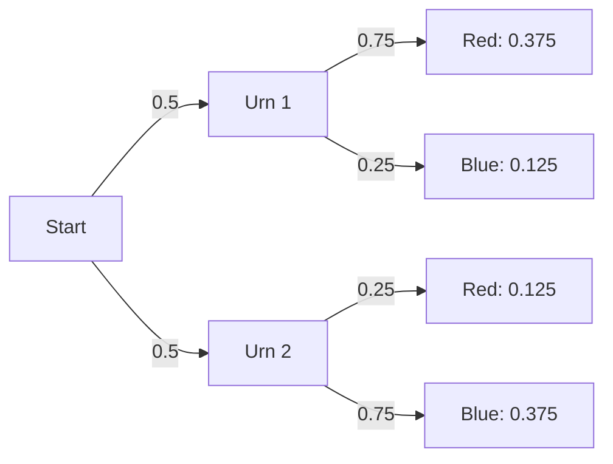
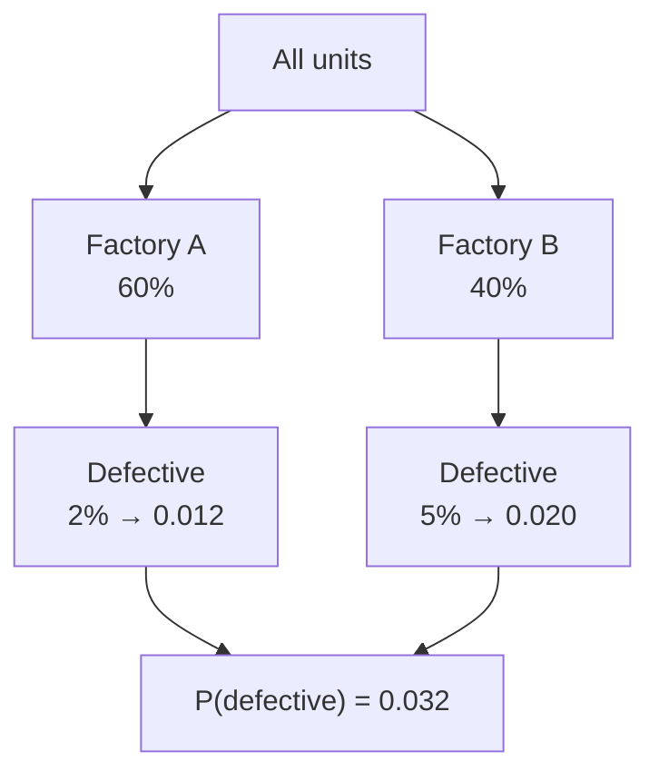

# M07 · Conditional Probability and Bayes' Theorem

<div class="psds-meta" markdown>
<span class="psds-chip psds-chip--core">Chapter</span>
<span class="psds-chip">14 study hours</span>
<span class="psds-chip">Module overview: [M07](../07-conditional-probability-and-bayes.md)</span>
</div>

!!! abstract "Interactive laboratory"
    [Lab L-02 — Conditional probability and Bayes' theorem](../../labs/conditional-probability.md) — move prevalence, sensitivity and the false-positive rate, and watch the posterior probability of a condition after a positive test.

## 1. The idea, before any symbols

Every probability you have ever used in practice was conditional. "The chance of rain
is 30%" means *given the season, the city and today's forecast*. "This drug works"
means *in the trial population*. Probability is always relative to information, and
this chapter makes that relativity explicit.

The central object is \(\Pr(A\mid B)\): the probability of \(A\) **given that you know
\(B\) occurred**. It is defined by restricting attention to the part of the sample
space where \(B\) is true:

\[ \Pr(A\mid B)=\frac{\Pr(A\cap B)}{\Pr(B)},\qquad \Pr(B)>0. \]

Everything else in the chapter is a consequence. Multiplication follows by
rearranging. Total probability follows by splitting an event into cases. Bayes'
theorem follows by writing the same intersection two ways. And the trees, tables and
spam filters later in the chapter are all bookkeeping devices for those three
identities.

The idea that makes conditional probability powerful is also the one that makes it
dangerous: **information is not neutral**. Knowing \(B\) can raise or lower the chance
of \(A\), and the human intuition for *how much* is poor. That is why a test that is
"95% accurate" can still be wrong most of the time it fires (§9).

## 2. Why this matters

**Most real questions are conditional.** "Given that a customer churned, what did they
do differently?" "Given a positive test, what is the chance of disease?" "Given this
email contains 'free', is it spam?" All are \(\Pr(\text{something}\mid\text{evidence})\).

**Two directions are easily confused.** Doctors know \(\Pr(+\mid\text{disease})\).
Patients want \(\Pr(\text{disease}\mid+)\). These are different numbers, sometimes by a
factor of ten, and the confusion has caused real harm in screening programmes and
courtrooms.

**Naive Bayes is built here.** The spam filter in §10 is a working classifier; the
same structure underlies many text classifiers. M18 extends it to priors and
posteriors over parameters.

**Independence is a modelling decision.** Assuming independence when it is false is the
most common source of overconfident predictions, in statistics and in machine
learning.

## 3. Terminology and notation

| Term | Meaning |
|---|---|
| \(\Pr(A\mid B)\) | conditional probability of \(A\) given \(B\) |
| \(A\cap B\) | both occur; "\(A\) and \(B\)" |
| **Independent** | \(\Pr(A\cap B)=\Pr(A)\Pr(B)\), equivalently \(\Pr(A\mid B)=\Pr(A)\) |
| **Mutually exclusive** | \(A\cap B=\varnothing\); cannot both occur |
| **Partition** | disjoint events \(B_1,\dots,B_k\) with \(\bigcup B_i=S\) |
| **Prior** | probability before evidence, \(\Pr(H)\) |
| **Posterior** | probability after evidence, \(\Pr(H\mid E)\) |
| **Likelihood** | \(\Pr(E\mid H)\), how well a hypothesis predicts the evidence |
| **Base rate** | the prior prevalence of the condition, \(\Pr(H)\) |
| **Sensitivity** | \(\Pr(+\mid\text{disease})\) — true-positive rate |
| **Specificity** | \(\Pr(-\mid\text{healthy})\) — true-negative rate |
| **PPV** | positive predictive value, \(\Pr(\text{disease}\mid+)\) |

!!! warning "Independent or mutually exclusive? Not the same"

    Mutually exclusive means they cannot happen together. Independent means that one
    happening tells you nothing about the other. If \(A\) and \(B\) are mutually
    exclusive **and both have positive probability**, they are strongly *dependent*:
    learning that \(A\) happened tells you \(B\) did not.

## 4. Conditional probability

### 4.1 Intuition

Restricting to \(B\) shrinks the sample space from \(S\) to \(B\). Probabilities are
re-scaled so that the new space has total probability 1. That is why the definition
divides by \(\Pr(B)\): it is the normalising constant for the smaller space.

### 4.2 Definition and immediate consequences

\[ \Pr(A\mid B)=\frac{\Pr(A\cap B)}{\Pr(B)} \]

Three consequences follow at once:

\[ \Pr(A^{c}\mid B)=1-\Pr(A\mid B), \qquad
   \Pr(A\cup C\mid B)=\Pr(A\mid B)+\Pr(C\mid B)-\Pr(A\cap C\mid B), \]

and the **multiplication rule**, obtained by rearranging the definition:

\[ \Pr(A\cap B)=\Pr(A\mid B)\,\Pr(B)=\Pr(B\mid A)\,\Pr(A). \]

*Why the second equality matters:* the two right-hand sides are the same number
computed from opposite directions, and setting them equal *is* Bayes' theorem.

### Example 4.3 — a die

Roll a fair die. Let \(B=\{2,4,6\}\) (even) and \(A=\{4,5,6\}\) (greater than 3).

\[ \Pr(A\mid B)=\frac{\Pr(\{4,6\})}{\Pr(\{2,4,6\})}=\frac{2/6}{3/6}=\frac23. \]

Compare the unconditional \(\Pr(A)=3/6=1/2\). Knowing the roll is even *raises* the
chance it exceeds 3.

### Example 4.4 — cards without replacement

Two cards are drawn from a standard deck. What is the probability the second is an ace
given the first is an ace?

After one ace is removed, 3 aces remain among 51 cards:

\[ \Pr(\text{2nd ace}\mid\text{1st ace})=\frac{3}{51}=\frac{1}{17}\approx0.0588. \]

Then, by the multiplication rule,

\[ \Pr(\text{both aces})=\frac{4}{52}\cdot\frac{3}{51}=\frac{1}{221}\approx0.00452, \]

matching the counting result from M06 — a useful cross-check.

## 5. Independent and dependent events

### 5.1 Definition

\(A\) and \(B\) are **independent** if

\[ \Pr(A\cap B)=\Pr(A)\,\Pr(B), \]

equivalently \(\Pr(A\mid B)=\Pr(A)\) whenever \(\Pr(B)>0\). Independence means the
evidence is uninformative.

### 5.2 Testing independence from numbers

Suppose \(\Pr(A)=0.5\), \(\Pr(B)=0.4\), \(\Pr(A\cap B)=0.2\). Then
\(\Pr(A)\Pr(B)=0.20\), so the events are independent.

Now change \(\Pr(A\cap B)\) to \(0.3\). The product is still 0.20, so the events are
dependent, and \(\Pr(A\mid B)=0.3/0.4=0.75\) — knowing \(B\) raises the chance of \(A\)
from 0.5 to 0.75.

### 5.3 Pairwise versus mutual independence

Three events are **mutually independent** if every pair satisfies the product rule
*and*

\[ \Pr(A\cap B\cap C)=\Pr(A)\Pr(B)\Pr(C). \]

Pairwise independence does not imply this. Classic counterexample: toss two fair coins,
let \(A\) = first is H, \(B\) = second is H, \(C\) = the two coins differ. Each pair is
independent (check: \(\Pr(A\cap B)=1/4=\tfrac12\cdot\tfrac12\), and similarly for the
other pairs), but \(\Pr(A\cap B\cap C)=0\neq\tfrac12\cdot\tfrac12\cdot\tfrac12\).

### 5.4 Conditional independence

\(A\) and \(B\) are **conditionally independent given \(C\)** if
\(\Pr(A\cap B\mid C)=\Pr(A\mid C)\Pr(B\mid C)\).

This is the assumption behind naive Bayes: two symptoms are treated as independent
*once you know the disease status*. It is often false marginally and approximately
true conditionally — which is why the classifier works despite an assumption that is
never exactly satisfied.

## 6. The theorem of total probability

If \(B_1,\dots,B_k\) form a partition of \(S\) (disjoint, exhaustive), then for any
event \(A\),

\[ \Pr(A)=\sum_{i=1}^{k}\Pr(A\mid B_i)\,\Pr(B_i). \]

**Derivation.** The sets \(A\cap B_1,\dots,A\cap B_k\) are disjoint and their union is
\(A\). By additivity,

\[ \Pr(A)=\sum_i \Pr(A\cap B_i)=\sum_i \Pr(A\mid B_i)\Pr(B_i). \]

The last step is the multiplication rule applied to each term.

*In words:* to find the overall probability of \(A\), split the world into cases, find
the probability of \(A\) within each case, and average using the case probabilities as
weights. It is a weighted average, and forgetting the weights is the standard error.

### Example 6.1 — two factories

Factory A makes 60% of a company's output with a 2% defect rate; factory B makes 40%
with a 5% defect rate. A unit is chosen at random.

\[ \Pr(\text{defective})=0.60(0.02)+0.40(0.05)=0.012+0.020=0.032. \]

So 3.2% of all units are defective. Note it is **not** the simple average
\((2\%+5\%)/2=3.5\%\), because the factories do not contribute equally.

### 6.2 Reversing it — which factory?

Given a defective unit, what is the probability it came from A?

\[ \Pr(A\mid\text{def})=\frac{\Pr(\text{def}\mid A)\Pr(A)}{\Pr(\text{def})}
   =\frac{0.012}{0.032}=0.375. \]

That is Bayes' theorem, and the denominator is the total-probability calculation we
just did. Bayes always has this shape: a likelihood times a prior, divided by a
weighted average of the same products.

## 7. Bayes' theorem

### 7.1 Statement and derivation

For a hypothesis \(H\) and evidence \(E\) with \(\Pr(E)>0\),

\[ \Pr(H\mid E)=\frac{\Pr(E\mid H)\,\Pr(H)}{\Pr(E)}. \]

**Derivation.** Both \(\Pr(H\cap E)\) and \(\Pr(E\cap H)\) equal the same intersection,
so

\[ \Pr(E\mid H)\Pr(H)=\Pr(H\mid E)\Pr(E). \]

Divide by \(\Pr(E)\). With a partition \(H_1,\dots,H_k\), the denominator expands by
total probability:

\[ \Pr(H_i\mid E)=\frac{\Pr(E\mid H_i)\Pr(H_i)}
   {\sum_{j}\Pr(E\mid H_j)\Pr(H_j)}. \]

### 7.2 The odds form (worth memorising)

Dividing the posterior for \(H\) by that for \(H^{c}\), the \(\Pr(E)\) cancels:

\[ \underbrace{\frac{\Pr(H\mid E)}{\Pr(H^{c}\mid E)}}_{\text{posterior odds}}
   =\underbrace{\frac{\Pr(E\mid H)}{\Pr(E\mid H^{c})}}_{\text{likelihood ratio}}
   \times\underbrace{\frac{\Pr(H)}{\Pr(H^{c})}}_{\text{prior odds}}. \]

The **likelihood ratio** (for a test: sensitivity / false-positive rate) says how much
the evidence moves belief; the prior odds say where belief started.

### Example 7.3 — a screening test, in counts

A disease has prevalence 1%. A test has sensitivity 92% and specificity 95%. Take
10,000 people.

| | Test + | Test − | Total |
|---|---|---|---|
| Disease | 92 | 8 | 100 |
| Healthy | 495 | 9,405 | 9,900 |
| Total | 587 | 9,413 | 10,000 |

- Diseased: \(1\%\) of 10,000 = 100. True positives \(=0.92(100)=92\).
- Healthy: 9,900. False positives \(=0.05(9{,}900)=495\).
- Total positives: 587.

\[ \Pr(\text{disease}\mid+)=\frac{92}{587}\approx0.1567\approx15.7\%. \]

**Reading it.** A positive result raises the chance of disease from 1% to about 16% —
a fifteen-fold increase, and still a 5-in-6 chance of a false alarm. The test is good;
the disease is rare. Both facts matter, and only the arithmetic keeps them together.

### Example 7.4 — the same test twice

The person tests positive and is retested with an independent test of the same
accuracy. Now use the 587 positives as the new population:

- Diseased among them: 92; second test positive: \(0.92(92)=84.64\).
- Healthy among them: 495; second test positive: \(0.05(495)=24.75\).
- Total second positives: \(84.64+24.75=109.39\).

\[ \Pr(\text{disease}\mid ++)=\frac{84.64}{109.39}\approx0.774. \]

Two independent positives take the probability from 16% to 77%. This is why confirmatory
testing is standard practice — and why "independent" is doing heavy lifting: if both
tests share the same flaw, the second adds little.

### Example 7.5 — odds form, quick

Prior odds \(=0.01/0.99=0.0101\). Likelihood ratio \(=0.92/0.05=18.4\).
Posterior odds \(=0.186\). Probability \(=0.186/(1+0.186)=0.157\). Same answer as the
count method, with less arithmetic — the odds form is faster when you will update
repeatedly.

## 8. Probability trees

A tree organises a sequential calculation. Branches carry conditional probabilities;
a path's probability is the product along it; the total for an outcome is the sum over
paths that reach it.

**Worked example — two urns.** Urn 1 has 3 red and 1 blue; Urn 2 has 1 red and 3 blue.
A fair coin picks an urn, then one ball is drawn.

- Path Urn 1 → red: \(0.5\times0.75=0.375\).
- Path Urn 1 → blue: \(0.5\times0.25=0.125\).
- Path Urn 2 → red: \(0.5\times0.25=0.125\).
- Path Urn 2 → blue: \(0.5\times0.75=0.375\).

Total red: \(0.375+0.125=0.5\). Given red, probability it came from Urn 1:
\(0.375/0.5=0.75\).



*What to look at:* the terminal values sum to 1 (\(0.375+0.125+0.125+0.375=1\)), which
is the check that the tree is complete. Reading backwards along a branch is Bayes:
the share of "Red" that comes from Urn 1 is \(0.375/0.5\).

## 9. Medical testing scenarios

### 9.1 Three questions that sound the same

| Question | Symbol | Typical value in our example |
|---|---|---|
| "If you have the disease, will the test find it?" | \(\Pr(+\mid D)\) | 0.92 |
| "If the test is positive, do I have the disease?" | \(\Pr(D\mid+)\) | 0.157 |
| "If you are healthy, will the test clear you?" | \(\Pr(-\mid H)\) | 0.95 |

Only the second is what a patient wants, and it cannot be read off the first without
the prevalence.

### 9.2 Why screening programmes care about prevalence

At 1% prevalence, 495 of 587 positives are false. If the disease is instead at 20%
prevalence (a high-risk group), the same test gives: diseased 2,000 → 1,840 positives;
healthy 8,000 → 400 false positives; PPV \(=1840/2240=0.821\). **The test has not
changed; the population has.** This is why targeted screening is more efficient than
universal screening, and why a test validated in a clinic can disappoint in the
community.

### 9.3 The cost of a false positive

A programme screening 100,000 people at 1% prevalence produces 5,870 positives, of
which about 920 are true. The remaining 4,950 people face follow-up biopsies, anxiety
and cost. Those are statistical consequences of §7.3, and they belong in the planning
before the programme starts.

## 10. Spam detection with naive Bayes

### 10.1 The model

Each email is spam (\(S\)) or ham (\(H\)). Each word \(w\) has a probability of
appearing in each class. Assuming words are conditionally independent given the class,

\[ \Pr(S\mid w_1,\dots,w_n)\;\propto\;\Pr(S)\prod_{i=1}^{n}\Pr(w_i\mid S). \]

The proportionality constant is the same for both classes, so you compare the two
products (or their logs, to avoid underflow).

### Example 10.2 — one word

From a labelled corpus: \(\Pr(S)=0.40\), \(\Pr(\text{"free"}\mid S)=0.30\),
\(\Pr(\text{"free"}\mid H)=0.02\).

\[ \Pr(S\mid\text{free})=\frac{0.40(0.30)}{0.40(0.30)+0.60(0.02)}
   =\frac{0.12}{0.132}\approx0.909. \]

A single word moves the probability from 40% to 91%.

### Example 10.3 — two words

Add "winner": \(\Pr(\text{winner}\mid S)=0.25\), \(\Pr(\text{winner}\mid H)=0.01\).

\[ \Pr(S\mid\text{free},\text{winner})
   =\frac{0.40(0.30)(0.25)}{0.40(0.30)(0.25)+0.60(0.02)(0.01)}
   =\frac{0.03}{0.03012}\approx0.996. \]

Two words take it to 99.6%. Note how fast the product grows: the likelihood ratio
multiplies, which is why naive Bayes needs smoothing for words rarely seen (§11, item
8).

### 10.4 What the assumption buys and costs

The independence assumption is false — "free" and "winner" co-occur. But because the
decision boundary is a comparison of two products, the classifier is often accurate
even when the probabilities themselves are badly calibrated. That distinction
(ranking right, numbers wrong) recurs throughout machine learning and is worth
remembering.

## 11. Common mistakes and misconceptions

| # | Mistake | Why it is wrong | Correct |
|---|---|---|---|
| 1 | \(\Pr(A\mid B)=\Pr(B\mid A)\) | The two condition on different events | Use Bayes |
| 2 | Ignoring the base rate in a positive test | Prevalence dominates when the disease is rare | Build the 2×2 table |
| 3 | Confusing independent with mutually exclusive | Exclusive events are maximally dependent | Check the definitions |
| 4 | Adding conditional probabilities without reweighting | They apply to different sub-populations | Weight by \(\Pr(B_i)\) |
| 5 | "Independence of pairs means mutual independence" | A three-way counterexample exists | Check all pairs **and** the triple |
| 6 | Multiplying probabilities of dependent events | Only valid under independence | Use the multiplication rule with the conditional |
| 7 | "The second test is independent" without evidence | Shared flaws correlate the tests | State the assumption; check the design |
| 8 | Naive Bayes with a zero count | One zero kills the product | Laplace smoothing |
| 9 | Treating a likelihood ratio as a probability | It can exceed 1 | It multiplies odds, not probabilities |
| 10 | "The probability changed, so the test is unreliable" | Probability is relative to information | Report both conditional directions |

## 12. How this connects to Data Science

- **Classifiers** output \(\Pr(y\mid x)\); the training set supplies the prior, the
  model the likelihood.
- **Naive Bayes** is the simplest generative classifier and the standard baseline for
  text.
- **Bayesian updating** in M18 generalises §7.5 to parameters: prior odds × likelihood
  ratio = posterior odds.
- **Recommenders** use conditional probabilities of items given a user's history.
- **A/B tests** condition on assignment; peeking changes the conditional probability of
  a false positive (M15).
- **Missing data** mechanisms (MCAR/MAR/MNAR) are conditional-independence statements
  about the missingness indicator.

## 13. Real-world scenarios

**Hepatitis C screening in Punjab.** Prevalence in the general population is low but
varies sharply by district and risk group. The same assay therefore yields very
different predictive values across populations — a fact that must be handled in
reporting, not just in the lab.

**Courtroom evidence.** "The chance of a random match is 1 in a million" is
\(\Pr(\text{match}\mid\text{innocent})\), not \(\Pr(\text{innocent}\mid\text{match})\).
Prosecutors have inverted this in ways that contributed to wrongful convictions.

**Fraud detection.** A rule flags transactions with a 1% false-positive rate. At 10
million transactions a day that is 100,000 alerts; no team can review them. The
likelihood ratio and the base rate together determine whether a rule is usable.

**Drug testing in sport.** With a 1% violation rate and a 99% specific test, roughly
half of positives are false. Sports bodies that publish "adverse analytical findings"
without predictive values invite exactly the confusion in §9.

**Search ranking.** "Given the query, what is the probability this document is
relevant?" is a conditional probability estimated from click data, which is itself
biased by what was shown — a conditioning problem on top of a conditioning problem.

## 14. Visual explanations

### 14.1 The two directions of conditioning

```
                 Disease            No disease
Test +        92 (TP)                495 (FP)
Test −         8 (FN)              9,405 (TN)

Pr(+ | disease) = 92/100  = 0.92      ← the lab's number
Pr(disease | +) = 92/587  = 0.157     ← the patient's number
```

*What to look at:* the denominators. The first divides by the row total; the second by
the column total. Nothing else differs.

### 14.2 Prior odds × likelihood ratio

```
prior 1%        odds 0.0101
LR+ = 18.4  →   odds 0.186
                probability 0.157

second positive → 0.186 × 18.4 = 3.42  →  0.774
```

*What to look at:* each positive multiplies the odds by the same factor. Repeated
evidence compounds multiplicatively, which is why two tests are so much stronger than
one.

### 14.3 The partition behind total probability



*What to look at:* the two contributions are weighted by output share. A simple
average of 2% and 5% would be wrong because the branches are not equally likely.

## 15. Practice exercises

**Exercise 1 (★).** In a class, 60% of students study Python, and 40% of those also
study R. What proportion studies both?

**Exercise 2 (★).** \(\Pr(A)=0.4\), \(\Pr(B)=0.5\), \(\Pr(A\mid B)=0.2\). Find
\(\Pr(A\cap B)\), \(\Pr(B\mid A)\) and \(\Pr(A\cup B)\).

**Exercise 3 (★).** Two events have \(\Pr(A)=0.3\), \(\Pr(B)=0.5\),
\(\Pr(A\cap B)=0.15\). Are they independent?

**Exercise 4 (★★).** A test has sensitivity 90% and specificity 98%. Prevalence is 2%.
Compute the PPV using a population of 10,000.

**Exercise 5 (★★).** Three machines produce 50%, 30% and 20% of output, with defect
rates 1%, 2% and 4%. Find the overall defect rate and the probability that a defective
item came from the third machine.

**Exercise 6 (★★).** Prior odds of spam are 2:3. A word has likelihood ratio 12. Find
the posterior probability of spam.

**Exercise 7 (★★★).** Two tests are used in sequence, both with sensitivity 0.9 and
specificity 0.95, and prevalence 2%. Compute \(\Pr(D\mid++)\), then compute it again
assuming the tests are *perfectly correlated* (the second adds no information). Explain
the difference.

**Exercise 8 (★★★).** Show that if \(\Pr(A\mid B)>\Pr(A)\) then
\(\Pr(B\mid A)>\Pr(B)\). Interpret the result.

## 16. Solutions

**Solution 1.** \(\Pr(\text{both})=\Pr(R\mid P)\Pr(P)=0.40\times0.60=0.24\), so 24%.

**Solution 2.** \(\Pr(A\cap B)=\Pr(A\mid B)\Pr(B)=0.2\times0.5=0.10\).
\(\Pr(B\mid A)=0.10/0.40=0.25\). \(\Pr(A\cup B)=0.4+0.5-0.1=0.8\).

**Solution 3.** \(\Pr(A)\Pr(B)=0.3\times0.5=0.15=\Pr(A\cap B)\). Yes, independent —
and note they are not mutually exclusive, since the intersection is non-zero.

**Solution 4.** 10,000 people, 2% prevalence → 200 diseased, 9,800 healthy.
TP \(=0.90(200)=180\); FP \(=0.02(9800)=196\). Total positives \(=376\).

\[ \Pr(D\mid+)=\frac{180}{376}\approx0.4788\approx47.9\%. \]

| | + | − | Total |
|---|---|---|---|
| Disease | 180 | 20 | 200 |
| Healthy | 196 | 9,604 | 9,800 |
| Total | 376 | 9,624 | 10,000 |

**Solution 5.** Overall defect rate:

\[ 0.5(0.01)+0.3(0.02)+0.2(0.04)=0.005+0.006+0.008=0.019. \]

Third machine's contribution: \(0.008/0.019\approx0.421\), about 42%.

**Solution 6.** Prior odds \(2/3=0.667\); posterior odds \(=0.667\times12=8\).
Probability \(=8/9\approx0.889\).

**Solution 7.** First test at 2% prevalence in 10,000: 200 diseased → 180 TP;
9,800 healthy → 490 FP; total positives 670; PPV \(=180/670=0.2687\). Now retest the
670 positives as the population:

- Diseased among them 180; second positive \(0.9(180)=162\).
- Healthy among them 490; second positive \(0.05(490)=24.5\).
- Total \(=186.5\); \(\Pr(D\mid++)=162/186.5\approx0.869\).

If the tests are perfectly correlated, the second test repeats the first exactly: every
first positive tests positive again, so \(\Pr(D\mid++)=0.2687\), unchanged. Real tests
lie between: correlated errors mean the second result adds less than independence
assumes. **Always state the independence assumption; it is an assumption about the
tests, not a mathematical default.**

**Solution 8.** \(\Pr(A\mid B)>\Pr(A)\) means
\(\Pr(A\cap B)/\Pr(B)>\Pr(A)\), so \(\Pr(A\cap B)>\Pr(A)\Pr(B)\). Dividing by
\(\Pr(A)>0\) gives \(\Pr(B\mid A)>\Pr(B)\). So the relation is symmetric: if \(B\)
raises the probability of \(A\), then \(A\) raises the probability of \(B\). Association
cannot be one-directional — which is precisely why "A predicts B" and "B predicts A"
are the same statistical claim, and why causal direction needs something beyond the
numbers.

## 17. Self-assessment

Answer, then check.

1. Define \(\Pr(A\mid B)\) and state the condition under which it is undefined.
2. Write the multiplication rule for three events.
3. Give the test for independence of two events.
4. Why does \(\Pr(A)=0.03\) imply \(A\) and \(B\) are dependent when \(B\) has positive
   probability?
5. State the theorem of total probability and name the requirement on the \(B_i\).
6. A test's sensitivity is 99% and its specificity is 90%. Which conditional
   probability is 99%? Which is 90%?
7. In words, what does a likelihood ratio of 18 mean?
8. Why must a naive Bayes filter use logarithms in practice?
9. A disease has prevalence 5% and a test has PPV 0.5. Is a positive result more likely
   true or false?
10. Two screening programmes use the same test but report PPVs of 0.16 and 0.82. What
    differs?

### Answers

1. \(\Pr(A\mid B)=\Pr(A\cap B)/\Pr(B)\); undefined when \(\Pr(B)=0\).
2. \(\Pr(A\cap B\cap C)=\Pr(A)\Pr(B\mid A)\Pr(C\mid A\cap B)\).
3. \(\Pr(A\cap B)=\Pr(A)\Pr(B)\).
4. Mutually exclusive events with positive probability cannot satisfy the product rule,
   so they are dependent (maximally so).
5. \(\Pr(A)=\sum_i\Pr(A\mid B_i)\Pr(B_i)\); the \(B_i\) must be disjoint and exhaustive
   (a partition).
6. Sensitivity is \(\Pr(+\mid D)=0.99\); specificity is \(\Pr(-\mid H)=0.90\).
7. The evidence is 18 times more likely under the hypothesis than under its complement,
   so it multiplies the prior odds by 18.
8. Multiplying many small probabilities underflows floating point; summing logs is
   numerically stable and equivalent for comparison.
9. True — PPV 0.5 means exactly half of positives are true positives.
10. The prevalence (base rate) of the tested population; the test is identical.

## 18. Revision summary

**Core identity.**

\[ \Pr(A\mid B)=\frac{\Pr(A\cap B)}{\Pr(B)}, \qquad
   \Pr(A\cap B)=\Pr(A\mid B)\Pr(B). \]

**Independence.** \(\Pr(A\cap B)=\Pr(A)\Pr(B)\); equivalent to
\(\Pr(A\mid B)=\Pr(A)\). Not the same as mutually exclusive.

**Total probability.** Partition, condition, weight, add:
\(\Pr(A)=\sum_i\Pr(A\mid B_i)\Pr(B_i)\).

**Bayes.** Posterior ∝ likelihood × prior; in odds form, posterior odds = likelihood
ratio × prior odds. The denominator is the total-probability calculation.

**Trees.** Multiply along a path; add across paths; read backwards for Bayes.

**Screening.** Sensitivity and specificity describe the test; PPV describes the patient,
and depends on prevalence. Two independent tests compound; correlated tests do not.

**Naive Bayes.** \(\Pr(S\mid w)\propto\Pr(S)\prod_i\Pr(w_i\mid S)\), with smoothing for
unseen words and logs for stability.

**Habits.**

1. Write the conditioning event before the number.
2. Build the 2×2 table for any screening question.
3. Redo a probability in counts when the answer surprises you.

**Next.** M08 turns events into numbers: random variables, distributions, expectation
and variance.

**Run it.** [Practical 07 — Conditional probability and Bayes](../../practicals/notebooks/07-conditional-probability-and-bayes.ipynb) · [all practicals](../../practicals/index.md)

---

**Previous:** [M06 chapter](../06-probability-fundamentals/chapter.md) ·
**Next:** [M08 · Random Variables and Mathematical Expectation](../08-random-variables-and-expectation.md)
