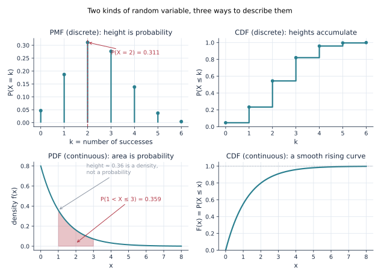
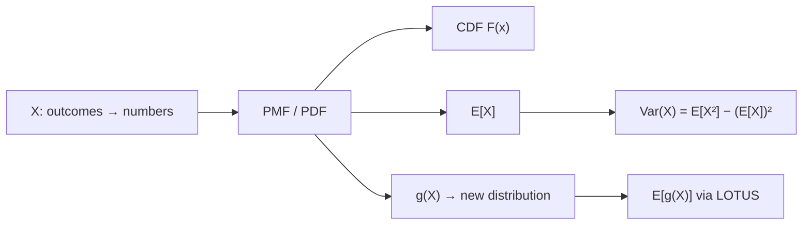

# M08 · Random Variables and Mathematical Expectation

<div class="psds-meta" markdown>
<span class="psds-chip psds-chip--core">Chapter</span>
<span class="psds-chip">16 study hours</span>
<span class="psds-chip">Module overview: [M08](../08-random-variables-and-expectation.md)</span>
</div>

## 1. The idea, before any symbols

A random variable is a **number attached to an outcome**. Toss two coins and count
heads: the outcome is \(HH\), the number is 2. Roll a die: the outcome is a face, the
number is its value. Measure a waiting time: the outcome is an interval, the number is
its length in minutes.

Once outcomes are numbers, arithmetic becomes available: you can add, average, compare
and transform. That is the whole trick, and it is why probability becomes statistics at
this point.

Three objects describe a random variable completely:

- the **PMF** (discrete) or **PDF** (continuous) — how probability is distributed over
  values;
- the **CDF** — the running total, \(F(x)=\Pr(X\le x)\);
- the **moments** — mean, variance and their relatives, which summarise location and
  spread.

And one operation generates the moments: **expectation**, a weighted average where the
weights are probabilities. Almost every formula later in the course is an expectation
in disguise: variance, covariance, likelihood contributions, risk, mean squared error.

## 2. Why this matters

**Expectation is the language of decision-making.** Expected cost, expected revenue,
expected loss — every decision under uncertainty is an optimisation over expectations.

**Variance is the language of risk.** Two investments with the same expected return are
not equivalent; the one with larger variance can ruin you. Modern portfolio theory is
the algebra of §7.

**The CDF is how software works.** `scipy.stats.norm.cdf`, quantile functions,
p-values and confidence intervals are all CDF operations. Understanding \(F\) is
understanding what those functions return.

**Transformations explain data pipelines.** A log transform, a standardisation, a
squared error: each is a function of a random variable, and each has a distribution you
can derive (§10).

## 3. Terminology and notation

| Symbol | Meaning |
|---|---|
| \(X\) | a random variable (capital) |
| \(x\) | a value it can take (lower case) |
| \(p_X(x)=\Pr(X=x)\) | probability mass function (discrete) |
| \(f_X(x)\) | probability density function (continuous) |
| \(F_X(x)=\Pr(X\le x)\) | cumulative distribution function, any \(X\) |
| \(\E[X]\), \(\mu_X\) | expected value (mean) |
| \(\Var(X)\), \(\sigma_X^{2}\) | variance |
| \(\sd(X)\), \(\sigma_X\) | standard deviation |
| \(\E[X^{k}]\) | \(k\)-th raw moment |
| \(\E[(X-\mu)^{k}]\) | \(k\)-th central moment |
| \(\Cov(X,Y)\) | covariance |
| \(M_X(t)=\E[e^{tX}]\) | moment generating function |

**Discrete versus continuous, in one line.** For discrete \(X\), probability lives *on*
points and we sum. For continuous \(X\), probability lives *in intervals*, a single
point has probability zero, and we integrate.

## 4. Discrete random variables: the PMF

A **probability mass function** assigns each value a probability:

\[ p_X(x_i)\ge0, \qquad \sum_i p_X(x_i)=1. \]

Probabilities of sets are sums: \(\Pr(a\le X\le b)=\sum_{x_i\in[a,b]}p_X(x_i)\).

### Example 4.1 — number of heads in two tosses

\(X\in\{0,1,2\}\) with \(p(0)=1/4\), \(p(1)=1/2\), \(p(2)=1/4\). Checks:
non-negative; sum \(=1\).

\[ \Pr(X\ge1)=p(1)+p(2)=0.75, \qquad \Pr(X=2)=0.25. \]

### 4.2 The CDF of a discrete variable

\(F(x)=\Pr(X\le x)\) is a **step function**, constant between values and jumping at
each one. For the coin example:

\[ F(x)=0\ (x<0),\quad 0.25\ (0\le x<1),\quad 0.75\ (1\le x<2),\quad 1\ (x\ge2). \]

The jumps are the PMF values: \(p(x_i)=F(x_i)-F(x_i^{-})\). This is why the CDF is the
more general object — it exists for every random variable, discrete or not.

## 5. Continuous random variables: the PDF

A **probability density function** \(f_X\) satisfies

\[ f_X(x)\ge0, \qquad \int_{-\infty}^{\infty}f_X(x)\,dx=1, \]

and probability is **area**:

\[ \Pr(a\le X\le b)=\int_{a}^{b}f_X(x)\,dx, \qquad
   F_X(x)=\int_{-\infty}^{x}f_X(t)\,dt, \qquad
   f_X(x)=\frac{d}{dx}F_X(x). \]

### 5.1 The two facts students most often get wrong

1. **\(f(x)\) is not a probability.** It can exceed 1. For a uniform density on
   \([0,0.5]\), \(f(x)=2\). Probability is the area under it, and areas cannot exceed 1.
2. **A single point has probability zero.** \(\Pr(X=3)=0\) for any continuous \(X\),
   even though \(X\) can equal 3. That is not a contradiction: with uncountably many
   values, each must carry zero mass for the total to be finite.

### Example 5.2 — \(f(x)=2x\) on \((0,1)\)

**Check it is a density.** \(\int_0^1 2x\,dx=\left[x^{2}\right]_0^1=1\). ✓

**CDF.** \(F(x)=\int_0^x 2t\,dt=x^{2}\) for \(0\le x\le1\), with \(F=0\) below and
\(F=1\) above.

**Interval probability.** \(\Pr(0.3<X<0.6)=F(0.6)-F(0.3)=0.36-0.09=0.27\).

**Tail.** \(\Pr(X>0.8)=1-0.64=0.36\).

Note that \(f(0.9)=1.8>1\) — allowed, because it is a density, not a probability.

## 6. Expected value

### 6.1 Definition

\[ \E[X]=\sum_i x_i\,p_X(x_i)\quad\text{(discrete)}, \qquad
   \E[X]=\int_{-\infty}^{\infty}x\,f_X(x)\,dx\quad\text{(continuous)}. \]

For a function \(g\), the **law of the unconscious statistician** says you need not find
the distribution of \(g(X)\):

\[ \E[g(X)]=\sum_i g(x_i)p_X(x_i), \qquad
   \E[g(X)]=\int g(x)f_X(x)\,dx. \]

*Why "unconscious":* you apply the formula without deriving the distribution of
\(g(X)\) — which is legitimate, and saves the work of §10.

### 6.2 Derivation of the linearity property

For constants \(a,b\),

\[ \E[aX+b]=\sum_i (ax_i+b)p(x_i)=a\sum_i x_ip(x_i)+b\sum_i p(x_i)=a\E[X]+b. \]

The same computation with integrals gives the continuous case. **No independence
assumption is used** — linearity holds for any random variables, which is why it is the
most useful identity in the subject.

By induction, \(\E\left[\sum_i a_iX_i\right]=\sum_i a_i\E[X_i]\).

### Example 6.3 — a fair die

\[ \E[X]=\sum_{k=1}^{6}k\cdot\frac16=\frac{21}{6}=3.5. \]

The expected value need not be an attainable value: no face shows 3.5. It is the
long-run average of many rolls.

### Example 6.4 — the continuous case

For \(f(x)=2x\) on \((0,1)\):

\[ \E[X]=\int_0^1 x(2x)\,dx=2\int_0^1 x^{2}dx=2\cdot\frac13=\frac23. \]

## 7. Variance and standard deviation

### 7.1 Definition and computational form

\[ \Var(X)=\E\left[(X-\mu)^{2}\right]=\E[X^{2}]-\left(\E[X]\right)^{2}, \qquad
   \sd(X)=\sqrt{\Var(X)}. \]

**Derivation of the shortcut.** Expand the square and use linearity:

\[ \E[(X-\mu)^{2}]=\E[X^{2}-2\mu X+\mu^{2}]
   =\E[X^{2}]-2\mu\E[X]+\mu^{2}=\E[X^{2}]-\mu^{2}. \]

### 7.2 Scaling

\[ \Var(aX+b)=a^{2}\Var(X). \]

*Derivation:* \(\E[(aX+b)-(a\mu+b)]^{2}=\E[a^{2}(X-\mu)^{2}]=a^{2}\Var(X)\). The shift
\(b\) changes nothing about spread; the scale \(a\) is squared, so a variable measured
in metres has variance in square metres and SD in metres.

### Example 7.3 — two tosses

\(\E[X]=1\). \(\E[X^{2}]=0^{2}(0.25)+1^{2}(0.5)+2^{2}(0.25)=0.5+1=1.5\).

\[ \Var(X)=1.5-1=0.5, \qquad \sd(X)=\sqrt{0.5}\approx0.707. \]

### Example 7.4 — die, and the density

Die: \(\E[X^{2}]=\frac16(1+4+9+16+25+36)=\frac{91}{6}\approx15.167\), so
\(\Var=\frac{91}{6}-\frac{49}{4}=\frac{35}{12}\approx2.917\) and
\(\sd\approx1.708\).

Density \(f(x)=2x\): \(\E[X^{2}]=\int_0^1 2x^{3}dx=\frac12\), so
\(\Var=\frac12-\frac49=\frac{1}{18}\approx0.0556\), \(\sd\approx0.2357\).

## 8. Moments

The \(k\)-th **raw moment** is \(m_k=\E[X^{k}]\); the \(k\)-th **central moment** is
\(\mu_k=\E[(X-\mu)^{k}]\). Mean is \(m_1\); variance is \(\mu_2\).

| Moment | Meaning | Use |
|---|---|---|
| \(m_1\) | mean | location |
| \(\mu_2\) | variance | spread |
| \(\mu_3/\sigma^{3}\) | skewness | asymmetry |
| \(\mu_4/\sigma^{4}\) | kurtosis | tail weight |

**Why higher moments matter in practice.** Two returns series with identical mean and
variance can differ sharply in the fourth moment, and that difference is the frequency
of extreme days. Risk management cares about the tails, not just the spread.

### 8.1 Moment generating functions

\(M_X(t)=\E[e^{tX}]\), and \(M^{(k)}(0)=\E[X^{k}]\). For the exponential with rate
\(\lambda\),

\[ M_X(t)=\E[e^{tX}]=\int_0^{\infty}e^{tx}\lambda e^{-\lambda x}dx
   =\frac{\lambda}{\lambda-t}\quad(t<\lambda). \]

Differentiating gives \(\E[X]=1/\lambda\) and \(\E[X^{2}]=2/\lambda^{2}\), so
\(\Var=1/\lambda^{2}\) — the derivations the exponential chapter (M10) would otherwise
ask you to take on trust.

## 9. Covariance

\[ \Cov(X,Y)=\E[(X-\mu_X)(Y-\mu_Y)]=\E[XY]-\E[X]\E[Y]. \]

**Properties** (each follows by expanding):

\[ \Cov(X,X)=\Var(X), \qquad \Cov(aX+b,\,cY+d)=ac\,\Cov(X,Y), \]
\[ \Var(X+Y)=\Var(X)+\Var(Y)+2\Cov(X,Y). \]

**Interpretation.** Positive covariance means the two variables tend to be above (or
below) their means together; negative means they move oppositely. Its size depends on
units, so it is usually standardised into a correlation (M11):

\[ \rho=\frac{\Cov(X,Y)}{\sd(X)\sd(Y)}\in[-1,1]. \]

**Independence implies zero covariance, but not the reverse.** For \(X\) uniform on
\(\{-1,0,1\}\) and \(Y=X^{2}\): \(\E[XY]=\E[X^{3}]=0=\E[X]\E[Y]\), so
\(\Cov=0\), yet \(Y\) is a deterministic function of \(X\).

## 10. Transformations of random variables

### 10.1 The CDF method (always works)

To find the distribution of \(Y=g(X)\), compute
\(F_Y(y)=\Pr(g(X)\le y)\) and differentiate.

### Example 10.2 — \(Y=X^{2}\) with \(X\sim U(0,1)\)

For \(0<y<1\), \(\Pr(X^{2}\le y)=\Pr(X\le\sqrt{y})=\sqrt{y}\). So

\[ F_Y(y)=\sqrt{y}, \qquad f_Y(y)=\frac{1}{2\sqrt{y}}. \]

Check: \(\int_0^1 \frac{1}{2\sqrt y}dy=\left[\sqrt y\right]_0^1=1\). ✓

Then \(\E[Y]=\int_0^1 y\cdot\frac{1}{2\sqrt y}dy=\frac12\int_0^1 y^{1/2}dy
=\frac12\cdot\frac23=\frac13\), which matches the direct route
\(\E[X^{2}]=\int_0^1 x^{2}\cdot 1\,dx=\frac13\). ✓ Two methods, one answer.

### 10.3 Linear transformations

If \(Y=aX+b\) with \(a\neq0\), then
\(f_Y(y)=\frac{1}{\lvert a\rvert}f_X\!\left(\frac{y-b}{a}\right)\), and
\(\E[Y]=a\E[X]+b\), \(\Var(Y)=a^{2}\Var(X)\).

**Worked example.** \(X\) has mean 5 and SD 2. Let \(Y=3X+2\).
\(\E[Y]=17\), \(\sd(Y)=3(2)=6\). A scale change multiplies the SD by \(\lvert a\rvert\)
— not by \(a^{2}\), because SD is in the original units.

### 10.4 Monotone transformations (the density formula)

If \(g\) is strictly increasing or decreasing and differentiable,

\[ f_Y(y)=f_X\left(g^{-1}(y)\right)\left\lvert\frac{d}{dy}g^{-1}(y)\right\rvert. \]

For \(Y=e^{X}\) with \(X\sim N(\mu,\sigma^{2})\): \(x=\ln y\),
\(dx/dy=1/y\), so \(f_Y(y)=\frac{1}{y\sigma\sqrt{2\pi}}
\exp\left(-\frac{(\ln y-\mu)^{2}}{2\sigma^{2}}\right)\) — the lognormal density (M10).
This is the reason a lognormal variable is normal *on the log scale*.

## 11. Common mistakes and misconceptions

| # | Mistake | Why it is wrong | Correct |
|---|---|---|---|
| 1 | "\(f(x)\) is the probability that \(X=x\)" | Densities can exceed 1; points have probability 0 | Integrate over an interval |
| 2 | "\(\E[X]\) must be a possible value" | A die's mean is 3.5 | Expectation is a long-run average |
| 3 | "\(\E[g(X)]=g(\E[X])\)" | Generally false unless \(g\) is linear | Use the LOTUS formula |
| 4 | "\(\Var(aX)=a\Var(X)\)" | Variance scales with the square | \(a^{2}\Var(X)\) |
| 5 | "\(\Var(X+Y)=\Var X+\Var Y\)" | Only when covariance is zero | Add \(2\Cov(X,Y)\) |
| 6 | "Zero covariance means independence" | \(Y=X^{2}\) on symmetric \(X\) is a counterexample | Independence is stronger |
| 7 | "The CDF is only for continuous variables" | It exists for every variable | Steps for discrete, smooth for continuous |
| 8 | Adding SDs across independent variables | Variances add, not SDs | \(\sd=\sqrt{\sigma_1^{2}+\sigma_2^{2}}\) |
| 9 | "\(\E[X^{2}]=(\E[X])^{2}\)" | That would make every variance zero | Use \(\E[X^{2}]\) from the distribution |
| 10 | Forgetting to check a density integrates to 1 | An unnormalised density gives impossible answers | Always verify normalisation first |

## 12. How this connects to Data Science

- **Loss functions** are expectations: mean squared error is \(\E[(Y-\hat y)^{2}]\), which
  is bias² + variance.
- **Standardisation** is the linear transformation \((X-\mu)/\sigma\), giving mean 0 and
  SD 1.
- **Feature engineering** is transformation; §10 tells you what happens to the
  distribution.
- **Ensembles**: averaging \(n\) independent predictions reduces variance by a factor of
  \(n\) — variance algebra, not magic.
- **Risk metrics** (expected shortfall, volatility) are moments of a return
  distribution.
- **Covariance matrices** are the input to PCA and to portfolio optimisation; the
  correlation version is the same information rescaled.

## 13. Real-world scenarios

**Insurance.** A policy pays PKR 500,000 with probability 0.002. Expected payout
\(=1{,}000\). A premium above that covers cost and risk; the variance tells the insurer
how much capital to hold.

**Delivery times.** A courier quotes the mean (2.3 days) and the SD (0.8 days). A
promise of "2 days or refund" is a probability statement about the tail, computed from
the CDF — not from the mean.

**Manufacturing tolerance.** A part's diameter is normally distributed with mean 10 mm
and SD 0.05 mm. The fraction outside \(10\pm0.1\) mm is
\(\Pr(\lvert Z\rvert>2)\approx4.6\%\), a CDF calculation that determines scrap rate.

**Portfolio risk.** Two assets with SDs 10% and 15%: combined SD is between 5% and 25%
depending on correlation. Diversification is the statement
\(\Var(X+Y)=\Var X+\Var Y+2\Cov\) with a negative covariance term.

**Model evaluation.** A model's squared error on a test set is an estimate of
\(\E[(Y-\hat Y)^{2}]\); the sampling variability of that estimate is itself a variance
problem (M12).

## 14. Visual explanations

### 14.1 PMF versus PDF

```
PMF (discrete)                  PDF (continuous)
p(x)                            f(x)
 0.5 ┤  █                        2  ┤╲
 0.25┤█ █ █                         ┤ ╲___
     └─┬─┬─┬──  x                   └──────╲__  x
       0 1 2                          0      1
 heights ARE probabilities       area IS probability
```

*What to look at:* in the left panel, read the height. In the right panel, read the
area. Confusing the two is misconception #1.

### 14.2 The same data as PDF and CDF

```
f(x) = 2x on (0,1)          F(x) = x² on (0,1)
 2 ┤    ╱                    1 ┤      ╱
   │  ╱                        │   ╱
 0 └──────── x               0 └─────── x
   0        1                 0       1
 area up to x = F(x)          slope of F = f(x)
```

*What to look at:* the two panels are the same information differentiated and
integrated. \(\Pr(a<X<b)=F(b)-F(a)\) is a difference of heights in the right panel.

[](../../assets/images/figures/fig-08-01-pmf-pdf-cdf.svg)

*Figure 14.1 — PMF, PDF and CDF side by side, for a binomial and an exponential variable*

**What it shows.** The top row is discrete: the height of each stem is a probability,
\(P(X = k)\), and the CDF is the running total of those heights, so it climbs in steps
of exactly \(p(k)\). The bottom row is continuous: the curve is a *density*, and
probability is the shaded **area** between two values. Compare the two annotations in
the lower-left panel — the density at \(x = 1\) is about 0.36, which is not the
probability of anything, while \(P(1 < X \le 3) = 0.359\) is the area from 1 to 3.

**The mathematics.** For a discrete variable, \(p(k) = P(X = k)\) and
\(F(k) = \sum_{j \le k} p(j)\); for a continuous variable no single point carries
probability, \(P(X = x) = 0\), so a density may exceed 1 and only has to satisfy
\(f(x) \ge 0\) and \(\int f(x)\,dx = 1\). Probability is recovered as an integral,

\[
P(a < X \le b) = \int_a^b f(x)\,dx = F(b) - F(a),
\]

so the CDF accumulates area and \(f = F'\) wherever \(F\) is differentiable. That is
the exact analogue of the discrete sum, which is why the two CDFs tell the same story
of accumulation while only the discrete one has visible jumps. The height-versus-area
distinction has a practical consequence: a density is only meaningful relative to the
axis it is drawn on, so densities in different units cannot be compared by eye, whereas
probabilities and CDF values can.

**Try it.** [Practical 08 — Random variables and expectation](../../practicals/notebooks/08-random-variables-and-expectation.ipynb)
reproduces these four panels and checks \(\int f = 1\) and \(F' = f\) numerically.


### 14.3 Variance as squared distance

```
values:   2   4   6   8   10        mean = 6
deviations: -4  -2   0   2    4
squares:    16   4   0   4   16     mean square = 8 = variance
SD = √8 ≈ 2.83
```

*What to look at:* variance is the average squared distance from the mean, so it is in
squared units; the SD is back in the data's units and is what you report.



## 15. Practice exercises

**Exercise 1 (★).** \(X\) takes values 0, 1, 2 with probabilities 0.2, 0.5, 0.3. Find
\(\E[X]\), \(\E[X^{2}]\), \(\Var(X)\) and \(\sd(X)\).

**Exercise 2 (★).** For \(f(x)=3x^{2}\) on \((0,1)\), verify it is a density, find
\(F(x)\) and compute \(\Pr(0.5<X<0.8)\).

**Exercise 3 (★).** If \(\E[X]=10\) and \(\Var(X)=9\), find \(\E[4X-3]\) and
\(\Var(4X-3)\), and the SD of \(4X-3\).

**Exercise 4 (★★).** \(X\) is exponential with rate 0.25 per minute. Using
\(\E[X]=1/\lambda\) and \(\Var(X)=1/\lambda^{2}\), state the mean and SD, and compute
\(\Pr(X>8)\).

**Exercise 5 (★★).** \(X\) has density \(f(x)=2x\) on \((0,1)\). Find the density of
\(Y=3X+1\) and verify that it integrates to 1.

**Exercise 6 (★★).** Two independent variables have \(\Var(X)=4\), \(\Var(Y)=9\). Find
\(\Var(2X-3Y)\) and \(\sd(2X-3Y)\).

**Exercise 7 (★★).** \(X\) and \(Y\) have \(\Cov(X,Y)=6\), \(\sd(X)=3\), \(\sd(Y)=5\).
Find the correlation and interpret it.

**Exercise 8 (★★★).** Show that for any random variable with finite second moment,
\(\E[(X-c)^{2}]\) is minimised at \(c=\E[X]\), and state the minimum value.

**Exercise 9 (★★★).** \(X\sim U(0,1)\). Find the density of \(Y=-\ln X\) and identify
the family.

## 16. Solutions

**Solution 1.** \(\E[X]=0(0.2)+1(0.5)+2(0.3)=1.1\).
\(\E[X^{2}]=0+0.5+4(0.3)=1.7\).
\(\Var=1.7-1.21=0.49\); \(\sd=0.7\).

**Solution 2.** \(\int_0^1 3x^{2}dx=\left[x^{3}\right]_0^1=1\). ✓
\(F(x)=x^{3}\). \(\Pr(0.5<X<0.8)=0.512-0.125=0.387\).

**Solution 3.** \(\E[4X-3]=4(10)-3=37\). \(\Var(4X-3)=16(9)=144\).
\(\sd=12\).

**Solution 4.** Mean \(=1/0.25=4\) minutes; SD \(=1/0.25=4\) minutes.
\(\Pr(X>8)=e^{-0.25(8)}=e^{-2}\approx0.1353\).

**Solution 5.** \(x=(y-1)/3\), \(dx/dy=1/3\), and \(f_X=2x\) on \((0,1)\) means
\(y\in(1,4)\). So

\[ f_Y(y)=\frac13\cdot2\cdot\frac{y-1}{3}=\frac{2(y-1)}{9},\quad 1<y<4. \]

Check: \(\int_1^4 \frac{2(y-1)}{9}dy=\frac{2}{9}\left[\frac{(y-1)^{2}}{2}\right]_1^4
=\frac{2}{9}\cdot\frac{9}{2}=1\). ✓
Also \(\E[Y]=3\E[X]+1=3(2/3)+1=3\). ✓

**Solution 6.** Independence gives zero covariance, so
\(\Var(2X-3Y)=4\Var(X)+9\Var(Y)=16+81=97\). \(\sd=\sqrt{97}\approx9.849\).
Note that the minus sign disappears: variance uses \((-3)^{2}=9\).

**Solution 7.** \(\rho=6/(3\times5)=0.4\): a moderate positive linear association — \(Y\)
tends to rise with \(X\), but the relationship is far from deterministic.

**Solution 8.** Expand:
\(\E[(X-c)^{2}]=\E[X^{2}]-2c\E[X]+c^{2}\). This is a quadratic in \(c\) with positive
leading coefficient; differentiate: \(-2\E[X]+2c=0\), so \(c=\E[X]\). The minimum value
is \(\E[X^{2}]-(\E[X])^{2}=\Var(X)\).

**Solution 9.** \(Y=-\ln X\) is decreasing, \(x=e^{-y}\), \(dx/dy=-e^{-y}\), so
\(f_Y(y)=1\cdot e^{-y}=e^{-y}\) for \(y>0\) — the exponential distribution with rate 1.
This is exactly **inverse-transform sampling** (M18): \(-\ln U\) generates an
exponential variate.

## 17. Self-assessment

1. Give the two conditions a PMF must satisfy, and the two a PDF must satisfy.
2. Why is \(f(x)\) not a probability?
3. State the shortcut formula for variance.
4. Prove \(\E[aX+b]=a\E[X]+b\) in one line for the discrete case.
5. What does the law of the unconscious statistician let you avoid?
6. When does \(\Var(X+Y)=\Var(X)+\Var(Y)\) hold?
7. What is wrong with "zero covariance implies independence"?
8. If \(Y=5X-2\) and \(\sd(X)=3\), what is \(\sd(Y)\)?
9. Convert a moment generating function evaluation into \(\E[X]\).
10. Give the CDF method in two steps.

### Answers

1. Non-negative and summing to 1; non-negative and integrating to 1.
2. It is a density: probability is the area under it, and densities may exceed 1.
3. \(\Var(X)=\E[X^{2}]-(\E[X])^{2}\).
4. \(\sum(ax_i+b)p_i=a\sum x_ip_i+b\sum p_i=a\E[X]+b\).
5. Deriving the distribution of \(g(X)\) before computing \(\E[g(X)]\).
6. When \(\Cov(X,Y)=0\), which independence guarantees but does not require.
7. Covariance detects only *linear* association; \(Y=X^{2}\) on a symmetric \(X\) has
   zero covariance but total dependence.
8. \(\sd(Y)=\lvert5\rvert(3)=15\).
9. Differentiate \(M_X(t)\) and evaluate at \(t=0\).
10. Write \(F_Y(y)=\Pr(g(X)\le y)\), then differentiate with respect to \(y\).

## 18. Revision summary

**Three objects.** PMF/PDF (where the probability is), CDF (running total), moments
(location and shape).

**Expectation.** Weighted average; \(\E[g(X)]\) by LOTUS; linear for any variables:
\(\E[aX+bY+c]=a\E[X]+b\E[Y]+c\).

**Variance.** \(\E[X^{2}]-(\E[X])^{2}\); scales as \(a^{2}\); adds with covariance:
\(\Var(X+Y)=\Var X+\Var Y+2\Cov\).

**Moments.** Raw \(m_k\), central \(\mu_k\); mean, variance, skewness, kurtosis; MGFs
generate them.

**Covariance and correlation.** \(\Cov=\E[XY]-\E[X]\E[Y]\);
\(\rho=\Cov/(\sd_X\sd_Y)\in[-1,1]\). Zero covariance ≠ independence.

**Transformations.** CDF method always; density formula for monotone \(g\);
linear case gives \(\E[Y]=a\E[X]+b\) and \(\Var(Y)=a^{2}\Var(X)\).

**Habits.**

1. Check normalisation before using any density.
2. Ask whether a "mean" answer needs a variance next to it.
3. Never move \(\E\) inside a nonlinear function.

**Next.** M09 catalogues the discrete distributions these tools describe.

**Run it.** [Practical 08 — Random variables and expectation](../../practicals/notebooks/08-random-variables-and-expectation.ipynb) · [all practicals](../../practicals/index.md)

---

**Previous:** [M07 chapter](../07-conditional-probability-and-bayes/chapter.md) ·
**Next:** [M09 · Discrete Probability Distributions](../09-discrete-distributions.md)
