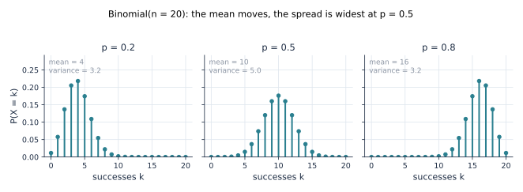
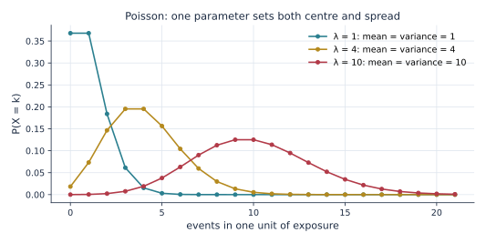
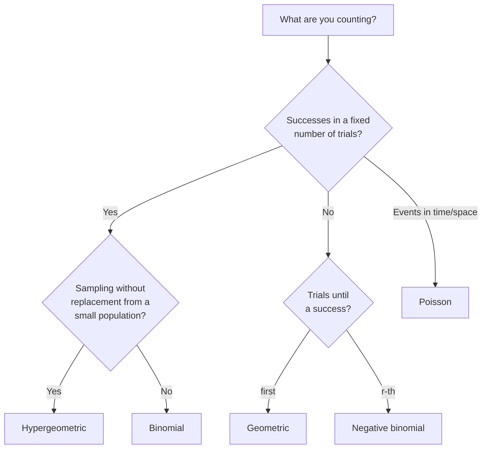

# M09 · Discrete Probability Distributions

<div class="psds-meta" markdown>
<span class="psds-chip psds-chip--core">Chapter</span>
<span class="psds-chip">14 study hours</span>
<span class="psds-chip">Module overview: [M09](../09-discrete-distributions.md)</span>
</div>

!!! abstract "Interactive laboratory"
    [Lab L-03 — Discrete probability distributions](../../labs/discrete-distributions.md) — switch between binomial, Poisson and geometric models and compare the exact mass function with simulated frequencies.

## 1. The idea, before any symbols

Most counting problems have the same shape: a fixed number of trials, each a success or
a failure, and a question about how many successes occurred. That shape is so common
that its distribution has a name, a formula and a set of properties worth memorising.

This chapter catalogues six discrete families. They are not arbitrary: each answers a
different question about the same underlying experiment.

| Question | Family |
|---|---|
| One trial, success or failure | Bernoulli |
| How many successes in \(n\) trials? | Binomial |
| How many trials until the first success? | Geometric |
| How many trials until the \(r\)-th success? | Negative binomial |
| How many successes when sampling **without** replacement? | Hypergeometric |
| How many events in a fixed interval of time or space? | Poisson |

The exam skill is not remembering six formulas; it is recognising which question is
being asked. §8 is a decision table for exactly that, and §9 compares the pairs that
students most often confuse.

## 2. Why this matters

**These are the models behind everyday data.** Defect counts, conversion counts, support
tickets per hour, disease cases per district, packets lost per minute. Choosing the wrong
family gives answers that are confidently wrong — the Poisson and the binomial differ
substantially when \(p\) is not small.

**Sampling without replacement is the default in audits and quality control.** Using the
binomial there overstates variability and understates the chance of many defects.

**They seed everything later.** The binomial appears in the normal approximation (M10),
in proportions (M12), in logistic regression; the Poisson appears in count models and
in Poisson processes.

## 3. Terminology and notation

| Symbol | Meaning |
|---|---|
| \(n\) | number of trials (fixed, known) |
| \(p\) | probability of success on one trial |
| \(X\) | number of successes (or trials, depending on family) |
| \(\binom{n}{k}\) | number of ways to choose \(k\) successes among \(n\) trials |
| \(\lambda\) | Poisson rate: mean events per unit interval |
| \(N,K,n\) | population size, successes in population, sample size (hypergeometric) |

Every family below assumes **independent trials with constant \(p\)** unless stated
otherwise. When that fails — sampling without replacement, or clustered data — the
binomial is the wrong model, and §9 says what to use instead.

## 4. Bernoulli distribution

### 4.1 Intuition

A single trial with two outcomes, coded 1 (success) and 0 (failure). One coin toss, one
free throw, one email being spam.

### 4.2 Definition

\[ \Pr(X=1)=p,\qquad \Pr(X=0)=1-p,\qquad
   \E[X]=p,\qquad \Var(X)=p(1-p). \]

**Derivation of the mean.**
\(\E[X]=1\cdot p+0\cdot(1-p)=p\).
**Derivation of the variance.**
\(\E[X^{2}]=1^{2}p+0=p\), so \(\Var=p-p^{2}=p(1-p)\).

### Example 4.3

A student attends class with probability 0.8. With \(X=1\) for attendance:
\(\E[X]=0.8\), \(\Var=0.8(0.2)=0.16\), \(\sd=0.4\). The mean of a 0/1 variable is
literally the proportion — the reason proportions and means are the same object.

## 5. Binomial distribution

### 5.1 Intuition

\(n\) independent Bernoulli trials, count the successes. The count is random because the
trials are.


[](../../assets/images/figures/fig-09-01-binomial.svg)

*Figure 5.1 — binomial shapes for n = 20 at three success probabilities*

**What it shows.** The mean np moves with p, but the spread is largest at p = 0.5 and shrinks towards both ends, in proportion to np(1 − p). At p = 0.2 or 0.8 the distribution is visibly skewed; at 0.5 it is symmetric. That is why binomial confidence intervals behave badly near 0 and 1.

### 5.2 Derivation of the PMF

A particular sequence with \(k\) successes and \(n-k\) failures has probability
\(p^{k}(1-p)^{n-k}\), by independence. Every such sequence has the same probability, and
there are \(\binom{n}{k}\) of them. So

\[ p_X(k)=\binom{n}{k}p^{k}(1-p)^{n-k},\qquad k=0,1,\dots,n. \]

**That the probabilities sum to 1** is the binomial theorem:
\(\sum_k\binom{n}{k}p^{k}(1-p)^{n-k}=(p+(1-p))^{n}=1\).

### 5.3 Mean and variance, derived

Write \(X=\sum_{i=1}^{n}X_i\) with \(X_i\) Bernoulli. By linearity,
\(\E[X]=\sum \E[X_i]=np\) — no independence needed.

For the variance, the \(X_i\) are independent, so variances add:
\(\Var(X)=\sum p(1-p)=np(1-p)\).

### Example 5.4 — conversion counts

An ad is clicked with probability 0.3 by each of 10 independent viewers. What is the
probability of exactly 3 clicks, and of at most 2?

\[ \Pr(X=3)=\binom{10}{3}(0.3)^{3}(0.7)^{7}=120(0.027)(0.08235)\approx0.2668. \]

For at most 2, add three terms:

\[ \Pr(X\le2)=(0.7)^{10}+10(0.3)(0.7)^{9}+45(0.09)(0.7)^{8}
   \approx0.0282+0.1211+0.2335=0.3828. \]

Mean \(=3\), variance \(=2.1\), \(\sd\approx1.449\).

### Example 5.5 — quality control with replacement

A production line has a 2% defect rate; 20 items are inspected independently. The
probability of finding no defects is \(0.98^{20}\approx0.6676\); the probability of at
least one is \(0.3324\). Note that "inspection" here means each item is replaced before
the next is drawn — otherwise use §7.

## 6. Geometric and negative binomial

### 6.1 Geometric: trials until the first success

To need exactly \(k\) trials, the first \(k-1\) must fail and the \(k\)-th must succeed:

\[ \Pr(X=k)=(1-p)^{k-1}p,\qquad k=1,2,\dots \]

**Mean derivation by tail sums.** For a non-negative integer variable,
\(\E[X]=\sum_{k\ge0}\Pr(X>k)\). Here \(\Pr(X>k)=(1-p)^{k}\), so
\(\E[X]=\sum_{k\ge0}(1-p)^{k}=\frac{1}{1-(1-p)}=\frac1p\).

Also \(\Var(X)=\frac{1-p}{p^{2}}\).

**Memorylessness.** \(\Pr(X>m+n\mid X>m)=\Pr(X>n)\): the past tells you nothing, because
trials are independent.

**Worked example.** A telemarketer reaches a person with probability 0.2.
\(\Pr(\text{first success on call 4})=0.8^{3}(0.2)=0.1024\). Mean calls \(=5\);
\(\Pr(\text{more than 5 calls})=0.8^{5}=0.32768\).

### 6.2 Negative binomial: trials until the \(r\)-th success

\[ \Pr(X=k)=\binom{k-1}{r-1}p^{r}(1-p)^{k-r},\qquad k=r,r+1,\dots \]

**Why the coefficient:** the \(k\)-th trial must be the \(r\)-th success; the other
\(r-1\) successes occupy \(r-1\) of the first \(k-1\) positions.

\[ \E[X]=\frac{r}{p},\qquad \Var(X)=\frac{r(1-p)}{p^{2}}. \]

**Worked example.** A salesperson needs 3 sales, \(p=0.2\). The probability that the
third sale is the 7th call:

\[ \Pr(X=7)=\binom{6}{2}(0.2)^{3}(0.8)^{4}=15(0.008)(0.4096)\approx0.0492. \]

Expected calls \(=3/0.2=15\).

### 6.3 Geometric versus negative binomial

The geometric is the negative binomial with \(r=1\). Use the geometric when you stop at
the **first** success and the negative binomial when you stop at the **\(r\)-th**. Note
both count *trials*; some textbooks count *failures before* the success, which shifts
the support by \(r\). Always check the support a source uses.

## 7. Hypergeometric distribution

### 7.1 Intuition

Sampling **without replacement** breaks independence: the composition of the population
changes after each draw. The hypergeometric counts successes in such a sample.

### 7.2 Definition

With \(N\) items, \(K\) of them "successes", drawing \(n\) without replacement:

\[ \Pr(X=k)=\frac{\binom{K}{k}\binom{N-K}{n-k}}{\binom{N}{n}}. \]

**Why:** choose \(k\) successes from the \(K\) available and \(n-k\) failures from the
\(N-K\), over all \(\binom{N}{n}\) samples.

\[ \E[X]=n\frac{K}{N},\qquad
   \Var(X)=n\frac{K}{N}\left(1-\frac{K}{N}\right)\frac{N-n}{N-1}. \]

The last factor is the **finite-population correction**; it is less than 1, so sampling
without replacement is *more* precise than with replacement.

### Example 7.3 — batch inspection

A batch of 20 components contains 5 defective. Four are inspected without replacement.
The probability of finding exactly one defective:

\[ \Pr(X=1)=\frac{\binom51\binom{15}{3}}{\binom{20}{4}}
   =\frac{5(455)}{4845}=\frac{2275}{4845}\approx0.4696. \]

Mean \(=4(5/20)=1\). Variance
\(=4(0.25)(0.75)(16/19)=12/19\approx0.632\). The binomial with \(n=4,p=0.25\) would give
variance 0.75 — an overstatement, because inspection depletes the batch.

## 8. Poisson distribution

### 8.1 Intuition

Counts of rare events in a fixed exposure: calls per minute, typos per page, cases per
district-week. The rate \(\lambda\) is the expected count.


[](../../assets/images/figures/fig-09-02-poisson.svg)

*Figure 8.1 — one parameter, one mean, one variance*

**What it shows.** For the Poisson the mean and the variance are both λ, so the distribution becomes symmetric and bell-like as λ grows. That equality is also its weakness: real count data whose variance exceeds the mean (over-dispersion) need a negative binomial, not a Poisson.

### 8.2 Definition

\[ \Pr(X=k)=\frac{\lambda^{k}e^{-\lambda}}{k!},\qquad k=0,1,2,\dots,\qquad
   \E[X]=\Var(X)=\lambda. \]

**Derivation as a limit of the binomial.** Take \(n\to\infty\), \(p\to0\) with
\(np\to\lambda\). Then

\[ \binom{n}{k}p^{k}(1-p)^{n-k}
   =\frac{n(n-1)\cdots(n-k+1)}{k!}\frac{\lambda^{k}}{n^{k}}
     \left(1-\frac{\lambda}{n}\right)^{n-k}
   \longrightarrow\frac{\lambda^{k}}{k!}e^{-\lambda}, \]

because the product of \(k\) factors each near 1 tends to 1, and
\((1-\lambda/n)^{n}\to e^{-\lambda}\). This is why the Poisson is the "rare event"
limit and why \(\E=\Var\): the binomial's \(np(1-p)\to\lambda\) as \(p\to0\).

### Example 8.3 — support tickets

A help desk receives 3 tickets per hour on average, Poisson. Then

\[ \Pr(X=0)=e^{-3}\approx0.0498,\qquad
   \Pr(X=2)=\frac{9e^{-3}}{2}\approx0.2240,\qquad
   \Pr(X\ge1)=1-e^{-3}\approx0.9502. \]

Because \(\E=\Var=3\), the SD is \(\sqrt3\approx1.732\): hour-to-hour variation of about
±1.7 tickets around a mean of 3. A queue sized for the mean will overflow often.

### Example 8.4 — Poisson approximation

A switchboard handles 1,000 calls, each dropped with probability 0.002. Exact model:
binomial. Approximation: \(\lambda=1000(0.002)=2\).

\[ \Pr(\text{none dropped})\approx e^{-2}\approx0.1353,\qquad
   \Pr(\text{at least one})\approx0.8647. \]

The exact binomial gives \(0.998^{1000}=0.1351\) — agreement to three decimal places,
which is why the approximation is used.

### 8.5 When the Poisson fails

- **Clustering**: events arrive in bursts (earthquakes, retweets), so variance exceeds
  the mean. The Poisson forces \(\Var=\E\); real counts often show over-dispersion.
- **Time-varying rate**: a lunchtime rush is not a constant \(\lambda\).
- **A hard upper bound**: if only 10 seats exist, a count cannot exceed 10, and the
  Poisson (unbounded) overstates the tail.

## 9. Choosing the right distribution

This is the table to memorise.

| | Trials fixed? | Replacement? | What is counted? | Mean | Variance |
|---|---|---|---|---|---|
| Bernoulli | 1 | — | success (0/1) | \(p\) | \(p(1-p)\) |
| Binomial | yes \(n\) | yes (independent) | successes | \(np\) | \(np(1-p)\) |
| Geometric | no | yes | trials to 1st success | \(1/p\) | \((1-p)/p^{2}\) |
| Negative binomial | no | yes | trials to \(r\)-th success | \(r/p\) | \(r(1-p)/p^{2}\) |
| Hypergeometric | yes \(n\) | **no** | successes | \(nK/N\) | \(n\frac KN(1-\frac KN)\frac{N-n}{N-1}\) |
| Poisson | no (interval) | — | events per interval | \(\lambda\) | \(\lambda\) |

### 9.1 The four confusions, resolved

**Binomial vs hypergeometric.** Both count successes in \(n\) draws. The difference is
replacement. Rule of thumb: if the sample is under about 5% of the population, the
binomial is an acceptable approximation (the correction factor
\((N-n)/(N-1)\approx1\)), otherwise use the hypergeometric.

**Geometric vs negative binomial.** Stop at the first success or the \(r\)-th. Same
family, different stopping rule.

**Binomial vs Poisson.** Binomial when \(n\) is fixed and known and \(p\) is not tiny;
Poisson when you count events in an interval and only the rate is known. Numerically
they agree when \(n\ge20\) and \(p\le0.05\).

**Binomial vs normal approximation.** For large \(np(1-p)\) (say \(>10\)), the binomial
is approximately normal — that is M10's business, and it is why the continuity
correction exists.



## 10. Common mistakes and misconceptions

| # | Mistake | Why it is wrong | Correct |
|---|---|---|---|
| 1 | Using the binomial when sampling without replacement | Trials are not independent | Hypergeometric |
| 2 | "Geometric counts failures" | Convention-dependent | Check the support; here it counts trials |
| 3 | "Poisson mean and variance differ" | For the Poisson they are equal by construction | \(\E=\Var=\lambda\) |
| 4 | Using the Poisson for clustered events | Real counts are over-dispersed | Negative binomial or a mixture |
| 5 | Forgetting \(\binom{n}{k}\) | A single sequence is not the only one | Multiply by the count of orderings |
| 6 | "\(p\) changes as you draw" ignored | That is the hypergeometric correction | Include \((N-n)/(N-1)\) |
| 7 | Binomial with non-constant \(p\) | Clustered or heterogeneous trials violate the model | Model the heterogeneity |
| 8 | "At least one" computed as \(n\times p\) | Overlaps double-count | \(1-(1-p)^{n}\) |
| 9 | Confusing "trials" and "successes" in the negative binomial | The support starts at \(r\) | \(k\ge r\) |
| 10 | Poisson tail for a bounded count | The Poisson is unbounded | Truncate or use the binomial |

## 11. How this connects to Data Science

- **Conversion modelling**: binomial counts with a logistic link (logistic regression).
- **A/B tests**: two binomial counts, compared (M15).
- **Count regression**: Poisson and negative binomial models for events per user.
- **Anomaly detection**: a Poisson tail flags an unusual spike in errors.
- **Sampling audits**: hypergeometric for inspection without replacement.
- **Retention**: geometric waiting times between visits.
- **Over-dispersion** is the first diagnostic in any count model: if variance ≫ mean,
  the Poisson is wrong.

## 12. Real-world scenarios

**Polio campaign monitoring.** Cases per district-week are modelled as Poisson with
district-specific rates; zero cases in a small district is weak evidence of zero
transmission, because \(\Pr(X=0)=e^{-\lambda}\) is high when \(\lambda\) is small.

**Call-centre staffing.** Arrivals per 15-minute interval, Poisson with a time-varying
rate. Staffing to the mean produces long queues roughly half the time — a Poisson
property, not bad luck.

**Exam multiple choice.** 20 independent questions, 4 options, guessing: \(X\sim
\text{Bin}(20,0.25)\), mean 5, SD \(\sqrt{3.75}\approx1.94\). A score of 10 is about
2.6 SD above chance.

**Batch acceptance sampling.** A supplier ships 500 units with 10 defectives; you inspect
20. Hypergeometric gives the probability of finding none — the number that decides
whether acceptance sampling is worth doing at all.

**Cricket sixes.** A batter hits a six with probability 0.05 per ball. The number of
balls until the next six is geometric with mean 20; the number of balls until three
sixes is negative binomial with mean 60.

## 13. Visual explanations

### 13.1 Shapes of the binomial at different \(p\)

```
p = 0.2                 p = 0.5                p = 0.8
▁▃█▅▂▁                  ▁▂▅█▅▂▁                ▁▂▅█▃▁
0        10             0        10            0        10
skewed right            symmetric              skewed left
```

*What to look at:* the binomial is symmetric only at \(p=0.5\); otherwise the mean
\(np\) sits away from the middle of the support.

### 13.2 Poisson: mean equals variance

| \(\lambda\) | \(\Pr(X=0)\) | Shape |
|---|---|---|
| 0.5 | 0.6065 | strongly right-skewed, mass at 0 |
| 2 | 0.1353 | right-skewed |
| 5 | 0.0067 | nearly symmetric |
| 20 | \(2\times10^{-9}\) | approximately normal |

*What to look at:* as \(\lambda\) grows the Poisson becomes symmetric and normal — the
same limit that makes the binomial normal (M10).

### 13.3 Replacement is the dividing line

```
With replacement:      draw → replace → draw      independent → Binomial
Without replacement:   draw → no replace → draw   dependent   → Hypergeometric

N = 20, n = 4: correction factor √((20−4)/(20−1)) = 0.92
N = 500, n = 20: correction factor 0.98  → binomial is fine
```

## 14. Practice exercises

**Exercise 1 (★).** \(X\sim\text{Bin}(8,0.4)\). Find \(\Pr(X=2)\), \(\Pr(X\le1)\),
\(\E[X]\) and \(\sd(X)\).

**Exercise 2 (★).** A die is rolled until a 6 appears. Find the probability it takes
exactly 3 rolls, and the expected number of rolls.

**Exercise 3 (★).** \(X\sim\text{Poisson}(4)\). Find \(\Pr(X=0)\), \(\Pr(X=3)\) and
\(\Pr(X\ge2)\).

**Exercise 4 (★★).** A committee of 5 is chosen at random from 12 people, 4 of whom are
women. Find the probability of exactly 2 women, using the hypergeometric distribution.

**Exercise 5 (★★).** A machine produces items with a 1% defect rate. In a batch of 200,
find the exact binomial probability of 0 defects and the Poisson approximation.

**Exercise 6 (★★).** A basketball player has a 0.7 free-throw rate. Find the probability
that the third success comes on the fifth attempt.

**Exercise 7 (★★★).** Show that for the Poisson, \(\E[X]=\lambda\) using the series
\(\sum_k k\lambda^{k}/k!\), and explain why \(\Var(X)=\lambda\) follows without further
integration.

**Exercise 8 (★★★).** A batch has 40 items, 8 defective. Compare the variance of the
number of defectives found when inspecting 10 items with and without replacement, and
comment.

## 15. Solutions

**Solution 1.** \(\Pr(X=2)=\binom82(0.4)^{2}(0.6)^{6}=28(0.16)(0.046656)=28(0.007465)
\approx0.2090\).
\(\Pr(X\le1)=(0.6)^{8}+8(0.4)(0.6)^{7}=0.016796+0.089580=0.106376\approx0.1064\).
\(\E=np=3.2\); \(\Var=8(0.4)(0.6)=1.92\); \(\sd\approx1.386\).

**Solution 2.** \(p=1/6\): \(\Pr(X=3)=(5/6)^{2}(1/6)\approx0.1157\). Mean \(=6\) rolls.

**Solution 3.** \(\Pr(X=0)=e^{-4}\approx0.0183\);
\(\Pr(X=3)=\frac{64}{6}e^{-4}\approx10.667(0.0183)\approx0.1954\);
\(\Pr(X\ge2)=1-\Pr(0)-\Pr(1)=1-0.0183-4(0.0183)=1-0.0916=0.9084\).

**Solution 4.** \(N=12\), \(K=4\), \(n=5\), \(k=2\):

\[ \Pr(X=2)=\frac{\binom42\binom83}{\binom{12}{5}}=\frac{6(56)}{792}
   =\frac{336}{792}\approx0.4242. \]

**Solution 5.** Exact: \(0.99^{200}\approx e^{200\ln0.99}=e^{-2.0100}\approx0.1340\).
Poisson with \(\lambda=2\): \(e^{-2}\approx0.1353\). The approximation is good to about
0.0013 — acceptable when \(n\) is large and \(p\) small.

**Solution 6.** Negative binomial with \(r=3\), \(k=5\), \(p=0.7\):

\[ \Pr(X=5)=\binom42(0.7)^{3}(0.3)^{2}=6(0.343)(0.09)\approx0.1852. \]

**Solution 7.**

\[ \E[X]=\sum_{k=0}^{\infty}k\frac{\lambda^{k}e^{-\lambda}}{k!}
   =\lambda e^{-\lambda}\sum_{k=1}^{\infty}\frac{\lambda^{k-1}}{(k-1)!}
   =\lambda e^{-\lambda}e^{\lambda}=\lambda. \]

For the variance, compute \(\E[X(X-1)]=\lambda^{2}\) by the same shifting argument, so
\(\E[X^{2}]=\lambda^{2}+\lambda\) and
\(\Var=\lambda^{2}+\lambda-\lambda^{2}=\lambda\). No integration is needed: the factorial
moments handle it.

**Solution 8.** Binomial: \(np(1-p)=10(0.2)(0.8)=1.6\).
Hypergeometric: \(1.6\times\frac{40-10}{39}=1.6(0.7692)\approx1.231\).
Without replacement the count is less variable, because each defective found removes a
defective from the pool. The difference matters: the binomial's SD (1.265) overstates
the hypergeometric's (1.109) by about 14%.

## 16. Self-assessment

1. Write the binomial PMF and say what each symbol means.
2. Why does the binomial require independent trials?
3. What is the relationship between the geometric and negative binomial?
4. State the finite-population correction and explain its direction.
5. When is the Poisson a good approximation to the binomial, and why?
6. Give the mean and variance of the hypergeometric.
7. Which distribution would model the number of defective items in a sample of 20 drawn
   from a batch of 50 without replacement?
8. Why must a Poisson model be checked for over-dispersion?
9. In the negative binomial, why does the support start at \(r\)?
10. A Bernoulli mean is 0.3. What is its variance?

### Answers

1. \(\binom nk p^{k}(1-p)^{n-k}\); \(n\) trials, \(k\) successes, per-trial probability \(p\).
2. Without independence the number of successes does not follow the binomial; the
   variance formula in particular fails.
3. Geometric is the special case \(r=1\) of the negative binomial.
4. \((N-n)/(N-1)<1\); sampling without replacement is more precise than with
   replacement.
5. When \(n\) is large and \(p\) small (roughly \(n\ge20\), \(p\le0.05\)), because the
   binomial limit with \(np\to\lambda\) is the Poisson.
6. \(\E=nK/N\); \(\Var=n\frac KN(1-\frac KN)\frac{N-n}{N-1}\).
7. Hypergeometric.
8. The Poisson forces variance = mean; clustered or heterogeneous counts violate this and
   the model understates uncertainty.
9. You cannot have \(r\) successes before trial \(r\).
10. \(0.3(0.7)=0.21\).

## 17. Revision summary

**Families and parameters.**

\[ \text{Bin}(n,p):\ \binom nk p^{k}(1-p)^{n-k};\quad
   \text{Geom}(p):\ (1-p)^{k-1}p;\quad
   \text{Pois}(\lambda):\ \frac{\lambda^{k}e^{-\lambda}}{k!}. \]

**Means and variances.** Bernoulli \(p,\ p(1-p)\); binomial \(np,\ np(1-p)\);
geometric \(1/p,\ (1-p)/p^{2}\); negative binomial \(r/p,\ r(1-p)/p^{2}\);
hypergeometric \(nK/N\) with correction; Poisson \(\lambda,\ \lambda\).

**The dividing lines.** Replacement (binomial vs hypergeometric); stopping rule
(geometric vs negative binomial); fixed \(n\) vs rate (binomial vs Poisson); rare
events vs ordinary probabilities.

**Structural facts.** Poisson is the small-\(p\), large-\(n\) limit of the binomial.
Geometric is memoryless. Hypergeometric variance is the binomial variance times the
correction factor.

**Habits.**

1. Ask whether sampling is with or without replacement *before* choosing a formula.
2. Check that probabilities sum to 1 with a small numerically-summed table.
3. Compare variance with mean for any count data; over-dispersion is a warning.

**Next.** M10 does the same catalogue for continuous variables, where probabilities are
areas.

**Run it.** [Practical 09 — Discrete distributions](../../practicals/notebooks/09-discrete-distributions.ipynb) · [all practicals](../../practicals/index.md)

---

**Previous:** [M08 chapter](../08-random-variables-and-expectation/chapter.md) ·
**Next:** [M10 · Continuous Probability Distributions](../10-continuous-distributions.md)
