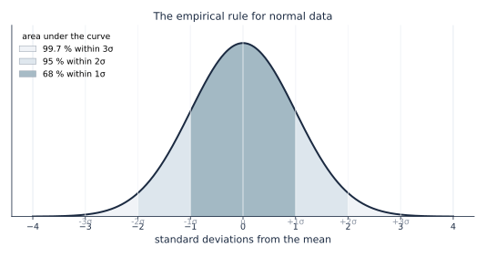
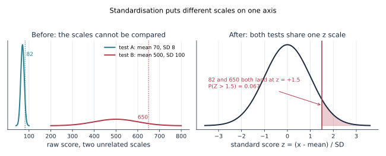
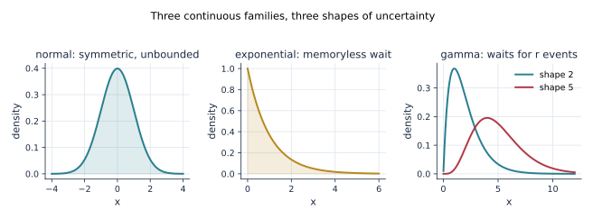

# M10 · Continuous Probability Distributions

<div class="psds-meta" markdown>
<span class="psds-chip psds-chip--core">Chapter</span>
<span class="psds-chip">14 study hours</span>
<span class="psds-chip">Module overview: [M10](../10-continuous-distributions.md)</span>
</div>

!!! abstract "Interactive laboratory"
    [Lab L-04 — Continuous probability distributions](../../labs/continuous-distributions.md) — shade an interval and see why its area, not the height of the curve, is the probability.
    [Lab L-05 — The normal distribution and z-scores](../../labs/normal-and-z-scores.md) — place an observation on a normal curve and read its z-score, percentile and tail probability.

!!! note "Critical values used in this chapter"
    [Standard normal table](../../reference/tables/standard-normal.md) — cumulative probabilities and how to read them; [Student's \(t\) table](../../reference/tables/t-distribution.md) when \(\sigma\) is estimated.

## 1. The idea, before any symbols

Continuous variables do not take isolated values: a waiting time can be 3.217…
minutes. So probability cannot live on points — it lives on **intervals**, and it is
measured as area under a density curve.

\[ \Pr(a\le X\le b)=\int_a^b f(x)\,dx,\qquad \Pr(X=x)=0. \]

The consequence that unsettles students: an event can be possible and have probability
zero. That is not a paradox; with uncountably many values, each must carry zero mass
for the total to be 1.

This chapter catalogues six continuous families, each answering a different kind of
question:

| Question | Family |
|---|---|
| All values in a range equally likely? | Uniform |
| Symmetric, bell-shaped measurement? | Normal (and standard normal) |
| Time until an event, constant hazard? | Exponential |
| Sum of waiting times / \(k\) events? | Gamma |
| A proportion or probability between 0 and 1? | Beta |

## 2. Why this matters

**The normal is the destination of the Central Limit Theorem** (M13). Almost every
interval and test in M14–M17 uses it, or the \(t\), which is derived from it.

**Standardisation is a daily operation.** z-scores convert any normal question into one
table; every statistical package's `norm.cdf` is doing exactly that.

**The exponential is the model of "no memory".** It describes waiting times in queues,
radioactive decay and the gap between customer arrivals, and its memoryless property is
what makes queueing theory tractable.

**The beta is the natural prior for proportions** and the reason Bayesian A/B testing
(M18) is clean: a Beta prior with a binomial likelihood gives a Beta posterior.

## 3. Terminology and notation

| Symbol | Meaning |
|---|---|
| \(f(x)\) | probability density function |
| \(F(x)\) | cumulative distribution function, \(F'=f\) |
| \(\mu,\sigma\) | mean and standard deviation (normal) |
| \(Z\) | standard normal variable, \(Z=(X-\mu)/\sigma\) |
| \(\Phi(z)\) | standard normal CDF |
| \(z_{\alpha}\) | the value with upper-tail area \(\alpha\) |
| \(\lambda\) | exponential/gamma rate |
| \(\alpha,\beta\) (or \(k,\theta\)) | gamma/beta shape and rate parameters |

**Rate versus scale.** The exponential is written \(f(x)=\lambda e^{-\lambda x}\) with
mean \(1/\lambda\). Some software uses the **scale** \(\theta=1/\lambda\) instead. A mean
of 4 minutes is \(\lambda=0.25\) or \(\theta=4\); always check which parameterisation you
are reading.

## 4. Uniform distribution

### 4.1 Intuition

Every value in \([a,b]\) is equally likely. The density is flat, so probability reduces
to length.

### 4.2 Definition and moments

\[ f(x)=\frac{1}{b-a},\quad a\le x\le b,\qquad
   \E[X]=\frac{a+b}{2},\qquad \Var(X)=\frac{(b-a)^{2}}{12}. \]

**Derivation of the mean.** \(\int_a^b \frac{x}{b-a}dx
=\frac{1}{b-a}\cdot\frac{b^{2}-a^{2}}{2}=\frac{a+b}{2}\).

**Derivation of the variance.** \(\E[X^{2}]=\frac{1}{b-a}\cdot\frac{b^{3}-a^{3}}{3}
=\frac{a^{2}+ab+b^{2}}{3}\); subtracting \(\left(\frac{a+b}{2}\right)^{2}\) gives
\((b-a)^{2}/12\).

### Example 4.3

Buses arrive uniformly every 0 to 10 minutes: \(X\sim U(0,10)\). Mean wait 5 minutes,
\(\Var=100/12\approx8.33\), \(\sd\approx2.89\).
\(\Pr(2<X<7)=5/10=0.5\); \(\Pr(X>8)=0.2\).

**Why the uniform matters beyond toy problems:** it is the source of randomness in
simulation. Inverse-transform sampling (M18) turns a uniform variate into any other
distribution, so every simulation begins here.

## 5. The normal distribution

### 5.1 Intuition

Symmetric, bell-shaped, described entirely by its centre and spread. It arises whenever
many small independent influences add up — measurement error, heights, sums of
independent trials (M13).

### 5.2 Definition

\[ f(x)=\frac{1}{\sigma\sqrt{2\pi}}\exp\left(-\frac{(x-\mu)^{2}}{2\sigma^{2}}\right),
   \qquad \E[X]=\mu,\quad \Var(X)=\sigma^{2}. \]

**Derivation sketch of normalisation.** Substituting \(z=(x-\mu)/\sigma\) reduces the
integral to \(\int e^{-z^{2}/2}dz=\sqrt{2\pi}\), which is the Gaussian integral; the
constant \(1/(\sigma\sqrt{2\pi})\) is exactly what makes the total area 1.


[](../../assets/images/figures/fig-10-02-normal-empirical.svg)

*Figure 5.1 — the empirical rule for normal data*

**What it shows.** Areas, not heights, are probabilities. About 68 % of normal observations lie within one standard deviation of the mean, 95 % within two and 99.7 % within three. The figure is why a z-score of 3 is rare and a z-score of 1 is not — and it is exact only for normal data.

### Example 5.3 — exam marks

Marks are \(N(70,8^{2})\). (a) \(\Pr(X<78)\); (b) \(\Pr(62<X<78)\);
(c) the mark exceeded by the top 10%.

**Standardise:** \(z=(x-70)/8\).

(a) \(z=1\), so \(\Pr=\Phi(1)=0.8413\).
(b) \(z=\pm1\), so \(\Pr=0.8413-0.1587=0.6827\) — the 68% of the empirical rule.
(c) Top 10% means the 90th percentile: \(z_{0.10}=1.2816\), so
\(x=70+1.2816(8)=80.25\).

### 5.4 The standard normal and \(\Phi\)

\(Z\sim N(0,1)\), and every normal probability is a standard-normal one:

\[ \Pr(X\le x)=\Phi\!\left(\frac{x-\mu}{\sigma}\right). \]

Key values worth knowing: \(\Phi(1)=0.8413\), \(\Phi(1.645)=0.95\),
\(\Phi(1.96)=0.975\), \(\Phi(2.576)=0.995\), and by symmetry
\(\Phi(-z)=1-\Phi(z)\).

### Example 5.5 — quality control

A shaft diameter is \(N(10,0.05^{2})\) mm; the specification is \(10\pm0.1\).
The fraction outside is

\[ \Pr(\lvert Z\rvert>2)=2(1-\Phi(2))=2(0.0228)=0.0456, \]

so about 4.6% is scrapped. Tightening the SD to 0.04 gives
\(\lvert z\rvert=2.5\), \(\Pr=0.0124\) — a three-fold reduction in scrap for a 20%
reduction in variability. That non-linear payoff is why tolerance decisions are made
with the normal CDF, not with rules of thumb.

## 6. Exponential distribution

### 6.1 Intuition

Time until the next event when events occur at a constant rate and independently — the
continuous twin of the Poisson. Its defining feature is **memorylessness**.

### 6.2 Definition and derivations

\[ f(x)=\lambda e^{-\lambda x},\ x\ge0,\qquad F(x)=1-e^{-\lambda x},\qquad
   \E[X]=\frac1\lambda,\qquad \Var(X)=\frac{1}{\lambda^{2}}. \]

**Derivation of the mean.**

\[ \E[X]=\int_0^{\infty}x\lambda e^{-\lambda x}dx
   =\Big[-xe^{-\lambda x}\Big]_0^{\infty}+\int_0^{\infty}e^{-\lambda x}dx
   =0+\frac1\lambda. \]

The first term vanishes at both ends (at \(\infty\) because the exponential beats
\(x\)); the second integral is \(1/\lambda\).

**Memorylessness.** For \(s,t>0\),

\[ \Pr(X>s+t\mid X>s)=\frac{e^{-\lambda(s+t)}}{e^{-\lambda s}}=e^{-\lambda t}
   =\Pr(X>t). \]

### Example 6.3 — call centre

Calls arrive at 0.5 per minute, so waiting time \(X\sim\text{Exp}(0.5)\).
Mean 2 minutes, SD 2 minutes (for the exponential, mean = SD).
\(\Pr(X>2)=e^{-1}\approx0.3679\); the median solves \(1-e^{-0.5m}=0.5\), giving
\(m=\ln 2/0.5\approx1.386\) minutes.

**Memoryless in practice:** having already waited 1 minute, the chance of waiting 2 more
is still \(e^{-1}=0.368\). Waiting does not make the call "due" — a fact that surprises
everyone and is true only because arrivals are independent.

## 7. Gamma distribution

### 7.1 Intuition

The time until the \(k\)-th event in a Poisson process — the sum of \(k\) independent
exponentials. Also used for right-skewed positive quantities (rainfall, insurance
claims) where the exponential is too rigid.

### 7.2 Definition

With shape \(\alpha>0\) and rate \(\beta>0\),

\[ f(x)=\frac{\beta^{\alpha}}{\Gamma(\alpha)}x^{\alpha-1}e^{-\beta x},\quad x>0,
   \qquad \E[X]=\frac{\alpha}{\beta},\qquad \Var(X)=\frac{\alpha}{\beta^{2}}. \]

\(\Gamma(\alpha)=\int_0^\infty t^{\alpha-1}e^{-t}dt\), with \(\Gamma(n)=(n-1)!\) for
integers, so the exponential is the case \(\alpha=1\).

**CDF for integer shape** (the sum-of-exponentials form):

\[ F(x)=1-e^{-\beta x}\sum_{j=0}^{\alpha-1}\frac{(\beta x)^{j}}{j!}. \]

### Example 7.3 — time for three arrivals

Events arrive at rate 0.5 per minute. The time to the third arrival is
\(\text{Gamma}(3,0.5)\): mean \(3/0.5=6\) minutes, variance \(3/0.25=12\),
SD \(\approx3.464\). The probability of waiting more than 8 minutes:

\[ \Pr(X>8)=e^{-4}\left(1+4+\frac{16}{2}\right)=13e^{-4}\approx13(0.0183)=0.2381. \]

### 7.4 Gamma versus exponential — the key difference

| | Exponential | Gamma |
|---|---|---|
| Counts | time to the **first** event | time to the **\(k\)-th** event |
| Shape parameter | none (fixed 1) | \(\alpha=k\) |
| Density at 0 | highest (\(\lambda\)) | 0 if \(\alpha>1\) |
| Mean = SD? | yes | only when \(\alpha=1\) |

The gamma becomes more symmetric as \(\alpha\) grows, by the same CLT that makes sums of
exponentials normal.

## 8. Beta distribution

### 8.1 Intuition

A distribution **on probabilities**: values in \((0,1)\), flexible shapes (U-shaped,
bell-shaped, skewed), and the conjugate prior for a binomial proportion.

\[ f(x)=\frac{x^{\alpha-1}(1-x)^{\beta-1}}{B(\alpha,\beta)},\quad 0<x<1,
   \qquad \E[X]=\frac{\alpha}{\alpha+\beta},\qquad
   \Var(X)=\frac{\alpha\beta}{(\alpha+\beta)^{2}(\alpha+\beta+1)}. \]

### Example 8.2 — Beta(2,3)

Mean \(=2/5=0.4\);
\(\Var=\frac{6}{25\cdot6}=0.04\); density at 0.5:

\[ f(0.5)=\frac{(0.5)^{1}(0.5)^{2}}{B(2,3)}=\frac{0.125}{1/12}=1.5, \]

using \(B(2,3)=\Gamma(2)\Gamma(3)/\Gamma(5)=1\cdot2/24=1/12\). The probability
\(\Pr(X<0.5)=0.6875\) — most of the mass sits below 0.5, as the mean 0.4 suggests.

### 8.3 Why the beta is worth knowing now

With a \(\text{Beta}(a,b)\) prior and \(s\) successes in \(n\) trials, the posterior is
\(\text{Beta}(a+s,\,b+n-s)\) (M18). The mean of that posterior is
\(\frac{a+s}{a+b+n}\): a weighted average of the prior mean and the observed
proportion. That single formula is Bayesian A/B testing in one line.

## 9. z-scores, percentiles and normal approximations

### 9.1 Percentiles from the normal

The \(p\)-th percentile is \(x_p=\mu+z_p\sigma\), where \(z_p=\Phi^{-1}(p)\). Examples:
\(z_{0.90}=1.2816\), \(z_{0.95}=1.645\), \(z_{0.975}=1.96\), \(z_{0.99}=2.326\).

### 9.2 z-scores as a common currency

\(z=(x-\mu)/\sigma\) is unit-free, so it compares across variables: a student at
\(z=1.5\) in maths and \(z=1.2\) in statistics did relatively better in maths. It is
also what `StandardScaler` computes in a data pipeline.


[](../../assets/images/figures/fig-10-03-zscore.svg)

*Figure 9.1 — standardisation across two incompatible scales*

**What it shows.** A mark of 82 on a test with mean 70 and SD 8, and a score of 650 on a test with mean 500 and SD 100, are the same achievement: both are 1.5 standard deviations above average. Standardisation is what makes different units, and different tests, comparable at all.

### 9.3 Normal approximation to the binomial, with continuity correction

If \(X\sim\text{Bin}(n,p)\) with \(np\) and \(n(1-p)\) both at least about 10, then
\(X\approx N(np,\,np(1-p))\). Because a binomial count is discrete and the normal is
continuous, adjust the boundary by 0.5:

\[ \Pr(X\le k)\approx\Phi\!\left(\frac{k+0.5-np}{\sqrt{np(1-p)}}\right). \]

**Worked example.** \(X\sim\text{Bin}(50,0.4)\), \(\mu=20\),
\(\sigma=\sqrt{12}\approx3.4641\). For \(\Pr(X\le18)\),

\[ z=\frac{18.5-20}{3.4641}=-0.433,\qquad \Pr\approx\Phi(-0.433)=0.3325. \]

Without the correction, \(z=-0.577\) and the answer is 0.2810 — a visible error. The
correction exists because "18 or fewer" includes the whole bar centred at 18.

## 10. Choosing a continuous distribution

| | Support | Shape | Parameters | Typical use |
|---|---|---|---|---|
| Uniform | \([a,b]\) | flat | \(a,b\) | random numbers, no information |
| Normal | \(\mathbb{R}\) | symmetric bell | \(\mu,\sigma\) | measurement error, sums |
| Exponential | \([0,\infty)\) | decreasing | \(\lambda\) | time to first event |
| Gamma | \([0,\infty)\) | skewed, flexible | \(\alpha,\beta\) | time to \(k\)-th event, positive skew |
| Beta | \((0,1)\) | U, bell or skewed | \(\alpha,\beta\) | proportions, probabilities |

### 10.1 Pairs students confuse

**Exponential vs Poisson.** Poisson counts events in an interval (discrete); exponential
measures the waiting time to the next event (continuous). One is the count, the other the
gap.

**Normal vs \(t\).** The \(t\) (M12) is used when \(\sigma\) is estimated from a small
sample; it has heavier tails and converges to the normal as \(n\) grows.

**Gamma vs exponential.** Both model waiting; the gamma allows several events and a
shape parameter, and reduces to the exponential at \(\alpha=1\).

**Beta vs uniform.** \(U(0,1)\) is \(\text{Beta}(1,1)\). The beta adds shape.

## 11. Common mistakes and misconceptions

| # | Mistake | Why it is wrong | Correct |
|---|---|---|---|
| 1 | "\(f(x)\) is a probability" | Densities can exceed 1 | Integrate over an interval |
| 2 | "\(\Pr(X=5)=0\) means impossible" | Continuous points carry zero mass | Probability lives on intervals |
| 3 | Mixing rate and scale | Mean is \(1/\lambda\), not \(\lambda\) | Check the parameterisation |
| 4 | "The exponential mean is its median" | Mean \(1/\lambda\), median \(\ln2/\lambda\) | They differ unless skewed-free |
| 5 | "Waiting longer makes an event due" | Memorylessness | The conditional probability is unchanged |
| 6 | Using the normal approximation without the continuity correction | Binomial is discrete | Adjust by 0.5 |
| 7 | "All symmetric distributions are normal" | Symmetry is necessary, not sufficient | Check the density/tails |
| 8 | Standardising with \(s\) when \(\sigma\) is known | Wasteful and changes the reference distribution | Use \(\sigma\) for \(z\), \(s\) for \(t\) |
| 9 | Assuming normality of raw data because the mean is normal | The CLT is about the mean, not the data | Plot the data |
| 10 | Beta density at an endpoint | \(f(0)\) can be infinite | Probabilities are integrals, still finite |

## 12. How this connects to Data Science

- **z-score scaling** standardises features; the normal CDF converts scores to
  percentiles.
- **Anomaly thresholds** ("3 sigma") are normal-tail statements, valid only if the tail
  is normal — which for heavy-tailed metrics it is not.
- **Survival analysis**: exponential and Weibull (a gamma relative) model time-to-event.
- **Queueing and capacity**: exponential inter-arrival times plus a Poisson arrival
  count.
- **Bayesian proportions**: beta prior, beta posterior; Thompson sampling draws from
  betas.
- **Simulation**: inverse-transform sampling from uniforms produces all of the above.

## 13. Real-world scenarios

**Load-shedding duration.** If outages last an exponential amount of time with mean 45
minutes, the chance an outage exceeds 2 hours is \(e^{-120/45}=e^{-2.667}\approx0.069\).
The memoryless property explains why "it has already been off an hour" does not mean it
will end soon.

**Height and nutrition surveys.** Child heights are approximately normal within age and
sex; the fraction below a growth-reference cutoff is a z-score calculation, and the
cutoff itself (e.g. −2 SD) is a percentile.

**Flood levels.** River discharge is right-skewed and positive; gamma or lognormal fits
are standard, and the "100-year flood" is a high quantile of the fitted distribution, not
a regular event.

**Click-through rates.** With 40 clicks from 1,000 impressions, the rate is uncertain;
a Beta posterior (M18) gives an interval, and its shape shows how much is still unknown.

**Test scores and grading.** Curving a class means applying a linear transformation
(§M08) whose effect on the distribution is a shift and a scale change; percentile
reporting instead uses the empirical CDF.

## 14. Visual explanations

### 14.1 The three shapes side by side

```
Uniform(0,10)        Normal(0,1)              Exponential(1)
 ───────────          ▁▃▅██▅▃▁                █▄▂▁
 └──────────          ────┬────                │╲
  0        10          -2 0 2                 0 ────
 flat                 bell, symmetric          decreasing, memoryless
```

*What to look at:* flat (no information), symmetric (two parameters), monotone
(constant hazard). Most applied modelling is a choice among these three shapes.


[](../../assets/images/figures/fig-10-01-families.svg)

*Figure 14.1 — normal, exponential and gamma densities*

**What it shows.** Shape is the fastest way to identify a family. The normal is symmetric and unbounded; the exponential starts at its maximum and decays, which is why its median lies below its mean; the gamma with shape r is a wait for r events, moving towards the normal as r grows.

### 14.2 z-scores and area

| Interval | z-range | Probability |
|---|---|---|
| \(\mu\pm1\sigma\) | \([-1,1]\) | 0.6827 |
| \(\mu\pm2\sigma\) | \([-2,2]\) | 0.9545 |
| \(\mu\pm3\sigma\) | \([-3,3]\) | 0.9973 |
| above \(\mu+1.645\sigma\) | \([1.645,\infty)\) | 0.05 |
| above \(\mu+1.96\sigma\) | \([1.96,\infty)\) | 0.025 |

*What to look at:* the last two rows are where confidence intervals come from (M14).
They are not conventions; they are areas.

### 14.3 Gamma as a sum of exponentials

```
α = 1  █▄▂▁            (exponential: peak at 0)
α = 2  ▁▅█▃▁           (peak at 1/β)
α = 5  ▁▂▅█▅▂▁         (peak at 4/β, nearly symmetric)
```

*What to look at:* as the shape parameter grows, the gamma becomes symmetric and
normal — the same limit theorem operating on waiting times.

## 15. Practice exercises

**Exercise 1 (★).** \(X\sim U(4,16)\). Find the mean, SD and \(\Pr(6<X<10)\).

**Exercise 2 (★).** \(X\sim N(50,10^{2})\). Find \(\Pr(X<65)\), \(\Pr(X>35)\) and the
90th percentile.

**Exercise 3 (★).** Waiting time is exponential with mean 5 minutes. Find
\(\Pr(X>10)\) and the median wait.

**Exercise 4 (★★).** A test score is \(N(60,12^{2})\). Find the cutoff for the top 5%.

**Exercise 5 (★★).** \(X\sim\text{Gamma}(2,0.5)\). Verify the mean and variance from the
formulas, and compute \(\Pr(X\le4)\).

**Exercise 6 (★★).** A proportion has a Beta(3,7) distribution. Find its mean, SD and the
density at 0.3.

**Exercise 7 (★★).** \(X\sim\text{Bin}(100,0.3)\). Use the normal approximation with a
continuity correction to estimate \(\Pr(X\le25)\), and state whether the approximation
is appropriate.

**Exercise 8 (★★★).** Show that the exponential is memoryless, and explain why the
geometric distribution is its discrete analogue.

## 16. Solutions

**Solution 1.** Mean \(=(4+16)/2=10\); \(\Var=(12)^{2}/12=12\), SD \(=\sqrt{12}\approx3.464\).
\(\Pr(6<X<10)=4/12=1/3\).

**Solution 2.** \(z=1.5\): \(\Pr(X<65)=\Phi(1.5)=0.9332\).
\(z=-1.5\): \(\Pr(X>35)=0.9332\).
90th percentile: \(50+1.2816(10)=62.82\).

**Solution 3.** \(\lambda=0.2\): \(\Pr(X>10)=e^{-2}\approx0.1353\). Median
\(=\ln2/0.2\approx3.466\) minutes.

**Solution 4.** \(z_{0.95}=1.645\), so the cutoff is \(60+1.645(12)=79.74\).

**Solution 5.** Mean \(=\alpha/\beta=2/0.5=4\); \(\Var=\alpha/\beta^{2}=2/0.25=8\);
SD \(\approx2.828\). Probability:
\(F(4)=1-e^{-2}(1+2)=1-0.406=0.594\).

**Solution 6.** Mean \(=3/10=0.3\);
\(\Var=\frac{3\cdot7}{100\cdot11}=\frac{21}{1100}\approx0.0191\), SD \(\approx0.1382\).
Density at 0.3: \(B(3,7)=\Gamma(3)\Gamma(7)/\Gamma(10)=\frac{2\cdot720}{362880}
=\frac{1}{252}\), so

\[ f(0.3)=\frac{(0.3)^{2}(0.7)^{6}}{1/252}=252(0.09)(0.117649)\approx2.668. \]

**Solution 7.** \(\mu=30\), \(\sigma=\sqrt{21}\approx4.5826\). With the correction,
\(z=(25.5-30)/4.5826=-0.982\):

\[ \Pr(X\le25)\approx\Phi(-0.982)=0.163. \]

The approximation is appropriate: \(np=30\) and \(n(1-p)=70\) both exceed 10.

**Solution 8.** For \(s,t>0\),
\(\Pr(X>s+t\mid X>s)=\frac{e^{-\lambda(s+t)}}{e^{-\lambda s}}=e^{-\lambda t}\). The
geometric does the same with counts: \(\Pr(X>m+n\mid X>m)=(1-p)^{n}\). Both are
memoryless because both assume independent trials/arrivals; the geometric is the
exponential's discrete counterpart, with \((1-p)\) playing the role of
\(e^{-\lambda}\).

## 17. Self-assessment

1. Why is \(\Pr(X=x)=0\) for a continuous variable?
2. Give the mean and variance of \(U(a,b)\).
3. Standardise \(X\sim N(80,6^{2})\) at \(x=89\).
4. What is \(\Phi(1.96)\), and why does it matter?
5. State the memoryless property in symbols.
6. Relate the gamma and exponential distributions.
7. What is the mean of a Beta\((a,b)\)?
8. When is the normal approximation to the binomial appropriate?
9. Why is a continuity correction needed?
10. If a waiting time has mean 4, what is \(\lambda\), and what is the SD?

### Answers

1. Uncountably many values must share a total probability of 1, so each carries zero.
2. \((a+b)/2\) and \((b-a)^{2}/12\).
3. \(z=(89-80)/6=1.5\).
4. 0.975 — the central 95% of a normal lies within \(\pm1.96\) SD.
5. \(\Pr(X>s+t\mid X>s)=\Pr(X>t)\).
6. Exponential is Gamma\((1,\lambda)\); gamma models the time to the \(k\)-th event.
7. \(a/(a+b)\).
8. When \(np\ge10\) and \(n(1-p)\ge10\).
9. The binomial is discrete and the normal continuous; the 0.5 adjustment includes the
   whole bar at the boundary.
10. \(\lambda=0.25\); SD \(=1/\lambda=4\).

## 18. Revision summary

**Probabilities are areas.** \(f(x)\) is a density; integrate to get probability;
\(F'=f\).

**Uniform.** Flat; mean midpoint; variance \((b-a)^{2}/12\).

**Normal.** \(N(\mu,\sigma^{2})\); standardise with \(z=(x-\mu)/\sigma\); use \(\Phi\);
68–95–99.7; quantiles \(x_p=\mu+z_p\sigma\).

**Exponential.** \(f=\lambda e^{-\lambda x}\); mean \(1/\lambda\), SD \(1/\lambda\);
memoryless; median \(\ln2/\lambda\).

**Gamma.** Shape \(\alpha\), rate \(\beta\); mean \(\alpha/\beta\), variance
\(\alpha/\beta^{2}\); sum of \(\alpha\) exponentials.

**Beta.** On \((0,1)\); mean \(a/(a+b)\); conjugate prior for proportions.

**Approximations.** Binomial → normal when \(np,n(1-p)\ge10\), with a 0.5 continuity
correction.

**Habits.**

1. Check the parameterisation (rate or scale) before computing.
2. Sketch the density: it tells you which tail you are integrating.
3. Never report a normal-based probability without saying whether the normality is
   assumed or justified.

**Next.** M11 moves to several variables at once: joint, marginal and conditional
distributions.

**Run it.** [Practical 10 — Continuous distributions and the normal curve](../../practicals/notebooks/10-continuous-distributions.ipynb) · [all practicals](../../practicals/index.md)

---

**Previous:** [M09 chapter](../09-discrete-distributions/chapter.md) ·
**Next:** [M11 · Joint Probability Distributions](../11-joint-distributions.md)
