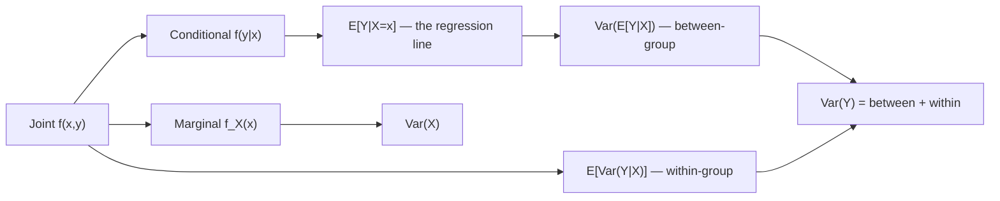
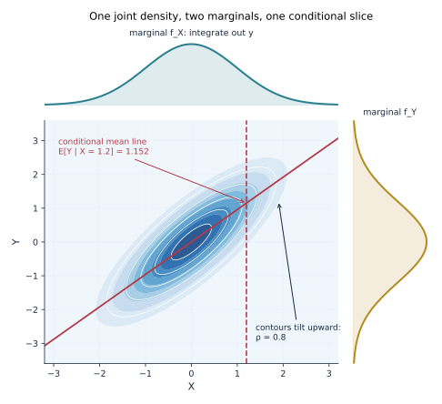

# M11 · Joint Probability Distributions

<div class="psds-meta" markdown>
<span class="psds-chip psds-chip--advanced">Chapter</span>
<span class="psds-chip">14 study hours</span>
<span class="psds-chip">Module overview: [M11](../11-joint-distributions.md)</span>
</div>

## 1. The idea, before any symbols

Every dataset is a rectangle: several variables measured on the same units. Until now
each variable had its own distribution. A **joint distribution** describes them
together, and that is what lets you ask whether they move together — the question
behind regression, ANOVA, and every correlation you will ever compute.

Three derived objects matter:

- the **marginal** distribution of one variable, ignoring the others;
- the **conditional** distribution of one variable given another;
- the **covariance**, a number summarising linear co-movement.

The central structural fact: marginals do not determine the joint. Two very different
joint distributions can have identical marginals, which is why "each variable looks
fine" is not evidence that the pair is fine.

## 2. Why this matters

**Independence is a joint statement.** It cannot be checked from either variable alone.

**Conditional distributions are what prediction means.** "Predicted price given
location and size" is \(\E[Y\mid X]\); regression (M16) estimates exactly this.

**Covariance is the engine of diversification, PCA and portfolio risk.** It is also the
reason multicollinearity ruins regression coefficients.

**Joint distributions explain surprising data shapes.** Clusters, funnel shapes and
Simpson's paradox are joint structures that marginals hide.

## 3. Terminology and notation

| Symbol | Meaning |
|---|---|
| \(p_{X,Y}(x,y)\) | joint PMF (discrete) |
| \(f_{X,Y}(x,y)\) | joint density (continuous) |
| \(f_X(x)\) | marginal density of \(X\) |
| \(f_{Y\mid X}(y\mid x)\) | conditional density of \(Y\) given \(X=x\) |
| \(\E[g(X,Y)]\) | joint expectation |
| \(\Cov(X,Y)\) | covariance |
| \(\rho_{X,Y}\) | correlation |
| \(X\perp Y\) | \(X\) and \(Y\) are independent |

**Normalisation.** Discrete: \(\sum_x\sum_y p(x,y)=1\). Continuous:
\(\iint f(x,y)\,dx\,dy=1\).

## 4. Joint distributions

### 4.1 Discrete case

A joint PMF is a table. Here \(X,Y\in\{0,1\}\):

| \(X\backslash Y\) | 0 | 1 | Marginal \(X\) |
|---|---|---|---|
| 0 | 0.1 | 0.2 | 0.3 |
| 1 | 0.3 | 0.4 | 0.7 |
| **Marginal \(Y\)** | 0.4 | 0.6 | 1.0 |

Every entry is a probability of a \((x,y)\) pair; the margins are sums along rows and
columns.

### 4.2 Continuous case

A joint density is a surface over the plane; probability is **volume**:

\[ \Pr((X,Y)\in A)=\iint_A f(x,y)\,dx\,dy. \]

Example: \(f(x,y)=x+y\) on \([0,1]^{2}\). Check normalisation:

\[ \int_0^1\int_0^1 (x+y)\,dy\,dx=\int_0^1\left(x+\tfrac12\right)dx
   =\tfrac12+\tfrac12=1. \]

## 5. Marginal distributions

### 5.1 Definition and intuition

Sum (or integrate) out the other variable:

\[ f_X(x)=\int f_{X,Y}(x,y)\,dy,\qquad p_X(x)=\sum_y p_{X,Y}(x,y). \]

The marginal answers "what does \(X\) do, ignoring \(Y\)?" — literally the row or column
totals.

### Example 5.2 — the table

From §4.1: \(p_X(0)=0.1+0.2=0.3\), \(p_X(1)=0.7\); \(p_Y(0)=0.4\), \(p_Y(1)=0.6\).

Then \(\E[X]=0.7\), \(\E[Y]=0.6\).

### Example 5.3 — the density

With \(f(x,y)=x+y\) on the unit square:

\[ f_X(x)=\int_0^1 (x+y)\,dy=x+\tfrac12,\qquad 0\le x\le1. \]

Check: \(\int_0^1 (x+\tfrac12)dx=\tfrac12+\tfrac12=1\). ✓ By symmetry,
\(f_Y(y)=y+\tfrac12\).

## 6. Conditional distributions

### 6.1 Definition

\[ f_{Y\mid X}(y\mid x)=\frac{f_{X,Y}(x,y)}{f_X(x)},\qquad
   p_{Y\mid X}(y\mid x)=\frac{p_{X,Y}(x,y)}{p_X(x)}. \]

This is M07's conditional probability applied to every value at once: divide the joint
by the marginal of the conditioning variable.

### Example 6.2 — the table

\[ p_{Y\mid X}(1\mid 1)=\frac{0.4}{0.7}\approx0.571. \]

Given \(X=1\), the chance \(Y=1\) rises from the marginal 0.6 to 0.571 — slightly
*lower*, which is the negative dependence the covariance will confirm.

### Example 6.3 — the density

For \(f(x,y)=x+y\) on the unit square:

\[ f_{Y\mid X}(y\mid x)=\frac{x+y}{x+\frac12},\qquad 0\le y\le1. \]

At \(x=0.5\): \(f_{Y\mid X}(y\mid0.5)=\frac{0.5+y}{1}=0.5+y\), a density on \([0,1]\).
Then \(\E[Y\mid X=0.5]=\int_0^1 y(0.5+y)dy=0.25+0.333=0.583\) — the conditional mean,
which M16 estimates for every \(x\) as the regression line.

## 7. Independence

### 7.1 Definition

\(X\) and \(Y\) are independent iff the joint is the product of the marginals:

\[ f_{X,Y}(x,y)=f_X(x)f_Y(y)\ \text{for all }x,y. \]

### 7.2 Testing it on two densities

**Independent example.** \(f(x,y)=4xy\) on \([0,1]^{2}\). It factors as
\((2x)(2y)\), so \(X\perp Y\).

**Dependent example.** \(f(x,y)=x+y\) on the same square. It does **not** factor:
\((x+\tfrac12)(y+\tfrac12)\neq x+y\). So \(X\) and \(Y\) are dependent, even though
each marginal is a perfectly ordinary density on \([0,1]\).

This pair is the best small example of §1's warning: identical support, similar
marginals, completely different joint behaviour.

### 7.3 Independence gives powerful simplifications

If \(X\perp Y\): \(\E[XY]=\E[X]\E[Y]\), \(\Cov(X,Y)=0\),
\(\Var(X+Y)=\Var(X)+\Var(Y)\), and \(f_{X,Y}=f_Xf_Y\). None of these hold in general.

## 8. Covariance and correlation

### 8.1 Definitions

\[ \Cov(X,Y)=\E[(X-\mu_X)(Y-\mu_Y)]=\E[XY]-\E[X]\E[Y],\qquad
   \rho=\frac{\Cov(X,Y)}{\sd(X)\sd(Y)}. \]

### Example 8.2 — the table

\(\E[XY]=1\cdot1\cdot0.4=0.4\) (only the \((1,1)\) cell contributes).
\(\E[X]\E[Y]=0.7(0.6)=0.42\). So \(\Cov=-0.02\).

\(\Var(X)=0.7-0.49=0.21\), \(\Var(Y)=0.6-0.36=0.24\),
\(\sd_X=0.4583\), \(\sd_Y=0.4899\). Then

\[ \rho=\frac{-0.02}{0.4583\times0.4899}=\frac{-0.02}{0.2245}\approx-0.089. \]

A weak negative linear association.

### Example 8.3 — the density

Split the integrand into its two terms, each of which is a product of one-dimensional
integrals:

\[ \E[XY]=\int_0^1\!\!\int_0^1 x^{2}y\,dy\,dx+\int_0^1\!\!\int_0^1 xy^{2}\,dy\,dx
   =\frac13\cdot\frac12+\frac12\cdot\frac13=\frac16+\frac16=\frac13. \]

\(\E[X]=\E[Y]=\frac{7}{12}\), so \(\E[X]\E[Y]=\frac{49}{144}\). Therefore (writing
\(\frac13=\frac{48}{144}\))

\[ \Cov=\frac{48}{144}-\frac{49}{144}=-\frac{1}{144},\qquad
   \Var(X)=\frac{5}{12}-\frac{49}{144}=\frac{11}{144}, \]

and \(\rho=\frac{-1/144}{11/144}=-\frac{1}{11}\approx-0.0909\) — the same weak negative
association as the table, arising from the density's asymmetry.

### 8.4 What correlation does not tell you

- It measures **linear** association only: \(Y=X^{2}\) with symmetric \(X\) has
  \(\rho=0\).
- It is bounded: \(-1\le\rho\le1\).
- It is unit-free, so it is comparable across variables — unlike covariance.
- It is not robust: one outlier can move it from 0.1 to 0.8.

## 9. Joint expectation

### 9.1 Linearity, always

\[ \E[aX+bY+c]=a\E[X]+b\E[Y]+c \]

with no independence assumption. Similarly \(\E[X+Y]=\E[X]+\E[Y]\) for any number of
variables.

### 9.2 Variance of a sum, with covariance

\[ \Var(X+Y)=\Var(X)+\Var(Y)+2\Cov(X,Y). \]

**Derivation.** Expand
\(\E[(X+Y)^{2}]-\left(\E[X+Y]\right)^{2}\) and collect terms; the cross term is
\(2(\E[XY]-\E[X]\E[Y])=2\Cov\).

**Worked example.** \(\Var(X)=4\), \(\Var(Y)=9\), \(\Cov=3\). Then
\(\Var(X+Y)=4+9+6=19\), while independence would give 13. Positive covariance makes the
sum more variable; negative covariance makes it less — the diversification effect.

### 9.3 The law of total variance

\[ \Var(X)=\E\big[\Var(X\mid Y)\big]+\Var\big(\E[X\mid Y]\big). \]

*In words:* total variability = average within-group variability + variability of the
group means. This identity is ANOVA's decomposition (M17) and the reason \(R^{2}\) has
the interpretation it does.

**Worked example.** Two groups: 60% with mean 10 and variance 4; 40% with mean 20 and
variance 9.

- \(\E[X]=0.6(10)+0.4(20)=14\).
- \(\E[\Var(X\mid Y)]=0.6(4)+0.4(9)=6\).
- \(\Var(\E[X\mid Y])=0.6(10-14)^{2}+0.4(20-14)^{2}=9.6+14.4=24\).
- Total: \(6+24=30\).

So 80% of the variability is *between* groups, and only 20% within — a group difference
worth explaining.

## 10. Convolution: sums of random variables

### 10.1 The convolution formula

For independent continuous \(X,Y\), the density of \(S=X+Y\) is

\[ f_S(s)=\int f_X(x)f_Y(s-x)\,dx. \]

### Example 10.2 — sum of two uniforms

\(X,Y\sim U(0,1)\) independent. The sum is triangular on \([0,2]\):

\[ f_S(s)=s\ (0\le s\le1),\qquad f_S(s)=2-s\ (1<s\le2). \]

Check: \(\int_0^1 s\,ds+\int_1^2(2-s)ds=\frac12+\frac12=1\). ✓
And \(\E[S]=\frac12+\frac12=1\), matching \(\mu_X+\mu_Y\).

**Reading it:** two flat densities convolve into a peak, which is the first hint of the
CLT (M13): sums of independent variables pile up in the middle.

### Example 10.3 — sum of two exponentials

If \(X,Y\sim\text{Exp}(\lambda)\) independent, \(S=X+Y\) is Gamma\((2,\lambda)\) with
density \(\lambda^{2}s e^{-\lambda s}\). With \(\lambda=0.5\): \(\E[S]=4\),
\(\Var=8\), and
\(\Pr(S>6)=e^{-3}(1+3)=4e^{-3}\approx0.199\).

## 11. Common mistakes and misconceptions

| # | Mistake | Why it is wrong | Correct |
|---|---|---|---|
| 1 | Taking the marginal as the joint | Marginals lose the dependence | Keep the table/density |
| 2 | "Zero correlation means independent" | Correlation catches only linear structure | \(Y=X^{2}\) is a counterexample |
| 3 | Multiplying marginals without checking independence | That is the independence assumption | Check or model the dependence |
| 4 | Confusing conditional with marginal | \(\Pr(Y\mid X)\neq\Pr(Y)\) unless independent | Compute from the joint |
| 5 | Adding SDs for a sum | Variances add, with the covariance term | \(\sd=\sqrt{\sigma_X^{2}+\sigma_Y^{2}+2\Cov}\) |
| 6 | "Covariance magnitude measures strength" | It depends on units | Use correlation |
| 7 | Assuming independence from a scatterplot | Curvature can hide dependence | Test with the joint distribution |
| 8 | Forgetting the covariance when summing | Independence is a special case | Include \(2\Cov\) |
| 9 | Reading \(\E[Y\mid X=x]\) as a constant | It is a random variable in \(X\) | It is a function of \(x\) |
| 10 | Convolving without independence | The formula assumes independence | Model dependence explicitly |

## 12. How this connects to Data Science

- **Regression** estimates \(\E[Y\mid X]\); the residual is \(\Var(Y\mid X)\).
- **ANOVA** is \(\Var(X)=\E[\Var\mid Y]+\Var(\E[X\mid Y])\) applied to groups.
- **PCA** uses the covariance matrix's eigenvectors; correlation is used when units
  differ.
- **Feature selection** drops variables with near-perfect correlation to avoid
  collinearity.
- **Data leakage** is often an accidental joint structure: a feature that is a
  deterministic function of the target.
- **Generative models** learn a joint distribution and then condition on it.

## 13. Real-world scenarios

**Height and weight.** Jointly normal-ish, \(\rho\approx0.6\) — strong but far from
deterministic, so weight prediction from height has wide intervals.

**Rainfall and crop yield.** Negative association in flood years, positive in moderate
ones: a *non-linear* joint structure where the correlation coefficient can be near zero
while dependence is strong.

**Temperature and electricity demand.** U-shaped: high demand at both extremes. \(\rho\)
near zero despite obvious dependence — the textbook warning about linear measures.

**Exam marks across subjects.** High positive correlation between maths and physics
marks reflects a shared latent ability; the shared factor is the reason both predict
later performance.

**House prices.** Price depends on area and location jointly: the effect of area differs
by location, which is an **interaction**, visible only in the joint distribution.

## 14. Visual explanations

### 14.1 Joint table reading

```
        Y=0    Y=1   marginal X
X=0     0.1    0.2     0.3
X=1     0.3    0.4     0.7
marg    0.4    0.6     1.0
        ↑ column sums      ↑ grand total must be 1
```

*What to look at:* conditional probabilities divide inside a row or column; marginals
are the totals on the edge. Every check starts with the grand total.

### 14.2 Independence as a product structure

| | Independent | Dependent |
|---|---|---|
| Joint | \(f(x)f(y)\) | any other surface |
| Cells | \(p(x)p(y)\) | not reproducible from margins |
| Covariance | 0 | usually ≠ 0 |

*What to look at:* independence is a strong, testable restriction. Most real pairs fail
it, and the interesting question is how they fail.

### 14.3 From joint to conditional mean



*What to look at:* every object in later chapters — regression, ANOVA, R² — is a branch
of this diagram.

[](../../assets/images/figures/fig-11-01-bivariate.svg)

*Figure 14.1 — one joint density, its two marginals, and the conditional mean at X = 1.2*

**What it shows.** The shaded contours are level sets of a joint density with
correlation \(\rho = 0.8\). They are tilted ellipses rather than circles, and that tilt
*is* the dependence: knowing \(X\) is above its mean shifts the likely values of \(Y\)
upward. The thin panels are the marginals, obtained by integrating the joint over the
other variable — the joint determines them, they do not determine the joint. The
dashed line is the conditional mean: at \(X = 1.2\) the slice through the surface
balances at \(E[Y \mid X = 1.2] = 1.152\).

**The mathematics.** With \(\mu_X = \mu_Y = 0\), \(\sigma_X = 1\), \(\sigma_Y = 1.2\) and
\(\rho = 0.8\),

\[
f(x,y) = \frac{1}{2\pi\sigma_X\sigma_Y\sqrt{1-\rho^2}}
\exp\left(-\frac{1}{2(1-\rho^2)}
\left[\frac{x^2}{\sigma_X^2} - \frac{2\rho xy}{\sigma_X\sigma_Y} + \frac{y^2}{\sigma_Y^2}\right]\right).
\]

Integrating out \(y\) returns \(f_X(x) = \mathcal{N}(0,1)\) and integrating out \(x\)
returns \(f_Y(y) = \mathcal{N}(0, 1.44)\): both marginals are normal whatever the
correlation, and many different joint densities share these two marginals, so "each
variable is normal" never implies "the pair is jointly normal". Conditioning fixes
\(x\) and renormalises the slice,

\[
f(y \mid x) = \frac{f(x,y)}{f_X(x)}
= \mathcal{N}\!\left(\rho\frac{\sigma_Y}{\sigma_X}x,\;
\sigma_Y^2(1-\rho^2)\right)
= \mathcal{N}(0.96x,\; 0.5184),
\]

so at \(x = 1.2\) the conditional mean is \(1.152\) and the conditional SD is
\(\sqrt{0.5184} = 0.72\) — the slice is narrower than the marginal, because knowing
\(X\) removes part of the uncertainty. Zero covariance would level the contours and
make the conditional mean constant; here the positive slope of the conditional mean,
\(0.8 \times 1.2 = 0.96\), is the population regression line, the same object M16
estimates from data.

**Try it.** [Practical 11 — Joint distributions](../../practicals/notebooks/11-joint-distributions.ipynb)
draws this surface, its marginals and its conditional slices from simulated data and
checks them against the formulas above.


## 15. Practice exercises

**Exercise 1 (★).** From the table in §4.1, find \(\Pr(X+Y=1)\), \(\Pr(X=1\mid Y=0)\) and
the conditional distribution of \(Y\) given \(X=0\).

**Exercise 2 (★).** For \(f(x,y)=4xy\) on \([0,1]^{2}\), find both marginals and state
whether \(X\) and \(Y\) are independent.

**Exercise 3 (★).** \(\E[X]=3\), \(\E[Y]=5\), \(\Var(X)=4\), \(\Var(Y)=9\),
\(\Cov=2\). Find \(\E[2X-3Y]\), \(\Var(2X-3Y)\) and \(\rho\).

**Exercise 4 (★★).** For \(f(x,y)=2\) on the triangle \(0<y<x<1\), find the marginal of
\(X\) and \(\E[Y\mid X=x]\).

**Exercise 5 (★★).** \(X,Y\) independent Poisson with means 2 and 3. Find the distribution
of \(X+Y\) and \(\Pr(X+Y=0)\).

**Exercise 6 (★★).** Using the two-group example in §9.3, compute the fraction of
variance explained by group membership, and interpret.

**Exercise 7 (★★★).** Show that \(\Cov(X,X+Y)=\Var(X)+\Cov(X,Y)\), and use it to find
\(\Var(X+Y)-\Var(X-Y)\) in terms of covariates.

**Exercise 8 (★★★).** \(X\sim U(0,1)\), \(Y=X^{2}\). Show \(\Cov(X,Y)\neq0\) and
comment on the claim "correlation measures dependence".

## 16. Solutions

**Solution 1.** \(\Pr(X+Y=1)=p(1,0)+p(0,1)=0.3+0.2=0.5\).
\(\Pr(X=1\mid Y=0)=0.3/0.4=0.75\).
Given \(X=0\): \(Y=0\) with \(0.1/0.3=0.333\), \(Y=1\) with \(0.2/0.3=0.667\).

**Solution 2.** \(f_X(x)=4x\int_0^1 y\,dy=4x\cdot\frac12=2x\); likewise \(f_Y(y)=2y\).
The product is \(4xy\), equal to the joint. **Independent.**

**Solution 3.** \(\E[2X-3Y]=6-15=-9\).
\(\Var(2X-3Y)=4(4)+9(9)-2(2)(3)(2)=16+81-24=73\). (The cross term is
\(2ac\Cov=2(2)(-3)(2)=-24\).)
\(\rho=2/(2\cdot3)=1/3\).

**Solution 4.** Normalisation: area of the triangle is \(\frac12\), so \(f=2\) gives
total 1. \(f_X(x)=\int_0^x 2\,dy=2x\), \(0<x<1\). Given \(X=x\), \(Y\) is uniform on
\((0,x)\), so \(\E[Y\mid X=x]=x/2\).

**Solution 5.** Sum of independent Poissons is Poisson with \(\lambda=5\):
\(\Pr(X+Y=0)=e^{-5}\approx0.0067\).

**Solution 6.** Between/total \(=24/30=0.8\), so 80% of the variability is explained by
group membership — the quantity \(R^{2}\) reports (M16).

**Solution 7.** \(\Cov(X,X+Y)=\Cov(X,X)+\Cov(X,Y)=\Var(X)+\Cov(X,Y)\).
By bilinearity, \(\Var(X+Y)-\Var(X-Y)=4\Cov(X,Y)\) — a neat identity, and the reason
paired differences reduce variance when the covariance is positive.

**Solution 8.** \(\E[X]=\frac12\), \(\E[Y]=\E[X^{2}]=\frac13\),
\(\E[XY]=\E[X^{3}]=\frac14\). So
\(\Cov=\frac14-\frac12\cdot\frac13=\frac14-\frac16=\frac{1}{12}\neq0\). The correlation
is \(\frac{1/12}{(1/\sqrt{12})(\sqrt{4/45})}\approx0.968\) — very high. But the point
stands in the other direction: a *different* nonlinear pair, \(Y=X^{2}\) with \(X\)
symmetric about 0, has \(\Cov=0\). Correlation measures linear dependence, not
dependence.

## 17. Self-assessment

1. How do you obtain a marginal from a joint PMF?
2. Write the conditional density formula.
3. Give the independence test in terms of the joint and the marginals.
4. State the covariance shortcut formula.
5. Why is correlation preferred to covariance for comparing pairs?
6. Write \(\Var(X+Y)\) with the covariance term.
7. What are the two terms of the law of total variance?
8. What does convolution compute, and under which assumption?
9. If two variables have \(\rho=0\), what can you conclude?
10. Is \(\E[Y\mid X=x]\) a number or a random variable?

### Answers

1. Sum the joint over the other variable.
2. \(f_{Y\mid X}(y\mid x)=f_{X,Y}(x,y)/f_X(x)\).
3. \(f_{X,Y}(x,y)=f_X(x)f_Y(y)\) for all \(x,y\).
4. \(\Cov=\E[XY]-\E[X]\E[Y]\).
5. It is unit-free and bounded in \([-1,1]\).
6. \(\Var X+\Var Y+2\Cov(X,Y)\).
7. \(\E[\Var(X\mid Y)]\) and \(\Var(\E[X\mid Y])\).
8. The distribution of a sum; it assumes independence.
9. Only that there is no *linear* association.
10. A number for each \(x\); as a function of \(X\) it is a random variable.

## 18. Revision summary

**Joint, marginal, conditional.** Joint describes the pair; marginals are totals;
conditionals divide the joint by a marginal.

**Independence.** Joint factors into marginals; then expectations multiply and variances
add.

**Covariance and correlation.** \(\Cov=\E[XY]-\E[X]\E[Y]\);
\(\rho=\Cov/(\sd_X\sd_Y)\). Zero covariance ≠ independence.

**Variance of sums.** \(\Var(X+Y)=\Var X+\Var Y+2\Cov\); independence removes the cross
term.

**Total variance.** \(\Var(X)=\E[\Var(X\mid Y)]+\Var(\E[X\mid Y])\) — the identity behind
regression and ANOVA.

**Convolution.** Sums of independent variables: densities convolve; uniforms give a
triangle, exponentials give a gamma.

**Habits.**

1. Check the joint table sums to 1 before computing anything.
2. Ask "marginal or conditional?" before dividing.
3. Never conclude independence from a correlation of zero.

**Next.** M12 applies joint distributions to samples: the sampling distribution is the
distribution of a statistic across all possible samples.

**Run it.** [Practical 11 — Joint distributions](../../practicals/notebooks/11-joint-distributions.ipynb) · [all practicals](../../practicals/index.md)

---

**Previous:** [M10 chapter](../10-continuous-distributions/chapter.md) ·
**Next:** [M12 · Sampling and Sampling Distributions](../12-sampling-and-sampling-distributions.md)
