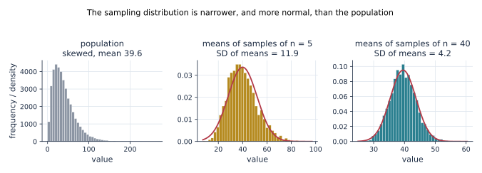
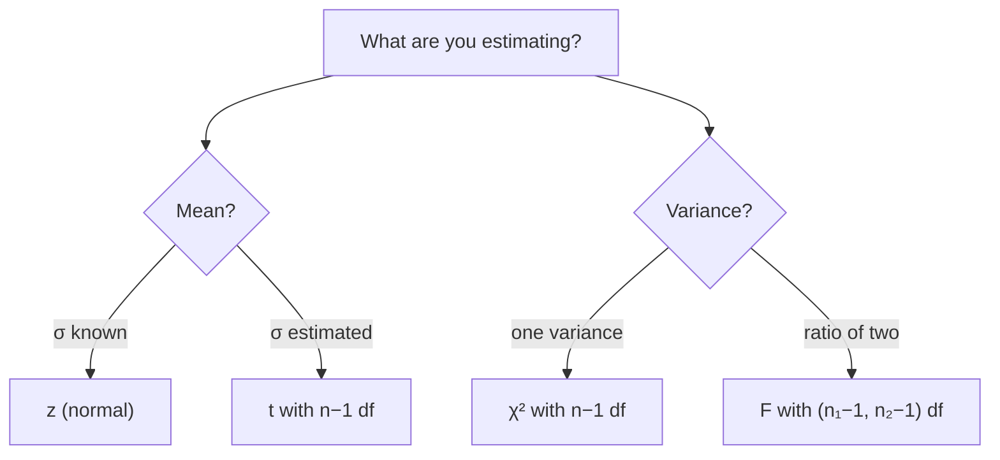

# M12 · Sampling and Sampling Distributions

<div class="psds-meta" markdown>
<span class="psds-chip psds-chip--core">Chapter</span>
<span class="psds-chip">14 study hours</span>
<span class="psds-chip">Module overview: [M12](../12-sampling-and-sampling-distributions.md)</span>
</div>

!!! abstract "Interactive laboratory"
    [Lab L-08 — Sampling distributions and standard error](../../labs/sampling-distributions.md) — take repeated samples and watch the distribution of the mean narrow like 1/sqrt(n).

## 1. The idea, before any symbols

Up to here, probability told you what data would look like if you knew the population.
Statistics reverses the direction: you see the data and want the population. The bridge
is one idea — **a statistic computed from a sample is itself a random variable**.

Before you draw the sample, \(\bar{x}\) is unknown and could be many things. It has a
distribution: the **sampling distribution**. Once you accept that, the rest follows:

- its spread is the **standard error**, which tells you how far an estimate is likely
  to be from the truth;
- its shape is approximately normal (M13), which is why so much of inference uses
  normal-based formulas;
- its exact shape when \(\sigma\) is estimated gives the \(t\), \(\chi^{2}\) and \(F\)
  distributions.

The mental picture: imagine repeating the whole study a thousand times. Each repetition
gives a different \(\bar{x}\). Plot those thousand values, and you are looking at the
sampling distribution.

## 2. Why this matters

**Every confidence interval is a sampling-distribution statement.** M14's intervals are
just "estimate ± a multiple of the standard error", where the multiple comes from the
distribution in this chapter.

**Standard errors are read everywhere.** A regression table's parentheses contain
standard errors; a poll's "±3 points" is one. Misreading them as standard deviations is
a category error.

**The \(t\), \(\chi^{2}\) and \(F\) distributions exist for one reason:** \(\sigma\) is
almost never known, so it must be estimated, and that estimation adds variability. If
you know only the formulas, you cannot tell when they apply.

**Sample size is a square-root decision.** Precision improves as \(\sqrt{n}\), so
planning a study is arithmetic, not guesswork.

## 3. Terminology and notation

| Symbol | Meaning |
|---|---|
| \(N\), \(\mu\), \(\sigma\), \(p\) | population size, mean, SD, proportion (parameters) |
| \(n\), \(\bar{x}\), \(s\), \(\hat p\) | sample size and statistics |
| \(\se(\bar{x})\) | standard error of the mean, \(\sigma/\sqrt{n}\) |
| \(\bar{X}\) | the sample mean as a random variable |
| \(\chi^{2}_{\nu}\) | chi-square with \(\nu\) degrees of freedom |
| \(t_{\nu}\) | Student's \(t\) with \(\nu\) degrees of freedom |
| \(F_{\nu_1,\nu_2}\) | \(F\) with numerator and denominator df |
| \(\nu\) | degrees of freedom |

**Degrees of freedom,** in one sentence: the number of independent pieces of
information left after estimating what the statistic needs. A sample of \(n\) deviations
from \(\bar{x}\) has only \(n-1\) free values, because they must sum to zero.

## 4. Populations, samples and why we sample

A **population** is the complete set you want to describe; a **sample** is the part you
observe. We sample because a census is often impossible (destructive testing), too
expensive, or too slow — and because a well-drawn sample can be more accurate than a
badly conducted census.

| | Census | Sample |
|---|---|---|
| Cost | high | low |
| Coverage | complete | partial |
| Error | measurement only | measurement **plus sampling error** |
| Feasible? | rarely | usually |

The trade is explicit: you accept sampling error in exchange for feasibility. What you
must not accept is **bias**, which is a systematic error that no sample size repairs.

## 5. Sampling methods and bias

### 5.1 Probability samples

| Method | How | When |
|---|---|---|
| Simple random | every subset of size \(n\) equally likely | a frame exists |
| Systematic | every \(k\)-th unit | ordered list, field work |
| Stratified | sample within strata, then combine with weights | subgroups differ |
| Cluster | sample whole groups, then units within | travel costs dominate |
| Multistage | clusters, then sub-clusters, then units | large surveys |

All four give every unit a **known** selection probability, which is what makes
\(\se\) computable. Weights (inverse selection probabilities) let you reconstruct
population totals.

### 5.2 Bias, and why size does not help

- **Selection bias**: the frame omits part of the population.
- **Non-response bias**: responders differ from non-responders.
- **Measurement bias**: the instrument is systematically wrong.
- **Survivorship bias**: only survivors are observed.

If a sample over-represents high-income households, the error has a component that does
not shrink as \(n\) grows. Precision improves; accuracy does not.

### 5.3 The finite-population correction

When sampling without replacement from a finite population,

\[ \Var(\bar{X})=\frac{\sigma^{2}}{n}\cdot\frac{N-n}{N-1}. \]

With \(N=1{,}000\) and \(n=100\), the factor is \(\sqrt{900/999}=0.949\) — a 5%
reduction in standard error. For \(n/N<0.05\) the factor is close to 1 and is usually
ignored; for audits of small populations it must not be.

## 6. The sampling distribution of the mean

### 6.1 Derivation of the mean and variance

Let \(X_1,\dots,X_n\) be independent with mean \(\mu\) and variance \(\sigma^{2}\).

**Mean.** By linearity,
\(\E[\bar X]=\frac1n\sum\E[X_i]=\frac1n(n\mu)=\mu\). So \(\bar X\) is unbiased.

**Variance.**
\(\Var(\bar X)=\frac{1}{n^{2}}\Var\left(\sum X_i\right)
=\frac{1}{n^{2}}\cdot n\sigma^{2}=\frac{\sigma^{2}}{n}\),
using independence so that covariances vanish. Hence

\[ \se(\bar X)=\frac{\sigma}{\sqrt{n}}. \]

**Shape.** If the \(X_i\) are normal, \(\bar X\) is exactly normal. Otherwise it is
approximately normal for large \(n\) — the CLT, in M13.

### Example 6.2 — precision of a mean

Scores have \(\sigma=15\). With \(n=25\), \(\se=15/5=3\). The probability that a sample
mean exceeds 105 when \(\mu=100\):

\[ z=\frac{105-100}{3}=1.667,\qquad \Pr=1-\Phi(1.667)\approx0.0478. \]

With \(n=100\), \(\se=1.5\) and \(z=3.333\), so \(\Pr\approx0.0004\). Four times the
data cuts the tail probability by a factor of about 100 — the \(\sqrt{n}\) law in
action.

### Example 6.3 — sample size for a target precision

Suppose you want \(\se\le2\) with \(\sigma=15\):

\[ n\ge\left(\frac{15}{2}\right)^{2}=56.25\;\Longrightarrow\;n=57. \]

Halving the target to \(\se\le1\) requires \(n\ge225\) — four times the sample, again.


[](../../assets/images/figures/fig-12-01-sampling-distribution.svg)

*Figure 6.1 — the population, and the sampling distribution of the mean at two sample sizes*

**What it shows.** The population is skewed and wide; the distribution of the mean is narrower by a factor of √n and, by the central limit theorem, closer to normal. Compare the standard deviations printed in the panel titles: multiplying n by 8 divides the spread by about 2.8. The population never changes — only the precision of the estimate does.

## 7. The sampling distribution of a proportion

For \(X\sim\text{Bin}(n,p)\), \(\hat p=X/n\):

\[ \E[\hat p]=p,\qquad \Var(\hat p)=\frac{p(1-p)}{n},\qquad
   \se(\hat p)=\sqrt{\frac{p(1-p)}{n}}. \]

**Derivation.** \(\E[\hat p]=\frac1n\E[X]=\frac{np}{n}=p\), and
\(\Var(\hat p)=\frac{1}{n^{2}}np(1-p)=\frac{p(1-p)}{n}\).

**Worked example.** \(p=0.4\), \(n=100\): \(\se=0.049\).
\(\Pr(\hat p>0.5)\): \(z=(0.5-0.4)/0.049=2.041\), so \(\Pr\approx0.0206\) — a 2% chance
of seeing a 50% sample proportion when the truth is 40%.

\(\Pr(0.35<\hat p<0.45)\): \(z=\pm1.020\), so \(\Pr\approx0.692\). Even with 100
observations, only about 69% of samples land within ±5 points.

**When the normal approximation is unsafe.** If \(np<10\) or \(n(1-p)<10\), use exact
binomial methods (M14's Wilson interval, M15's exact test).

## 8. Chi-square: the distribution of the sample variance

### 8.1 The result

For a normal population,

\[ \frac{(n-1)s^{2}}{\sigma^{2}}\sim\chi^{2}_{n-1}. \]

**Why \(n-1\) degrees of freedom.** The \(n\) deviations \(x_i-\bar x\) satisfy one linear
constraint (they sum to zero), so they live in an \((n-1)\)-dimensional space. The
chi-square distribution counts squared standard normals, and there are only \(n-1\)
independent ones.

### 8.2 Properties

Mean \(=\nu\), variance \(=2\nu\), support \((0,\infty)\), right-skewed, becoming
symmetric as \(\nu\) grows. It is the distribution of a sum of squared standard normals,
which is why variances (sums of squares) follow it.

### Example 8.3

A process is designed for \(\sigma=4\) (\(\sigma^{2}=16\)). A sample of \(n=16\) gives
\(s^{2}=25\). Then

\[ \chi^{2}=\frac{15(25)}{16}=23.4375,\qquad \nu=15. \]

The 95th percentile of \(\chi^{2}_{15}\) is 24.996, and 23.44 is below it, so this
sample is **not** unusual at the 5% level — even though \(s^{2}\) is 56% larger than
\(\sigma^{2}\). With only 16 observations, that much variation in \(s^{2}\) is
expected. This is the lesson of the chapter: **an estimate's variability is often much
larger than intuition suggests.**

## 9. Student's \(t\): when \(\sigma\) is estimated

### 9.1 The problem

In practice \(\sigma\) is unknown, so we use \(s\) and compute
\((\bar x-\mu)/(s/\sqrt{n})\). The denominator is now random, which makes the ratio more
variable than a standard normal — especially in small samples.

### 9.2 The result

For a normal population,

\[ T=\frac{\bar X-\mu}{s/\sqrt{n}}\sim t_{n-1}. \]

The \(t\) distribution is symmetric, bell-shaped, with **heavier tails** than the
normal; as \(\nu\to\infty\) it converges to \(N(0,1)\). The extra tail mass is the price
of estimating \(\sigma\).

### Example 9.3

A sample of \(n=10\) gives \(\bar x=68\), \(s=8\); test the reference \(\mu_0=70\):

\[ t=\frac{68-70}{8/\sqrt{10}}=\frac{-2}{2.530}=-0.791,\qquad \nu=9. \]

The 97.5th percentile of \(t_9\) is 2.262, so \(\lvert t\rvert=0.79\) is far inside the
central 95% region: no evidence of a difference. (M15 turns this into a formal test.)

### 9.4 \(t\) versus \(z\)

| | \(z\) | \(t\) |
|---|---|---|
| Uses | known \(\sigma\) | estimated \(s\) |
| Distribution | \(N(0,1)\) | \(t_{n-1}\) |
| Tails | thinner | heavier |
| When | rare in practice | the default |
| At \(n=30\) | — | close to \(z\); at \(n=5\) clearly different |

The old "use \(t\) if \(n<30\)" rule is a rough guide, not a theorem: the \(t\) is
correct whenever \(\sigma\) is estimated, whatever \(n\) is.

## 10. The \(F\) distribution: ratios of variances

### 10.1 The result

If \(S_1^{2}\) and \(S_2^{2}\) are independent sample variances from normal populations,

\[ F=\frac{S_1^{2}/\sigma_1^{2}}{S_2^{2}/\sigma_2^{2}}\sim F_{\nu_1,\nu_2},
   \qquad \nu_i=n_i-1. \]

Under \(H_0:\sigma_1^{2}=\sigma_2^{2}\), the ratio reduces to \(S_1^{2}/S_2^{2}\).

### 10.2 Where it appears

- comparing two variances (this chapter, M15);
- ANOVA: the ratio of between-group to within-group mean squares (M17);
- the overall \(F\) test of a regression (M16).

### Example 10.3

Sample 1: \(n_1=16\), \(s_1^{2}=25\). Sample 2: \(n_2=21\), \(s_2^{2}=16\).

\[ F=\frac{25}{16}=1.5625,\qquad \nu_1=15,\ \nu_2=20. \]

The 97.5th percentile of \(F_{15,20}\) is about 2.57, so 1.56 is unremarkable: the
variances are compatible. Note the ratio is directional — you should place the larger
variance on top for a one-tailed comparison, or double the tail for two-sided.

## 11. Choosing the right sampling distribution

| Question | Statistic | Distribution |
|---|---|---|
| How precise is a mean, \(\sigma\) known? | \((\bar X-\mu)/(\sigma/\sqrt n)\) | \(N(0,1)\) |
| How precise is a mean, \(\sigma\) estimated? | \((\bar X-\mu)/(s/\sqrt n)\) | \(t_{n-1}\) |
| How precise is a variance? | \((n-1)s^{2}/\sigma^{2}\) | \(\chi^{2}_{n-1}\) |
| Are two variances equal? | \(s_1^{2}/s_2^{2}\) | \(F_{n_1-1,n_2-1}\) |
| How precise is a proportion? | \((\hat p-p)/\sqrt{\hat p(1-\hat p)/n}\) | approximately \(N(0,1)\) |



## 12. Common mistakes and misconceptions

| # | Mistake | Why it is wrong | Correct |
|---|---|---|---|
| 1 | "The standard error is the SD" | One describes data, one describes an estimate | \(\se=s/\sqrt n\) |
| 2 | "The sampling distribution is the data's distribution" | It is the distribution of a *statistic* | Plot many sample means |
| 3 | Using \(z\) when \(s\) is estimated | The denominator is random | Use \(t\) |
| 4 | "A bigger sample fixes bias" | Bias does not shrink with \(n\) | Fix the design |
| 5 | "\(n>30\) makes everything normal" | The CLT concerns the mean's distribution, and skew matters | Simulate the actual case |
| 6 | Forgetting the finite-population correction in audits | It matters when \(n/N\) is not small | Multiply by \(\sqrt{(N-n)/(N-1)}\) |
| 7 | Taking \(\se(\hat p)\) with the sample \(p\) as if exact | It is an estimate | Use it, but note the approximation |
| 8 | "The chi-square has \(n\) df" | One df is lost to estimating the mean | \(n-1\) |
| 9 | Treating the \(F\) ratio as symmetric | \(F\) is skewed and directional | Put the larger variance on top or double the tail |
| 10 | "Sampling error can be eliminated" | Only with a census | Quantify it, do not wish it away |

## 13. How this connects to Data Science

- **Cross-validation** produces a sampling distribution of a performance metric; its
  spread is a standard error.
- **A/B tests** compare two proportions, with \(\se\) from §7.
- **Bootstrap** (M17–M18) approximates the sampling distribution when no formula
  exists.
- **Dashboard error bars** are sampling-distribution statements; without them a
  fluctuation is indistinguishable from a finding.
- **Model comparison** uses \(F\) tests and their likelihood-ratio relatives.
- **Survey weighting** uses selection probabilities; the design determines the
  variance.

## 14. Real-world scenarios

**Household income survey.** A stratified sample of 4,000 households with income
\(\sigma\approx\) PKR 60,000 gives \(\se=60000/\sqrt{4000}\approx949\) — about PKR 950 on
a mean of, say, 85,000. The reported "±1,900" is roughly \(2\se\).

**Election polling.** With \(n=1{,}000\) and \(p\) near 0.5,
\(\se=\sqrt{0.25/1000}=0.0158\), so a "±3 point" margin is about \(1.9\se\). The
sampling error is small; the *non-sampling* errors (likely voters, response bias) are
usually larger — which is why polls miss.

**Quality control.** A batch's variance is monitored with a chi-square chart. A large
\((n-1)s^{2}/\sigma_0^{2}\) signals a process that has become less consistent, even when
the mean is unchanged.

**Clinical measurement.** A lab reports a mean of 12.4 with \(\se=0.3\) from \(n=9\)
replicates; the \(t\) distribution with 8 df gives the interval width. Reporting
\(s=0.9\) instead of \(\se=0.3\) would overstate precision threefold.

**Server latency.** Mean latency is estimated from 10,000 requests, so \(\se\) is tiny —
but requests are not independent (bursts), so the true standard error is larger than
\(\sigma/\sqrt n\) suggests. Independence is an assumption to check, not a fact.

## 15. Visual explanations

### 15.1 From population to sampling distribution

```
Population (σ = 15)
   ▁▃▅███▅▃▁            all possible values

Sample of n = 25 → x̄₁ = 101.2
Sample of n = 25 → x̄₂ = 98.7      distribution of x̄:
Sample of n = 25 → x̄₃ = 103.9        ▁▃▅█▅▃▁   narrower by √25 = 5
        ...                            centred at μ
```

*What to look at:* the sample mean's distribution is centred where the population is,
but five times narrower. And it is the *means* that form the bell, not the data.

### 15.2 The √n law

| \(n\) | \(\se\) when \(\sigma=15\) | Relative precision |
|---|---|---|
| 25 | 3.00 | 1.0 |
| 100 | 1.50 | 2.0 |
| 400 | 0.75 | 4.0 |
| 1,600 | 0.375 | 8.0 |

*What to look at:* quadrupling \(n\) halves the error. Precision is bought at a
quadratic price.

### 15.3 t versus normal tails

```
        normal            t with 5 df
  ────╮    ╭────        ───╮      ╭───
      │    │                ╲    ╱
   ───┴────┴───          ────┴──┴────
      thin tails            heavier tails
```

*What to look at:* the \(t\) has more mass far from zero, which is why its critical
values are larger (2.571 vs 1.96 at 5 df for a 95% interval) — the correct compensation
for not knowing \(\sigma\).

## 16. Practice exercises

**Exercise 1 (★).** A population has \(\sigma=20\). For \(n=16\), \(n=64\) and
\(n=400\), compute \(\se(\bar X)\).

**Exercise 2 (★).** \(\hat p=0.35\) from \(n=400\). Compute the standard error.

**Exercise 3 (★).** For a normal population, what is the distribution of
\((n-1)s^{2}/\sigma^{2}\) when \(n=12\)? Give its mean and variance.

**Exercise 4 (★★).** A sample of 36 gives \(\bar x=52\), \(s=9\). Test \(\mu_0=50\) by
computing \(t\) and comparing with \(t_{35,0.975}\approx2.030\).

**Exercise 5 (★★).** Two samples: \(n_1=10\), \(s_1^{2}=12\); \(n_2=16\),
\(s_2^{2}=8\). Compute the \(F\) statistic and its degrees of freedom.

**Exercise 6 (★★).** A finite population has \(N=800\). Find the correction factor for
\(n=200\) and state the effect on \(\se\).

**Exercise 7 (★★★).** Show that \(\se(\bar X)\) is minimised for a fixed total sample
size by allocating the sample proportionally in a stratified design with two strata,
and explain the intuition.

**Exercise 8 (★★★).** A poll of 900 gives \(\hat p=0.52\). Compute \(\se\) and comment
on whether "52% support" is distinguishable from 50%.

## 17. Solutions

**Solution 1.** \(20/4=5\); \(20/8=2.5\); \(20/20=1\).

**Solution 2.** \(\se=\sqrt{0.35(0.65)/400}=\sqrt{0.2275/400}=\sqrt{0.00056875}
\approx0.02385\).

**Solution 3.** \(\chi^{2}_{11}\): mean 11, variance 22.

**Solution 4.** \(\se=9/6=1.5\); \(t=(52-50)/1.5=1.333\). Since
\(1.333<2.030\), there is no significant evidence against \(\mu=50\) at the 5% level
(two-sided).

**Solution 5.** Put the larger variance on top: \(F=12/8=1.5\) with \(\nu_1=9\),
\(\nu_2=15\). Compare with the upper 2.5% point of \(F_{9,15}\) (about 3.1): no evidence
of unequal variances.

**Solution 6.** \(\sqrt{(800-200)/(800-1)}=\sqrt{600/799}=\sqrt{0.751}=0.8666\). The
standard error is reduced by about 13% relative to sampling with replacement — the
sample is a quarter of the population, so this is not negligible.

**Solution 7.** With strata of sizes \(N_1,N_2\), variances \(\sigma_1^{2},\sigma_2^{2}\)
and sample sizes \(n_1+n_2=n\), the variance is
\(\frac{\sigma_1^{2}}{n_1}+\frac{\sigma_2^{2}}{n_2}\) (up to population factors).
Minimising subject to the constraint gives \(n_i\propto\sigma_i N_i\): allocate more
sample where the stratum is large and variable. The intuition is that a stratum that is
uniform contributes little variability per observation, so extra observations there buy
little precision.

**Solution 8.** \(\se=\sqrt{0.52(0.48)/900}=\sqrt{0.2496/900}=\sqrt{0.0002773}
\approx0.01665\). An approximate 95% interval is \(0.52\pm1.96(0.01665)\), i.e.
\([0.487,0.553]\) — which includes 0.50. So 52% is **not** distinguishable from 50% at
this sample size, and a headline claiming a majority would be unsupported. (M14 makes
this precise.)

## 18. Self-assessment

1. Define the sampling distribution of a statistic.
2. Give \(\E[\bar X]\) and \(\Var(\bar X)\) and the assumption each uses.
3. What is the difference between \(s\) and \(\se(\bar X)\)?
4. State the standard error of a sample proportion.
5. Why does the sample variance have \(n-1\) degrees of freedom?
6. When is the \(t\) distribution used instead of the normal?
7. What does the \(F\) distribution compare, and what are its two df?
8. What does the finite-population correction do, and when does it matter?
9. Why does a larger sample not reduce bias?
10. How many observations are needed to halve a standard error?

### Answers

1. The distribution of a statistic over all possible samples of size \(n\).
2. \(\E[\bar X]=\mu\) (linearity); \(\Var(\bar X)=\sigma^{2}/n\) (independence).
3. \(s\) measures spread in the data; \(\se\) measures the precision of the mean.
4. \(\sqrt{p(1-p)/n}\), estimated with \(\hat p\).
5. The deviations sum to zero, so only \(n-1\) are free.
6. Whenever \(\sigma\) is estimated from the sample, especially when \(n\) is small.
7. The ratio of two variances (or mean squares); \(n_1-1\) and \(n_2-1\).
8. It scales the variance by \((N-n)/(N-1)\); it matters when the sample is a
   non-trivial fraction of the population.
9. Bias is a property of the selection mechanism, not of the number of observations.
10. Four times as many.

## 19. Revision summary

**Core statement.** A statistic is a random variable; its distribution is the sampling
distribution.

**Mean.** \(\E[\bar X]=\mu\); \(\Var(\bar X)=\sigma^{2}/n\);
\(\se=\sigma/\sqrt n\); with a finite population multiply by
\(\sqrt{(N-n)/(N-1)}\).

**Proportion.** \(\E[\hat p]=p\); \(\se=\sqrt{p(1-p)/n}\); normal approximation needs
\(np,n(1-p)\ge10\).

**Three derived distributions.**

\[ \frac{(n-1)s^{2}}{\sigma^{2}}\sim\chi^{2}_{n-1},\qquad
   \frac{\bar X-\mu}{s/\sqrt n}\sim t_{n-1},\qquad
   \frac{s_1^{2}}{s_2^{2}}\sim F_{n_1-1,\,n_2-1}. \]

**Bias versus precision.** Bias is systematic and does not shrink; precision improves
as \(\sqrt n\).

**Design.** Probability sampling gives known selection probabilities, which is what makes
standard errors computable.

**Habits.**

1. Name the statistic before naming its distribution.
2. Ask whether \(\sigma\) is known; if not, it is a \(t\).
3. Report a standard error with every estimate, and never call it an SD.

**Next.** M13 explains *why* these distributions look the way they do — the Law of Large
Numbers and the Central Limit Theorem.

**Run it.** [Practical 12 — Sampling distributions](../../practicals/notebooks/12-sampling-and-sampling-distributions.ipynb) · [all practicals](../../practicals/index.md)

---

**Previous:** [M11 chapter](../11-joint-distributions/chapter.md) ·
**Next:** [M13 · Law of Large Numbers and the CLT](../13-law-of-large-numbers-and-clt.md)
