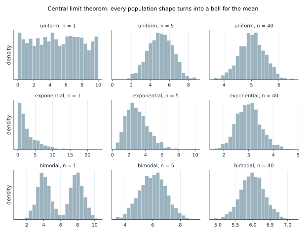

# M13 · Law of Large Numbers and Central Limit Theorem

<div class="psds-meta" markdown>
<span class="psds-chip psds-chip--advanced">Chapter</span>
<span class="psds-chip">12 study hours</span>
<span class="psds-chip">Module overview: [M13](../13-law-of-large-numbers-and-clt.md)</span>
</div>

!!! abstract "Interactive laboratory"
    [Lab L-06 — The law of large numbers](../../labs/law-of-large-numbers.md) — watch a running average settle onto mu, and watch a Cauchy sample refuse to settle.
    [Lab L-07 — The Central Limit Theorem](../../labs/clt.md) — change the population shape and the sample size, and watch the sampling distribution become normal.

## 1. The idea, before any symbols

Two theorems answer two different questions about averages.

**Where does the average go?** The Law of Large Numbers says it converges to the
population mean. With enough data, the estimate stops moving.

**What shape does it have on the way?** The Central Limit Theorem says its
distribution becomes normal, whatever the population looked like.

The distinction is easy to state and easy to forget:

| | Law of Large Numbers | Central Limit Theorem |
|---|---|---|
| About | the *value* of \(\bar X\) | the *distribution* of \(\bar X\) |
| Claim | \(\bar X\to\mu\) | \(\sqrt n(\bar X-\mu)/\sigma\to N(0,1)\) |
| Needs | finite mean (strong law) | finite variance |
| Gives | consistency of estimates | interval widths, p-values, error bars |
| Does **not** say | anything about shape | that the data become normal |

That last row is the most important line in the chapter. **The data do not become
normal.** A sample of 10,000 incomes is still skewed. It is the *average* whose
distribution becomes normal — a different object entirely.

## 2. Why this matters

**Every classical interval and test is CLT-based.** The \(z\) in \(\bar x\pm1.96\,\se\)
is justified by this theorem, not by the data being normal.

**Simulation depends on the LLN.** A Monte Carlo estimate is "run it many times and
average"; the LLN is what makes that converge, and the CLT is what gives its error bar.

**The failure modes are practical.** Heavy-tailed data — financial returns, file sizes,
some latency distributions — can have infinite variance, and then neither theorem
applies. Practitioners who assume otherwise report confident nonsense.

**Sample size is a variance question.** The CLT tells you how large \(n\) must be for a
given approximation quality, which depends on the population's skewness, not on a
universal rule of 30.

## 3. Terminology and notation

| Symbol | Meaning |
|---|---|
| \(\bar X_n\) | sample mean of \(n\) observations |
| \(\xrightarrow{p}\) | convergence in probability |
| \(\xrightarrow{a.s.}\) | almost sure convergence |
| \(\xrightarrow{d}\) | convergence in distribution |
| \(L^{2}\) | convergence in mean square |
| \(\Phi\) | standard normal CDF |
| \(g'(\mu)\) | derivative of \(g\) at \(\mu\) (delta method) |
| \(B\) | number of Monte Carlo replications |

## 4. Modes of convergence

A sequence of random variables can converge in several senses. The differences matter
because each justifies a different practical claim.

| Mode | Definition | Practical meaning |
|---|---|---|
| In probability | \(\Pr(\lvert X_n-X\rvert>\epsilon)\to0\) for all \(\epsilon>0\) | The chance of any noticeable error vanishes |
| Almost surely | \(\Pr(\lim_n X_n=X)=1\) | Every realised sequence converges, except on a null set |
| In distribution | \(F_n(x)\to F(x)\) at continuity points | Only the distribution settles, not the value |
| In mean square | \(\E[(X_n-X)^{2}]\to0\) | Both the value and its variance settle |

**Implications.** Mean-square convergence implies convergence in probability;
convergence in probability implies convergence in distribution. The converses fail.

**Two counterexamples worth remembering.**

- *Distribution without probability:* \(X_n\) takes values 0 and 1 with probability
  \(\tfrac12\) each, independently of \(n\). Its distribution is constant, so it
  converges in distribution, but the sequence never settles on a value.
- *Probability without mean square:* a variable that is 0 with high probability and
  huge with tiny probability can converge in probability while its variance explodes.

## 5. The Law of Large Numbers

### 5.1 The weak law

For i.i.d. \(X_i\) with mean \(\mu\) and finite variance \(\sigma^{2}\),

\[ \bar X_n \xrightarrow{p}\mu. \]

**Proof by Chebyshev.** Chebyshev's inequality says
\(\Pr(\lvert Y-\E[Y]\rvert\ge\epsilon)\le\Var(Y)/\epsilon^{2}\). Apply it to
\(Y=\bar X_n\), whose mean is \(\mu\) and variance is \(\sigma^{2}/n\):

\[ \Pr\left(\lvert\bar X_n-\mu\rvert\ge\epsilon\right)
   \le\frac{\sigma^{2}}{n\epsilon^{2}}\longrightarrow0. \]

That is the whole proof, and it is worth knowing by heart: the bound shrinks like
\(1/n\), so the average concentrates.

**Worked example (Example 5.1).** With \(\sigma=15\) and \(n=100\), the chance that
\(\bar X\) is off by more than 3 is at most

\[ \frac{225}{100(9)}=0.25. \]

The bound is loose (the true probability is much smaller if the data are normal), but it
requires **no distributional assumption at all** — only a finite variance.

### 5.2 The strong law

\[ \Pr\left(\lim_{n\to\infty}\bar X_n=\mu\right)=1. \]

The strong law says the *entire sequence* converges simultaneously, not just each
individual step. It needs only \(\E\lvert X\rvert<\infty\), so it is strictly stronger
than the weak law in its conclusion, and applies under weaker assumptions than the
Chebyshev proof above requires.

**Why the difference matters.** The weak law says "for large \(n\), the average is
probably close". The strong law says "the average converges, with probability one";
in particular, a numerical simulation will settle, not oscillate.

### 5.3 What the LLN does not say

1. **It does not say the sample resembles the population.** A biased sample converges
   to the biased expectation, whatever that is.
2. **It does not say the data become normal.** That is the CLT's business — and even
   then, it is the mean that becomes normal.
3. **It does not make a rare event impossible.** A 1-in-a-million event happens about
   once per million trials, forever.
4. **It does not require a finite variance for the strong law** — but it does require a
   finite mean.

### 5.4 The Cauchy counterexample

The standard Cauchy distribution has density \(f(x)=1/[\pi(1+x^{2})]\). Its mean
integral \(\int x f(x)dx\) diverges, so there is no \(\mu\). Consequently \(\bar X_n\)
does not converge: it has the *same* Cauchy distribution for every \(n\). Averaging
10,000 Cauchy observations is no better than one, because the average of \(n\) Cauchys
is again standard Cauchy.

**Practical meaning:** for data with infinite mean — extreme heavy tails — "more data"
does not fix the estimate. Neither the LLN nor the CLT applies, and confidence intervals
that assume them are meaningless.

## 6. The Central Limit Theorem

### 6.1 Statement

For i.i.d. \(X_i\) with mean \(\mu\) and **finite** variance \(\sigma^{2}\),

\[ \frac{\sqrt n\,(\bar X_n-\mu)}{\sigma}\xrightarrow{d}N(0,1). \]

Equivalently, for large \(n\), \(\bar X_n\approx N(\mu,\sigma^{2}/n)\), and sums
\(S_n=\sum X_i\approx N(n\mu,n\sigma^{2})\).

### 6.2 Proof sketch via moment generating functions

Let \(Z_i=(X_i-\mu)/\sigma\), so \(\E[Z_i]=0\), \(\Var(Z_i)=1\). The MGF of
\(Z_i\) has the expansion

\[ M_Z(t)=1+\frac{t^{2}}{2}+o(t^{2}), \]

because the linear term vanishes (mean zero) and the quadratic coefficient is
\(\E[Z^{2}]/2=1/2\). The standardised mean is
\(W_n=\frac{1}{\sqrt n}\sum Z_i\), and by independence

\[ M_{W_n}(t)=\left[M_Z\left(\frac{t}{\sqrt n}\right)\right]^{n}
   =\left[1+\frac{t^{2}}{2n}+o\!\left(\frac1n\right)\right]^{n}
   \longrightarrow e^{t^{2}/2}, \]

which is the MGF of \(N(0,1)\). Convergence of MGFs implies convergence in
distribution. \(\square\)

The proof is worth reading once because it shows *why* the normal appears: the
quadratic term survives the limit and everything higher vanishes. Any distribution with
a finite variance has the same first two moments, so the limit is universal.

### 6.3 What "large \(n\)" means

There is no universal threshold. What matters is the shape of the population:

| Population | Skewness | Rough \(n\) needed for a decent normal approximation |
|---|---|---|
| Normal | 0 | any \(n\) (exact) |
| Uniform, symmetric | 0 | about 5–10 |
| Exponential | 2 | about 30–50 |
| Lognormal | large | 100–1,000 |
| Bernoulli with \(p=0.01\) | large | until \(np\ge10\) |
| Cauchy | undefined | **never** |

The Berry–Esseen theorem makes this quantitative: the error in the normal approximation
is bounded by \(C\,\E\lvert Z\rvert^{3}/\sqrt n\), so it shrinks like \(1/\sqrt n\) and
is larger when the third moment is large.


[](../../assets/images/figures/fig-13-01-clt.svg)

*Figure 6.1 — the central limit theorem for three populations at n = 1, 5 and 40*

**What it shows.** The left column is the population itself: uniform, exponential, and a two-peaked mixture. By n = 5 the means are already mound-shaped and symmetric; by n = 40 all three are indistinguishable in shape. The theorem is about the mean, not the data: at n = 40 the underlying observations are still exponential or bimodal.

### 6.4 Worked example — CLT with an exponential population (Example 6.1)

Waiting times are exponential with mean 2 minutes (\(\lambda=0.5\)). Take
\(n=49\) observations. Then

\[ \E[\bar X]=2,\qquad \se=\frac{2}{\sqrt{49}}=\frac{2}{7}\approx0.2857. \]

Despite the population being strongly skewed, the CLT gives

\[ \Pr(\bar X>2.5)\approx 1-\Phi\!\left(\frac{2.5-2}{0.2857}\right)
   =1-\Phi(1.75)\approx0.0401. \]

Simulation confirms this to within Monte Carlo error at \(B=10{,}000\).

### 6.5 Worked example — continuity correction (Example 6.2)

A binomial count \(X\sim\text{Bin}(100,0.3)\) has \(\mu=30\) and
\(\sigma=\sqrt{21}\approx4.5826\). For \(\Pr(X\le25)\), the correction uses 25.5:

\[ z=\frac{25.5-30}{4.5826}=-0.982,\qquad \Pr\approx\Phi(-0.982)=0.163. \]

Without the correction (\(z=-1.091\)) the answer is 0.138 — a 15% relative error,
which is why the 0.5 matters for discrete variables.

### 6.6 Worked example — the delta method (Example 6.3)

For a smooth \(g\), a first-order Taylor expansion around \(\mu\) gives

\[ g(\bar X)\approx g(\mu)+g'(\mu)(\bar X-\mu), \]

so \(\Var(g(\bar X))\approx[g'(\mu)]^{2}\sigma^{2}/n\).

Suppose \(\hat p=0.4\) from \(n=100\), and the quantity of interest is the variance of
a Bernoulli, \(g(p)=p(1-p)\). Then \(g'(p)=1-2p\), so

\[ \se\big(g(\hat p)\big)\approx\lvert1-0.8\rvert\sqrt{\frac{0.4(0.6)}{100}}
   =0.2(0.049)=0.0098. \]

This is how standard errors are produced for derived metrics — conversion-rate variance,
revenue per user, click-through ratios — without a closed-form distribution.

## 7. Simulation-based understanding

### 7.1 The sampling machine

The idea is simple and worth doing once by hand:

1. Fix a population (say, exponential with mean 2).
2. Draw \(B=10{,}000\) samples of size \(n\).
3. Record the mean of each sample.
4. Plot the histogram of the 10,000 means.

What you see: the histogram is centred at 2, has spread \(2/\sqrt n\), and becomes
symmetric and bell-shaped as \(n\) grows — even though every sample came from a skewed
population. That picture *is* the CLT.

### 7.2 Checking the error of a simulation

A Monte Carlo estimate \(\hat\theta_B\) from \(B\) replications has its own standard
error, estimated by the sample SD of the replications divided by \(\sqrt B\):

\[ \se(\hat\theta_B)\approx\frac{s}{\sqrt B}. \]

With \(B=10{,}000\) and \(s=0.7\), \(\se\approx0.007\). A reported difference smaller
than about two of those is noise, not a finding. This is the discipline that separates a
simulation study from an anecdote.

### 7.3 The LLN in a running average

Plot \(\bar X_n\) against \(n\). It wiggles, then settles. For exponential data it
settles by a few hundred observations. For Cauchy data it never settles — the running
average takes large jumps whenever an extreme value arrives, forever. The two pictures
side by side are the best argument for checking the mean exists before averaging.

## 8. Practical implications for data analysis

| Situation | What M13 says |
|---|---|
| Reporting a mean from \(n=1{,}000\) | Its uncertainty is \(\sigma/\sqrt n\); report it |
| A/B test with a skewed revenue metric | The CLT may need a larger \(n\) than for conversion; simulate or bootstrap |
| Confidence interval for a proportion at 0.2% | Normal approximation fails; use exact or Wilson methods |
| "We have 10 million rows, so significance is guaranteed" | Precision improves, but effect size does not; and clustered data breaks the \(\sqrt n\) assumption |
| Bootstrap on 8 observations | Resampling cannot create information the sample lacks |
| Monte Carlo study with 100 replications | Its own error is \(\approx s/\sqrt{100}\); too few for 3-decimal claims |

## 9. Common mistakes and misconceptions

| # | Mistake | Why it is wrong | Correct |
|---|---|---|---|
| 1 | "With enough data the distribution becomes normal" | The data keep their shape | The mean's distribution becomes normal |
| 2 | "\(n>30\) guarantees normality" | Skew and outliers dominate | Check with simulation; skew matters |
| 3 | "The LLN says the sample represents the population" | It says the mean converges to *its* expectation | Bias breaks representativeness |
| 4 | "A rare event cannot happen in a large sample" | Probability per trial is unchanged | Expected count grows with \(n\) |
| 5 | "Chebyshev gives a tight bound" | It is deliberately conservative | Use it only for a guaranteed margin |
| 6 | "The CLT needs the data to be i.i.d." — and assuming it | Dependence (clusters, time) changes the variance | Use cluster-robust or block methods |
| 7 | "Infinite variance is a theoretical curiosity" | It is common in finance and file sizes | Check tail behaviour before averaging |
| 8 | "Monte Carlo error is negligible" | It is \(s/\sqrt B\) | Report it |
| 9 | "The delta method is exact" | It is a first-order approximation | Verify for highly nonlinear \(g\) |
| 10 | "Convergence in distribution means the values converge" | Only the CDFs converge | Values need convergence in probability |

## 10. Real-world scenarios

**Insurance claims.** Claim sizes are heavy-tailed. Averaging 10,000 claims gives a
stable estimate of the mean *only if* the mean exists; for some reinsurance layers it
does not, and sample means are unstable. The LLN's condition is a business question.

**Click-through rate at 0.2%.** With 100,000 impressions, the count is about 200 and
\(np=200\), so the normal approximation is adequate — but a *segment* with 300
impressions and 1 click is not: \(np=1\).

**Latency monitoring.** Request latencies are skewed and correlated within a minute.
The naive standard error \(\sigma/\sqrt n\) understates uncertainty by a large factor,
because requests are not independent draws.

**Monte Carlo pricing.** A simulation with \(B=100{,}000\) paths has an error of roughly
\(s/\sqrt B\); halving it requires four times the compute — the same \(\sqrt n\) law in
a different costume.

**Polling aggregation.** Averaging many polls reduces sampling error but not house
effects or non-response bias; the LLN applies to the random component only.

## 11. Visual explanations

### 11.1 The two theorems on one picture

```
distribution of X̄, n = 2      n = 10           n = 50
    ▁▃█▃▁                       ▁▂▅█▅▂▁          ▁▂▃▅█▅▃▂▁
  wide, skewed                narrower          narrow, symmetric
        ↑ LLN: centre stays at μ, spread → 0
        ↑ CLT: shape → normal
```

*What to look at:* both panels change with \(n\), but for different reasons. The centre
is fixed by the LLN; the shape is fixed by the CLT.

### 11.2 Running averages

| \(n\) | \(\bar X_n\) for well-behaved data | \(\bar X_n\) for Cauchy data |
|---|---|---|
| 10 | 2.31 | −0.42 |
| 100 | 2.07 | 3.19 |
| 1,000 | 1.98 | −0.07 |
| 10,000 | 2.01 | 12.6 |
| 100,000 | 2.00 | −4.3 |

*What to look at:* the left column settles; the right column does not. The difference is
not sample size, it is the existence of a mean.

### 11.3 Where the 0.5 comes from

```
binomial bars centred at 18:      [17.5 ──── 18.5]
normal curve:                        ╭─╮
P(X ≤ 18) includes the whole bar → boundary at 18.5, not 18
```

*What to look at:* the continuity correction is geometry: the normal curve is continuous
and the binomial is not, so you extend the boundary to the edge of the bar.

## 12. Exercises

**Exercise 1 (★).** State the weak and strong laws in symbols and say which is stronger.

**Exercise 2 (★).** Use Chebyshev to bound \(\Pr(\lvert\bar X-\mu\rvert\ge2)\) when
\(\sigma=8\) and \(n=64\).

**Exercise 3 (★).** For \(X\sim\text{Bin}(200,0.4)\), use the CLT with a continuity
correction to estimate \(\Pr(X\le70)\).

**Exercise 4 (★★).** A population has mean 50 and variance 400. For \(n=100\), find the
probability that the sample mean exceeds 54.

**Exercise 5 (★★).** Let \(g(x)=x^{2}\), with \(\bar X\) having mean 3 and variance
0.25. A colleague reports \(\se(g(\bar X))\approx1.5\) by multiplying \(g'(3)\) by the
variance. Find the correct standard error and name the error.

**Exercise 6 (★★).** A simulation with \(B=400\) replications gives a mean of 0.42 and
a sample SD of 0.8. Report the estimate with its Monte Carlo standard error.

**Exercise 7 (★★★).** Explain why the average of \(n\) standard Cauchy variables has the
same distribution as one, using the characteristic-function or MGF argument in outline.

**Exercise 8 (★★★).** A colleague says: "With 50,000 survey responses, the sample is
representative." Identify the statistical error and describe the design that would make
the claim true.

## 13. Solutions

**Solution 1.** Weak: \(\bar X_n\xrightarrow{p}\mu\); strong:
\(\Pr(\lim\bar X_n=\mu)=1\). The strong law is stronger: it implies the weak law, and it
applies under weaker moment assumptions.

**Solution 2.** \(\Var(\bar X)=64/64=1\); bound \(=1/4=0.25\).

**Solution 3.** \(\mu=80\), \(\sigma=\sqrt{48}\approx6.9282\); with correction
\(z=(70.5-80)/6.9282=-1.371\); \(\Pr\approx0.0852\).

**Solution 4.** \(\se=20/10=2\); \(z=(54-50)/2=2\); \(\Pr\approx0.0228\).

**Solution 5.** \(g'=2x\), so \(g'(3)=6\). The variance is 0.25, so the SD is 0.5, and
\(\se\approx6(0.5)=3\). The colleague used the variance where the standard deviation
belongs: the delta method propagates **standard errors**, not variances, so the correct
factor is \(\lvert g'\rvert\times\sd\), not \(\lvert g'\rvert\times\Var\).

**Solution 6.** \(\se=0.8/\sqrt{400}=0.04\). Report \(0.42\pm0.08\) (two standard
errors), or \(0.42\) with MCSE 0.04.

**Solution 7.** The standard Cauchy has characteristic function
\(\phi(t)=e^{-\lvert t\rvert}\). The average of \(n\) i.i.d. copies has
\(\phi_{\bar X}(t)=[\phi(t/n)]^{n}=[e^{-\lvert t\rvert/n}]^{n}=e^{-\lvert t\rvert}\),
which is again standard Cauchy. Averaging buys nothing because there is no scale to
average.

**Solution 8.** The error is assuming the LLN implies representativeness. A large
sample converges to the expectation of *the sampling mechanism*; if that mechanism
excludes or over-represents groups, the limit is biased. The design would need a
probability sample with known selection probabilities (stratified, with weights) and a
documented response rate, not just a large \(n\).

## 14. Self-assessment

1. Which theorem tells you the shape of the sampling distribution?
2. What condition does the CLT require that the strong law does not?
3. Give the Chebyshev bound for \(n=100\), \(\sigma=10\), \(\epsilon=2\).
4. Why does the continuity correction add 0.5?
5. State the delta-method variance formula.
6. Why does averaging Cauchy data fail?
7. What does the LLN say about a biased estimator?
8. How would you report a Monte Carlo estimate?
9. Name two analyses that rely on the CLT.
10. Does the data become normal as \(n\) grows? Explain in one sentence.

### Answers

1. The CLT.
2. Finite variance.
3. \(100/(100\cdot4)=0.25\).
4. A discrete count's probability mass is a bar of width 1 centred on the integer.
5. \(\Var(g(\bar X))\approx[g'(\mu)]^{2}\sigma^{2}/n\).
6. The Cauchy has no finite mean, so there is nothing for the average to converge to.
7. It converges to the estimator's expectation, which may differ from the parameter.
8. Estimate plus \(s/\sqrt B\) as Monte Carlo standard error.
9. Confidence intervals and hypothesis tests based on \(z\) or \(t\).
10. No — the data keep their shape; the mean's distribution becomes normal.

## 15. Revision summary

**LLN.** \(\bar X_n\to\mu\) in probability (Chebyshev, finite variance) and almost
surely. Bias is unaffected.

**CLT.** \(\sqrt n(\bar X-\mu)/\sigma\to N(0,1)\); needs finite variance; the data do
not become normal.

**Approximations.** Continuity correction 0.5 for discrete variables; \(np,n(1-p)\ge10\)
for proportions; skewness determines the needed \(n\).

**Delta method.** \(\se(g(\hat\theta))\approx\lvert g'(\theta)\rvert\se(\hat\theta)\).

**Simulation.** Monte Carlo error \(s/\sqrt B\); always report it.

**Failure modes.** Infinite mean (Cauchy), infinite variance (heavy tails), dependence
(clusters, time series).

**Habits.**

1. Check the tail behaviour before averaging a heavy-tailed metric.
2. Simulate the sampling distribution rather than assuming it.
3. Attach a Monte Carlo error to every simulation result.

**Next.** M14 uses these theorems to build estimates with quantified uncertainty.

**Run it.** [Practical 13 — Law of Large Numbers and CLT](../../practicals/notebooks/13-law-of-large-numbers-and-clt.ipynb) · [all practicals](../../practicals/index.md)

---

**Previous:** [M12 chapter](../12-sampling-and-sampling-distributions/chapter.md) ·
**Next:** [M14 · Estimation and Confidence Intervals](../14-estimation-and-confidence-intervals.md)
