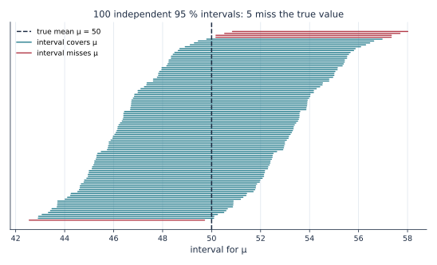
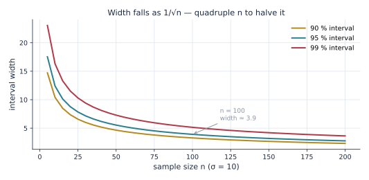

# M14 · Statistical Estimation and Confidence Intervals

<div class="psds-meta" markdown>
<span class="psds-chip psds-chip--core">Chapter</span>
<span class="psds-chip">16 study hours</span>
<span class="psds-chip">Module overview: [M14](../14-estimation-and-confidence-intervals.md)</span>
</div>

!!! abstract "Interactive laboratory"
    [Lab L-09 — Confidence interval coverage](../../labs/confidence-intervals.md) — draw a hundred intervals and count how many capture the true mean.

!!! note "Critical values used in this chapter"
    [Student's \(t\) table](../../reference/tables/t-distribution.md) — the interval multiplier for every mean interval in this chapter; [standard normal table](../../reference/tables/standard-normal.md) for the known-\(\sigma\) case.

## 1. The idea, before any symbols

Estimation has two halves.

**Point estimation:** produce one number. The sample mean estimates the population mean;
35 successes out of 100 estimate a proportion; the reciprocal of the mean wait estimates
a rate.

**Interval estimation:** produce a range with a stated reliability. This is the honest
form, because a point estimate is almost certainly wrong in the third decimal place —
the question is how wrong it might be.

Both halves rest on the same object from M12: the sampling distribution of the estimator.
If you know how an estimator varies across samples, you know how far it might be from the
truth.

## 2. Why this matters

**Every model output is an estimate.** A regression coefficient, a churn rate, a
predicted uplift: all are statistics with sampling variability, and reporting them
without uncertainty is a form of overclaiming.

**The bias–variance trade-off is the core of applied modelling.** Regularisation,
shrinkage, ensembles and Bayesian priors are all deliberate trades of bias for variance.
You cannot understand them without §5.

**Intervals are where interpretation goes wrong.** "95% confidence" does not mean a 95%
chance that the parameter is in *this* interval. §9 fixes that, and it is the single most
commonly misreported sentence in applied statistics.

## 3. Terminology and notation

| Symbol | Meaning |
|---|---|
| \(\theta\) | unknown parameter |
| \(\hat\theta\) | estimator (a random variable) |
| \(\hat\theta_{\text{obs}}\) | the estimate (a number) |
| \(\text{bias}(\hat\theta)=\E[\hat\theta]-\theta\) | systematic error |
| \(\text{MSE}(\hat\theta)=\E[(\hat\theta-\theta)^{2}]\) | bias² + variance |
| \(L(\theta)\) | likelihood; \(\ell=\log L\) |
| \(I(\theta)\) | Fisher information |
| \(1-\alpha\) | confidence level |
| \(z_{1-\alpha/2}\), \(t_{\nu,1-\alpha/2}\) | critical values |
| \(\se(\hat\theta)\) | standard error of the estimator |

## 4. Point estimation

### 4.1 What makes a good estimator

An estimator is a **rule**, not a number: \(\hat\theta=g(X_1,\dots,X_n)\). Four
properties are used to judge a rule.

| Property | Definition | What it buys |
|---|---|---|
| Unbiasedness | \(\E[\hat\theta]=\theta\) | No systematic error |
| Efficiency | Small variance (relative to alternatives) | Precision per observation |
| Consistency | \(\hat\theta_n\xrightarrow{p}\theta\) | More data improves it |
| Sufficiency | Captures all information about \(\theta\) | Nothing is lost by summarising |

No estimator is best on all four. The sample mean is unbiased and efficient for a normal
mean but not robust; the median is robust but less efficient; a shrinkage estimator is
biased but has lower MSE. **Estimation is a choice among trade-offs, not a search for a
perfect rule.**

### 4.2 Standard estimators and their properties

| Parameter | Estimator | Unbiased? | \(\Var\) |
|---|---|---|---|
| Mean \(\mu\) | \(\bar x\) | yes | \(\sigma^{2}/n\) |
| Variance \(\sigma^{2}\) | \(s^{2}\) | yes | depends on kurtosis |
| Variance \(\sigma^{2}\) | \(\hat\sigma^{2}=\frac1n\sum(x-\bar x)^{2}\) | no (factor \(\frac{n-1}{n}\)) | smaller |
| Proportion \(p\) | \(\hat p=x/n\) | yes | \(p(1-p)/n\) |
| Exponential rate \(\lambda\) | \(1/\bar x\) | no (biased upward) | \(\lambda^{2}/n\) asymptotically |

**The two variance estimators, side by side.** For the marks in M03 (\(n=10\),
\(\sum(x-\bar x)^{2}=1960.10\)):

\[ s^{2}=\frac{1960.10}{9}=217.79,\qquad
   \hat\sigma^{2}=\frac{1960.10}{10}=196.01. \]

The first is unbiased; the second is the MLE and is on average too small by a factor
\((n-1)/n=0.9\). With \(n=10\), that is a 10% understatement — a real difference, which
shrinks as \(n\) grows.

## 5. Bias, variance and MSE

### 5.1 The decomposition

\[ \text{MSE}(\hat\theta)=\E[(\hat\theta-\theta)^{2}]
   =\big(\text{bias}\big)^{2}+\Var(\hat\theta). \]

**Derivation.** Add and subtract \(\E[\hat\theta]\):

\[ \E[(\hat\theta-\theta)^{2}]
   =\E\big[(\hat\theta-\E\hat\theta)^{2}\big]
    +2\E\big[(\hat\theta-\E\hat\theta)(\E\hat\theta-\theta)\big]
    +(\E\hat\theta-\theta)^{2}. \]

The middle term is zero because \(\E[\hat\theta-\E\hat\theta]=0\); the first is the
variance and the last is bias².

### 5.2 Worked example

An estimator has bias 2 and variance 9. Then \(\text{MSE}=4+9=13\), and its RMSE is
\(\sqrt{13}\approx3.61\). Note that removing the bias would give MSE 9 — but if
de-biasing inflated the variance to 14, the biased estimator would be better. This is
exactly the logic of ridge regression and of Bayesian shrinkage.

### 5.3 Consistency

If \(\E[\hat\theta_n]\to\theta\) and \(\Var(\hat\theta_n)\to0\), then
\(\hat\theta_n\xrightarrow{p}\theta\) (Chebyshev). So a sequence of estimators with
vanishing bias and variance is consistent. The sample mean is consistent for \(\mu\)
whenever \(\sigma^{2}<\infty\) — and not otherwise (M13's Cauchy case).

## 6. Maximum likelihood estimation

### 6.1 The method

For data \(x_1,\dots,x_n\) from a model \(f(x;\theta)\), the **likelihood** is the joint
density viewed as a function of \(\theta\):

\[ L(\theta)=\prod_{i=1}^{n}f(x_i;\theta),\qquad
   \ell(\theta)=\sum_{i=1}^{n}\log f(x_i;\theta). \]

The MLE \(\hat\theta\) maximises \(\ell\). The **score** is \(\ell'(\theta)\), and the
estimator solves \(\ell'(\hat\theta)=0\) with \(\ell''(\hat\theta)<0\).

### 6.2 Worked example — exponential (Example 6.1)

\[ \ell(\lambda)=n\log\lambda-\lambda\sum x_i,\qquad
   \ell'(\lambda)=\frac n\lambda-\sum x_i=0
   \;\Longrightarrow\;\hat\lambda=\frac{1}{\bar x}. \]

With \(\bar x=4\) minutes, \(\hat\lambda=0.25\) per minute. And
\(\ell''=-n/\lambda^{2}<0\), so it is a maximum.

### 6.3 Worked example — Bernoulli (Example 6.2)

With \(x\) successes in \(n\) trials,

\[ \ell(p)=x\log p+(n-x)\log(1-p),\qquad
   \ell'(p)=\frac xp-\frac{n-x}{1-p}=0
   \;\Longrightarrow\;\hat p=\frac xn. \]

For \(x=35\), \(n=100\): \(\hat p=0.35\), the sample proportion.

### 6.4 Worked example — normal (Example 6.3)

\[ \ell(\mu,\sigma^{2})=-\frac n2\log(2\pi\sigma^{2})
   -\frac{1}{2\sigma^{2}}\sum(x_i-\mu)^{2}. \]

Differentiating with respect to \(\mu\) gives \(\hat\mu=\bar x\); differentiating with
respect to \(\sigma^{2}\) and substituting gives
\(\hat\sigma^{2}=\frac1n\sum(x_i-\bar x)^{2}\). For the M03 marks,
\(\hat\sigma^{2}=196.01\) and \(\hat\sigma=14.00\), against the unbiased
\(s^{2}=217.79\).

### 6.5 Properties of MLEs

- **Consistent** and asymptotically normal:
  \(\hat\theta\approx N(\theta,\,1/(nI(\theta)))\).
- **Invariant:** the MLE of \(g(\theta)\) is \(g(\hat\theta)\).
- **Efficient asymptotically**, attaining the Cramér–Rao bound.
- **Not necessarily unbiased** in finite samples (the normal variance is the example).

### 6.6 Method of moments, for contrast

Set sample moments equal to population moments. For the exponential,
\(\bar x=1/\lambda\Rightarrow\hat\lambda=1/\bar x\) — the same as the MLE here. For the
uniform \([0,\theta]\), \(\bar x=\theta/2\Rightarrow\hat\theta=2\bar x\), which is
unbiased but less efficient than the MLE \(\max x_i\). Moment estimators are easy and
often good starting values for numerical optimisation.

## 7. Information and sufficiency, in brief

**Fisher information** \(I(\theta)=-\E[\ell''(\theta)]\) measures how sharply the
likelihood peaks. The **Cramér–Rao bound** says any unbiased estimator has

\[ \Var(\hat\theta)\ge\frac{1}{nI(\theta)}. \]

For the exponential, \(I(\lambda)=1/\lambda^{2}\), and \(\Var(1/\bar x)\approx
\lambda^{2}/n\) — the bound is attained asymptotically.

**A sufficient statistic** captures everything the sample says about \(\theta\). For the
Poisson, \(\sum x_i\) is sufficient; for the normal mean with known variance, \(\bar x\)
is. Sufficiency matters because it tells you what to report and what can be discarded.

**Efficiency comparison.** For normal data, the median has variance
\(\approx\frac{\pi}{2n}\sigma^{2}\), about 1.57 times the mean's — an efficiency of
\(1/1.57\approx0.64\). Robustness costs precision; that trade is deliberate.

## 8. Confidence intervals

### 8.1 The pivotal method

If \(Q(\text{data},\theta)\) has a distribution free of \(\theta\), invert a probability
statement about \(Q\) into an interval for \(\theta\).

**Mean, known \(\sigma\):** \(Z=(\bar x-\mu)/(\sigma/\sqrt n)\sim N(0,1)\),

\[ \bar x\pm z_{1-\alpha/2}\frac{\sigma}{\sqrt n}. \]

**Mean, unknown \(\sigma\):** \(T=(\bar x-\mu)/(s/\sqrt n)\sim t_{n-1}\),

\[ \bar x\pm t_{n-1,1-\alpha/2}\frac{s}{\sqrt n}. \]

**Example 8.1 (known \(\sigma\)).** \(\bar x=100\), \(\sigma=15\), \(n=25\):

\[ 100\pm1.96\left(\frac{15}{5}\right)=100\pm5.88=[94.12,\;105.88]. \]

**Example 8.2 (\(t\) interval).** \(\bar x=52\), \(s=9\), \(n=16\), so
\(t_{15,0.975}=2.131\):

\[ 52\pm2.131\left(\frac94\right)=52\pm4.79=[47.21,\;56.79]. \]

The \(t\) interval is wider than the \(z\) interval would be — the price of estimating
\(\sigma\) from 16 observations.

### 8.3 Proportions

**Wald interval** (the textbook formula, and the one that fails at the edges):

\[ \hat p\pm z_{1-\alpha/2}\sqrt{\frac{\hat p(1-\hat p)}{n}}. \]

For \(\hat p=0.35\), \(n=400\): \(0.35\pm1.96(0.02385)=0.35\pm0.0467=[0.303,\;0.397]\).

**Wilson interval** (better behaved):

\[ \frac{\hat p+\frac{z^{2}}{2n}}{1+\frac{z^{2}}{n}}
   \pm\frac{z}{1+\frac{z^{2}}{n}}\sqrt{\frac{\hat p(1-\hat p)}{n}
   +\frac{z^{2}}{4n^{2}}}. \]

For the same data this gives about \([0.305,\;0.398]\) — barely different here, because
\(n\hat p=140\) is large. But at \(\hat p=0\) with \(n=20\) the Wald interval collapses to
\([0,0]\), which is absurd: 20 trials cannot rule out a 15% rate. Wilson gives roughly
\([0,\;0.161]\). **Use Wilson (or exact) whenever \(\hat p\) is near 0 or 1, or
\(n\hat p<10\).**

### 8.4 Two-sample intervals

For a difference of means with a pooled variance (equal-variance assumption),

\[ (\bar x_1-\bar x_2)\pm t_{n_1+n_2-2,\,1-\alpha/2}\,
   s_p\sqrt{\frac1{n_1}+\frac1{n_2}},\qquad
   s_p^{2}=\frac{(n_1-1)s_1^{2}+(n_2-1)s_2^{2}}{n_1+n_2-2}. \]

**Example 8.3.** Group 1: \(\bar x_1=68\), \(s_1=9\), \(n_1=20\). Group 2:
\(\bar x_2=62\), \(s_2=11\), \(n_2=25\). Then

\[ s_p^{2}=\frac{19(81)+24(121)}{43}=\frac{4443}{43}=103.33,\quad s_p=10.165, \]

\[ \se=10.165\sqrt{\frac1{20}+\frac1{25}}=10.165(0.3)=3.05, \]

and with \(t_{43,0.975}\approx2.016\),

\[ 6\pm2.016(3.05)=6\pm6.15=[-0.15,\;12.15]. \]

**Reading it:** the interval includes zero, so a difference of zero is compatible with
the data — the same conclusion the corresponding test reaches in M15. Note also the
width: ±6 points on a difference of 6 is a weak result, and *reporting the interval says
that honestly* whereas "difference of 6 marks" alone does not.

For proportions, use the difference with
\(\se=\sqrt{\hat p_1(1-\hat p_1)/n_1+\hat p_2(1-\hat p_2)/n_2}\), and prefer the
Wilson or Newcombe construction when counts are small.

### 8.5 Sample size for a target margin

For a mean with known \(\sigma\),

\[ n=\left(\frac{z_{1-\alpha/2}\,\sigma}{E}\right)^{2}. \]

With \(\sigma=15\), \(E=3\), \(z=1.96\): \(n=(9.8)^{2}=96.04\Rightarrow97\).
Halving \(E\) to 1.5 requires 385 — four times as many, again (M12).

For a proportion, use the worst case \(p=0.5\):
\(n=(1.96/0.03)^{2}(0.25)\approx1068\) for a ±3 point margin.

## 9. Interpretation, and the mistakes that follow

### 9.1 What a 95% interval means

The procedure has 95% long-run coverage: if you repeated the study many times and built
an interval each time, about 95% of those intervals would contain \(\mu\).

**What it does not mean:** "there is a 95% chance that \(\mu\) lies in *this* interval."
Once computed, the interval either contains \(\mu\) or it does not; the randomness was
in the sampling, not in the parameter. Under a Bayesian prior you can make a probability
statement about the parameter — that is a *credible* interval (M18), and it is a
different object.

### 9.2 Coverage, demonstrated

A simulation with \(\mu=100\), \(\sigma=15\), \(n=25\) and 10,000 replications produces
intervals that cover the true mean about 95% of the time. At \(n=5\), the \(z\)-based
interval covers only about 87% — because \(s\) is unstable and the normal quantile is too
small. This is exactly why the \(t\) interval exists, and why using \(z\) with \(s\) in
small samples is an error of substance, not of notation.


[](../../assets/images/figures/fig-14-01-ci-coverage.svg)

*Figure 9.1 — 100 independent 95 % intervals for the same mean*

**What it shows.** Each line is one study's interval; the dashed line is the true mean, which the analyst never sees. In this run five intervals miss. That is what '95 % confidence' means — 95 % of intervals from this procedure capture the parameter, not that this particular interval has a 95 % chance of doing so.

### 9.3 Common mistakes

| # | Mistake | Why it is wrong | Correct |
|---|---|---|---|
| 1 | "95% chance the parameter is in this interval" | The parameter is fixed | 95% of such intervals cover it |
| 2 | "A wider interval is more accurate" | Width is imprecision | Narrower is more informative at a given confidence |
| 3 | Reporting \(\bar x\) with no interval | Hides sampling error | Always pair an estimate with its uncertainty |
| 4 | Using \(z\) with \(s\) in small samples | Understates width | Use \(t\) |
| 5 | Wald interval at \(\hat p=0\) or 1 | Gives a zero-width interval | Wilson or exact |
| 6 | Treating a 99% interval as "safer" without cost | It is wider; precision is lost | Choose the level in advance |
| 7 | Reading a 95% interval as a 95% *prediction* interval | Prediction intervals are far wider | Distinguish mean response from new observation |
| 8 | Pooling variances without checking equality | The pooled SE can be badly wrong | Welch's interval by default |
| 9 | Building an interval from a biased sample | Coverage is irrelevant if the target is wrong | Fix the design |
| 10 | Comparing overlapping intervals as "no difference" | Overlap is not the right test | Use the interval for the difference |

## 10. Real-world scenarios

**Average delivery time.** 200 deliveries give \(\bar x=38\) minutes, \(s=11\), so
\(\se=0.778\) and a 95% \(t\) interval is \(38\pm1.53=[36.5,39.5]\). A promise of
"35 minutes" is outside the interval, so the target is not being met on average — a
conclusion you cannot draw from the point estimate alone.

**Conversion rate.** 35 of 400 visitors convert: \(\hat p=0.0875\),
\(\se=0.0141\), interval about \([0.062,0.117]\). A "target of 10%" is inside the
interval, so the data are compatible with meeting it.

**Model coefficient.** A regression estimate of 0.42 with a standard error of 0.15 gives
\([0.12,0.72]\): positive, but the plausible effect ranges from small to large. Marketing
decisions that depend on the effect being above 0.5 are not supported.

**Survey with weighting.** Stratified estimates combine strata with weights; the
interval must use the design-based variance, not a naive \(\sqrt{\hat p(1-\hat p)/n}\),
which ignores the weighting.

**Measurement error.** A lab's replicate mean has a \(t\) interval from 9 replicates;
reporting \(s\) instead of \(\se\) makes the measurement look three times more precise.
This is the mistake in misconception #3 above, in a setting where it affects decisions.

## 11. Visual explanations

### 11.1 Coverage, not probability

```
100 simulated 95% intervals for μ = 100
──────[====]──────────   covers
──[=====]─────────────   covers
──────────[===]───────   covers
──────────[====]──────   misses (about 5 of 100)
   ↑ μ fixed; the interval moves
```

*What to look at:* the parameter never moves; the intervals do. Coverage is a property
of the procedure, not of one realisation.

### 11.2 Bias–variance trade-off

| Estimator | Bias | Variance | MSE |
|---|---|---|---|
| Unbiased, noisy | 0 | 9 | 9 |
| Shrunk | 2 | 4 | 8 |
| Heavily shrunk | 4 | 1 | 17 |

*What to look at:* the middle row is better than the unbiased one on MSE. Accepting a
little bias to remove a lot of variance is a legitimate strategy — the foundation of
ridge, lasso and hierarchical models.

### 11.3 Interval width versus confidence

| Level | \(z\) | Width factor | Comment |
|---|---|---|---|
| 90% | 1.645 | 1.00 | Narrower, less protection |
| 95% | 1.960 | 1.19 | Conventional |
| 99% | 2.576 | 1.57 | Much wider |

*What to look at:* the width grows with confidence, and the growth is not linear. Choose
the level before seeing the data, not after.


[](../../assets/images/figures/fig-14-02-ci-width.svg)

*Figure 11.1 — width against sample size at three confidence levels*

**What it shows.** Width falls as 1/√n, so quadrupling the sample only halves the interval. Raising confidence widens it: 99 % is always wider than 95 % at the same n. When someone asks for a narrower interval the honest answers are more data or less confidence — never a smaller sample reported as if it were the same study.

## 12. Exercises

**Exercise 1 (★).** Define an estimator, an estimate, bias and MSE.

**Exercise 2 (★).** \(\bar x=64\), \(s=10\), \(n=25\). Construct the 95% \(t\) interval.

**Exercise 3 (★).** Derive the MLE of \(p\) for 12 successes in 40 trials, and compute it.

**Exercise 4 (★★).** For the exponential, show that \(\hat\lambda=1/\bar x\) and compute
it for \(\bar x=2.5\).

**Exercise 5 (★★).** An estimator has \(\E[\hat\theta]=10.5\) when \(\theta=10\), and
\(\Var=4\). Compute bias, MSE and RMSE.

**Exercise 6 (★★).** A poll finds 12 supporters in 60 respondents. Compute the Wald and
Wilson intervals, then explain which you would report.

**Exercise 7 (★★).** How large a sample is needed for a margin of error of 2 marks when
\(\sigma=12\) and the confidence level is 95%?

**Exercise 8 (★★★).** Show that \(\hat\sigma^{2}=\frac1n\sum(x-\bar x)^{2}\) is biased
and compute \(\E[\hat\sigma^{2}]\) for \(n=8\), \(\sigma^{2}=50\).

**Exercise 9 (★★★).** Explain why a 95% interval computed from a non-random (convenience)
sample has no meaningful coverage, even though the arithmetic is correct.

## 13. Solutions

**Solution 1.** An estimator is a rule mapping data to a value; an estimate is the value
it produced for one sample; bias is \(\E[\hat\theta]-\theta\); MSE is
\(\E[(\hat\theta-\theta)^{2}]=\text{bias}^{2}+\Var\).

**Solution 2.** \(t_{24,0.975}=2.064\); \(\se=10/5=2\); interval
\(64\pm4.13=[59.87,\;68.13]\).

**Solution 3.** \(\hat p=x/n=12/40=0.30\).

**Solution 4.** \(\ell=n\log\lambda-\lambda\sum x_i\), so
\(\ell'=n/\lambda-\sum x_i=0\Rightarrow\hat\lambda=n/\sum x_i=1/\bar x\). With
\(\bar x=2.5\), \(\hat\lambda=0.4\).

**Solution 5.** Bias \(=0.5\); MSE \(=0.25+4=4.25\); RMSE \(=\sqrt{4.25}\approx2.06\).

**Solution 6.** \(\hat p=0.2\), \(\se=\sqrt{0.2(0.8)/60}=\sqrt{0.002667}=0.05164\).
Wald: \(0.2\pm1.96(0.05164)=[0.099,\;0.301]\). Wilson: about
\([0.117,\;0.320]\) — centred higher because it shrinks towards 0.5. Report Wilson: at
12 successes the normal approximation is borderline (\(n\hat p=12\)), and Wilson keeps
the interval away from zero, which Wald's symmetry does not.

**Solution 7.** \(n=(1.96\times12/2)^{2}=(11.76)^{2}=138.3\Rightarrow139\).

**Solution 8.** With \(S=\sum(x-\bar x)^{2}\), \(\E[S]=(n-1)\sigma^{2}\), so
\(\E[\hat\sigma^{2}]=\frac{n-1}{n}\sigma^{2}\). For \(n=8\), \(\sigma^{2}=50\):
\(\E=43.75\), a 12.5% understatement.

**Solution 9.** Coverage is a statement about repeated *random* samples from the target
population. A convenience sample is not drawn by a known mechanism, so the distribution
of the estimator is not the one the interval assumes; the interval's 95% is a claim
about a sampling process that did not occur.

## 14. Self-assessment

1. Give the bias–variance decomposition of MSE.
2. Why is \(s^{2}\) divided by \(n-1\)?
3. State the score equation for an MLE.
4. Write the \(t\) interval formula and name each symbol.
5. When does the Wald interval fail badly?
6. What does 95% confidence actually guarantee?
7. Give the sample-size formula for a target margin of error.
8. What is the difference between a confidence interval and a prediction interval?
9. Name two properties an estimator can have that conflict.
10. Why is a biased estimator sometimes preferred?

### Answers

1. \(\text{MSE}=\text{bias}^{2}+\Var\).
2. The deviations sum to zero, so only \(n-1\) are free; dividing by \(n-1\) makes it
   unbiased.
3. \(\ell'(\theta)=0\) with \(\ell''<0\).
4. \(\bar x\pm t_{n-1,1-\alpha/2}\,s/\sqrt n\).
5. When \(\hat p\) is near 0 or 1, or \(n\hat p<10\).
6. That 95% of intervals built this way cover the parameter.
7. \(n=(z\sigma/E)^{2}\).
8. A confidence interval is for the mean response; a prediction interval is for a single
   new observation and is much wider.
9. Unbiasedness and variance (efficiency); efficiency and robustness.
10. Because trading a little bias for a large reduction in variance can lower MSE.

## 15. Revision summary

**Point estimation.** An estimator is a rule; judge it by bias, variance, MSE,
consistency and sufficiency.

**MSE.** \(\text{bias}^{2}+\Var\); a biased estimator can beat an unbiased one.

**MLE.** Maximise the log-likelihood; solve \(\ell'=0\) and check \(\ell''<0\).
Consistent, invariant, asymptotically efficient, not always unbiased.

**Intervals.** Pivot the statistic:
\(\bar x\pm z\sigma/\sqrt n\) (known \(\sigma\));
\(\bar x\pm t s/\sqrt n\) (estimated \(\sigma\)); Wilson for proportions; pooled or
Welch for two samples.

**Sample size.** \(n=(z\sigma/E)^{2}\); precision costs quadratically.

**Interpretation.** Coverage is a property of the procedure, not of one interval; the
parameter does not move.

**Habits.**

1. Report an interval with every estimate.
2. State whether \(\sigma\) is known; if not, use \(t\).
3. Never use Wald at the boundary; never read overlap as "no difference".

**Next.** M15 turns intervals into decisions, and shows what a p-value is — and is not.

**Run it.** [Practical 14 — Estimation and confidence intervals](../../practicals/notebooks/14-estimation-and-confidence-intervals.ipynb) · [all practicals](../../practicals/index.md)

---

**Previous:** [M13 chapter](../13-law-of-large-numbers-and-clt/chapter.md) ·
**Next:** [M15 · Hypothesis Testing](../15-hypothesis-testing.md)
