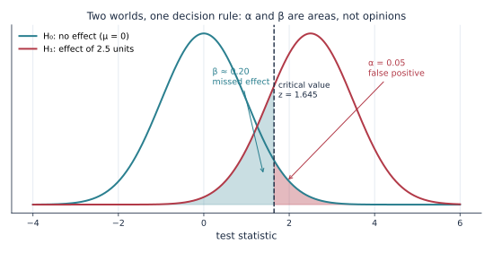

# M15 · Hypothesis Testing

<div class="psds-meta" markdown>
<span class="psds-chip psds-chip--core">Chapter</span>
<span class="psds-chip">18 study hours</span>
<span class="psds-chip">Module overview: [M15](../15-hypothesis-testing.md)</span>
</div>

!!! abstract "Interactive laboratory"
    [Lab L-10 — Hypothesis tests and p-values](../../labs/p-values.md) — simulate studies with and without a real effect and see what p-values actually do.
    [Lab L-13 — Type I and Type II errors, and power](../../labs/power-and-errors.md) — move the effect size, sample size and significance level and watch the two error rates trade off.

!!! note "Critical values used in this chapter"
    [Student's \(t\) table](../../reference/tables/t-distribution.md) and the [standard normal table](../../reference/tables/standard-normal.md); [choosing a table](../../reference/tables/choosing-a-table.md) if the boundary you need is not obvious.

## 1. The idea, before any symbols

A hypothesis test is a decision rule with two known ways of being wrong, and a stated
probability for one of them.

You assume a **null hypothesis** — usually "no effect" — derive what data would look
like if it were true, and ask whether your data are surprising under that assumption. If
they are, you reject the null. The word "surprising" is quantified by the **p-value**.

The logic is indirect because it has to be. You cannot prove a hypothesis; you can only
show that the data are unlikely under its negation. That is why a test ends in "reject
\(H_0\)" or "fail to reject \(H_0\)" rather than "accept".

Everything else — \(z\), \(t\), \(\chi^{2}\), \(F\) — is bookkeeping: which test
statistic, with which distribution under \(H_0\).

## 2. Why this matters

**Decisions are made with these.** Drug approval, feature rollout, quality control,
fraud rules. Each has a cost for false positives and a cost for false negatives, and the
test framework makes both explicit.

**Power is a design decision made before data collection.** An underpowered study that
finds nothing has found nothing about the world; it has only shown that its own sample
was too small.

**Most reported p-values are misinterpreted.** Not by the public only — by researchers.
§6 is the corrective: a p-value is a probability *of data*, not *of a hypothesis*.

**Multiplicity is the failure mode of modern analytics.** Testing twenty metrics and
reporting the one that was significant is a procedure that finds noise with high
probability (§9).

## 3. Terminology and notation

| Symbol | Meaning |
|---|---|
| \(H_0\) | null hypothesis |
| \(H_1\) | alternative hypothesis |
| \(\alpha\) | significance level: \(\Pr(\text{reject }H_0\mid H_0\text{ true})\) |
| \(\beta\) | \(\Pr(\text{fail to reject}\mid H_1\text{ true})\) |
| \(1-\beta\) | **power** |
| \(p\) | p-value |
| \(T\) | test statistic |
| \(\Delta\) | effect size (difference worth detecting) |
| \(d\) | standardised effect size (Cohen's \(d\)) |
| \(m\) | number of tests (multiplicity) |

## 4. The logic of a test

### 4.1 Five steps

1. **State the hypotheses** in terms of a parameter, before seeing the data.
2. **Choose the statistic** and its distribution under \(H_0\).
3. **Set \(\alpha\)** and the rejection region (or decide to report a p-value).
4. **Compute** the statistic from the data.
5. **Conclude in context**, with the effect size and interval.

### 4.2 One- or two-tailed?

- **Two-tailed** \(H_1:\theta\neq\theta_0\): detect a difference in either direction.
- **One-tailed** \(H_1:\theta>\theta_0\): detect an increase only.

The choice must be made **before** the data. Choosing the tail after seeing which way
the estimate fell doubles the effective Type I error, and is a form of p-hacking. In
most applied work the two-tailed test is the honest default, because a surprising
decrease is also a finding.

### 4.3 The decision table

| | \(H_0\) true | \(H_1\) true |
|---|---|---|
| Reject \(H_0\) | **Type I error**, probability \(\alpha\) | Correct, probability \(1-\beta\) (power) |
| Fail to reject | Correct, probability \(1-\alpha\) | **Type II error**, probability \(\beta\) |

## 5. Errors, power and the design triangle

### 5.1 The three levers

Power depends on four quantities, and fixing any three determines the fourth:

\[ 1-\beta=f(\alpha,\;n,\;\Delta,\;\sigma). \]

- Larger **effect** \(\Delta\) → easier to detect.
- Larger **sample** \(n\) → easier to detect.
- Smaller **noise** \(\sigma\) → easier to detect.
- Larger \(\alpha\) → easier to detect, at the cost of more false positives.

### 5.2 Sample size for a two-sample comparison

For a two-sided test of two means with equal variances,

\[ n\ \text{per group}\ \approx\ \frac{2\left(z_{1-\alpha/2}+z_{1-\beta}\right)^{2}\sigma^{2}}{\Delta^{2}}. \]

With \(\alpha=0.05\), power 0.80, \(\sigma=10\), \(\Delta=5\):

\[ n\approx\frac{2(1.96+0.8416)^{2}(100)}{25}
   =\frac{2(7.849)(100)}{25}=62.8\;\Rightarrow\;63\ \text{per group}. \]

Note the structure: \(n\) grows with \(\sigma^{2}\) (noise) and falls with \(\Delta^{2}\)
(effect). Halving the effect quadruples the required sample.

**Power curve.** With \(n=40\) per group the same design has power

\[ \Phi\!\left(\frac{\Delta}{\sigma\sqrt{2/n}}-z_{1-\alpha/2}\right)
   =\Phi(2.236-1.96)=\Phi(0.276)\approx0.61, \]

so a real 5-mark difference would be missed about 39% of the time. That is what an
underpowered study does: it reports "no significant difference" and is believed.

### 5.3 Post-hoc power is not a fix

Computing power *after* the study, using the observed effect, adds no information — it
is a monotone function of the p-value. Power must be specified from a smallest effect
size of interest, before data collection.

### 5.4 Effect size and practical significance

\[ d=\frac{\bar x_1-\bar x_2}{s_p}. \]

With a 5-mark difference and \(s_p=10\), \(d=0.5\) — conventionally "medium". But
conventions are not decisions: with \(n=10{,}000\), \(d=0.05\) is "significant" and
irrelevant. Always report \(d\) (or a raw difference) and an interval next to \(p\).

## 6. p-values, correctly

### 6.1 The definition

\[ p=\Pr\big(T\ \text{at least as extreme as observed}\ \big|\ H_0\big). \]

It is computed **assuming \(H_0\) is true**, and it measures how surprising the data are
under that assumption.

### 6.2 What a p-value is not — the critical section

> **A p-value is not the probability that the null hypothesis is true.**
> \(\;p\neq\Pr(H_0\mid\text{data})\).

The p-value is \(\Pr(\text{data}\mid H_0)\); the quantity people want is
\(\Pr(H_0\mid\text{data})\). Reversing a conditional is the error M07 spent a chapter
on, and it needs the prior: by Bayes,

\[ \Pr(H_0\mid\text{data})=\frac{\Pr(\text{data}\mid H_0)\Pr(H_0)}
   {\Pr(\text{data})}. \]

A small \(p\) says the data are unlikely **if \(H_0\)**; whether \(H_0\) is likely
depends also on how plausible \(H_0\) was beforehand and on the probability of such data
under \(H_1\). With many tested hypotheses (genomics, A/B metric farms), most small
p-values come from true nulls, so \(\Pr(H_0\mid p\text{ small})\) can be high even when
\(p\) is tiny.

Also **not**:

| Claim | Why it is wrong |
|---|---|
| "\(p=0.03\) means a 3% chance \(H_0\) is true" | It is \(\Pr(\text{data}\mid H_0)\) |
| "\(p=0.03\) means the effect is large" | p depends on \(n\) as well as size |
| "\(p>0.05\) proves no effect" | Absence of evidence is not evidence of absence |
| "\(1-p\) is the probability the result replicates" | Replication probability is a different calculation |
| "\(p=0.049\) is meaningful, \(p=0.051\) is not" | The threshold is a convention, not a cliff |

### 6.3 Uniformity under the null

If \(H_0\) is true and all assumptions hold, the p-value is uniformly distributed on
\([0,1]\). So 5% of true nulls give \(p<0.05\) **by construction**. This single fact
explains why "20 tests, one significant" is unremarkable (§9), and why a p-value near
0.05 from one small study is weak evidence.

### 6.4 Correct wording

- *Reject:* "There is evidence that the mean differs from 50 (\(t_{99}=2.22\),
  \(p=0.026\); 95% CI for the difference \([0.2,\,3.8]\))."
- *Fail to reject:* "The data are compatible with no difference (\(t_{43}=1.97\),
  \(p=0.055\)); the interval includes zero and also effects as large as 12 points, so the
  study cannot rule out a meaningful difference."
- *Never:* "We proved there is no effect." "The null hypothesis is true with probability
  0.95."

## 7. The tests

### 7.1 One-sample \(z\)-test (known \(\sigma\))

\[ z=\frac{\bar x-\mu_0}{\sigma/\sqrt n}. \]

**Example 7.1.** \(n=100\), \(\bar x=52\), \(\sigma=9\), \(\mu_0=50\):

\[ z=\frac{2}{0.9}=2.222,\qquad p=2(1-\Phi(2.222))\approx0.0263. \]

Reject at 5%. Note that \(\sigma\) is rarely known — this test is mostly pedagogical, and
its real use is in large-sample approximations.

### 7.2 One-sample \(t\)-test (unknown \(\sigma\))

\[ t=\frac{\bar x-\mu_0}{s/\sqrt n},\qquad \nu=n-1. \]

**Example 7.2.** \(n=10\), \(\bar x=68\), \(s=8\), \(\mu_0=70\):

\[ t=\frac{-2}{2.530}=-0.791,\qquad \nu=9. \]

The critical value is \(t_{9,0.975}=2.262\); \(|t|=0.79\) is far inside, and
\(p\approx0.450\). No evidence of a difference — and the interval
\(68\pm2.262(2.53)=[62.3,\;73.7]\) shows the data are also compatible with a 3.7-mark
increase, so "no difference" is not the whole story.

### 7.3 Two-sample \(t\)-test

Pooled (equal variances):

\[ t=\frac{\bar x_1-\bar x_2}{s_p\sqrt{1/n_1+1/n_2}},\qquad
   \nu=n_1+n_2-2. \]

**Example 7.3.** Using the M14 numbers: difference 6, \(s_p=10.165\), \(\se=3.05\),
\(t=1.9675\), \(\nu=43\). Then \(p\approx0.055\) — marginally not significant at 5%.
With \(n\) this small, the honest report is the interval \([-0.15,\,12.15]\): the data
are compatible with no difference and with a large one.

**Welch's version** (unequal variances) does not pool; it uses
\(s_1^{2}/n_1+s_2^{2}/n_2\) and a fractional df. It is the safer default, and modern
software uses it unless told otherwise.

### 7.4 Paired \(t\)-test

When the same units are measured twice, analyse the **differences**:

\[ t=\frac{\bar d}{s_d/\sqrt n},\qquad \nu=n-1. \]

**Example 7.4.** Nine students before and after a workshop: mean improvement
\(\bar d=2.4\), \(s_d=3.1\). Then \(t=2.4/(3.1/3)=2.323\), \(\nu=8\), and the critical
value is 2.306, so \(p\approx0.048\) — just significant.

**Why pairing matters.** The paired design removes between-student variability; if
students differ a lot in baseline, the unpaired comparison would have a much larger
standard error and might not detect the same effect. Pairing is a design decision that
buys power for free when the correlation within pairs is positive.

### 7.5 Test for a proportion

\[ z=\frac{\hat p-p_0}{\sqrt{p_0(1-p_0)/n}} \]

using the **null** value \(p_0\) in the denominator (not \(\hat p\)).

**Example 7.5.** 90 of 400 convert, \(p_0=0.20\): \(\hat p=0.225\),
\(\se_0=\sqrt{0.2(0.8)/400}=0.02\), \(z=1.25\), \(p=0.211\). No evidence of a change.

Two-proportion version:

\[ z=\frac{\hat p_1-\hat p_2}{\sqrt{\hat p(1-\hat p)\left(\frac1{n_1}+\frac1{n_2}\right)}},
   \qquad \hat p=\frac{x_1+x_2}{n_1+n_2}. \]

### 7.6 Which test?

| Design | Parameter | Test |
|---|---|---|
| One mean, \(\sigma\) known | \(\mu\) | \(z\) |
| One mean, \(\sigma\) estimated | \(\mu\) | one-sample \(t\) |
| Two independent means | \(\mu_1-\mu_2\) | two-sample \(t\) (Welch) |
| Two paired measurements | \(\mu_d\) | paired \(t\) |
| One proportion | \(p\) | \(z\) (or exact binomial) |
| Two proportions | \(p_1-p_2\) | two-proportion \(z\) |
| One variance | \(\sigma^{2}\) | \(\chi^{2}\) |
| Two variances | \(\sigma_1^{2}/\sigma_2^{2}\) | \(F\) |
| Three or more means | all \(\mu_i\) | ANOVA (M17) |
| Association of categories | independence | \(\chi^{2}\) (M17) |

## 8. Assumptions and their consequences

| Assumption | Violated by | Consequence | Remedy |
|---|---|---|---|
| Independence | clusters, repeated measures, time | Standard errors too small; p too small | Cluster-robust SE, mixed models |
| Normality (small \(n\)) | skew, outliers | \(t\) critical values wrong | Larger \(n\), rank tests, bootstrap |
| Equal variances (pooled \(t\)) | unequal group spreads | Wrong SE | Welch |
| Known \(\sigma\) (\(z\)) | usually estimated | Interval too narrow | \(t\) |
| Random sampling | convenience samples | Inference targets the wrong population | Redesign |
| Pre-specified analysis | peeking, optional stopping | \(\alpha\) inflated | Sequential methods |

**A test's assumptions are about the sampling mechanism and the population, not just the
histogram.** A large \(n\) rescues normality approximately (M13), but never rescues a
biased sample or dependent observations.

## 9. Multiplicity

### 9.1 The inflation

With \(m\) independent tests at level \(\alpha\),

\[ \Pr(\text{at least one false positive})=1-(1-\alpha)^{m}. \]

For \(m=20\), \(\alpha=0.05\): \(1-0.95^{20}\approx0.6415\) — a 64% chance of at least
one spurious "significant" result. This is not a flaw in the tests; it is arithmetic.

### 9.2 Two corrections

**Bonferroni:** test each at \(\alpha/m\). Controls the family-wise error rate (FWER),
is simple, and is conservative when tests are correlated.

**Benjamini–Hochberg (BH):** controls the false discovery rate (FDR) — the expected
proportion of false positives among rejections. Order the p-values and reject up to the
largest \(k\) with \(p_{(k)}\le \frac{k}{m}\alpha\).

**Example 9.1.** Five p-values: 0.001, 0.008, 0.039, 0.041, 0.12; \(m=5\),
\(\alpha=0.05\).

| \(k\) | \(p_{(k)}\) | BH threshold \(k(0.05)/5\) | Reject? |
|---|---|---|---|
| 1 | 0.001 | 0.010 | yes |
| 2 | 0.008 | 0.020 | yes |
| 3 | 0.039 | 0.030 | no |
| 4 | 0.041 | 0.040 | no |
| 5 | 0.120 | 0.050 | no |

BH rejects the first **two** hypotheses. Bonferroni at \(0.05/5=0.01\) also rejects
two here (0.001 and 0.008 are both below 0.01), so this small example does not separate
them. BH's advantage appears with many tests, where it is less conservative and finds
more true effects at the same false-discovery rate.

### 9.3 The garden of forking paths

Multiplicity does not require multiple declared tests. Choosing the outcome, the subgroup,
the covariate set or the stopping point **after** seeing the data creates the same
inflation without any correction being applied. Pre-registration and a fixed analysis
plan are the only real protections.

## 10. Real-world scenarios

**A/B test of a checkout change.** Conversion 0.120 vs 0.140 with 1,000 users per arm:
pooled \(\hat p=0.13\), \(\se=0.01504\), \(z=1.33\), \(p\approx0.18\). Not significant.
The honest report: "the observed lift is 2 percentage points, with a 95% interval of
about [−0.9, +4.9] points; the test is inconclusive", plus a power calculation showing
that detecting a 2-point lift at 80% power needs about 6,000 users per arm.

**Screening 500 genes.** Bonferroni at 0.05/500 = \(10^{-4}\) is very strict; BH at 5%
FDR is the standard because the goal is a follow-up list, not a single decision.

**Quality control.** A \(\chi^{2}\) test for process variance detects a real change; a
\(t\) test for the mean does not. Testing the wrong parameter is a common design error —
the question determines the statistic.

**Clinical trial stopped early.** Peeking at the data inflates Type I error; the correct
approach fixes the number of interim looks in advance (group-sequential boundaries) or
uses a Bayesian design (M18).

**Survey with clusters.** Households within a village are similar; treating them as
independent halves the standard error and doubles the apparent significance. Design
effects are not optional refinements.

## 11. Visual explanations

### 11.1 The two distributions under \(H_0\) and \(H_1\)

```
        H0            H1
     ╭──╮          ╭──╮
   ╭─╯  ╰─╮      ╭─╯  ╰─╮
 ──┴──────┴──────┴──────┴──
      ↑α/2   ↑β     ↑α/2
 rejection      power = 1−β
```

*What to look at:* the two curves overlap, so no rule can be right always. \(\alpha\) is
the area in the rejection region under \(H_0\); power is the area of \(H_1\) in that same
region. Moving the boundary trades one for the other; increasing \(n\) separates the
curves.


[](../../assets/images/figures/fig-15-01-h0-h1.svg)

*Figure 11.1 — the null and alternative distributions, with α and β as areas*

**What it shows.** The left curve is a world in which nothing is happening; the right curve a world with a real effect. The critical value is placed so that only α = 5 % of the null world lies to its right, and the shaded area under the alternative to its left, β ≈ 20 %, is the chance of missing the effect. Moving the critical value trades one area for the other — that trade is the whole of test design.

### 11.2 p-value uniformity

| \(p\) bin | Expected share under \(H_0\) | Observed in 10,000 true nulls |
|---|---|---|
| 0.00–0.05 | 5% | ≈5% |
| 0.05–0.25 | 20% | ≈20% |
| 0.75–1.00 | 25% | ≈25% |

*What to look at:* every bin is equally likely when \(H_0\) is true. A histogram of
p-values from many null tests is flat — which is why 5% significance is guaranteed to
produce false positives at a 5% rate.

### 11.3 Power versus sample size

| \(n\) per group | Power at \(d=0.5\) |
|---|---|
| 20 | ≈0.34 |
| 40 | ≈0.61 |
| 63 | ≈0.80 |
| 90 | ≈0.93 |
| 130 | ≈0.99 |

*What to look at:* power rises with \(n\), and the last increments are expensive. Design
for 0.80 unless a false negative is especially costly.

## 12. Exercises

**Exercise 1 (★).** State \(H_0\) and \(H_1\) for testing whether a filling machine
dispenses 500 mL on average, two-tailed.

**Exercise 2 (★).** Define Type I error, Type II error and power, and give their symbols.

**Exercise 3 (★).** A test gives \(p=0.032\). State what this means and give two things
it does not mean.

**Exercise 4 (★★).** \(n=36\), \(\bar x=48.6\), \(s=6\), \(\mu_0=50\). Compute the
\(t\) statistic, the df and the two-sided conclusion at 5%.

**Exercise 5 (★★).** 80 of 500 users convert; test \(H_0:p=0.20\) against
\(p\neq0.20\).

**Exercise 6 (★★).** A paired study of 16 pairs gives \(\bar d=1.8\), \(s_d=2.4\).
Test at 5% and construct the interval.

**Exercise 7 (★★).** Compute the sample size per group needed for 90% power to detect
\(\Delta=4\) with \(\sigma=12\) at \(\alpha=0.05\).

**Exercise 8 (★★★).** Fifteen independent tests produce one p-value of 0.03. Compute
the probability of at least one such result under the global null, and comment.

**Exercise 9 (★★★).** Explain why "the p-value is 0.06, so the effect is absent" is
wrong, and write a correct sentence instead.

## 13. Solutions

**Solution 1.** \(H_0:\mu=500\); \(H_1:\mu\neq500\).

**Solution 2.** Type I: \(\Pr(\text{reject}\mid H_0)=\alpha\); Type II:
\(\Pr(\text{fail to reject}\mid H_1)=\beta\); power \(=1-\beta\).

**Solution 3.** If \(H_0\) were true, data at least this extreme would occur 3.2% of the
time. It does not mean \(H_0\) has probability 0.032, and it does not mean the effect is
large or important.

**Solution 4.** \(\se=6/6=1\); \(t=(48.6-50)/1=-1.4\), \(\nu=35\),
\(t_{35,0.975}=2.030\). \(|t|<2.030\), so no significant evidence; \(p\approx0.17\).

**Solution 5.** \(\hat p=0.16\), \(\se_0=\sqrt{0.2(0.8)/500}=0.017889\),
\(z=(0.16-0.20)/0.017889=-2.236\), \(p\approx0.0254\). Reject at 5%: the conversion
rate is lower than 20%.

**Solution 6.** \(t=(1.8)/(2.4/4)=3.0\), \(\nu=15\), \(t_{15,0.975}=2.131\).
Significant. Interval: \(1.8\pm2.131(0.6)=[0.52,\;3.08]\). The interval excludes zero,
consistent with the test.

**Solution 7.** For 90% power, \(z_{0.90}=1.2816\):
\(n=2(1.96+1.2816)^{2}(144)/16=2(10.505)(144)/16=189.1\Rightarrow190\) per group.

**Solution 8.** \(1-0.95^{15}=1-0.4633=0.5367\). Under the global null there is a 54%
chance of at least one p below 0.05, so a single \(p=0.03\) among fifteen tests is
unremarkable — it is what chance produces. Only the Bonferroni threshold
(0.0033) or an FDR procedure would justify a claim.

**Solution 9.** A p-value of 0.06 means the data are not surprising enough to reject
\(H_0\) at the 5% level; it says nothing about whether an effect exists. Correct: "The
data are compatible with no effect (\(p=0.06\)); the 95% interval for the difference was
\([-0.2,\,5.1]\), so a meaningful effect cannot be excluded — a larger study is needed."

## 14. Self-assessment

1. Write the definition of a p-value in symbols.
2. Why is \(p\neq\Pr(H_0\mid\text{data})\)?
3. What is the relationship between \(\alpha\), \(\beta\) and power?
4. When would you use a paired test?
5. Which test compares two proportions?
6. What does the Bonferroni correction control, and what is its cost?
7. Why does peeking inflate Type I error?
8. What is the correct conclusion when \(p=0.20\)?
9. Give one assumption that a large sample cannot fix.
10. What does Cohen's \(d\) add to a p-value?

### Answers

1. \(p=\Pr(T\ge t_{\text{obs}}\mid H_0)\) (or the two-sided analogue).
2. One conditions on the data, the other on the hypothesis; converting between them
   requires a prior.
3. Power \(=1-\beta\); increasing \(\alpha\) increases power, all else equal.
4. When the same units are measured twice (or matched pairs), so differences are
   analysed.
5. A two-proportion \(z\)-test, or Fisher's exact for small counts.
6. The family-wise error rate; it reduces power, especially with many correlated tests.
7. Each look is another chance to cross the boundary, so the effective \(\alpha\)
   accumulates.
8. Fail to reject \(H_0\): the data are compatible with the null, which is not the same
   as evidence for it.
9. Non-random sampling (bias) or dependence between observations.
10. It expresses the effect in standard-deviation units, so it can be compared across
    studies and judged for practical importance.

## 15. Revision summary

**Structure.** Hypotheses → statistic → distribution under \(H_0\) → p-value or
rejection region → conclusion with effect size and interval.

**Errors.** \(\alpha=\Pr(\text{Type I})\), \(\beta=\Pr(\text{Type II})\),
power \(=1-\beta\). All four of \(\alpha,\beta,n,\Delta\) are linked; specify three.

**p-value.** \(\Pr(\text{data at least this extreme}\mid H_0)\). **Not**
\(\Pr(H_0\mid\text{data})\), not an effect size, not a replication probability.

**Tests.** \(z\) (known \(\sigma\)), one-sample \(t\), two-sample \(t\) (Welch by
default), paired \(t\), proportion \(z\), and, for variances, \(\chi^{2}\) and \(F\).

**Assumptions.** Independence, approximate normality (small \(n\)), variance equality if
pooling, random sampling, pre-specified analysis. Only the first, third and last cannot
be fixed by more data.

**Multiplicity.** \(1-(1-\alpha)^{m}\) inflation; Bonferroni for FWER, BH for FDR,
pre-registration for the forking paths.

**Habits.**

1. Write the conclusion in the units of the problem, with an interval.
2. Say "compatible with" rather than "proves" when \(p>\alpha\).
3. Ask how many tests were run before believing a single p-value.

**Next.** M16 applies testing to relationships: correlation and regression.

**Run it.** [Practical 15 — Hypothesis testing](../../practicals/notebooks/15-hypothesis-testing.ipynb) · [all practicals](../../practicals/index.md)

---

**Previous:** [M14 chapter](../14-estimation-and-confidence-intervals/chapter.md) ·
**Next:** [M16 · Correlation and Regression](../16-correlation-and-regression.md)
