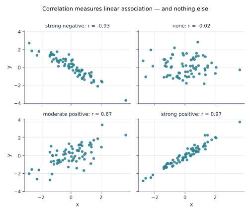
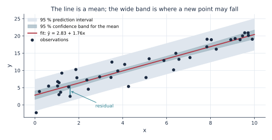

# M16 · Correlation and Regression

<div class="psds-meta" markdown>
<span class="psds-chip psds-chip--core">Chapter</span>
<span class="psds-chip">18 study hours</span>
<span class="psds-chip">Module overview: [M16](../16-correlation-and-regression.md)</span>
</div>

!!! abstract "Interactive laboratory"
    [Lab L-11 — Correlation and linear regression](../../labs/correlation-regression.md) — move the slope, the noise and the sample size and see what r, R-squared and the p-value for the slope depend on.

## 1. The idea, before any symbols

Two variables measured on the same units can be related in three distinct ways, and they
are often confused:

1. **They co-vary** — a statistical association you can measure (correlation).
2. **One predicts the other** — a model you can fit and use (regression).
3. **One causes the other** — a claim that requires a design, not a coefficient.

This chapter gives you the first two and explains, carefully, why they never deliver the
third on their own.

The unifying geometry is simple. Plot the points. Correlation asks how tightly they lie
near a straight line. Regression asks which straight line, and how well it does. The
least-squares line is the one that minimises the sum of squared vertical distances — and
everything else (slope, intercept, \(R^{2}\), standard errors) follows from that single
criterion.

## 2. Why this matters

**Regression is the workhorse of applied analytics** — pricing, risk, forecasting,
uplift, and the baseline every machine-learning model is compared against.

**Diagnostics decide whether the model can be believed.** A regression always fits; the
question is whether the fit describes the data or an artefact of a violated assumption.

**Causal language is where analyses go wrong in public.** A coefficient is a partial
association. Reading it as an effect size, without a design that identifies the effect,
is the most consequential error in applied statistics.

## 3. Terminology and notation

| Symbol | Meaning |
|---|---|
| \(r\) | Pearson correlation coefficient |
| \(\rho_s\), \(\tau\) | Spearman rank correlation, Kendall's tau |
| \(S_{xx}=\sum(x_i-\bar x)^{2}\) | sum of squared deviations of \(x\) |
| \(S_{xy}=\sum(x_i-\bar x)(y_i-\bar y)\) | sum of cross-products |
| \(\hat\beta_0,\hat\beta_1\) | estimated intercept and slope |
| \(\hat y_i\) | fitted value |
| \(e_i=y_i-\hat y_i\) | residual |
| \(s_e\) | residual standard error |
| \(R^{2}\) | coefficient of determination |
| \(\bar R^{2}\) | adjusted \(R^{2}\) |
| \(\text{VIF}\) | variance inflation factor |

## 4. Covariance and Pearson correlation

### 4.1 Covariance

\[ \Cov(X,Y)=\E[(X-\mu_X)(Y-\mu_Y)],\qquad
   s_{xy}=\frac{1}{n-1}\sum(x_i-\bar x)(y_i-\bar y). \]

Covariance is positive when the variables tend to be above their means together. Its
magnitude depends on the units — a covariance of 500 means nothing on its own — so we
standardise.

### 4.2 Pearson correlation

\[ r=\frac{s_{xy}}{s_x s_y}
   =\frac{\sum(x_i-\bar x)(y_i-\bar y)}
   {\sqrt{\sum(x_i-\bar x)^{2}}\sqrt{\sum(y_i-\bar y)^{2}}}. \]

Properties: \(-1\le r\le1\); \(r=\pm1\) only for an exact linear relation; unit-free;
sensitive to outliers and to restriction of range.

**Relation to regression.** With standardised variables, \(r\) *is* the slope. That is
why \(R^{2}=r^{2}\) in simple regression — they are the same quantity at two scales.


[](../../assets/images/figures/fig-16-01-correlation.svg)

*Figure 4.1 — four datasets with known correlations*

**What it shows.** The correlation coefficient measures linear association only. The bottom-left panel shows a clear pattern with r = 0.45: a relationship that is real but not straight gives an even lower r, and a curved one can give r ≈ 0. In the top right, r = −0.9 means the points fall close to a downward line — not that 90 % of the variation is explained, which is r² = 0.81.

### 4.3 Inference on \(r\)

Under bivariate normality, \(H_0:\rho=0\) can be tested with
\(t=r\sqrt{(n-2)/(1-r^{2})}\), or via Fisher's transformation

\[ z=\operatorname{artanh}(r),\qquad \se(z)=\frac{1}{\sqrt{n-3}}, \]

which also gives a confidence interval for \(\rho\).

### 4.4 Spearman's rank correlation

Replace values by ranks and compute Pearson's \(r\) on the ranks:

\[ \rho_s=1-\frac{6\sum d_i^{2}}{n(n^{2}-1)} \]

(no ties). It measures **monotone** association, is robust to outliers, and works for
ordinal data.

**Worked example (Example 4.1).** Take \(x=(1,2,3,4,5)\) and \(y=(1,4,9,16,25)\). The
ranks of \(y\) are \(1,2,3,4,5\), identical to those of \(x\), so \(\rho_s=1\) — a
perfectly monotone relationship. Pearson's \(r\) is \(0.981\): high but not 1, because
the relationship is curved. **Spearman detects the monotonicity that Pearson
understates** — and the gap between 0.981 and 1.000 is a diagnostic for curvature.

## 5. Simple linear regression

### 5.1 The model

\[ y_i=\beta_0+\beta_1x_i+\varepsilon_i,\qquad
   \varepsilon_i\ \text{independent},\ \E[\varepsilon]=0,\ \Var(\varepsilon)=\sigma^{2}. \]

The four assumptions in words: **linearity** in the parameters, **independence** of
errors, **constant variance** (homoscedasticity), and **normality** of errors (needed only
for small-sample intervals and tests).

### 5.2 Deriving least squares

Minimise \(Q(\beta_0,\beta_1)=\sum(y_i-\beta_0-\beta_1x_i)^{2}\). Differentiate:

\[ \frac{\partial Q}{\partial\beta_0}=-2\sum(y_i-\beta_0-\beta_1x_i)=0, \]
\[ \frac{\partial Q}{\partial\beta_1}=-2\sum x_i(y_i-\beta_0-\beta_1x_i)=0. \]

The first equation gives \(\hat\beta_0=\bar y-\hat\beta_1\bar x\). Substituting into the
second and simplifying gives

\[ \hat\beta_1=\frac{S_{xy}}{S_{xx}},\qquad \hat\beta_0=\bar y-\hat\beta_1\bar x. \]

**Worked example (Example 5.1).** For \(x=(1,2,3,4,5)\), \(y=(2,4,5,4,5)\):
\(\bar x=3\), \(\bar y=4\),

\[ S_{xy}=(-2)(-2)+(-1)(0)+(0)(1)+(1)(0)+(2)(1)=6,\qquad
   S_{xx}=4+1+0+1+4=10, \]

so \(\hat\beta_1=0.6\) and \(\hat\beta_0=4-0.6(3)=2.2\). The fitted line is
\(\hat y=2.2+0.6x\), and the prediction at \(x=6\) is 5.8.

**Interpretation:** each additional unit of \(x\) is associated with 0.6 more units of
\(y\), on average, within the observed range. Not "causes", and not "outside the range" —
extrapolation beyond \(x=5\) is unsupported by these data.

### 5.3 Decomposition and \(R^{2}\)

\[ \underbrace{\sum(y_i-\bar y)^{2}}_{\text{SST}}
   =\underbrace{\sum(\hat y_i-\bar y)^{2}}_{\text{SSR}}
   +\underbrace{\sum(y_i-\hat y_i)^{2}}_{\text{SSE}},
   \qquad R^{2}=\frac{\text{SSR}}{\text{SST}}=1-\frac{\text{SSE}}{\text{SST}}. \]

For the example: SST \(=6\), SSR \(=\hat\beta_1S_{xy}=0.6(6)=3.6\), SSE \(=2.4\). So
\(R^{2}=0.6\): 60% of the variation in \(y\) is accounted for by the linear fit.

**What \(R^{2}\) does not say:** that the model is correct, that the relationship is
causal, or that predictions are accurate. A quadratic fit to curved data can have
\(R^{2}=0.95\) while the linear model has 0.4 — and both can be wrong for a third
variable.

### 5.4 Inference on the slope

\[ s_e=\sqrt{\frac{\text{SSE}}{n-2}},\qquad
   \se(\hat\beta_1)=\frac{s_e}{\sqrt{S_{xx}}},\qquad
   t=\frac{\hat\beta_1}{\se(\hat\beta_1)},\quad \nu=n-2. \]

For the example: \(s_e=\sqrt{2.4/3}=0.8944\),
\(\se(\hat\beta_1)=0.8944/\sqrt{10}=0.2828\), \(t=0.6/0.2828=2.121\) with \(\nu=3\).
Since \(t_{3,0.975}=3.182\), the slope is **not** significant (\(p\approx0.12\)), and the
95% interval is

\[ 0.6\pm3.182(0.2828)=[-0.30,\;1.50]. \]

**Reading it:** five points cannot pin down a slope. The interval includes zero and
values as large as 1.5 — the honest conclusion is "suggestive, inconclusive".

### 5.5 Confidence and prediction intervals

For a value \(x_0\),

\[ \hat y_0\pm t_{\nu,1-\alpha/2}\,s_e\sqrt{\frac1n+\frac{(x_0-\bar x)^{2}}{S_{xx}}}
   \quad\text{(confidence band)}, \]

\[ \hat y_0\pm t_{\nu,1-\alpha/2}\,s_e\sqrt{1+\frac1n+\frac{(x_0-\bar x)^{2}}{S_{xx}}}
   \quad\text{(prediction interval)}. \]

At \(x_0=6\): \(\hat y_0=5.8\), the confidence band is
\(5.8\pm3.182(0.938)=[2.82,\;8.79]\), and the prediction interval is
\(5.8\pm3.182(1.296)=[1.68,\;9.92]\). The prediction interval is much wider because it
includes the irreducible noise \(\varepsilon\).


[](../../assets/images/figures/fig-16-02-regression.svg)

*Figure 5.1 — the fitted line, its confidence band, and the wider prediction interval*

**What it shows.** The line estimates the mean of y at each x; the dark band is the uncertainty in that mean, and the pale band is where a single new observation is likely to fall. Both are narrowest near the mean of x and flare at the edges, because extrapolation is uncertainty. The marked residual is one of the quantities least squares minimises.

## 6. Multiple regression

### 6.1 The model and the estimator

\[ y=X\beta+\varepsilon,\qquad \hat\beta=(X^{\top}X)^{-1}X^{\top}y, \qquad
   \Var(\hat\beta)=\sigma^{2}(X^{\top}X)^{-1}. \]

Each coefficient is a **partial** association: the change in \(y\) associated with a
one-unit change in \(x_j\), **holding the other predictors fixed**. This is a different
quantity from the simple-regression slope, and the difference is the whole point of
multiple regression.

### 6.2 Adjusted \(R^{2}\)

Adding predictors can only increase \(R^{2}\), so it cannot be used to compare models of
different sizes:

\[ \bar R^{2}=1-(1-R^{2})\frac{n-1}{n-k-1}. \]

With \(R^{2}=0.85\), \(n=10\), \(k=2\): \(\bar R^{2}=1-0.15(9/7)=0.807\). The adjustment
punishes the two predictors for the sample size; with \(n=10\) and \(k=2\), each costs
about 1.3 percentage points.

### 6.3 Dummy variables and interactions

A categorical predictor with \(c\) levels enters as \(c-1\) dummies against a reference
level. The intercept is the reference group's mean; each dummy is that group's
difference from it.

An **interaction** \(x_1x_2\) means the effect of \(x_1\) depends on \(x_2\):

\[ y=\beta_0+\beta_1x_1+\beta_2x_2+\beta_3x_1x_2. \]

Here \(\partial y/\partial x_1=\beta_1+\beta_3x_2\) — a slope that changes with \(x_2\).
If \(\beta_3\neq0\), the main effects alone are misleading.

### 6.4 Multicollinearity

When predictors are highly correlated, \(X^{\top}X\) is nearly singular, so
\(\Var(\hat\beta)\) inflates:

\[ \text{VIF}_j=\frac{1}{1-R_j^{2}},\qquad
   \se(\hat\beta_j)\ \text{inflates by}\ \sqrt{\text{VIF}_j}. \]

With \(R_j^{2}=0.8\), VIF \(=5\) and standard errors double. Symptoms: large standard
errors, coefficients that flip sign when a variable is added, and an overall \(F\) that
is highly significant while individual \(t\)'s are not.

**Fixes:** drop a redundant predictor (which changes the question), combine them into an
index, or use regularisation (ridge shrinks exactly in the ill-conditioned directions).

## 7. Residual analysis

The residuals \(e_i=y_i-\hat y_i\) are the model's leftovers, and they carry the
diagnosis.

| Check | Plot | Failure looks like | Remedy |
|---|---|---|---|
| Linearity | residuals vs fitted | curve or U-shape | add a term, transform |
| Constant variance | residuals vs fitted | funnel | transform \(y\), weighted LS |
| Normality | Q–Q plot of residuals | S-curve, heavy tails | larger \(n\), robust methods |
| Independence | residuals vs order/time | runs, cycles | time-series model, clustered SE |
| Influence | Cook's distance, leverage | one point dominates | report with and without it |
| Outliers | studentised residuals | \|r\| > 3 | investigate, do not delete silently |

**One number is not a diagnosis.** \(R^{2}\) can be high with a funnel-shaped residual
plot; the standard errors will then be wrong, and every p-value with them.

## 8. Association is not causation — the full argument

A regression coefficient is a conditional association. It becomes a causal effect only
if the design rules out the alternatives. Three concrete mechanisms:

**Confounding.** Ice-cream sales and drowning deaths are correlated, because both rise
with temperature. Temperature is a common cause; adjusting for it removes the
association. In general, an omitted confounder biases the coefficient by
\(\beta_{\text{omitted}}\times(\text{coefficient of the omitted variable on }x)\).

**Reverse causation.** "Firms with more safety training have more accidents" may reflect
that risky firms buy training, not that training causes accidents.

**Selection.** Among hospital patients, treatment and outcome can appear negatively
related because the sickest patients receive the most aggressive treatment.

**What would justify a causal claim:** randomisation (an experiment), or a credible
identification strategy (instrumental variables, regression discontinuity, differences-
in-differences) together with explicit assumptions. A p-value of \(10^{-12}\) on a
coefficient changes none of this. The correct sentence is "associated with", unless the
design earns "causes".

## 9. Common mistakes and misconceptions

| # | Mistake | Why it is wrong | Correct |
|---|---|---|---|
| 1 | "\(r=0.8\) means \(y\) is 80% caused by \(x\)" | Correlation is not causation, and \(r\) is not a percentage | Report \(r\); discuss design separately |
| 2 | "\(R^{2}=0.9\) means a good model" | It can hide curvature, heteroscedasticity and outliers | Check residuals |
| 3 | "A high-leverage point is an outlier" | Leverage is about \(x\), outlier about \(y\) | Compute both diagnostics |
| 4 | "The standard error is about the data" | It is about the coefficient | \(\se(\hat\beta)\) measures estimate precision |
| 5 | "Dropping a collinear variable fixes the problem" | It changes the model and the question | Choose based on the research question or regularise |
| 6 | "Extrapolating is fine if \(R^{2}\) is high" | The relationship may not hold outside the range | Restrict to observed range |
| 7 | "Non-significant slope means no relationship" | The relationship may be non-linear | Plot, add terms, check interval width |
| 8 | "\(R^{2}\) can be compared across different \(y\)" | It depends on the variance of \(y\) | Compare within the same outcome, or use RMSE |
| 9 | "Prediction interval = confidence band" | One is for a new observation, one for the mean | Use the right one |
| 10 | "Correlation of 0 means independent" | Only linear association is measured | Plot and test non-linear dependence |

## 10. Real-world scenarios

**House prices.** Regressing price on area, bedrooms and location gives coefficients that
are *partial* associations: the area coefficient holds location fixed. If location is
omitted and correlated with area, the area coefficient absorbs part of the location
effect — omitted-variable bias, quantified by the bias formula.

**Student performance.** Attendance and marks correlate at \(r=0.42\) in M01's example.
A regression of marks on attendance gives a slope with a wide interval; a causal claim
would need random assignment or an instrument, because motivation drives both.

**Marketing mix.** Advertising channels are highly correlated (campaigns run together),
so VIFs are large and individual channel coefficients are unstable. Aggregating channels
or using regularisation gives stable, if less granular, answers.

**Sales forecasting.** A regression with a time trend extrapolates badly if the trend
changes; residual plots against time reveal the problem before the forecast does.

**Model deployment.** A model with \(R^{2}=0.85\) in-sample may have 0.4 out-of-sample if
\(n\) is small and \(k\) is large — the reason for adjusted \(R^{2}\) and held-out
validation.

## 11. Visual explanations

### 11.1 The least-squares line

```
y │        ·
  │     · ╱·        residuals are vertical distances
  │    ╱ ·
  │  ╱·           the line minimises Σe²
  │╱
  └────────────── x
```

*What to look at:* squares, not absolute values — that is why a single large residual
dominates the fit, and why outliers matter so much.

### 11.2 Correlation versus monotonicity

| Data | Pearson \(r\) | Spearman \(\rho_s\) |
|---|---|---|
| Perfect line | 1.000 | 1.000 |
| \(y=x^{2}\), \(x=1..5\) | 0.981 | 1.000 |
| Line with one outlier | 0.35 | 0.90 |
| U-shape, symmetric | ≈0 | ≈0 |

*What to look at:* the gap between the two columns is diagnostic. A high \(\rho_s\) with a
low \(r\) means monotone but non-linear, or an outlier-dominated line.

### 11.3 Residual patterns

```
good                curved              funnel
 ·  ·  ·             ·   ·              · ·
·  ·  ·  ·          ·  ·  ·            ·   ·
 ·  ·  ·           ·  ·  ·           ·       ·
flat band          U-shape            widening
```

*What to look at:* the left panel is what you want. Curvature means the model is wrong;
a funnel means the variance assumption is wrong. Both are invisible in \(R^{2}\).

## 12. Exercises

**Exercise 1 (★).** For \(x=(1,2,3,4)\), \(y=(2,3,5,6)\), compute \(S_{xx}\), \(S_{xy}\),
the slope and the intercept.

**Exercise 2 (★).** Given \(r=0.6\), \(n=20\), test \(H_0:\rho=0\) at 5%.

**Exercise 3 (★).** Interpret \(\hat\beta_1=0.42\), \(\se=0.15\), \(n=100\), \(k=1\).

**Exercise 4 (★★).** For the M16 example (\(S_{xx}=10\), \(S_{xy}=6\), SST \(=6\),
\(n=5\)), verify \(R^{2}\), \(s_e\) and the \(t\) statistic for the slope.

**Exercise 5 (★★).** Two predictors have \(R_1^{2}=0.9\). Compute VIF and the inflation
in the standard error, and say what you would do.

**Exercise 6 (★★).** A model with \(n=50\), \(k=4\) has \(R^{2}=0.62\). Compute
\(\bar R^{2}\) and comment on whether the four predictors earn their place.

**Exercise 7 (★★).** Explain why a slope of 0.6 from a simple regression can become
−0.1 in a multiple regression, and what that implies about the omitted variable.

**Exercise 8 (★★★).** A regression of salary on experience and gender gives a gender
coefficient of −8,000 with \(p<0.001\). Write a careful interpretation and name two
alternative explanations that the coefficient cannot rule out.

## 13. Solutions

**Solution 1.** \(\bar x=2.5\), \(\bar y=4\); deviations \(x\): \(-1.5,-0.5,0.5,1.5\);
\(y\): \(-2,-1,1,2\). \(S_{xx}=2.25+0.25+0.25+2.25=5\);
\(S_{xy}=3+0.5+0.5+3=7\). \(\hat\beta_1=7/5=1.4\);
\(\hat\beta_0=4-1.4(2.5)=0.5\).

**Solution 2.** \(t=0.6\sqrt{18/(1-0.36)}=0.6\sqrt{28.125}=0.6(5.303)=3.182\),
\(\nu=18\); \(t_{18,0.975}=2.101\), so reject: evidence of a positive association.

**Solution 3.** A one-unit increase in \(x\) is associated with 0.42 more units of \(y\),
with standard error 0.15; the 95% interval is roughly \([0.12,\,0.72]\) (using
\(t_{98}\approx1.984\)). The association is positive and precise enough to be
distinguishable from zero, but the plausible effect ranges from small to large.

**Solution 4.** \(R^{2}=3.6/6=0.6\); SSE \(=2.4\); \(s_e=\sqrt{2.4/3}=0.8944\);
\(\se(\hat\beta_1)=0.8944/\sqrt{10}=0.2828\); \(t=0.6/0.2828=2.121\).

**Solution 5.** VIF \(=1/(1-0.9)=10\); standard errors inflate by \(\sqrt{10}=3.16\).
Options: drop one predictor if they measure the same construct, combine them into an
index, or use ridge regression, which stabilises the coefficients at the cost of bias.

**Solution 6.** \(\bar R^{2}=1-(0.38)(49/45)=1-0.4138=0.586\). The four predictors
add only 3.4 percentage points over what chance would give; each must be justified by
the question, not by the in-sample fit.

**Solution 7.** The simple slope absorbs the effect of any correlated omitted variable.
If the omitted variable is positively associated with both \(x\) and \(y\), the simple
slope is biased upward; controlling for it can remove the association entirely (or
reverse it). The multiple-regression coefficient is the partial association; the
difference between the two is the omitted-variable bias.

**Solution 8.** "Holding experience constant, the model estimates that the average salary
associated with the recorded gender category differs by 8,000 (units), with a 95%
interval that excludes zero. This is an association in these data, not an established
causal effect." Alternatives the coefficient cannot rule out: (i) an omitted confounder
such as job role or hours worked, correlated with both gender and salary; (ii) selection
— who is in the sample at all — plus measurement issues in how gender is recorded.

## 14. Self-assessment

1. Give the least-squares slope formula and say what it minimises.
2. What does \(R^{2}=0.6\) mean, and what does it not mean?
3. When is Spearman preferred to Pearson?
4. Why can adjusted \(R^{2}\) fall when a predictor is added?
5. Define VIF and state the consequence of a large value.
6. Name the four regression assumptions.
7. What does a funnel-shaped residual plot indicate?
8. Why is a prediction interval wider than a confidence band?
9. Give two mechanisms by which a correlation can arise without causation.
10. What would make a causal claim from observational data defensible?

### Answers

1. \(\hat\beta_1=S_{xy}/S_{xx}\); it minimises \(\sum(y_i-\hat y_i)^{2}\).
2. 60% of the variance in \(y\) is explained by the linear fit; it does not mean the
   model is correct, causal, or good at prediction.
3. When the relationship is monotone but non-linear, the data are ordinal, or outliers
   would dominate Pearson's \(r\).
4. Because it penalises the loss of a degree of freedom; the gain in fit may not offset
   the penalty.
5. \(\text{VIF}=1/(1-R_j^{2})\); large VIF inflates the standard error by
   \(\sqrt{\text{VIF}}\).
6. Linearity, independence, constant variance, normality of errors.
7. Heteroscedasticity: the variance of the errors grows with the fitted value.
8. It includes the irreducible error for a single new observation.
9. Confounding and reverse causation (also selection).
10. Randomisation, or an explicit identification strategy with stated assumptions.

## 15. Revision summary

**Correlation.** \(r=S_{xy}/(\sqrt{S_{xx}}\sqrt{S_{yy}})\in[-1,1]\); linear only;
sensitive to outliers. Spearman for monotone/ordinal.

**Least squares.** \(\hat\beta_1=S_{xy}/S_{xx}\), \(\hat\beta_0=\bar y-\hat\beta_1\bar x\);
\(R^{2}=\text{SSR}/\text{SST}\); \(s_e=\sqrt{\text{SSE}/(n-2)}\).

**Inference.** \(t=\hat\beta_1/\se(\hat\beta_1)\) with \(n-2\) df; intervals for
coefficients, means and predictions.

**Multiple regression.** Partial coefficients; adjusted \(R^{2}\);
\(\text{VIF}=1/(1-R_j^{2})\); interactions change interpretation.

**Diagnostics.** Residuals vs fitted (linearity, variance), Q–Q (normality), order
(independence), Cook's distance (influence).

**Causation.** Needs design: randomisation or identification. A coefficient alone never
supplies it.

**Habits.**

1. Plot before fitting, and plot the residuals after.
2. Report coefficients with intervals, not just stars.
3. Describe associations as associations.

**Next.** M17 compares groups and counts: ANOVA, chi-square and rank-based tests.

**Run it.** [Practical 16 — Correlation and regression](../../practicals/notebooks/16-correlation-and-regression.ipynb) · [all practicals](../../practicals/index.md)

---

**Previous:** [M15 chapter](../15-hypothesis-testing/chapter.md) ·
**Next:** [M17 · ANOVA, Chi-Square and Nonparametric Statistics](../17-anova-chi-square-nonparametric.md)
