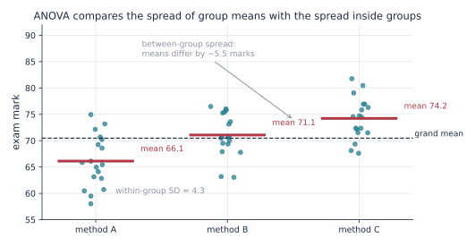

# M17 · ANOVA, Chi-Square and Nonparametric Statistics

<div class="psds-meta" markdown>
<span class="psds-chip psds-chip--advanced">Chapter</span>
<span class="psds-chip">16 study hours</span>
<span class="psds-chip">Module overview: [M17](../17-anova-chi-square-nonparametric.md)</span>
</div>

!!! abstract "Interactive laboratory"
    [Lab L-14 — ANOVA and comparison of multiple groups](../../labs/anova.md) — change the number of groups, their separation and the within-group noise, and watch F and eta-squared respond.

!!! note "Critical values used in this chapter"
    [\(F\) table](../../reference/tables/f-distribution.md) for the ANOVA sections, [chi-square table](../../reference/tables/chi-square.md) for goodness of fit, independence and variance.

## 1. The idea, before any symbols

Three questions recur in applied work: do these groups differ, are these two categorical
variables related, and what do I do when the assumptions fail? This chapter answers all
three with one organising idea — **variance decomposition**.

ANOVA splits total variation into a part explained by group membership and a part left
over. The ratio is the \(F\) statistic. A chi-square test does the same thing with counts:
compare observed to expected, square, divide, sum. Rank tests do it with ordering rather
than magnitude. Once you see the common structure, the procedures stop being a list to
memorise.

## 2. Why this matters

**Group comparisons are everywhere.** Segment performance, treatment arms, model variants.
Comparing two groups is a \(t\) test; comparing three or more with repeated \(t\) tests
inflates the error rate, which is what ANOVA exists to prevent.

**Categorical data needs its own tools.** Counts cannot be averaged; association between
categories requires a different statistic and a different set of assumptions.

**Nonparametric methods are the honest fallback.** When data are ordinal, heavily skewed,
or contain outliers that cannot be removed, rank and resampling methods keep the
inference valid — at a small cost in power.

## 3. Terminology and notation

| Symbol | Meaning |
|---|---|
| \(k\) | number of groups |
| \(n_i\), \(N\) | group size, total sample size |
| \(\bar y_i\), \(\bar y\) | group mean, grand mean |
| SSB, SSW | between-group, within-group sums of squares |
| MSB, MSW | mean squares (SS/df) |
| \(F\) | \(F\) statistic, ratio of mean squares |
| \(\eta^{2}\) | proportion of variance explained |
| \(O,E\) | observed and expected counts |
| \(\chi^{2}\) | chi-square statistic |
| \(U\) | Mann–Whitney statistic |
| \(W^{+},W^{-}\) | Wilcoxon signed-rank sums |
| \(H\) | Kruskal–Wallis statistic |

## 4. One-way ANOVA

### 4.1 The model and the hypotheses

\[ y_{ij}=\mu+\tau_i+\varepsilon_{ij},\qquad \varepsilon_{ij}\sim N(0,\sigma^{2})\
\text{independent}. \]

\[ H_0:\tau_1=\cdots=\tau_k=0 \quad\text{(all group means equal)},\qquad
   H_1:\ \text{at least one differs}. \]

Assumptions: independent observations, normally distributed residuals, equal variances.
The test is robust to mild non-normality with balanced groups, but not to dependence.

### 4.2 The decomposition

\[ \underbrace{\sum_i\sum_j(y_{ij}-\bar y)^{2}}_{\text{SST}}
   =\underbrace{\sum_i n_i(\bar y_i-\bar y)^{2}}_{\text{SSB}}
   +\underbrace{\sum_i\sum_j(y_{ij}-\bar y_i)^{2}}_{\text{SSW}}. \]

Degrees of freedom: \(k-1\) between, \(N-k\) within, \(N-1\) total. Mean squares divide
by df, and

\[ F=\frac{\text{SSB}/(k-1)}{\text{SSW}/(N-k)}\sim F_{k-1,\,N-k}\ \text{under }H_0. \]

**Why \(F\) works:** if the groups are identical, the between-group mean square and the
within-group mean square both estimate \(\sigma^{2}\), so their ratio is about 1. If the
group means differ, the numerator grows while the denominator does not.


[](../../assets/images/figures/fig-17-01-anova.svg)

*Figure 4.1 — between-group and within-group variation*

**What it shows.** ANOVA asks whether the group means are further apart than the spread inside the groups would suggest. Here the means differ by about 5.5 marks while the within-group SD is about 5, so the ratio is large and F is significant. If the within-group spread were twice as large, the same differences would be unremarkable — which is exactly what the F ratio encodes.

### 4.3 Worked example (Example 4.1)

Three teaching methods, five students each:

| Group | Values | Mean |
|---|---|---|
| A | 6, 7, 8, 7, 7 | 7.0 |
| B | 8, 9, 10, 9, 9 | 9.0 |
| C | 5, 6, 7, 6, 6 | 6.0 |

Grand mean: \((7+9+6)/3=7.3333\).

\[ \text{SSB}=5\left[(7-7.3333)^{2}+(9-7.3333)^{2}+(6-7.3333)^{2}\right]
   =5(4.6667)=23.3333. \]

Within groups, each group's deviations are \(-1,0,1,0,0\), summing to squares of 2 per
group: \(\text{SSW}=6\).

| Source | SS | df | MS | \(F\) |
|---|---|---|---|---|
| Between | 23.3333 | 2 | 11.6667 | 23.333 |
| Within | 6.0000 | 12 | 0.5000 | |
| Total | 29.3333 | 14 | | |

\(F_{2,12,0.95}=3.885\); \(23.333\gg3.885\), so reject \(H_0\): the methods differ.

**Effect size:** \(\eta^{2}=23.3333/29.3333=0.7955\) — 80% of the variation in marks is
between methods. That is a large effect, and it is the number to report alongside \(F\).

### 4.4 Post-hoc comparisons

A significant \(F\) says "some group differs" — not which. With \(k=3\) there are three
pairwise comparisons, and testing each at 5% inflates the family-wise error to about 14%.

**Tukey HSD** controls it using the studentised range \(q\):

\[ \text{HSD}=q_{k,\,N-k,\,1-\alpha}\sqrt{\frac{\text{MSW}}{n}}. \]

With \(q_{3,12,0.95}=3.773\), \(\text{MSW}=0.5\), \(n=5\):
\(\text{HSD}=3.773(0.3162)=1.193\).

| Comparison | Difference | vs HSD | Conclusion |
|---|---|---|---|
| B − A | 2.0 | > 1.193 | significant |
| B − C | 3.0 | > 1.193 | significant |
| A − C | 1.0 | < 1.193 | **not** significant |

**Reading it:** the omnibus test was overwhelming, yet A and C do not differ
significantly once multiplicity is controlled. That is not a contradiction — it is what a
conservative simultaneous procedure does, and it is why reporting only the omnibus \(F\)
is incomplete.

## 5. Two-way ANOVA and interactions

With two factors, the model adds a main effect for each and an interaction:

\[ y_{ijk}=\mu+\alpha_i+\beta_j+(\alpha\beta)_{ij}+\varepsilon_{ijk}. \]

**Main effects** are differences in marginal means; the **interaction** is a difference
in differences. Cell means make it visible.

| Cell means | Male | Female |
|---|---|---|
| Method 1 | 70 | 60 |
| Method 2 | 74 | 64 |

Method adds 4 for both genders; gender adds 10 for both methods (in the opposite
direction). No interaction: the pattern is parallel, so main effects describe everything.

| Cell means | Male | Female |
|---|---|---|
| Method 1 | 70 | 60 |
| Method 2 | 66 | 70 |

Now Method 2 is worse for males and better for females — the lines cross. Reporting "the
methods do not differ" (the marginal means are 65 and 68) would hide the finding.

**Rule:** interpret main effects only when the interaction is negligible. When it is
present, report the cell means.

## 6. Chi-square: three procedures, one statistic

### 6.1 The statistic

\[ \chi^{2}=\sum_{ij}\frac{(O_{ij}-E_{ij})^{2}}{E_{ij}}, \]

with \(E\) computed under \(H_0\) and df determined by the design. The statistic is large
when observed counts are far from expected.

### 6.2 Goodness of fit

**Example 6.1.** A die is rolled 120 times; counts are 15, 18, 22, 25, 20, 20. Under
fairness, each expected count is 20.

\[ \chi^{2}=\frac{25+4+4+25+0+0}{20}=\frac{58}{20}=2.9,\qquad \nu=6-1=5. \]

\(\chi^{2}_{5,0.95}=11.07\); 2.9 is far below, so there is no evidence the die is biased.
Note the sample size: with 1,200 rolls the same proportions would give \(\chi^{2}=29\) and
be significant — a real, if tiny, bias. Statistical significance here measures departure
from fairness, not its importance.

### 6.3 Test of independence

**Example 6.2.** A 2×2 table of exposure and outcome, \(N=200\):

| | Cases | Non-cases | Total |
|---|---|---|---|
| Exposed | 40 | 60 | 100 |
| Unexposed | 20 | 80 | 100 |
| Total | 60 | 140 | 200 |

Expected under independence: \(100(60)/200=30\), \(100(140)/200=70\), and the same for
the second row.

\[ \chi^{2}=\frac{(40-30)^{2}}{30}+\frac{(60-70)^{2}}{70}
   +\frac{(20-30)^{2}}{30}+\frac{(80-70)^{2}}{70}
   =3.333+1.429+3.333+1.429=9.524, \]

with \(\nu=(2-1)(2-1)=1\). Since \(\chi^{2}_{1,0.95}=3.841\), reject independence.

**Effect size:** the odds ratio is \((40/60)/(20/80)=0.667/0.25=2.667\), and Cramér's
\(V=\sqrt{\chi^{2}/(N\cdot\min(r-1,c-1))}=\sqrt{9.524/200}=0.218\) — a moderate
association. Report both: the p-value says "not independent", the effect size says "how
strongly".

### 6.4 Homogeneity

Same arithmetic as independence, different design: independence samples one population
and cross-classifies; homogeneity samples separately from each population and compares the
distribution of one variable. The conclusion differs ("associated" vs "same distribution
across groups"), so state the design.

### 6.5 Conditions

Expected counts should be at least 5 in each cell; otherwise use Fisher's exact test
(2×2) or collapse categories. The chi-square statistic is also insensitive to ordering:
for ordinal categories, a trend test is more powerful.

## 7. Nonparametric alternatives

### 7.1 Mann–Whitney \(U\) (two independent groups)

Convert all values to ranks; \(U\) counts how often values in one group exceed values in
the other.

**Example 7.1.** A: 12, 15, 18 (ranks 1, 2, 3); B: 20, 22, 25 (ranks 4, 5, 6).
Rank sum for A is 6, so

\[ U_1=6-\frac{3(4)}{2}=6-6=0,\qquad U_2=9-0=9. \]

The smaller \(U\) is 0. With \(n_1=n_2=3\), the exact two-sided p-value is \(2/20=0.10\)
— not significant at 5%. Six observations cannot establish a difference even when the
groups do not overlap at all, which is a lesson about sample size rather than about tests.

**What it tests:** \(H_0\) that the two distributions are identical, or (under an
equal-shape assumption) that the medians are equal. It is **not** a general test of
medians; with different shapes, "Mann–Whitney tests medians" is false.

### 7.2 Wilcoxon signed-rank (paired data)

Rank the absolute differences, then compare the sum of positive ranks \(W^{+}\) with the
sum of negative ranks \(W^{-}\).

**Example 7.2.** Eight paired differences: 2, 3, −1, 4, 5, 2, 3, 6. Absolute values
ranked: 1→1, 2→2.5, 2→2.5, 3→4.5, 3→4.5, 4→6, 5→7, 6→8. The single negative
difference (−1) has rank 1, so \(W^{-}=1\) and \(W^{+}=35\).

The exact two-sided p-value is \(2(2/256)\approx0.016\) — significant. Note the test uses
both the sign and the size of the differences (unlike the sign test, which uses only
signs).

### 7.3 Kruskal–Wallis (three or more independent groups)

\[ H=\frac{12}{N(N+1)}\sum_{i=1}^{k}n_i\bar R_i^{2}-3(N+1), \]

with \(\bar R_i\) the mean rank in group \(i\), and \(H\sim\chi^{2}_{k-1}\) approximately.

**Example 7.3.** Three groups of five with non-overlapping ranges (A: 1–5, B: 6–10,
C: 11–15). Then \(\bar R_A=3\), \(\bar R_B=8\), \(\bar R_C=13\), \(N=15\):

\[ H=\frac{12}{15(16)}\left[5(9)+5(64)+5(169)\right]-48
   =0.05(1210)-48=12.5. \]

With \(\nu=2\), \(\chi^{2}_{2,0.95}=5.991\), so reject: at least one group differs.
Follow up with Dunn's test (a rank-based analogue of Tukey) rather than repeated
Mann–Whitney tests.

### 7.4 Permutation and bootstrap, in one paragraph each

A **permutation test** pools the groups, reshuffles labels many times, and computes the
statistic each time; the p-value is the share of reshuffles at least as extreme as the
observed one. Its only assumption is exchangeability under \(H_0\). A **bootstrap**
resamples with replacement from the observed data to approximate the sampling
distribution of a statistic, giving standard errors and percentile intervals without a
formula. Both are developed in M18.

## 8. Choosing a test

| Question | Parametric | Nonparametric | Notes |
|---|---|---|---|
| Two independent groups | two-sample \(t\) (Welch) | Mann–Whitney \(U\) | ranks if skewed/ordinal |
| Two paired measurements | paired \(t\) | Wilcoxon signed-rank | differences analysed |
| Three or more groups | one-way ANOVA | Kruskal–Wallis | post-hoc needed either way |
| Two factors | two-way ANOVA | aligned rank transform (advanced) | interaction is the point |
| Counts vs a distribution | — | \(\chi^{2}\) goodness of fit | expected counts ≥5 |
| Two categorical variables | — | \(\chi^{2}\) independence | report Cramér's \(V\) |
| Small 2×2 counts | — | Fisher's exact | exact p-value |
| Association strength | Pearson \(r\) | Spearman \(\rho\) | monotone vs linear |

**Decision procedure.** (1) What is the design — independent or paired, how many groups?
(2) What is the variable type — continuous, ordinal, count, categorical? (3) Are the
assumptions plausible — independence, approximate normality, equal variances, expected
counts? (4) Choose; (5) check the assumptions you can check; (6) report the effect size.

## 9. Common mistakes and misconceptions

| # | Mistake | Why it is wrong | Correct |
|---|---|---|---|
| 1 | "ANOVA says which groups differ" | It is an omnibus test | Follow with Tukey or Dunn |
| 2 | Repeated \(t\) tests after a significant \(F\) | Inflates the error rate | Use a multiplicity-controlled procedure |
| 3 | "\(\chi^{2}\) is valid for any table" | Small expected counts break the approximation | Fisher's exact or collapse |
| 4 | "Mann–Whitney tests medians" | Only under equal shapes | State the assumption or the stochastic dominance interpretation |
| 5 | "Nonparametric means no assumptions" | Independence and exchangeability remain | Check the design |
| 6 | Ignoring the interaction in two-way ANOVA | Main effects can be misleading | Interpret cells when interaction is present |
| 7 | Reporting only p-values for group differences | Ignores magnitude | Report \(\eta^{2}\), means and intervals |
| 8 | Running a normality test and abandoning \(t\) | Large \(n\) makes tests sensitive to trivial departures | Judge with plots and \(n\) |
| 9 | Using a paired test on unpaired data (or vice versa) | The design determines the analysis | Match the test to the design |
| 10 | Treating ordinal categories as continuous | Equal gaps are assumed | Use rank-based methods |

## 10. Real-world scenarios

**Three teaching methods.** The ANOVA above shows a real difference, and Tukey locates it:
B beats both A and C, while A and C are indistinguishable. A report saying "the methods
differ" without that breakdown is uninformative.

**Product variants.** Four checkout designs tested on 2,000 users each; conversion is
binary, so use a chi-square test on the 4×2 table (or a logistic model). A significant
result needs a follow-up: which variant, and by how much.

**Clinical subgroups.** Two-way ANOVA with treatment and severity shows a disordinal
interaction: the drug helps severe cases and harms mild ones. The marginal "no overall
effect" would be dangerously misleading.

**Satisfaction surveys.** Ratings 1–5 are ordinal; the Kruskal–Wallis test across
departments respects the ordering without assuming equal gaps.

**Paired before/after.** The same 30 customers rated the app before and after a redesign;
Wilcoxon signed-rank is appropriate because ratings are ordinal and differences may be
skewed.

## 11. Visual explanations

### 11.1 Between and within

```
Group A   ● ● ●        spread within: small
Group B      ● ● ●     gap between: large   → F large
Group C  ● ● ●

Group A ●   ●  ●       spread within: large
Group B   ●  ●    ●    gap between: small   → F small
Group C  ●    ● ●
```

*What to look at:* \(F\) is a signal-to-noise ratio. The same mean differences can be
significant or not, depending on the within-group spread.

### 11.2 Interaction plots

```
No interaction          Disordinal interaction
75 ┤  A───B            75 ┤      B
70 ┤  │   │            70 ┤  A───╲
65 ┤  C───D            65 ┤       ╲──B
   └───────              └──────────
   lines parallel        lines cross
```

*What to look at:* parallel lines mean main effects tell the whole story; crossing lines
mean they do not.

### 11.3 Chi-square as squared standardised gaps

| Cell | O | E | (O−E)²/E |
|---|---|---|---|
| Exposed, case | 40 | 30 | 3.33 |
| Exposed, non-case | 60 | 70 | 1.43 |
| Unexposed, case | 20 | 30 | 3.33 |
| Unexposed, non-case | 80 | 70 | 1.43 |
| **Total** | | | **9.52** |

*What to look at:* each cell contributes a standardised squared gap; the statistic is
their sum, so a few large discrepancies drive the result.

## 12. Exercises

**Exercise 1 (★).** State the hypotheses and assumptions of one-way ANOVA.

**Exercise 2 (★).** Complete the ANOVA table: SSB \(=40\), SSW \(=60\), \(k=3\),
\(N=20\). Compute MSB, MSW and \(F\).

**Exercise 3 (★).** A 3×2 table has 120 observations. Give the degrees of freedom for a
chi-square test of independence.

**Exercise 4 (★★).** For the ANOVA in Example 4.1, compute \(\eta^{2}\) and interpret it.

**Exercise 5 (★★).** A 2×2 table: 30/50 exposed are cases, 20/50 unexposed are cases.
Compute expected counts, \(\chi^{2}\), the odds ratio and Cramér's \(V\).

**Exercise 6 (★★).** Ten paired differences give \(W^{+}=45\), \(W^{-}=10\) with \(n=10\).
State the conclusion using a critical value of 8 for the smaller sum at 5% (two-sided).

**Exercise 7 (★★★).** Explain why running three \(t\) tests instead of an ANOVA inflates
the Type I error, and compute the inflation for three independent tests at 5%.

**Exercise 8 (★★★).** A Kruskal–Wallis test is significant with four groups. Describe
the follow-up analysis and explain why four Mann–Whitney tests would be inappropriate.

## 13. Solutions

**Solution 1.** \(H_0\): all group means equal; \(H_1\): at least one differs.
Assumptions: independence, normal residuals, equal variances.

**Solution 2.** MSB \(=40/2=20\); MSW \(=60/17=3.529\); \(F=20/3.529=5.667\) with
df \((2,17)\).

**Solution 3.** \((3-1)(2-1)=2\).

**Solution 4.** \(\eta^{2}=23.3333/29.3333=0.796\): about 80% of the total variation in
marks is accounted for by method. That is a large effect, and it is what makes the result
practically interesting, not the p-value alone.

**Solution 5.** Row totals 50 each; column totals: cases 50, non-cases 50; \(N=100\).
Expected: 25 in every cell.

\[ \chi^{2}=4\left(\frac{5^{2}}{25}\right)=4(1)=4,\qquad \nu=1, \]

which exceeds 3.841, so reject independence. Odds ratio
\(=(30/20)/(20/30)=1.5/0.667=2.25\). Cramér's
\(V=\sqrt{4/100}=0.20\).

**Solution 6.** The smaller sum is \(W^{-}=10\), which exceeds the critical value 8, so
fail to reject: no significant evidence of a shift.

**Solution 7.** Each test has a 5% chance of a false positive; with independent tests the
family-wise rate is \(1-0.95^{3}=0.1428\) — about 14% instead of 5%. ANOVA replaces the
three tests with one, preserving 5%.

**Solution 8.** Use Dunn's test with a multiplicity correction (or pairwise
Mann–Whitney with Holm adjustment). Four uncorrected Mann–Whitney tests give a family-wise
error of \(1-0.95^{6}=0.265\) for six pairs — a 26% chance of at least one false
positive.

## 14. Self-assessment

1. Write the ANOVA decomposition and give the df for each term.
2. What does a significant \(F\) establish, and what does it not?
3. Why is Tukey needed after ANOVA?
4. Give the formula for a chi-square statistic.
5. How many df does a 3×4 independence test have?
6. What is the expected-count condition, and what do you do if it fails?
7. What does Mann–Whitney actually test?
8. When is the Wilcoxon signed-rank test used?
9. What is an interaction, in one sentence?
10. Why can a nonparametric test be less powerful?

### Answers

1. SST = SSB + SSW; df \(k-1\), \(N-k\), \(N-1\).
2. That at least one group mean differs; not which one, and not the size of the effect.
3. To control the family-wise error rate across pairwise comparisons.
4. \(\sum(O-E)^{2}/E\).
5. \((3-1)(4-1)=6\).
6. Expected counts ≥5; otherwise use Fisher's exact test or collapse categories.
7. Whether one group's values tend to be larger than the other's (stochastic dominance);
   medians only under equal shapes.
8. Paired data, especially ordinal or skewed differences.
9. When the effect of one factor depends on the level of another.
10. Because it discards magnitude information, using only ranks.

## 15. Revision summary

**ANOVA.** SST = SSB + SSW; \(F=\text{MSB}/\text{MSW}\); assumptions independence,
normality, equal variances; \(\eta^{2}\) for effect size; Tukey (or Dunn) for follow-up.

**Two-way.** Main effects plus interaction; interpret cells when lines cross.

**Chi-square.** \(\sum(O-E)^{2}/E\); goodness of fit (\(k-1\) df), independence
(\((r-1)(c-1)\) df), homogeneity (same arithmetic, different design). Effect sizes:
Cramér's \(V\), odds ratio.

**Ranks.** Mann–Whitney (two independent), Wilcoxon signed-rank (paired), Kruskal–Wallis
(\(k\) groups), with post-hoc corrections.

**Permutation and bootstrap.** Assumption-light alternatives that resample the data.

**Habits.**

1. Report an effect size with every p-value.
2. Follow an omnibus test with a corrected post-hoc procedure.
3. Match the test to the design before looking at the data.

**Next.** M18 closes the course with Bayesian inference, resampling, and statistical
practice.

**Run it.** [Practical 17 — ANOVA, chi-square and nonparametric tests](../../practicals/notebooks/17-anova-chi-square-nonparametric.ipynb) · [all practicals](../../practicals/index.md)

---

**Previous:** [M16 chapter](../16-correlation-and-regression/chapter.md) ·
**Next:** [M18 · Bayesian Statistics and Data Science Methods](../18-bayesian-and-data-science-methods.md)
