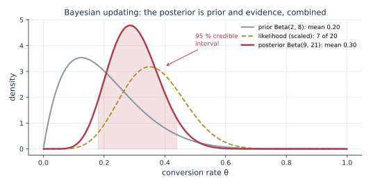

# M18 · Bayesian Statistics and Statistical Methods for Data Science

<div class="psds-meta" markdown>
<span class="psds-chip psds-chip--advanced">Chapter</span>
<span class="psds-chip">18 study hours</span>
<span class="psds-chip">Module overview: [M18](../18-bayesian-and-data-science-methods.md)</span>
</div>

!!! abstract "Interactive laboratory"
    [Lab L-12 — Bayesian updating](../../labs/bayesian-updating.md) — start from a Beta prior, add data batch by batch, and watch the posterior move and narrow.

## 1. The idea, before any symbols

Two changes of perspective close the course.

The first is **Bayesian**. A frequentist treats the parameter as fixed and the data as
random. A Bayesian treats both as uncertain and applies the conditional-probability
machinery from M07 to a whole distribution:

\[ \underbrace{p(\theta\mid y)}_{\text{posterior}}\propto
   \underbrace{p(y\mid\theta)}_{\text{likelihood}}\times
   \underbrace{p(\theta)}_{\text{prior}}. \]

The output is not a number and an error rate; it is a distribution over the parameter.
You can then say "there is a 95% probability the effect lies in this range" — a sentence
a frequentist cannot make, and the reason the two paradigms are not interchangeable.

The second is **computational**. Many questions have no closed-form answer, and modern
statistics answers them by simulating: resample the data (bootstrap), shuffle the labels
(permutation), or sample the posterior (MCMC). These methods assume less and cost only
compute.

The third section of the chapter turns both towards practice: experiments, monitoring,
and the uncertainty that survives into a deployed model.

## 2. Why this matters

**Probabilities about parameters are what decisions need.** "Should we ship?" wants
\(\Pr(\text{lift}>0\mid\text{data})\), which is Bayesian. "How often would this procedure
mislead us?" is frequentist. Knowing which question you are asking is the skill.

**Simulation is the general-purpose tool.** Bootstrap intervals, permutation tests and
Monte Carlo power analyses work where formulas do not.

**Most deployed-model failures are statistical.** Leakage, peeking, drift and
overfitting are not software bugs; they are inference mistakes at scale.

## 3. Terminology and notation

| Symbol | Meaning |
|---|---|
| \(\theta\) | parameter, treated as random |
| \(p(\theta)\) | prior |
| \(p(y\mid\theta)\) | likelihood |
| \(p(\theta\mid y)\) | posterior |
| \(p(y)\) | marginal likelihood (evidence) |
| \(B\) | bootstrap or Monte Carlo replications |
| \(\hat\theta_{\text{MLE}}\) | maximum-likelihood estimate |
| \(\hat R\) | MCMC convergence diagnostic |
| \(\text{BF}\) | Bayes factor |
| MDE | minimum detectable effect |

## 4. Bayesian inference

### 4.1 Priors

A prior encodes what you believed before seeing the data. Three kinds:

- **Informative**: real previous evidence (a meta-analysis, a pilot study).
- **Weakly informative**: a broad distribution that rules out absurd values.
- **Reference / "flat"**: minimal influence; note that "non-informative" is a misnomer —
  a flat prior on \(p\) is not flat on the odds \(p/(1-p)\).

**Priors are assumptions, and they are visible.** That is a virtue: a frequentist
analysis also assumes something (the model, the sampling scheme), but the assumption is
implicit.

### 4.2 The likelihood

\(p(y\mid\theta)\) is the probability of the observed data as a function of the
parameter — the same object as MLE's likelihood, used differently: MLE maximises it,
Bayes multiplies it by the prior and normalises.

### 4.3 Conjugate updating

When the prior and posterior are in the same family, updating is arithmetic.

**Beta–Bernoulli.** Prior \(\theta\sim\text{Beta}(a,b)\); \(s\) successes in \(n\) trials:

\[ \theta\mid y\sim\text{Beta}(a+s,\;b+n-s),\qquad
   \E[\theta\mid y]=\frac{a+s}{a+b+n}. \]

**Example 4.1.** Prior \(\text{Beta}(2,3)\) (mean 0.4), then 8 successes in 10 trials:

\[ \text{posterior}=\text{Beta}(10,5),\qquad \E=\frac{10}{15}=0.6667, \]

\[ \sd=\sqrt{\frac{10\cdot5}{15^{2}\cdot16}}=\sqrt{\frac{50}{3600}}=0.1179. \]

An approximate 95% credible interval is \(0.667\pm1.96(0.118)=[0.436,\;0.898]\).
Compare: the prior mean 0.4, the MLE 0.8, the posterior mean 0.667. **The posterior
sits between the prior and the data** — that is shrinkage, and it is automatic.

**Gamma–Poisson.** Prior \(\lambda\sim\text{Gamma}(\alpha,\beta)\); counts summing to
\(S\) over exposure \(t\) give \(\text{Gamma}(\alpha+S,\beta+t)\).

**Normal–Normal.** Prior \(\theta\sim N(\mu_0,\tau_0^{2})\); data
\(\bar y\sim N(\theta,\sigma^{2}/n)\). Precisions add:

\[ \frac{1}{\tau_1^{2}}=\frac{1}{\tau_0^{2}}+\frac{n}{\sigma^{2}},\qquad
   \mu_1=\tau_1^{2}\left(\frac{\mu_0}{\tau_0^{2}}+\frac{n\bar y}{\sigma^{2}}\right). \]

**Example 4.2.** Prior \(N(0,100)\) (precision 0.01); \(n=25\), \(\sigma=15\),
\(\bar y=110\) (data precision \(25/225=0.1111\)).

\[ \text{posterior precision}=0.1211,\quad \Var=8.257,\quad \sd=2.873, \]

\[ \mu_1=\frac{0+110(0.1111)}{0.1211}=100.92. \]

The data are pulled from 110 towards the prior mean of 0, ending at 100.92 — a 92%
weight on the data, exactly matching \(0.1111/0.1211\). **Shrinkage is proportional to
information**, which is why it is severe for small \(n\) and negligible for large \(n\).

### 4.4 Credible intervals

A 95% credible interval contains the parameter with posterior probability 0.95 — a direct
probability statement. It is **not** the same object as a confidence interval:

| | Confidence interval | Credible interval |
|---|---|---|
| Statement | 95% of such intervals cover \(\theta\) | 95% posterior probability \(\theta\) is inside |
| Randomness | the interval | the parameter |
| Needs a prior | no | yes |
| Numbers | often similar with weak priors | often similar, meaning differs |

With weak priors and large \(n\), the two usually agree numerically — which is why the
distinction is often glossed over, and why it matters when they disagree.

### 4.5 Bayes factors

\[ \text{BF}_{10}=\frac{p(y\mid H_1)}{p(y\mid H_0)},\qquad
   \underbrace{\frac{\Pr(H_1\mid y)}{\Pr(H_0\mid y)}}_{\text{posterior odds}}
   =\text{BF}_{10}\times\underbrace{\frac{\Pr(H_1)}{\Pr(H_0)}}_{\text{prior odds}}. \]

If prior odds are 1:1 and the posterior probability of \(H_1\) is 0.8, posterior odds are
4, so \(\text{BF}_{10}=4\): the data are four times more likely under \(H_1\).

Bayes factors are sensitive to the prior *on the parameter under each hypothesis*, which
is why they are more controversial than posteriors themselves. Report the prior, and
check sensitivity.

## 5. Maximum likelihood versus Bayesian estimation

| | MLE | Bayesian |
|---|---|---|
| Output | a point (plus asymptotic SE) | a full posterior |
| Prior information | ignored | incorporated explicitly |
| Small samples | can be extreme (0 or 1 for proportions) | shrunk towards the prior |
| Uncertainty | asymptotic normal | exact given the model and prior |
| Computation | optimisation | integration/sampling |
| Interpretation | "the most likely parameter value" | "the distribution of belief" |

**The practical difference, in one example.** Eight successes in ten trials: MLE 0.8;
posterior mean 0.667 with prior \(\text{Beta}(2,3)\). The MLE can be 1.0 after three
successes, which is indefensible for prediction; the Bayesian estimate never reaches the
boundary. This is why Bayesian methods are popular for small-sample rates — and why
Laplace smoothing in text classification is the same idea under another name.

## 6. Resampling: bootstrap and permutation

### 6.1 The bootstrap

To estimate the sampling distribution of a statistic without a formula: resample \(n\)
observations **with replacement** from the observed data, compute the statistic, repeat
\(B\) times, and use the spread of the \(B\) values.

- **Standard error:** the SD of the bootstrap replicates.
- **Percentile interval:** the 2.5th and 97.5th percentiles of the replicates.

**Example 6.1.** 1,000 bootstrap resamples of a mean give a mean of 4.2 and a bootstrap
SD of 0.42, with percentile interval \([2.1,\;5.6]\). Report
\(4.2\;[2.1,5.6]\) — and never fewer than about 1,000 resamples for an interval.

**When it fails:** extreme quantiles (the 99.9th percentile), very small \(n\), dependent
data (time series, clusters), and statistics that are not smooth functions of the data.

### 6.2 The permutation test

Under \(H_0\) of no group effect, the labels are exchangeable. Shuffle them, recompute the
statistic, and count how often the shuffled statistic is at least as extreme:

\[ \hat p=\frac{1+\#\{b: T_b^{*}\ge T_{\text{obs}}\}}{B+1}. \]

The \(+1\) in numerator and denominator counts the observed dataset as one of the
possibilities, which keeps the test valid.

**Why it is attractive:** the only assumption is exchangeability under \(H_0\) — no
normality, no equal variances, no distributional family. The cost is computation, and the
fact that it tests the null it can test (identical distributions), not an arbitrary
parameter value.

### 6.3 Monte Carlo

Monte Carlo estimates an expectation by averaging simulated draws:

\[ \hat\mu_B=\frac1B\sum_{b=1}^{B}g(X_b),\qquad \se\approx\frac{s_g}{\sqrt B}. \]

**Example 6.2.** Estimating \(\pi\) by sampling points uniformly in the unit square: the
share inside the quarter circle is \(\pi/4\approx0.7854\), so
\(\hat\pi=4\hat p\). With \(B=10{,}000\), the SD of the indicator is
\(\sqrt{0.7854(0.2146)}=0.4105\), so \(\se(\hat\pi)=4(0.4105/100)=0.0164\). Reporting
\(\pi=3.14\pm0.02\) is honest; reporting 3.14159 from \(B=100\) is not.

**Variance reduction** (antithetic variates, control variates, importance sampling) buys
precision without more replications, and matters when each replication is expensive.

## 7. A/B testing

### 7.1 The design checklist

1. **Metric** — one primary outcome, defined precisely.
2. **Unit of randomisation** — user, session, or cluster; must match the analysis.
3. **MDE** — the smallest effect worth detecting; drives the sample size.
4. **Sample size** — from a power calculation, before launch.
5. **Duration** — at least one full business cycle; account for novelty.
6. **Stopping rule** — fixed horizon, or a pre-specified sequential boundary.
7. **Guardrails** — metrics that must not degrade (latency, complaints).
8. **Pre-registered analysis** — including subgroups.

### 7.2 Worked example

Variant A: 120 conversions in 1,000. Variant B: 140 in 1,000.

\[ \hat p_A=0.12,\quad \hat p_B=0.14,\quad \hat p=0.13,\quad
   \se=\sqrt{0.13(0.87)\left(\tfrac{2}{1000}\right)}=0.01504, \]

\[ z=\frac{0.02}{0.01504}=1.33,\qquad p\approx0.18. \]

Frequentist conclusion: not significant at 5%. Interval for the difference:
\(0.02\pm1.96(0.01504)=[-0.009,\;0.049]\).

Bayesian view with flat Beta(1,1) priors: posteriors \(\text{Beta}(121,881)\) and
\(\text{Beta}(141,861)\); using a normal approximation,
\(\Pr(p_B>p_A)\approx\Phi(1.33)\approx0.91\). So "there is about a 91% probability B is
better" — a different sentence, and one that still does not justify shipping if the
guardrails are uncertain or the effect is below the MDE.

### 7.3 Peeking

Checking a test repeatedly and stopping when \(p<0.05\) inflates the Type I error. With
five equally spaced looks over the course of the test and a nominal 5% threshold, the
actual error rate is roughly **14%**, not 5%.

**Fixes:** fix the horizon in advance; use group-sequential boundaries (Pocock, O'Brien–
Fleming); or use a Bayesian decision rule with an explicit loss function — noting that a
Bayesian analysis does not make optional stopping free unless the decision rule is
specified in advance too.

### 7.4 Multiple metrics

Testing 20 metrics at 5% gives a \(1-0.95^{20}=0.64\) chance of at least one spurious
result (M15). Declare one primary metric; treat the rest as exploratory and say so.

## 8. Uncertainty in machine learning

### 8.1 Where the uncertainty lives

| Source | Example | Handled by |
|---|---|---|
| Estimation | test accuracy 0.82 from \(n=500\) | intervals: \(\se=\sqrt{0.82(0.18)/500}=0.017\) |
| Model selection | best of 30 configurations | nested CV, held-out test |
| Data shift | next month's users differ | monitoring, drift tests |
| Labels | noisy annotations | probabilistic labels, calibration |
| Specification | the model is wrong in kind | residual checks, domain review |

**Example 8.1.** Accuracy 0.82 on 500 test cases: a 95% interval is approximately
\(0.82\pm1.96(0.0172)=[0.786,\;0.854]\). Reporting "82%" without that interval implies a
precision the test set cannot support — and comparing two models whose intervals overlap
is not evidence of a difference.

### 8.2 Probability and statistics in predictive modelling

- **Calibration**: of the cases predicted at 0.8, about 80% should be positive. A model
  can rank well and be badly calibrated; reliability diagrams show which.
- **Proper scoring rules**: log loss and Brier score reward calibrated probabilities, and
  unlike accuracy they are sensitive to confidence.
- **Cross-validation** estimates generalisation error, with its own sampling variability;
  report the fold-to-fold spread.
- **Conformal prediction** turns any model into one with distribution-free coverage
  guarantees, using a held-out calibration set.

### 8.3 Model evaluation and honesty

Report the metric, the uncertainty, the evaluation protocol (split, seeds, folds), and
the population. A model validated on last year's users and deployed to this year's is a
different model in effect — distribution shift is a statistical claim that must be
monitored, not assumed away.

## 9. Interpretation, assumptions and limitations

### 9.1 What each method assumes

| Method | Key assumption | Fails when |
|---|---|---|
| Conjugate Bayes | the prior and likelihood family | the model is badly misspecified |
| MCMC | the chain converges | diagnostics fail; multimodal posteriors |
| Bootstrap | the sample is representative | small \(n\), dependence, extreme quantiles |
| Permutation | exchangeability under \(H_0\) | clustered or paired structure ignored |
| Monte Carlo | correct simulation model | the simulator is wrong, not the maths |
| A/B test | randomisation, no interference | network effects, shared caches |

### 9.2 Correct wording

- Bayesian: "Given the model and prior, the posterior probability that the lift exceeds
  zero is 0.91."
- Bootstrap: "The bootstrap 95% interval for the mean is [2.1, 5.6]; it assumes the
  sample is representative."
- A/B: "The observed lift is 2 points, with a 95% interval of [−0.9, 4.9]; the test is
  inconclusive at this sample size."
- Never: "the model is 91% likely to be better, therefore ship" — without the loss
  function, the guardrails and the MDE.

## 10. Common mistakes and misconceptions

| # | Mistake | Why it is wrong | Correct |
|---|---|---|---|
| 1 | "A flat prior is objective" | It is flat on one scale only | State the prior and check sensitivity |
| 2 | "The posterior mean is the most probable value" | That is the mode | Report mean, median or mode deliberately |
| 3 | "Credible and confidence intervals are the same" | Different definitions and assumptions | State which you computed |
| 4 | "Bayes factors prove a hypothesis" | They depend on priors over models | Report sensitivity |
| 5 | "Bootstrap works for any statistic" | Extreme quantiles and dependence break it | Check the resampling scheme |
| 6 | "A permutation test needs normality" | It needs exchangeability only | Check the design, not the histogram |
| 7 | "Monte Carlo error is negligible" | It is \(s/\sqrt B\) | Report it |
| 8 | "Checking the A/B test daily is harmless" | It inflates \(\alpha\) to about 14% | Fixed horizon or sequential bounds |
| 9 | "82% accuracy means 82% for every subgroup" | Aggregate metrics hide subgroup variation | Report per-group metrics with intervals |
| 10 | "Cross-validation is a hypothesis test" | It estimates error, not a p-value | Use it for selection, then test on held-out data |

## 11. Real-world scenarios

**Conversion rate with sparse data.** A new checkout variant has 3 conversions in 20
sessions. The MLE is 0.15 with a Wald interval of \([0,0.31]\); a Beta(1,1) posterior
gives a mean of 0.19 and a credible interval that stays inside \((0,1)\). The Bayesian
answer is more useful for a go/no-go decision, and its shrinkage is explicit.

**Churn model in production.** A model with 0.82 test accuracy is deployed; three months
later accuracy is 0.74. Nothing in the code changed — the population did. Monitoring the
distribution of predictions and of key features is the statistical control that catches it.

**Pricing experiment.** Two price points tested on 20,000 users each; the effect is
significant but only 0.3%, below the MDE of 1%. The statistically significant result is
commercially irrelevant, and the MDE was set for exactly this reason.

**Genomics.** 20,000 genes tested with BH at 5% FDR; the reported list is expected to
contain about 5% false discoveries. Saying so is part of the result.

**Forecasting with prediction intervals.** A demand forecast of 1,200 units with a 90%
prediction interval of [900, 1,600] supports a stocking decision; the point forecast alone
does not.

## 12. Visual explanations

### 12.1 Prior, likelihood and posterior

```
prior Beta(2,3)        likelihood (8/10)      posterior Beta(10,5)
  ▁▃█▅▂▁                ▁▂▅█▅▂▁               ▁▂▃▅█▅▃▂▁
  0    1                 0        1            0        1
  mean 0.4               peak 0.8              mean 0.667
```

*What to look at:* the posterior is the compromise, weighted by information. With more
data the posterior moves onto the likelihood; with less, it stays near the prior.


[](../../assets/images/figures/fig-18-01-bayes.svg)

*Figure 12.1 — Bayesian updating for a conversion rate*

**What it shows.** The grey curve is the belief before any data, the dashed curve is what 7 successes in 20 trials would say alone, and the red curve is the posterior — a compromise weighted by how much information each source carries. With 20 observations the data pull the mean from 0.20 to 0.30 without erasing the prior; with 2,000 they would.

### 12.2 Shrinkage as a function of \(n\)

| \(n\) successes/trials | MLE | Posterior mean (Beta(2,3)) | Weight on data |
|---|---|---|---|
| 1/2 | 0.50 | 0.43 | 0.29 |
| 5/10 | 0.50 | 0.47 | 0.67 |
| 20/40 | 0.50 | 0.49 | 0.89 |
| 100/200 | 0.50 | 0.498 | 0.976 |

*What to look at:* the same MLE, different posterior means. Shrinkage is largest exactly
where the data are weakest — the property that makes Bayesian estimates stable.

### 12.3 Peeking inflates error

```
Nominal 5%, five looks      →  actual ≈14%
Nominal 5%, one look        →  actual 5%
Continuous monitoring       →  approaches 1 as looks → ∞
```

*What to look at:* the error rate is a property of the *procedure*, including how often
you looked. Fixing the horizon is part of the analysis plan, not an administrative detail.

## 13. Exercises

**Exercise 1 (★).** Write Bayes' theorem for a parameter \(\theta\) and name each term.

**Exercise 2 (★).** Prior Beta(3,3); observe 5 successes in 8 trials. Give the posterior
and its mean.

**Exercise 3 (★).** State two differences between a confidence interval and a credible
interval.

**Exercise 4 (★★).** A prior \(N(10,4)\) is combined with \(n=16\) observations with
\(\sigma=8\) and \(\bar y=14\). Compute the posterior mean and variance.

**Exercise 5 (★★).** A bootstrap of 2,000 resamples gives a mean of 12.4 with bootstrap
SD 0.8. Report the estimate and its standard error.

**Exercise 6 (★★).** A permutation test with \(B=999\) finds 12 shuffled statistics at
least as extreme as the observed one. Compute the p-value.

**Exercise 7 (★★).** An A/B test has 300 conversions in 2,000 sessions vs 330 in 2,000.
Compute the difference, its standard error, and interpret at 5%.

**Exercise 8 (★★★).** Explain why a Bayesian analysis with a flat prior does not license
unlimited peeking, and what additional ingredient a valid sequential Bayesian decision
requires.

**Exercise 9 (★★★).** A model reports 0.88 accuracy on a 300-case test set. Give an
approximate 95% interval and explain what it implies for comparing it to a second model at
0.86.

## 14. Solutions

**Solution 1.** \(p(\theta\mid y)\propto p(y\mid\theta)p(\theta)\): posterior ∝
likelihood × prior.

**Solution 2.** \(\text{Beta}(3+5,\,3+3)=\text{Beta}(8,6)\), mean \(8/14=0.5714\).

**Solution 3.** A credible interval has a direct probability interpretation for
\(\theta\); a confidence interval's coverage is a property of the procedure. A credible
interval requires a prior.

**Solution 4.** Prior precision \(1/4=0.25\); data precision \(16/64=0.25\); posterior
precision \(0.5\), so \(\Var=2\). Mean
\(=2(10(0.25)+14(0.25))=2(6)=12\). The posterior is exactly halfway, because the two
precisions are equal.

**Solution 5.** Estimate 12.4, \(\se=0.8\). A percentile interval would come from the
2.5th and 97.5th percentiles of the replicates; report both.

**Solution 6.** \(\hat p=(1+12)/(1+999)=13/1000=0.013\).

**Solution 7.** \(\hat p_1=0.15\), \(\hat p_2=0.165\), difference 0.015; pooled
\(\hat p=0.1575\), \(\se=\sqrt{0.1575(0.8425)(2/2000)}=0.0115\); \(z=1.30\),
\(p\approx0.19\). Not significant; the interval \([-0.008,\;0.038]\) includes zero and
effects of commercial interest, so the test is inconclusive rather than negative.

**Solution 8.** A flat prior gives a posterior proportional to the likelihood, so the
posterior after peeking is the same object a frequentist would use — but the *decision
rule* "stop when the posterior probability exceeds 0.95" is evaluated repeatedly, and each
look is a new chance to cross the threshold. Validity requires a pre-specified stopping
rule and a loss function, or a sequential design with calibrated boundaries.

**Solution 9.** \(\se=\sqrt{0.88(0.12)/300}=\sqrt{0.000352}=0.01876\); interval
\(0.88\pm1.96(0.0188)=[0.843,\;0.917]\). The 0.86 model's interval overlaps heavily, so
300 cases cannot separate them — the comparison needs a paired test on the same cases
(McNemar) or a larger test set.

## 15. Self-assessment

1. Write the posterior in proportional form and name the three terms.
2. What does a conjugate prior buy you?
3. Give the posterior for a Beta(2,2) prior with 6 successes in 10 trials.
4. State two differences between MLE and Bayesian estimation.
5. What does the bootstrap resample, and with or without replacement?
6. What is the only assumption of a permutation test?
7. Write the Monte Carlo standard error formula.
8. Why does peeking inflate the Type I error rate?
9. What is calibration, and how is it checked?
10. Name two sources of uncertainty in a deployed model's performance.

### Answers

1. \(p(\theta\mid y)\propto p(y\mid\theta)p(\theta)\): likelihood, prior, posterior.
2. Closed-form updating: the posterior stays in the prior's family.
3. \(\text{Beta}(8,6)\), mean 0.571.
4. MLE gives a point estimate and ignores prior information; Bayes gives a distribution
   and shrinks towards the prior.
5. The observed data, with replacement, at the original sample size.
6. Exchangeability of labels under \(H_0\).
7. \(\se\approx s_g/\sqrt B\).
8. Each look is another opportunity to cross the threshold, so the error accumulates.
9. Predicted probabilities match observed frequencies; checked with a reliability diagram
   or Brier score.
10. Sampling variability of the evaluation set, and distribution shift over time.

## 16. Revision summary

**Bayes.** Posterior ∝ likelihood × prior; conjugacy makes it arithmetic;
prior → posterior is learning.

**Conjugate pairs.** Beta–Bernoulli, Gamma–Poisson, Normal–Normal (precisions add).

**Credible versus confidence.** Direct probability about \(\theta\) versus long-run
coverage of a procedure.

**MLE versus Bayes.** Point versus distribution; no prior versus explicit prior; boundary
estimates versus shrinkage.

**Resampling.** Bootstrap (with replacement, for standard errors and intervals);
permutation (shuffle labels, for p-values); both assumption-light and compute-heavy.

**Monte Carlo.** \(\hat\mu_B\) with error \(s/\sqrt B\); report it.

**Experiments.** Pre-specify metric, MDE, sample size, stopping rule and guardrails;
peeking inflates error to about 14% with five looks.

**ML uncertainty.** Evaluation-set sampling error, model-selection optimism, drift,
calibration; report intervals and the population.

**Habits.**

1. Say which paradigm produced the number, and what it assumes.
2. Report simulation results with their own error.
3. Treat the deployed model as a statistical claim that needs monitoring.

**Next.** The course ends here; the [course map](../index.md) lists the follow-on topics
— causal inference, time series, multivariate methods — that build on it.

**Run it.** [Practical 18 — Bayesian statistics and data-science methods](../../practicals/notebooks/18-bayesian-and-data-science-methods.ipynb) · [all practicals](../../practicals/index.md)

---

**Previous:** [M17 chapter](../17-anova-chi-square-nonparametric/chapter.md) ·
**Back to:** [Course map](../index.md)
