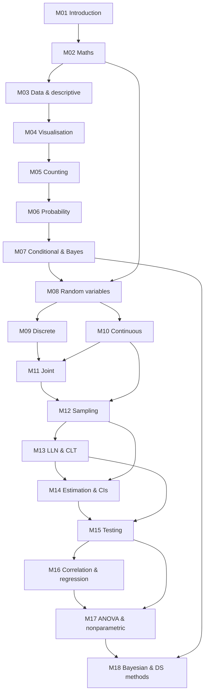

# The eighteen modules

The course is eighteen modules in eight parts, from orientation to Bayesian
methods. Each module is a self-contained study unit of 6–18 hours; together they
are about 250 hours, or roughly ten hours per week across two semesters.

This page is the **map**: what each module covers, what it depends on, and the
order that works.

Every formula, test and term used below is collected in the [reference section](../reference/index.md)
— formula sheets, a test selection guide and a glossary.

## Module map

| # | Module | Part | Level | Hours |
|---|---|---|---|---|
| M01 | [Introduction to Probability and Statistics](01-introduction-to-statistics.md) | I | Beginner | 6 |
| M02 | [Mathematical Foundations for Statistics](02-mathematical-foundations.md) | I | Beginner | 12 |
| M03 | [Data and Descriptive Statistics](03-data-and-descriptive-statistics.md) | I | Beginner | 14 |
| M04 | [Data Visualization and Exploratory Analysis](04-data-visualization.md) | I | Beginner | 12 |
| M05 | [Counting and Combinatorics](05-counting-and-combinatorics.md) | II | Beginner | 10 |
| M06 | [Probability Fundamentals](06-probability-fundamentals.md) | II | Core | 14 |
| M07 | [Conditional Probability and Bayes' Theorem](07-conditional-probability-and-bayes.md) | II | Core | 14 |
| M08 | [Random Variables and Mathematical Expectation](08-random-variables-and-expectation.md) | III | Core | 16 |
| M09 | [Discrete Probability Distributions](09-discrete-distributions.md) | III | Core | 14 |
| M10 | [Continuous Probability Distributions](10-continuous-distributions.md) | III | Core | 14 |
| M11 | [Joint Probability Distributions](11-joint-distributions.md) | III | Advanced | 14 |
| M12 | [Sampling and Sampling Distributions](12-sampling-and-sampling-distributions.md) | IV | Core | 14 |
| M13 | [Law of Large Numbers and the Central Limit Theorem](13-law-of-large-numbers-and-clt.md) | IV | Advanced | 12 |
| M14 | [Statistical Estimation and Confidence Intervals](14-estimation-and-confidence-intervals.md) | V | Core | 16 |
| M15 | [Hypothesis Testing](15-hypothesis-testing.md) | V | Core | 18 |
| M16 | [Correlation and Regression](16-correlation-and-regression.md) | VI | Core | 18 |
| M17 | [ANOVA, Chi-Square and Nonparametric Statistics](17-anova-chi-square-nonparametric.md) | VII | Advanced | 16 |
| M18 | [Bayesian Statistics and Statistical Methods for Data Science](18-bayesian-and-data-science-methods.md) | VIII | Advanced | 18 |

**252 hours** in total, before projects and revision.

## The dependency graph

Arrows point from a module to the modules that need it. Nothing here is
decoration: if you open a module and a symbol is unfamiliar, this graph tells you
where it came from.

## Prerequisite table

The short version, with the reason each dependency exists.

| Module | Requires | Because |
|---|---|---|
| M01 | — | Entry point; assumes school algebra only |
| M02 | M01 | Needs the vocabulary of data and inference before learning its notation |
| M03 | M02 | Summation notation and functions are used in every summary measure |
| M04 | M03 | You cannot choose a plot without knowing what a summary measures |
| M05 | M02 | Factorials, products and counting arguments |
| M06 | M05 | Equally likely outcomes are counted before they are axiomatised |
| M07 | M06 | Conditioning is defined using unconditional probability |
| M08 | M06, M07, M02 | Expectation needs distributions and integration |
| M09 | M08 | Each family's mean and variance is derived with expectation |
| M10 | M08, M09 | Densities and continuous analogues; the normal appears here |
| M11 | M09, M10 | Joint laws combine discrete and continuous machinery |
| M12 | M10, M11 | Sampling distributions are built from the normal, χ², t and F |
| M13 | M12 | The CLT is a statement about the distribution of a statistic |
| M14 | M12, M13 | Intervals are inversions of sampling-distribution statements |
| M15 | M14, M13 | Tests are decision rules built on the same distributions as intervals |
| M16 | M11, M14, M15 | Regression needs covariance, standard errors and tests |
| M17 | M15, M16 | ANOVA is regression with a categorical predictor |
| M18 | M07, M17 | Bayes' theorem plus the classical inference it is compared with |

## Reading the graph as a student

Three consequences worth stating plainly:

1. **Part I is not optional.** M02 and M03 look elementary and are load-bearing:
   every later formula uses summation notation and every later interpretation uses
   the idea of spread.
2. **M12 and M13 are the hinge.** Students who "do not understand p-values" are
   almost always missing the sampling distribution, not the arithmetic. If M15
   feels opaque, go back to M12 rather than rereading M15.
3. **M11 is the gateway to modelling.** Joint distributions are what make
   covariance, regression and multivariate thinking possible. It is marked
   Advanced for that reason.

## Three study sequences

### Full sequence (recommended)

M01 → M02 → M03 → M04 → M05 → M06 → M07 → M08 → M09 → M10 → M11 → M12 →
M13 → M14 → M15 → M16 → M17 → M18.

### One-semester core

M01, M02, M03, M04, M05, M06, M07, M08, M09, M10, M12, M13, M14, M15.
Skipped: M11, M16, M17, M18 — treat as a follow-on reading list. Roughly 170
hours.

### Modelling-first (for students who already know probability)

Revise M11 and M12, then M14 → M15 → M16 → M17 → M18. Return to M05–M10 only
where a symbol is unfamiliar. This path is fast and unforgiving: it assumes the
distribution work is genuinely secure.

## If you are stuck, revise this

| Symptom | Revise |
|---|---|
| "I do not follow the algebra" | M02 (summation, functions, derivatives, integrals) |
| "I do not know which summary to use" | M03 |
| "My chart is misleading" | M04 |
| "I cannot set up the counting" | M05 |
| "The union/intersection rules confuse me" | M06 |
| "I mix up P(A\|B) and P(B\|A)" | M07 |
| "E[X] and Var(X) feel arbitrary" | M08 |
| "I cannot tell which distribution fits" | M09, M10 |
| "Covariance and correlation blur together" | M11 |
| "I do not see why the sample mean varies" | M12 |
| "n > 30 keeps being quoted at me" | M13 |
| "I cannot interpret a confidence interval" | M14 |
| "p-values make no sense" | M12, then M15 |
| "My regression coefficients are uninterpretable" | M16 |
| "The ANOVA table is opaque" | M17 |
| "Bayesian and frequentist results look contradictory" | M18 |

## What a module contains

Every module page has the same thirteen sections: introduction, why it matters,
learning objectives, prerequisites, topic breakdown (in numbered learning units),
important mathematical concepts, expected knowledge, connections to data science,
practical applications, exercises and assessment plan, and a recommended study
sequence — plus navigation to the module before and after it.

Module pages are published as they are verified. The
[course roadmap](../roadmap.md) states exactly which are available today.
