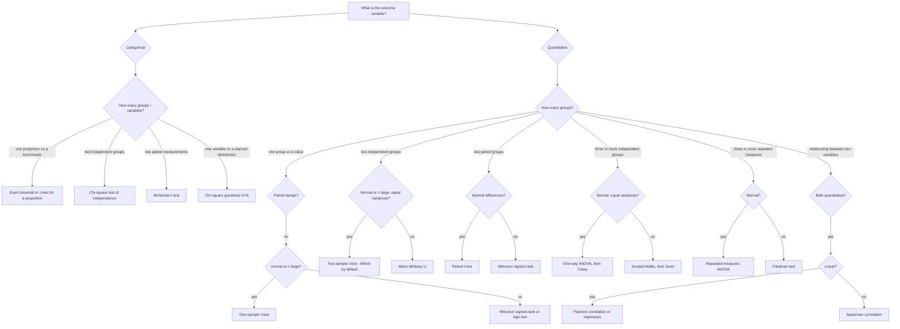

# Choosing a statistical test

Five questions decide almost every test: what kind of outcome, how many groups, paired or
independent, what shape the data have, and what you are claiming. Answer them in order.

The flowchart is the fast path. The tables below it carry the assumptions and the interpretation,
which the flowchart cannot.

## The decision path

## Step 1 — What kind of variable is the outcome?

| Outcome | Examples | Tests available |
|---|---|---|
| Binary / categorical | converted, defaulted, passed | proportion tests, chi-square, McNemar, logistic regression |
| Ordinal | Likert scale, satisfaction rank | Mann–Whitney, Wilcoxon, Kruskal–Wallis, Spearman |
| Quantitative, roughly normal | height, exam mark, reaction time | \(t\)-tests, ANOVA, Pearson, linear regression |
| Quantitative, skewed or heavy-tailed | income, waiting time, claim size | Mann–Whitney, bootstrap, log transform, gamma/GLM models |
| Count | defects per batch, arrivals | Poisson/negative binomial models, chi-square on categories |
| Time to event | churn, survival | Kaplan–Meier, log-rank, Cox model (beyond this course) |

The outcome decides the family. The predictor decides the design.

## Step 2 — How many groups, and are they independent?

| Design | Independent | Paired / repeated |
|---|---|---|
| One group | one-sample test against a value | — |
| Two groups | two-sample test | paired test on differences |
| Three or more | one-way ANOVA / Kruskal–Wallis | repeated-measures ANOVA / Friedman |
| Two categorical variables | chi-square independence | McNemar (2×2) |

**Independence is a property of the observations, not of the variables.** Two measurements on the
same person are paired even if they sit in different columns. Ignoring pairing loses precision and
can reverse a conclusion.

## Step 3 — Are the assumptions met?

| Assumption | How to check | If violated |
|---|---|---|
| Independence | design knowledge — not a test | cluster/mixed models; this cannot be fixed post hoc |
| Normality of the outcome (or residuals) | histogram, Q-Q plot; Shapiro–Wilk for small \(n\) | \(n>30\) often suffices by the CLT; otherwise a rank test |
| Equal variances | Levene's or Brown–Forsythe | Welch's \(t\); Welch ANOVA; Kruskal–Wallis |
| Linearity | scatter plot, residual plot | transform, add a term, or use Spearman |
| Expected counts \(\ge5\) | compute them | exact tests, or merge categories |
| No influential outliers | box plot, Cook's distance | robust methods, report sensitivity |

Assumption checks are diagnostics, not gates: report what you checked and what you did about it.

## Step 4 — Parametric or nonparametric?

| Situation | Parametric | Nonparametric alternative | What changes |
|---|---|---|---|
| One mean | one-sample \(t\) | Wilcoxon signed-rank, sign test | tests median / symmetry |
| Two independent means | two-sample \(t\) | Mann–Whitney U | tests stochastic dominance |
| Three or more means | one-way ANOVA | Kruskal–Wallis | ranks, not means |
| Repeated measures | RM-ANOVA | Friedman | ranks within subjects |
| Two quantitative variables | Pearson \(r\) | Spearman \(\rho\) | monotone, not linear |
| Two proportions | \(z\) test, chi-square | Fisher's exact | exact \(p\) |
| Paired binary | McNemar | exact McNemar | exact \(p\) |

Prefer the parametric test when its assumptions hold: it is more powerful and its estimates
(means, differences) are easier to communicate. Switch when the assumption fails *materially*, not
as a reflex. With \(n=200\) and mild skew, the \(t\)-test is usually fine; with \(n=12\) and a
clear outlier, it is not.

## Step 5 — What exactly are you claiming?

| Claim | Test | Notes |
|---|---|---|
| "Different from" | two-sided | the default |
| "Greater than" | one-sided | must be justified *before* seeing data |
| "Equivalent" | equivalence test (TOST) | a non-significant test does **not** show equivalence |
| "Associated" | correlation / chi-square | association is not causation |
| "Predicts" | regression | check calibration and out-of-sample error |

## Interpretation guide

Every test result needs four sentences, in this order:

1. **Estimate with interval.** "Conversion rose by 2.3 percentage points (95 % CI 1.2 to 3.4)."
2. **Test result.** "\(z=4.24\), \(p<0.001\)."
3. **Size and meaning.** "That is roughly 230 extra conversions per 10,000 sessions."
4. **Limits.** "Observational? Confounded? Assumptions strained? Generalisable?"

| \(p\)-value | What it licenses | What it does not |
|---|---|---|
| \(p<0.001\) | strong evidence against \(H_0\) | proof, or a large effect |
| \(0.01\le p<0.05\) | moderate evidence | replication, or practical importance |
| \(0.05\le p<0.10\) | weak, inconclusive | "no effect" |
| \(p\ge0.10\) | insufficient evidence | equivalence, or a true null |

A confidence interval that excludes the null and an effect too small to matter is a common and
honest outcome: statistically detectable, practically irrelevant. Say so.

## Critical values for the test you chose

Once the test is chosen, the boundary comes from one of four tables. All four are
generated from SciPy in [statistical tables](tables/index.md), so the numbers match
what Python prints.

| Test you chose | Table | Degrees of freedom | Two-tailed 5 % boundary |
|---|---|---|---|
| \(z\)-test, \(z\)-interval (known \(\sigma\), proportions) | [standard normal](tables/standard-normal.md) | none | 1.960 |
| One-sample, paired, two-sample or regression \(t\) | [Student's \(t\)](tables/t-distribution.md) | \(n-1\), pairs \(-1\), \(n_1+n_2-2\), \(n-2\) | 2.262 on 9 df, 2.042 on 30 df |
| Goodness of fit, independence, one variance | [chi-square](tables/chi-square.md) | \(k-1-m\), \((r-1)(c-1)\), \(n-1\) | 11.070 on 5 df, 3.841 on 1 df |
| ANOVA, variance ratio, nested models, and the \(F\) form of any of the \(t\) tests | [\(F\)](tables/f-distribution.md) | \((\nu_1,\nu_2)\): numerator then denominator | 2.839 for \((3,40)\) |

Two rules cover most of the mistakes: a two-tailed test at level \(\alpha\) reads
the \(\alpha/2\) boundary, and the \(F\) table's numerator df is the number of
restrictions being tested. [Choosing a table](tables/choosing-a-table.md) walks
through both, with four worked tests end to end.

## Worked selections

**A/B test on conversion.** Binary outcome, two independent groups, large \(n\): two-proportion
\(z\)-test with an interval for the difference. Check randomisation balance first.

**Before/after satisfaction on the same 40 customers.** Ordinal, paired: Wilcoxon signed-rank.
A two-sample test would be wrong because the observations are matched.

**Defect counts across three production lines.** Count outcome, three independent groups,
over-dispersed: negative binomial regression with a line factor, or Kruskal–Wallis if only a
rank comparison is needed. Plain ANOVA on counts ignores the mean–variance link.

**Correlation between study hours and marks.** Both quantitative, roughly linear, \(n=480\):
Pearson \(r\) with an interval, plus a regression for the slope in marks per hour.

**Diagnostic test accuracy.** No group comparison at all: sensitivity, specificity, PPV and a ROC
curve. A \(p\)-value for "accuracy better than chance" is the least interesting number here.

**Ten customers rate four designs.** Ordinal, repeated measures, small \(n\): Friedman test with
post-hoc pairwise sign tests, and a warning that ten subjects cannot settle much.
