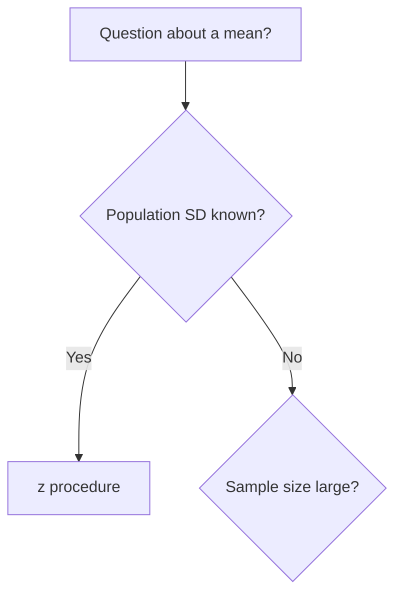

# 06 — Website Architecture

**Recommendation: MkDocs Material**, generating a static site for GitHub Pages.
This document specifies the configuration in full so that Phase 1 is a
copy-in-and-verify job rather than a design exercise.

---

## 1. Why MkDocs Material

| Requirement | How Material meets it |
|---|---|
| Mathematical equations | `pymdownx.arithmatex` + MathJax; AMS environments, `aligned`, `cases`, equation referencing |
| Python code highlighting | Pygments, line numbers, line highlighting, annotations, copy button |
| Search | Built-in client-side search with suggestions, highlighting and shareable result URLs |
| Sidebar navigation | Collapsible sections, section indexes, sticky table of contents, "back to top" |
| Light and dark modes | Two palettes with OS preference detection and a manual toggle |
| Responsive layout | Mobile-first; drawer navigation on small screens |
| Tables and diagrams | Native tables, Mermaid fences, glightbox for figures |
| Student progress | Navigation features plus a small custom tracker (§6) |
| Authoring | Plain Markdown in git — no CMS, no database, no build service |
| Cost | Free, MIT theme, static hosting on GitHub Pages |

**Alternatives considered and rejected.** *Docusaurus* — React/MDX complexity and a
Node toolchain with no benefit here. *Sphinx + MyST* — better for API docs,
heavier authoring, weaker default styling. *Jupyter Book* — excellent for
notebook-first books, but weaker long-form navigation, search tuning and theming.
*Quarto* — strong for reproducible publishing, but its site model fits
article-shaped output better than a 30-page structured course, and the theme
customisation ceiling is lower.

## 2. The Material end-of-life caveat

Material for MkDocs **reaches end of life on 5 May 2027**; the same team is
building **Zensical**, an MIT-licensed successor that can read an existing
`mkdocs.yml` and offers a `classic` theme variant preserving Material's
appearance.

This does **not** change the recommendation — Material is the right tool for this
build, and it is what the brief requests — but it changes three decisions, which
are adopted now:

1. **Configuration stays standard.** Only documented `mkdocs.yml` keys, no
   Insiders-only features. Anything Insiders-only would be unreproducible on a
   public build anyway.
2. **Customisation is isolated** in `docs/assets/stylesheets/extra.css` and two
   JavaScript files. No theme-file overrides, no forked theme.
3. **A migration checkpoint is scheduled** at Phase 9, before May 2027, to
   evaluate Zensical against this repository. The `classic` variant is expected to
   make this a configuration diff, not a rewrite.

The risk and its mitigation are tracked as **R03** in
[09 — Risks and Quality](09-risks-and-quality.md).

## 3. Configuration (`mkdocs.yml`)

Proposed in full. **Not yet created** — it is a Phase-1 artifact, because a config
that references 30 unwritten pages produces a failing build and a misleading
`nav`.

```yaml
site_name: Probability and Statistics for Data Science
site_description: >-
  A complete self-study course in probability and statistics for BS Data Science
  students — derivations, worked examples, Python, exercises and solutions.
site_author: Engr. Dr. Muhammad Nadeem Majeed
site_url: https://nadeem-majeedch.github.io/Probability-and-Statistics/
repo_url: https://github.com/nadeem-majeedch/Probability-and-Statistics
repo_name: nadeem-majeedch/Probability-and-Statistics
edit_uri: edit/main/docs/
copyright: >-
  © 2026 Engr. Dr. Muhammad Nadeem Majeed · Department of Data Science (PUCIT),
  University of the Punjab, Lahore · Content CC BY-NC-SA 4.0 · Code MIT

docs_dir: docs
site_dir: site

theme:
  name: material
  language: en
  logo: assets/images/brand/logo.svg
  favicon: assets/images/brand/favicon.png
  font:
    text: Inter
    code: JetBrains Mono
  icon:
    repo: fontawesome/brands/github
    edit: material/pencil
    view: material/eye
  palette:
    - media: "(prefers-color-scheme: light)"
      scheme: default
      primary: custom          # colours supplied by extra.css
      accent: custom
      toggle:
        icon: material/weather-night
        name: Switch to dark mode
    - media: "(prefers-color-scheme: dark)"
      scheme: slate
      primary: custom
      accent: custom
      toggle:
        icon: material/weather-sunny
        name: Switch to light mode
  features:
    - navigation.instant
    - navigation.instant.progress
    - navigation.instant.prefetch
    - navigation.tracking
    - navigation.sections
    - navigation.indexes
    - navigation.top
    - navigation.footer
    - navigation.path
    - toc.follow
    - search.suggest
    - search.highlight
    - search.share
    - content.code.copy
    - content.code.annotate
    - content.code.select
    - content.tabs.link
    - content.tooltips
    - content.action.edit
    - content.action.view

nav:
  - Home: index.md
  - Start here:
      - Syllabus: syllabus.md
      - How to study: how-to-study.md
      - Set up your computer: setup.md
      - Course roadmap: roadmap.md
  - Part I — Foundations:
      - part-1-foundations/index.md
      - 01 · Mathematical foundations: part-1-foundations/01-mathematical-foundations.md
      - 02 · Data and statistical thinking: part-1-foundations/02-data-and-statistical-thinking.md
      - 03 · Descriptive statistics: part-1-foundations/03-descriptive-statistics.md
      - 04 · Data visualization: part-1-foundations/04-data-visualization.md
  # ... Parts II–VIII follow the same pattern (see 03 — Repository Structure)
  - Practice notebooks: practice/index.md
  - Projects:
      - projects/index.md
      - Project 1 · Describing data: projects/project-1-describing-data.md
      - Project 2 · Probability by simulation: projects/project-2-probability-by-simulation.md
      - Project 3 · An inference study: projects/project-3-inference-study.md
      - Marking rubric: projects/project-rubric.md
  - Assessments:
      - assessments/index.md
      - Quizzes: assessments/quizzes/index.md
      - Exercise sets: assessments/exercise-sets/index.md
      - Solutions: assessments/solutions/index.md
  - Reference:
      - Formula sheet: reference/formula-sheet.md
      - Notation: reference/notation.md
      - Statistical tables: reference/statistical-tables.md
      - Python cookbook: reference/python-cookbook.md
      - Glossary: reference/glossary.md
  - About:
      - Instructor: about/instructor.md
      - Licence: about/licence.md
      - Acknowledgements: about/acknowledgements.md

plugins:
  - search:
      lang: en
      separator: '[\s\u200b\-_,:!=\[\]()"`/]+|\.(?!\d)|&[lg]t;|(?!\b)(?=[A-Z][a-z])'
  - minify:
      minify_html: true
      minify_js: true
      minify_css: true
  - git-revision-date-localized:
      enable_creation_date: true
      type: date
      fallback_to_build_date: true
  - mkdocs-jupyter:
      execute: false            # outputs are committed; see notebook policy
      include_source: true
      show_input: true
      ignore_h1_titles: true
      theme: dark

markdown_extensions:
  - abbr
  - admonition
  - attr_list
  - def_list
  - footnotes
  - md_in_html
  - tables
  - toc:
      permalink: true
      slugify: !!python/object/apply:pymdownx.slugs.slugify {kwds: {case: lower}}
  - pymdownx.arithmatex:
      generic: true
  - pymdownx.betterem
  - pymdownx.caret
  - pymdownx.details
  - pymdownx.highlight:
      anchor_linenums: true
      line_spans: __span
      pygments_lang_class: true
  - pymdownx.inlinehilite
  - pymdownx.keys
  - pymdownx.mark
  - pymdownx.smartsymbols
  - pymdownx.snippets
  - pymdownx.superfences:
      custom_fences:
        - name: mermaid
          class: mermaid
          format: !!python/name:pymdownx.superfences.fence_code_format
  - pymdownx.tabbed:
      alternate_style: true
  - pymdownx.tasklist:
      custom_checkbox: true
  - pymdownx.tilde

extra_css:
  - assets/stylesheets/extra.css

extra_javascript:
  - assets/javascripts/mathjax.js
  - assets/javascripts/progress.js
  - https://cdn.jsdelivr.net/npm/mathjax@3/es5/tex-mml-chtml.js
  - https://cdn.jsdelivr.net/npm/mermaid@11/dist/mermaid.min.js

extra:
  social:
    - icon: fontawesome/brands/github
      link: https://github.com/nadeem-majeedch/Probability-and-Statistics
  generator: false
```

**Three details that are easy to get wrong, flagged for Phase 1 verification.**

- `pygments_lang_class: true` is what lets `content.code.annotate` work on fenced
  code; without it annotations silently stop appearing.
- The `toc.slugify` line requires `pymdown-extensions` and keeps heading anchors
  stable across builds, which matters because modules cross-link to sections.
- `mkdocs-jupyter` option names move between releases. Verify `execute`,
  `include_source`, `show_input` against the installed 0.27.x before relying on
  them; the fallback is to convert finished notebooks to Markdown pages.

## 4. Mathematics pipeline

Markdown → `pymdownx.arithmatex` (generic mode) → MathJax → typeset page.

`docs/assets/javascripts/mathjax.js`:

```js
window.MathJax = {
  tex: {
    inlineMath: [["\\(", "\\)"]],
    displayMath: [["\\[", "\\]"]],
    processEscapes: true,
    processEnvironments: true,
    tags: "none",
    macros: {
      E: "\\operatorname{E}",
      Var: "\\operatorname{Var}",
      Cov: "\\operatorname{Cov}",
      sd: "\\operatorname{sd}",
      se: "\\operatorname{se}",
      iid: "\\overset{\\text{iid}}{\\sim}",
      indep: "\\perp\\!\\!\\!\\perp",
      R: "\\mathbb{R}",
      P: "\\Pr"
    }
  },
  options: {
    ignoreHtmlClass: ".*|",
    processHtmlClass: "arithmatex"
  }
};

// Re-typeset after Material's instant navigation swaps the document.
document$.subscribe(() => {
  MathJax.startup.output.clearCache();
  MathJax.typesetClear();
  MathJax.texReset();
  MathJax.typesetPromise();
});
```

Authoring rules that follow from this:

- Inline math uses `\( ... \)`, display math uses `\[ ... \]`. Never `$...$` —
  in generic mode it will not render, and a stray dollar in prose (prices,
  currency, shell prompts) would corrupt the page.
- Course-wide macros (`\E`, `\Var`, `\Cov`, `\se`) are defined once here, so
  notation cannot drift between modules. `reference/notation.md` documents them.
- `document$` is Material's observable; forgetting the re-typeset step is the
  classic bug where equations vanish after the first internal navigation.

**MathJax vs KaTeX.** KaTeX is faster but lacks some AMS environments this course
uses (`aligned` inside `cases`, `\operatorname*`, tag-free numbering). MathJax 3 is
chosen; the ~1 MB payload is acceptable for a study site and is cached. If
performance becomes a problem, `pymdownx.arithmatex` can be switched to KaTeX mode
in one line — but only after auditing macros, since KaTeX's macro support differs.

## 5. Diagrams, code and notebooks

**Mermaid** for logic, not data: decision trees for test selection, flow diagrams
for the study protocol, dependency graphs for the course. Data graphics are
matplotlib PNG/SVG — Mermaid must never be used to draw a distribution.

````markdown

````

**Code blocks** must always declare a language, and use Material annotations for
line-by-line commentary:

````markdown
```python
import numpy as np
rng = np.random.default_rng(42)      # (1)!
sample = rng.normal(0, 1, size=1000)
```
````

**Notebooks** are embedded with `mkdocs-jupyter`, `execute: false`, because
outputs are committed (see the notebook policy in
[03 — Repository Structure](03-repository-structure.md)). A notebook page is a
*practical*, not a substitute for a module page: the module carries the reasoning,
the notebook carries the computation.

## 6. Progress-oriented navigation

Material has no built-in progress tracking, and no plugin is adopted (a plugin is
a build-time dependency that can break a release). Instead, one small script:

**`docs/assets/javascripts/progress.js`**

- Reads the current page's module number from a `data-module` attribute injected
  by the page's front matter/`extra` block.
- Renders a "Mark this module complete" checkbox under the title.
- Stores completion in `localStorage` under `psds.progress.v1` — a map of module
  id → ISO date. No account, no server, no analytics.
- On the part index pages, shows "3 of 6 modules complete" with a small bar.
- Subscribes to `document$` so it survives instant navigation.

Rationale for `localStorage` over a plugin or a service: it needs no backend, it
works offline, it respects student privacy, and it cannot break the site build.
The limitation — progress does not follow the student between devices — is stated
in `how-to-study.md` rather than hidden.

Supporting navigation features already enabled above: `navigation.path`
(breadcrumb trail), `navigation.footer` (previous/next), `navigation.tracking`
(URL reflects the active section), `navigation.instant.progress` (a loading bar),
`toc.follow` (the sidebar follows your reading position), and `navigation.top`.

## 7. Search

- `search.suggest` gives instant title/heading suggestions; `search.highlight`
  marks matches on the target page; `search.share` produces a permalink.
- The custom `separator` improves tokenisation of identifiers such as
  `scipy.stats.ttest_ind` and `X̄`, which the default splitter handles poorly.
- **Known limitation:** LaTeX in search indexes is noisy. The mitigation is
  structural — every symbol, test and distribution also appears as a word in
  `reference/glossary.md` and `reference/notation.md`, which are indexed cleanly.
  This is why those reference pages are mandatory, not decorative.

## 8. Content metadata conventions

Front matter on every module page:

```yaml
---
title: Hypothesis Testing
description: Decision rules, error rates, p-values, power and multiple comparisons.
module: 20
part: 5
level: Core
hours: 10
prerequisites: [17, 18, 19]
---
```

`description` feeds the search index and link previews; `module`, `level` and
`hours` feed the progress script and the module cards on the homepage;
`prerequisites` lets the template render "Before you start" automatically and
gives a future link-checker a machine-readable dependency graph.

## 9. Deployment plan — documented, not executed

Per the brief, **nothing is deployed and no workflow is installed.** This is the
runbook for when it is authorised.

**Hosting.** GitHub Pages, project site at
`https://nadeem-majeedch.github.io/Probability-and-Statistics/`. The repository is
public, which satisfies Pages' requirement for free project sites. `has_pages` is
currently `false`, so Pages must be enabled once — **Settings → Pages → Source:
GitHub Actions** — by the repository owner.

**Build.** `mkdocs build --strict`, which fails on any broken internal link,
missing page in `nav`, or unrecognised configuration key. `--strict` is the
quality gate; a build that merely "succeeds with warnings" is not acceptable for a
teaching resource.

**Workflow** (`.github/workflows/docs.yml`) — to be added in Phase 9 only:

```yaml
name: Build and publish course site
on:
  push:
    branches: [main]
    paths: ["docs/**", "mkdocs.yml", "requirements-docs.txt", ".github/workflows/docs.yml"]
  workflow_dispatch:

permissions:
  contents: read
  pages: write
  id-token: write

concurrency:
  group: pages
  cancel-in-progress: false

jobs:
  build:
    runs-on: ubuntu-latest
    steps:
      - uses: actions/checkout@v4
        with: { fetch-depth: 0 }        # git-revision-date plugin needs history
      - uses: actions/setup-python@v5
        with: { python-version: "3.12", cache: pip }
      - run: pip install -r requirements-docs.txt
      - run: mkdocs build --strict
      - uses: actions/configure-pages@v5
      - uses: actions/upload-pages-artifact@v3
        with: { path: site }
  deploy:
    needs: build
    runs-on: ubuntu-latest
    environment:
      name: github-pages
      url: ${{ steps.deployment.outputs.page_url }}
    steps:
      - id: deployment
        uses: actions/deploy-pages@v4
```

Notes that belong with that workflow:

- `fetch-depth: 0` is required or every page shows "last updated: today".
- `permissions` must include `pages: write` and `id-token: write`; omitting
  `id-token` is the most common cause of a rejected deployment.
- No secrets are needed. Nothing in the site is authenticated.
- No analytics. If usage data is ever wanted, use a privacy-respecting
  counter and disclose it in `about/licence.md`.

**Local preview before publishing.** `mkdocs serve` on `http://127.0.0.1:8000`
with `--strict` available as a flag; the instructor verifies the homepage, one
module per part, dark mode, search and one notebook page.

**Versioning.** Not adopted initially. `mike` can publish
`/latest/` and `/v1/` once the course has a first complete edition; until then a
single branch of the site matches the single branch of the course.

## 10. Performance and accessibility targets

| Target | Budget | Checked by |
|---|---|---|
| Largest page weight | < 1.5 MB excluding MathJax | build output inspection |
| Total site | < 40 MB | build output inspection |
| Images per module | ≤ 8, each < 250 KB | `tools/check_assets.py` |
| Lighthouse performance | ≥ 90 on a module page | manual, Phase 8 |
| Lighthouse accessibility | ≥ 95 | manual, Phase 8 |
| Contrast | WCAG AA (4.5:1 body, 3:1 large text) | axe DevTools + manual |
| Keyboard navigation | every control reachable, visible focus | manual |
| Print | module readable as A4 PDF, equations intact | manual |

These are release gates, not aspirations: a module is not "done" until its page
passes them.
